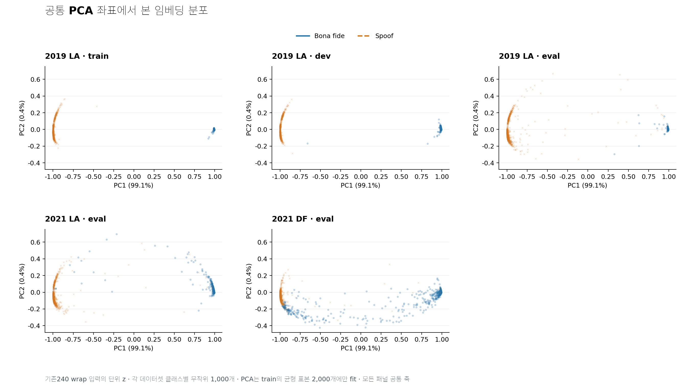
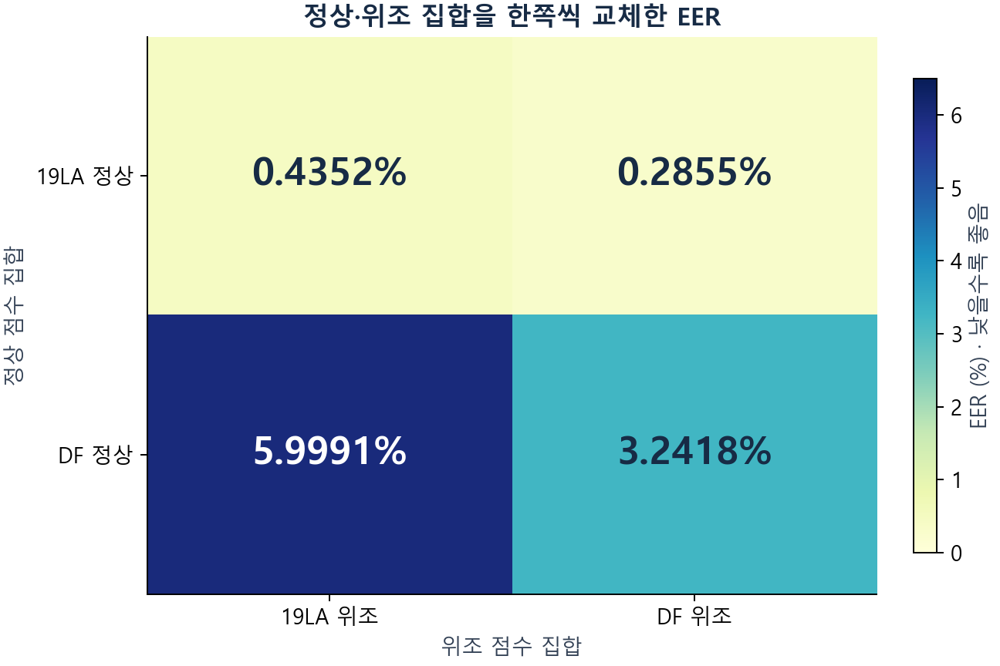

# EBM 연구 활동과 실험 기록

포트폴리오에서 펼쳐 보던 네 활동의 실험 방법·평가 기준·결과표·해석을 옮긴 문서입니다. 기존 실험 아카이브와 연결하며, 수치가 확인된 비교 조건을 함께 적었습니다.

정상은 실제 사람의 음성, 위조는 AI로 합성·변조한 음성입니다. EER은 두 종류를 구분할 때의 오류율로 낮을수록 좋습니다. 19LA·21LA·DF는 서로 다른 평가 자료입니다.

## 활동 1. 반복 없이 학습한 모델의 1초 음성을 대조해, 길이 단축보다 반복 입력이 EER을 더 크게 악화시킴을 확인

### 기존

기존 EBM은 짧은 원음을 약 4초가 되도록 반복해 입력합니다. 예를 들어 1초 음성을 네 번 이어도 입력 길이만 늘고 고유한 음성 내용은 1초로 같습니다.

### 문제

PCA 시각화에서 서로 밀려나지 못해 구분력이 약했던 표본의 대부분이 반복 입력이었습니다. 짧은 내용 자체의 어려움과 반복으로 입력을 늘린 영향을 분리해 확인할 필요가 있었습니다.

### 해결 방법

두 모델을 각각 50회 학습한 상태로 고정하고, 같은 원음 336개의 앞 1초·2초를 그대로 또는 반복해 비교했습니다. 약 4초 원음을 짧게 잘랐을 때의 EER 변화와, 같은 짧은 구간에 반복만 추가했을 때의 변화를 따로 계산했습니다.

### 결과

반복 없이 학습한 모델의 앞 1초에서는 짧게 자르기 +7.2115%p보다 반복 추가 +7.6923%p의 EER 악화가 컸습니다. 기존 모델은 같은 1초 구간을 반복하자 EER이 29.3269%→15.3846%로 낮아져, 반복이 항상 해롭다는 결론으로 확대하지 않았습니다.

### 실험 1. PCA에서 구분력이 약했던 표본의 대부분이 반복 입력임을 확인

**실험 방법**

음성 특징과 정상 기준의 코사인 관계를 정리한 뒤, 공통 PCA 축에 특징 분포를 시각화했습니다. 서로 밀려나지 못하고 구분력이 약했던 영역의 표본과 반복 입력 여부를 대조했습니다.

**평가 기준**

기존 반복 학습 모델에서 추출한 특징을 사용했습니다. 학습 자료의 클래스 균형 2,000개에만 PCA 축을 맞추고, 자료·클래스별 1,000개를 같은 축에 표시했습니다. 구분력이 약했던 영역의 표본을 입력 처리 조건과 대조했습니다. 코사인 분해 x = s·c + √(1−s²)·u에서 s = cos θ이고 c는 단위 정상 기준입니다. 이 분해와 원래 특징의 선형 PCA는 서로 다른 좌표 표현입니다.

**결과**

시각화에서 특징들이 서로 밀려나지 못해 구분력이 약했던 표본의 대부분은 반복 입력이 적용된 음성이었습니다.

파랑은 정상, 주황은 위조입니다. 분리가 약한 영역의 표본을 반복 입력 여부와 대조했고, 대부분이 반복 입력 표본임을 확인했습니다. 그림의 wrap은 짧은 음성을 반복해 입력한 조건입니다.

**해석**

특징을 충분히 분리하지 못한 현상이 반복 입력 표본에 집중되어 있음을 확인했습니다. 이어지는 실험에서 반복 횟수 증가와 음성 길이 단축의 영향을 각각 비교했습니다.

**기록 범위**

“분리가 약했던 표본 대부분이 반복 입력이었다”는 시각화와 표본 대조에 관한 연구자의 정성적 관찰입니다. 해당 영역의 분모·표본 수를 별도 집계한 결과는 이 문서에 없습니다. 아래 반복 비율 분석이나 다른 좌표계의 시각화 수치를 이 관찰의 정량 증거로 바꾸어 해석하지 않습니다. 반복의 영향과 길이의 영향은 뒤의 같은 원음 대조 실험에서 분리해 비교합니다.

**기존 상세 기록**

- [02_repetition/E013/README.md](02_repetition/E013/README.md)
- [05_residual_geometry/E083/README.md](05_residual_geometry/E083/README.md)

### 실험 2. 같은 1초 내용을 2초·약 4초로 반복한 EER 비교

**실험 방법**

긴 원음 336개의 앞 1초를 고정하고 그대로 또는 2초·4.0375초까지 반복해 입력했습니다. 기존 반복 학습 모델과 반복 없이 학습한 모델을 각각 50회 학습 상태로 고정했습니다.

**평가 기준**

21LA 정상 128개·위조 208개, 같은 앞 1초 내용의 점수입니다. 1초·2초·4초는 입력 길이이며 새 음성 내용은 추가하지 않았습니다. 추가 추론 잡음은 0입니다. EER은 낮을수록 좋습니다. 자연적으로 짧은 음성 전체의 공식 성능이 아닌 선택 표본의 진단입니다. 다른 길이·뒷부분까지 같은 단조 증가를 보인 결과가 아닙니다.

**결과**

반복 없이 학습한 모델의 EER은 13.9423% → 15.8654% → 21.6346%로 높아졌습니다. 기존 모델은 29.3269% → 14.9038% → 15.3846%로, 반복 후 오히려 낮았습니다.

**같은 앞 1초 내용 · 입력 목표 길이별 EER ↓**

| 50회 학습 후 고정한 모델 | 1초 그대로 | 2초로 반복 | 4.0375초로 반복 |
| --- | --- | --- | --- |
| 반복 없이 학습 | 13.9423% | 15.8654% | 21.6346% |
| 기존 반복 학습 | 29.3269% | 14.9038% | 15.3846% |

입력 길이 변화와 반복 횟수·처리 문맥의 변화가 함께 포함됩니다. 표본 내 점 추정입니다.

**해석**

반복이 늘수록 악화되는 경향은 반복 없이 학습한 모델의 앞 1초에서 확인했습니다. 기존 모델에도 같은 경향이 있다고 해석하지 않았습니다.

**기존 상세 기록**

- [02_repetition/E016/README.md](02_repetition/E016/README.md)
- [_shared/references/docs/experiments/ebm_shortening_vs_repetition_eer_20261111.md](_shared/references/docs/experiments/ebm_shortening_vs_repetition_eer_20261111.md)

### 실험 3. 짧게 자른 영향과 같은 짧은 내용의 반복 영향을 분리

**실험 방법**

각 모델 안에서 약 4초 원음을 2초·1초로 자른 변화를 먼저 계산했습니다. 그다음 같은 짧은 구간을 약 4초로 반복했을 때의 추가 변화를 따로 계산했습니다.

**평가 기준**

같은 336개 원음·앞부분·고정 50회 학습 모델을 비교했습니다. 짧게 자른 영향은 짧은 비반복 EER − 약 4초 원음 EER, 반복 영향은 같은 짧은 내용의 반복 EER − 비반복 EER입니다. %p는 백분율 차이입니다. 두 변화는 산술 분해이며 독립적인 인과 기여율이 아닙니다. 반복 없는 모델의 앞 1초에서 두 악화량의 차이는 +0.4808%p인 점 추정입니다. 그 차이 자체의 통계적 유의성을 증명한 결과는 아닙니다. 전체 21LA의 별도 대조에서는 기존 모델의 EER이 6.688715%→1.052789%로 낮아졌고 반복 없는 학습 모델은 4.792117%→7.736953%로 높아졌습니다.

**결과**

반복 없이 학습한 모델의 앞 1초는 짧게 자르기 +7.2115%p, 반복 추가 +7.6923%p로 반복 쪽 악화가 더 컸습니다. 2초와 기존 모델은 같은 결론이 아니었습니다.

**같은 모델 안에서 분리한 EER 변화 · 각 행은 동일 원음 대조**

| 모델 | 남긴 내용 | 짧게 자른 영향 | 반복 추가 영향 |
| --- | --- | --- | --- |
| 반복 없이 학습 | 1초 | 7.2115%p 악화 | 7.6923%p 악화 |
| 반복 없이 학습 | 2초 | 5.2885%p 악화 | 3.6058%p 악화 |
| 기존 반복 학습 | 1초 | 26.2019%p 악화 | 13.9423%p 개선 |
| 기존 반복 학습 | 2초 | 10.3365%p 악화 | 5.7692%p 개선 |

반복 없는 학습 모델의 2초는 짧게 자르기 5.2885%p 악화가 반복 추가 3.6058%p 악화보다 큽니다. 기존 모델은 두 길이 모두 반복으로 개선됐습니다.

**해석**

반복의 영향이 더 컸다는 결론은 반복 없이 학습한 모델의 앞 1초 조건에 한정됩니다. 기존 모델의 반복은 EER을 낮췄으며, 서로 다른 모델의 악화량 차이를 반복의 순수 효과로 쓰지 않았습니다.

**기존 상세 기록**

- [_shared/references/docs/experiments/ebm_shortening_vs_repetition_eer_20261111.md](_shared/references/docs/experiments/ebm_shortening_vs_repetition_eer_20261111.md)

### 활동 결론

반복 없이 학습한 모델의 앞 1초 조건에서는 짧게 자르기보다 반복 추가의 EER 악화가 더 컸습니다. 기존 모델에서는 반복이 EER을 낮췄으므로, 두 모델 전체에 같은 결론을 적용하지 않았습니다.

## 활동 2. 정상·위조 음성을 각각 교체해, 정상 출처 변화로 EER이 0.44%→6.00%로 악화되는 조건을 확인

### 기존

EBM은 학습에서 본 정상 음성의 특징을 기준으로 위조 여부를 판단합니다. 새 평가 자료에서는 위조 기법뿐 아니라 정상 음성의 녹음 출처도 함께 달라집니다.

### 문제

새 자료에서 오류가 늘어도 위조 기법의 차이와 정상 음성 출처의 차이가 섞여 있어, 어느 쪽 변화에 더 민감한지 알기 어려웠습니다.

### 해결 방법

모델을 고정한 채 이미 계산한 정상·위조 점수 집합을 각각 다른 자료의 집합으로 바꿔 조합별 EER을 계산했습니다. 오판한 정상 특징의 최근접 음성도 학습 자료와 DF 자료에서 따로 찾아 정상 분포의 차이를 확인했습니다.

### 결과

19LA 기준 EER은 0.435177%였고, 정상 점수 집합만 DF로 바꾸면 5.999058%로 높아졌습니다. 위조 집합만 DF로 바꾸면 0.285520%로 낮아져, 이 비교에서는 정상 출처 변화의 영향이 더 컸습니다. 정상 다양성을 늘린 장기 학습의 개선을 검증한 결과와는 구분했습니다.

### 실험 1. 정상과 위조의 평가 집합을 따로 교체

**실험 목적**

새로운 평가의 오류 증가가 새로운 위조 종류만의 문제는 아닐 수 있다.

**실험 방법**

한 번에 160개씩 50회 학습한 뒤 고정한 모델의 19LA와 DF 전체 저장 점수를 사용했다. 위조를 고정하고 정상 집합만 바꾸거나, 정상을 고정하고 위조만 바꾸는 2×2 교차 EER을 계산했다. 모델 재학습은 하지 않았다.

**평가 기준**

같은 점수 정의의 EER을 비교하고 출처별 화자를 묶어 2,000회 재표집했다. EER은 낮을수록 좋다. 길이 재가중과 음성 압축·변환을 거치지 않은 제한도 별도 민감도 대조로 확인했다. 교체 순서별 차이는 합산 가능한 인과 기여율이 아니다.

**실험 요약**

동일 모델에서 정상·위조 평가 집합을 하나씩 교체해, 정상 출처 변화와 위조 공격기법 구성 변화의 EER을 비교했습니다.

**결과**

기준 EER은 0.435177%였습니다. 정상만 DF로 교체하면 5.999058%로 악화됐고, 위조만 DF로 교체하면 0.285520%였습니다.

**상세 결과**

19LA 위조를 고정하고 정상만 DF로 바꾸면 0.435177%→5.999058%였다. 19LA 정상을 고정하고 위조만 DF로 바꾸면 0.285520%였다. 길이 비중을 맞추거나 음성 압축·변환을 거치지 않은 부분으로 제한해도 정상 교체의 악화가 남았다.

**정상·위조 평가 집합을 한쪽씩 교체한 EER**

| 정상 집합 | 19LA 위조 고정 EER ↓ | DF 위조 고정 EER ↓ |
| --- | --- | --- |
| 19LA 정상 | 0.435177% | 0.285520% |
| DF 정상 | 5.999058% | 3.241828% |

한 번에 160개씩 50epoch 학습한 같은 모델의 저장 점수를 사용했다. 정상·위조 평가 집합을 한쪽씩 교체해 EER을 계산했다.

같은 고정 모델에서 정상 점수 집합(행)과 위조 점수 집합(열)을 한쪽씩 교체한 결과입니다. 각 칸은 EER(%)이며 낮을수록 좋습니다.

**해석**

이 비교에서는 공격기법 구성이 다른 위조 집합보다 정상 음성의 출처 변화가 EER에 더 큰 영향을 줬습니다. 공격기법의 수만 따로 조절한 실험은 아닙니다.

**비교 조건 보충**

기존에 저장한 정상·위조 점수 집합을 다시 조합한 교차 평가입니다. 음성을 새로 합성하거나 정상 다양성만 달리해 다시 학습한 실험은 아닙니다.

**기존 상세 기록**

- [03_bonafide_diversity/E060/README.md](03_bonafide_diversity/E060/README.md)

### 실험 2. 정상 출처별 오류와 특징이 가장 가까운 비교 음성 비교

**실험 목적**

새로운 정상 음성의 특징이 학습 때 본 정상 음성의 범위에서 벗어나 잘못 판단되는가?

**실험 방법**

같은 모델(한 번에 160개로 학습)에서 19LA 개발 자료로 정한 판정 기준을 유지하고, 정상 음성을 잘못 거부한 비율을 출처별로 비교했습니다. 잘못 판단한 DF 정상 음성과 특징이 가장 가까운 비교 음성을 학습 자료에서 찾은 경우와, 화자가 겹치지 않게 나눈 DF 자료에서 찾은 경우를 비교했습니다.

**평가 기준**

정상 거부율은 낮을수록 좋지만 전체 EER과 구분했다. 가장 가까운 비교 음성이 정상인 비율은 비교 음성 분포를 설명하는 통계이며 높고 낮음을 곧 탐지 성능으로 보지 않았다. 참조 클래스 수를 맞추고 자료 분할과 출처별 분모를 확인했다.

**실험 요약**

같은 판정 기준으로 출처별 정상 오판을 비교했습니다. 오판한 정상 음성과 가장 가까운 비교 음성을 학습 자료와 DF 자료에서 각각 찾았습니다.

**결과**

같은 기준에서도 정상 오판율은 출처별 0.5668%·65.6085%·37.5556%로 달랐습니다. 이 정상 오판율은 전체 EER과 구분했습니다.

**상세 결과**

정상 거부율은 ASVspoof 0.5668%, VCC2018 65.6085%, VCC2020 37.5556%였다. 틀린 VCC2018 정상 334개의 최근접이 정상인 비율은 학습 자료의 비교 음성 29.94%, DF 자료의 비교 음성 90.12%였다.

**정상 출처별 오류와 특징이 가장 가까운 비교 음성의 차이**

| 측정 항목 | 출처·참조 | 결과 |
| --- | --- | --- |
| 고정 19LA 임계값 정상 거부율 | ASVspoof | 0.5668% |
| 고정 19LA 임계값 정상 거부율 | VCC2018 | 65.6085% |
| 고정 19LA 임계값 정상 거부율 | VCC2020 | 37.5556% |
| 틀린 VCC2018 정상의 최근접이 정상인 비율 | 학습 자료 참조 | 29.94% |
| 틀린 VCC2018 정상의 최근접이 정상인 비율 | DF 화자 분리 참조 | 90.12% |

위 세 행의 정상 거부율과 아래 두 행의 최근접 비율은 서로 다른 통계다. 최근접 비교는 틀린 VCC2018 정상 334개를 대상으로 하며 DF 자료의 비교 음성는 평가 자료의 출처 라벨을 사용한 내부 진단이다.

**해석**

정상 오판이 새 출처에 집중됐고, 같은 출처 자료에서는 정상 음성과 더 자주 가까웠습니다. 학습 자료의 정상 범위가 새 출처까지 충분히 대표하지 못하는 현상을 확인했습니다.

**기존 상세 기록**

- [03_bonafide_diversity/E065/README.md](03_bonafide_diversity/E065/README.md)

### 활동 결론

19LA를 기준으로 한 집합 교체 비교에서는 공격기법이 다른 위조를 넣을 때보다 출처가 다른 정상 음성을 넣을 때 EER이 더 크게 악화됐습니다. 새로운 공격기법뿐 아니라 학습 정상 음성의 다양성도 핵심 점검 대상으로 삼았습니다.

## 활동 3. 코사인 점수에 특징 벡터의 L2 norm을 추가해, 소형 분류기의 DF EER을 17.10%→14.55%로 개선

### 기존

EBM의 기본 판정은 정상 기준과 음성 특징의 코사인 유사도에 기반합니다. 코사인은 방향을 비교하므로 특징 벡터의 L2 norm, 즉 벡터 길이의 차이를 직접 반영하지 않습니다.

### 문제

같은 방향 점수에서도 L2 norm에 추가 구분 정보가 남는지 확인해야 했습니다. EBM 본체를 바로 바꾸기 전에 같은 소형 분류기의 입력만 바꾸는 진단이 필요했습니다.

### 해결 방법

EBM과 특징 추출기를 고정하고, 학습 자료로 소형 분류기를 학습했습니다. 코사인 점수만 넣는 경우와 L2 norm도 더하는 경우를 같은 DF 진단 20,000건에서 비교했습니다. 정규화 전 전체 특징·스케일 계수는 별도 조건으로 검증했습니다.

### 결과

소형 분류기의 DF EER이 17.10%→14.55%로 낮아져 L2 norm의 추가 정보를 확인했습니다. 이 분류기는 DF 안에서 학습한 모델이 아니며, 원래 EBM 코사인 점수의 EER 3.35%보다 높았습니다. 따라서 소형 분류기 입력의 개선으로 설명하고 EBM 본체의 성능 개선으로 제시하지 않았습니다.

### 실험 1. 작은 분류기로 특징 벡터의 L2 norm의 추가 정보 확인

**실험 목적**

코사인 점수에 특징 벡터의 L2 norm를 더하면, 코사인 점수만으로 구분하지 못한 정보를 활용할 수 있다.

**실험 방법**

특징 벡터의 L2 norm를 EBM 본체에 바로 적용하기 어려워, 저장한 특징을 읽는 작은 분류기로 먼저 시험했습니다. 코사인 점수(정상 기준과 특징의 방향 유사도)만 사용하는 조건과 특징 벡터의 L2 norm도 추가한 조건을 비교했습니다. 원래 학습 자료에서 분류기를 학습하고 개발 자료에서 설정을 고른 뒤 같은 DF 진단 20,000개에 적용했습니다.

**평가 기준**

같은 모의 분류기 구조에서 특징 벡터의 L2 norm의 추가 여부에 따른 EER을 비교했다. EER은 낮을수록 좋다. 원래 학습 자료로 학습하고 개발 자료로 선택한 뒤, DF 평가 자료에 그대로 적용했다.

**실험 요약**

저장된 특징으로 작은 분류기를 만들고 코사인 점수만 입력한 경우와 특징 벡터의 L2 norm도 추가한 경우를 비교했습니다.

**결과**

코사인 점수만 사용한 모의 분류기의 EER은 17.10%, 특징 벡터의 L2 norm를 추가한 모의 분류기는 14.55%였다. 특징 벡터의 L2 norm 추가로 EER이 2.55%p 낮아졌다.

**모의 분류기에서 특징 벡터의 L2 norm 추가에 따른 DF EER**

| 모의 분류기 입력 | DF 진단 EER ↓ |
| --- | --- |
| 코사인 점수만 사용 | 17.10% |
| 코사인 점수 + 특징 벡터의 L2 norm | 14.55% |

같은 DF 진단 20,000개에서 두 모의 분류기를 비교했다. 특징 벡터의 L2 norm 추가로 2.55%p 개선됐다. EBM 본체의 학습 구조는 변경하지 않았다.

**해석**

같은 작은 분류기에 특징 벡터의 L2 norm을 더해 오류가 줄었습니다. EBM 본체에 적용하기 전 가능성을 확인했습니다.

**기준 모델과의 비교**

같은 진단의 원래 EBM 코사인 EER은 3.35%였습니다. 17.10%→14.55%는 소형 분류기 입력끼리의 비교이며, DF 안에서 학습한 교차검증 또는 EBM 본체의 성능 개선이 아닙니다.

**기존 상세 기록**

- [04_norm_information/E041/README.md](04_norm_information/E041/README.md)
- [_shared/references/artifacts/geometry_cache/local_analysis/6ac3505da0708324/metrics.csv](_shared/references/artifacts/geometry_cache/local_analysis/6ac3505da0708324/metrics.csv)

### 실험 2. 정규화 전후 특징을 같은 분류기로 비교

**실험 목적**

같은 코사인·크기 입력에 정규화 전 특징을 더하면 정규화 후 특징보다 유용한 정보가 읽힐 수 있다.

**실험 방법**

한 번에 160개로 학습한 고정 모델의 DF 진단 20,000개를 사용했습니다. 공통 점수·L2 norm 입력에, 특징의 평균과 퍼짐을 맞추는 LayerNorm 처리 전 전체 특징(h), 처리 후 전체 특징(z), 처리 전 특징의 평균·표준편차만 각각 추가했습니다. 출처·화자가 겹치지 않도록 바깥 5분할로 평가하고 각 학습 분할 안쪽의 3분할로 설정을 선택했습니다.

**평가 기준**

EER과 클래스 균형 로그 손실은 낮을수록 좋습니다. 로그 손실은 정답에 부여한 확률을 평가하는 오차이며, 클래스별 비중을 맞춰 계산했습니다. 각 학습 자료 묶음 안에서만 입력의 평균·퍼짐과 설정을 정했습니다. DF 내부 정답으로 학습한 진단이며 새 출처에 적용한 결과는 아닙니다.

**실험 요약**

같은 분류기에 정규화 전·후 전체 특징 또는 평균·표준편차만 추가했습니다.

**결과**

정규화 후 특징을 더한 EER은 1.7000%, 정규화 전 특징을 더한 EER은 1.4944%였습니다.

**상세 결과**

정규화 후 z 추가는 EER 1.7000%·로그 손실 0.064016, 전 h 추가는 1.4944%·0.040671이었다. h의 평균·표준편차 두 값만 더한 조건은 EER 3.2444%였다.

**DF 내부 분류기의 정규화 전후 특징 비교**

| 공통 입력에 추가한 특징 | EER ↓ | 균형 로그 손실 ↓ |
| --- | --- | --- |
| 정규화 후 특징 벡터 | 1.7000% | 0.064016 |
| 정규화 전 특징 벡터 | 1.4944% | 0.040671 |
| 정규화 전 평균·표준편차만 | 3.2444% | 0.091780 |

DF 진단 20,000개를 화자 등으로 묶어 나눈 5×3 교차검증이다. 정규화 전 전체 특징에는 방향·평균·크기가 함께 들어 있다.

**해석**

정규화 전 전체 특징에는 평균·표준편차 두 값만으로 대체되지 않는 정보가 있었습니다. DF 내부 진단 결과입니다.

**기존 상세 기록**

- [04_norm_information/E045/README.md](04_norm_information/E045/README.md)

### 실험 3. 추가 분류기에서 스케일 계수만 고정

**실험 목적**

정규화 전 표현의 스케일 계수이 실제 예측 함수에서 역할을 하는가?

**실험 방법**

정규화 전 특징으로 학습한 분류기의 예측을 평균 성분과 스케일 계수×방향 성분으로 분해했다. 각 바깥 학습 분할의 평균으로 스케일 계수을 고정해 DF·21LA 진단 예측이 어떻게 달라지는지 확인했다. 원래 EBM을 재학습하거나 LayerNorm을 제거하지 않았다.

**평가 기준**

고정 분류기의 클래스 균형 로그 손실과 EER을 따로 비교했다. 둘 다 낮을수록 좋지만 서로 같은 방향으로 움직인다고 가정하지 않았다. 수치 복원 오차를 검사한 추가 분류기의 입력만 바꾼 진단이며 새 출처 자료 성능 검증이 아니다.

**실험 요약**

분류기를 고정하고 정규화 전 특징의 좌표 표준편차로 계산한 스케일 계수만 학습 분할의 평균으로 바꿨습니다.

**결과**

스케일 계수 고정 후 로그 손실은 DF 0.055027→0.091065, 21LA 0.024919→0.034004로 높아졌다. EER은 DF 1.9500%→2.0500%였지만 21LA는 0.8000%→0.7111%로 낮아졌다.

**고정 분류기의 스케일 계수만 바꾼 내부 대조**

| 진단 자료 | 조건 | EER ↓ | 균형 로그 손실 ↓ |
| --- | --- | --- | --- |
| DF | 원래 저장 분류기 | 1.9500% | 0.055027 |
| DF | 스케일 계수만 고정 | 2.0500% | 0.091065 |
| 21LA | 원래 저장 분류기 | 0.8000% | 0.024919 |
| 21LA | 스케일 계수만 고정 | 0.7111% | 0.034004 |

각 자료 20,000개·저장 분류기 초기값 101. 분류기를 재학습한 대안이 아니다. 로그 손실과 EER의 변화 방향이 같지 않아 두 지표를 따로 읽는다.

**해석**

스케일 계수는 정규화 전 벡터 좌표의 표준편차로 계산한 값입니다. 벡터의 L2 norm 한 값을 직접 고정한 실험과 구분했습니다.

**기존 상세 기록**

- [04_norm_information/E059/README.md](04_norm_information/E059/README.md)

### 활동 결론

EBM 본체를 바꾸기 전 작은 분류기로 L2 norm의 추가 정보를 확인했습니다. 정규화 전 벡터 전체와 스케일 계수의 후속 실험은 norm 한 값만 추가한 실험과 구분했습니다.

## 활동 4. 센트로이드에 수직인 방향 성분으로 DF 내부 EER을 3.51%→1.20%로 개선했으나, 출처 간 전이에서는 개선하지 못함

### 기존

센트로이드는 정상 음성의 기준 벡터입니다. 기준과의 코사인 점수가 같아도, 센트로이드에 수직인 방향 성분은 서로 다를 수 있습니다.

### 문제

기존 분류 손실이 이 방향 차이를 구별하는지, 추가 방향 정보가 같은 자료 내부에서만 유용한지 아니면 새 출처에도 적용되는지 나눠 확인해야 했습니다.

### 해결 방법

센트로이드와의 각도·L2 norm을 고정하고 수직 방향 성분만 회전시켜 손실과 미분을 계산했습니다. DF 내부 분류기에는 이 성분과 같은 차원의 잡음을 각각 추가해 대조했고, 학습 자료에서 배운 분류기를 DF·21LA로 옮겨 적용하는 실험도 따로 진행했습니다.

### 결과

DF 내부 교차검증에서는 방향 성분을 추가하자 EER이 3.5056%→1.20%로 낮아졌습니다. 반면 출처 간 전이에서는 DF가 3.35%→3.40%로 악화됐고 21LA는 0.80%로 같았습니다. 내부에서 구분 정보가 남는다는 결과와 새 자료에서 오류를 줄인다는 결과를 구분했습니다.

### 실험 1. 같은 각도에서 센트로이드에 수직인 방향 성분만 회전

**실험 목적**

정상 기준과의 각도와 특징 벡터의 L2 norm를 유지한 채 나머지 방향만 바꾸면, 기존 분류 손실(OCSoftmax)은 그 차이를 구별하는가?

**실험 방법**

실제 손실 코드와 160차원 합성 벡터를 사용했다. 정상 기준에 수직인 성분만 회전시키고 원래 클래스 가중 손실과 방향 미분을 계산했다. 이는 새 음성 추론이나 성능 학습이 아니다.

**평가 기준**

직교성·손실 차이·센트로이드에 수직인 방향 성분에 대한 미분이 수학적 불변성과 맞는지 수치 검산했다. 오차가 기준에 가까운지는 구현 검증이며 검출 정확도 개선 지표가 아니다. 정상 쌍 손실과 위조의 분류 손실도 구분했다.

**실험 요약**

센트로이드와의 각도·벡터의 L2 norm은 유지하고, 수직 방향 성분만 회전시켜 실제 손실과 미분을 계산했습니다.

**결과**

같은 각도에서 수직 방향 성분만 회전했을 때 분류 손실 차이는 수치 정밀도 수준이었습니다.

**상세 결과**

기준 각도가 같은 위조의 센트로이드에 수직인 방향 성분은 원래 분류 손실에서 구별되지 않았다. 실제 코드의 센트로이드에 수직인 방향 성분에 대한 미분 최대값은 약 5.55×10⁻¹⁷이었다.

**같은 각도를 유지한 방향 회전의 수치 검사**

| 검사 | 측정값 | 의미 |
| --- | --- | --- |
| 합성 회전의 최대 OC 손실 차이 | 5.829e-16 | 수치 정밀도 수준의 차이 |
| 후속 실제 코드 센트로이드에 수직인 방향 성분에 대한 미분 최대값 | 5.551e-17 | 기준 각도 밖 방위에 대한 불변성 |

160차원 합성 벡터와 실제 손실 코드를 사용한 수치 검사다. 합성 회전의 손실 차이와 코드의 분석적 미분을 각각 계산했다.

**해석**

같은 각도에서 수직 방향 성분의 차이를 기존 분류 손실이 구별하지 않는다는 것을 수치로 확인했습니다.

**기존 상세 기록**

- [05_residual_geometry/E051/README.md](05_residual_geometry/E051/README.md)

### 실험 2. 점수·L2 norm를 통제한 방향 추가 분류

**실험 목적**

코사인과 특징 벡터의 L2 norm가 설명하지 않는 판별 정보가 센트로이드에 수직인 방향 성분에 남아 있는가?

**실험 방법**

한 번에 160개로 학습한 고정 모델의 DF 진단 20,000개에 작은 분류기를 학습했다. 공통 입력인 점수·최종 특징 벡터의 L2 norm·방향값을 계산할 수 있는지 나타내는 표시에 센트로이드에 수직인 방향 성분을 더하고, 같은 차원의 고정 잡음을 더한 대조와 비교했다. 출처·화자 그룹이 겹치지 않는 바깥 5·안쪽 3분할을 사용했다.

**평가 기준**

EER과 균형 로그 손실은 낮을수록 좋다. 관측 조건을 추가한 대조와 같은 차원 잡음 대조를 함께 봤다. 출처 전체를 미관찰로 남긴 실험이 아니라 DF 내부 정답으로 학습한 정보 활용 가능성 진단이다.

**실험 요약**

DF 안에서 코사인 점수·L2 norm에 수직 방향 성분을 추가한 분류기를 학습하고, 같은 차원의 잡음을 더한 대조와 비교했습니다.

**결과**

기본 EER 3.505556%에서 방향 추가 1.200000%, 잡음 추가 4.200000%였다. 출처·코덱·길이 조건을 넣은 기본값 2.077778%도 방향 추가 후 0.600000%였다.

**DF 내부에서 점수·L2 norm에 방향을 추가한 결과**

| 추가 분류기 입력 | EER ↓ | 균형 로그 손실 ↓ |
| --- | --- | --- |
| 점수·L2 norm·유효 표시 | 3.5056% | 0.098882 |
| 기본 + 센트로이드에 수직인 방향 성분 | 1.2000% | 0.038342 |
| 기본 + 같은 차원 잡음 | 4.2000% | 0.123376 |
| 기본 + 관측 조건 | 2.0778% | 0.054727 |
| 관측 조건 + 센트로이드에 수직인 방향 성분 | 0.6000% | 0.020767 |

DF 진단 20,000개 안에서 정답을 사용해 학습한 모의 분류기의 그룹 교차검증 결과다.

**해석**

같은 차원의 잡음과 달리 수직 방향 성분은 구분에 도움이 됐습니다. 새 출처 일반화가 아닌 DF 내부 진단입니다.

**기존 상세 기록**

- [05_residual_geometry/E043/README.md](05_residual_geometry/E043/README.md)

### 실험 3. 학습 자료에서 맞춘 방향 정보를 평가 자료에 적용

**실험 목적**

내부에서 읽힌 방향 정보를 원래 학습 자료만으로 학습해도 새 평가에서 활용할 수 있는가?

**실험 방법**

학습 자료 25,380개에서 추가 분류기를 학습하고 개발 자료 14,983개에서 설정을 골랐습니다. 원래 코사인 점수의 순서를 유지하는 기본식에 방향 정보나 같은 차원의 잡음을 더했습니다. 선택한 분류기를 바꾸지 않고 DF·21LA 진단 각 20,000개에 적용했습니다.

**평가 기준**

세 초기값의 EER·균형 로그 손실과 개발 임계값 오류를 비교했다. EER과 로그 손실은 낮을수록 좋다. 자료 내부 학습과 전이를 구분하고, 저장 예측에 대한 화자 대응 구간을 전체 탐색의 독립 확증으로 사용하지 않았다.

**실험 요약**

원래 학습 자료로 수직 방향 성분을 쓰는 추가 분류기를 학습한 뒤 모델을 바꾸지 않고 DF·21LA에 적용했습니다.

**결과**

선형 방향 잔차는 DF 로그 손실을 0.563682→0.561294로 조금 낮췄지만 EER은 3.35%→3.40%로 높였다. 21LA EER은 0.8%로 같았다.

**원래 학습 자료로 학습한 방향 분류기를 DF에 적용**

| 방법 | 세 초기값 평균 EER ↓ | 세 초기값 평균 균형 로그 손실 ↓ |
| --- | --- | --- |
| 단조 기본식 | 3.3500% | 0.563682 |
| 기본식 + 선형 방향 잔차 | 3.4000% | 0.561294 |

원래 학습 자료로 학습·개발 자료로 선택한 뒤 DF 진단 20,000개에 고정 적용했다. 세 초기값의 지표 평균이며 예측 앙상블이 아니다. 21LA EER은 두 조건 모두 0.8%였다.

**해석**

같은 자료 안에서 유용한 수직 방향 성분의 정보가 다른 출처에서도 그대로 통하지는 않았습니다.

**기존 상세 기록**

- [05_residual_geometry/E054/README.md](05_residual_geometry/E054/README.md)

### 실험 4. 특징 항목별 중요도를 추가 학습

**실험 목적**

이미 학습한 특징을 고정하고 숫자 항목별 중요도만 학습하면, 새 평가 자료의 성능이 기존 코사인 점수보다 좋아지는가?

**실험 방법**

원래 EBM은 바꾸지 않았습니다. 모든 입력에 같은 가중치를 쓰는 방식, 입력마다 가중치를 다르게 정하는 방식과 같은 크기의 신경망, 각 특징 항목의 거리 비중을 학습하는 대각 거리 모듈을 비교했습니다. 원래 학습 자료로 학습하고 개발 자료로 선택한 뒤 DF·21LA에 적용했습니다.

**평가 기준**

초기 난수를 다르게 한 세 추가 모듈의 EER·로그 손실과 차이의 추정 범위를 확인했습니다. 낮을수록 좋습니다. 개선 범위가 0을 포함하면 개선을 확정할 수 없습니다. 초기값별 지표 평균이며 여러 모델의 예측을 합친 결과는 아닙니다.

**실험 요약**

EBM을 고정하고 특징 항목별 가중치·거리 비중만 학습해 새 평가 자료에 적용했습니다.

**결과**

입력별 가중치의 DF EER은 3.350000%→3.342593%였지만 개선 구간이 0을 포함했다. 21LA EER은 0.8%로 같았고, 대각 거리는 세 초기값 모두 개발에서 입력을 바꾸지 않는 기준을 선택했다.

**추가 가중치·거리 모듈의 새 평가 자료의 EER**

| 방법 | DF 진단 평균 EER ↓ | 21LA 진단 평균 EER ↓ |
| --- | --- | --- |
| 입력을 바꾸지 않는 기준 기준 / 정적 가중치 | 3.350000% | 0.800000% |
| 입력별 가중치 | 3.342593% | 0.800000% |
| 대각 거리 학습 | 3.350000% | 0.800000% |

각 자료 20,000개·추가 모듈 초기값 3개의 지표 평균. 입력별 가중치의 작은 DF 개선 구간은 0을 포함했고, 대각 거리는 모두 개발에서 epoch 0의 입력을 바꾸지 않는 기준을 선택했다.

**해석**

DF의 작은 차이는 확인된 개선이 아니었고, 21LA는 같았습니다. 추가 가중치 학습은 채택하지 않았습니다.

**배운 점**

**배운 점**: 추가 모듈의 크기보다 실제 점수 변화와 평가 자료의 EER을 확인해야 했다. 학습 전 상태를 선택 후보에 포함해, 추가 학습이 유효한 변경을 만들었는지 확인했다.

**후속 점검**: 가중치 범위와 규제 강도, 모델 선택 기준을 한 번에 하나씩 바꾸고 변형 없는 기준을 유지한다.

개발 자료에서 선택한 모듈을 손대지 않은 평가 자료에 적용하고, 여러 초기값의 차이와 화자 단위 불확실성을 함께 보고한다.

**참고 자료**: 

**확인된 결과**: 입력별 가중치는 DF EER을 3.350000%에서 3.342593%로 바꿨지만 개선 구간은 0을 포함했다. 21LA는 0.8%로 같았다. 대각 거리 모듈은 세 초기값 모두 개발 자료에서 학습 전 상태를 선택했다.

**기존 상세 기록**

- [05_residual_geometry/E052/README.md](05_residual_geometry/E052/README.md)
- [05_residual_geometry/E053/README.md](05_residual_geometry/E053/README.md)

### 활동 결론

DF 내부에서는 수직 방향 성분이 유용했지만, 원래 학습 자료에서 배워 새 자료에 적용한 오류율은 개선되지 않았습니다. 추가 좌표 가중치도 뚜렷한 개선을 얻지 못했습니다.

