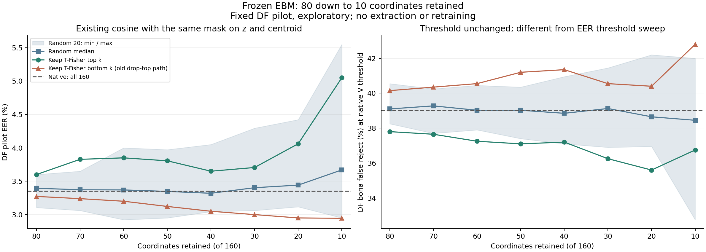

> 역사 문서 보존본. 원문 작성 당시의 상태·계획을 포함한다. 최신 상태와 확정 결과는 experience의 각 실험 README를 우선한다.

# ② 후속: 남기는 채널을 80개에서 10개까지 줄인 실험

> **해석 갱신: 2026-11-05 17:47 KST.** 과거 실행의 수치·그림을 보존하고 새 후속 결과에 맞춰 결론과 남은 범위를 수정했다. 최신 통합 판정은 [방향·채널 전체 분석](../ebm_frozen_all_results_20261105.md)에 있다. 기존 실험의 수치와 그림은 해당 실행의 결과로 보존한다.

2026-11-05 09:59 KST 계산·검증 완료. 기존 [채널 제거 실험](02_channel_ablation.md)의 후속 `channel_keep_sweep_v1`이다. [네 실험 목록](README.md).

추가 후속: [5·3·2개 유지 실험](02_channel_reduction_to2.md)도 완료했다. 하위 유지 EER는 각각 2.9500/2.9222/2.9222%였으나 하위 2개의 AUROC와 V 성능은 악화됐다. 아래 본문은 80→10개 실행 당시의 결과다.

## 1. 가설

**기존 코사인 점수에 필요한 신호가 여러 채널에 중복돼 있다면, 점수 계산에 남기는 채널을 80개보다 더 줄여도 기존 DF EER를 유지하는 부분집합이 있을 수 있다.** 사용자의 요청에 따라 남기는 수를 10개까지 줄여 확인했다.

같은 수의 채널이라도 어떤 좌표를 남기는지에 따라 결과가 달라질 수 있다. 따라서 T에서 정한 중요도가 높은 채널, 낮은 채널, 무작위 채널을 구분했다. 이 순위가 DF에서도 좋은 부분집합의 순위인지 함께 관찰한다.

여기서 검사하는 것은 이미 생성된 160차원 표현의 일부 좌표로 계산한 코사인이다. 처음부터 출력 차원이 작은 EBM의 학습 효과나 최소 필요 차원을 확정하는 실험은 아니다.

## 2. 실험

남기는 채널을 **80→70→60→50→40→30→20→10개**로 줄였다. 전체 160개를 쓰는 native cosine을 기준으로, 각 개수마다 다음 세 조건을 비교했다.

| 조건 | 남기는 채널 | 역할 |
| --- | --- | --- |
| 하위 k개 유지 | T-Fisher 중요도가 낮은 k개 | 앞선 상위 채널 제거 실험의 연장 |
| 상위 k개 유지 | T-Fisher 중요도가 높은 k개 | 중요도가 높은 채널을 남기는 대조 |
| 무작위 k개 유지 | 고정한 무작위 부분집합 20개 | 어떤 좌표를 남기는지에 따른 변동 |

**앞서 EER 3.2722%가 나온 “80개 남김”은 상위 80개를 제거한 결과이므로 하위 80개 유지에 해당한다.** 상위 80개 유지의 새 결과와 구별해야 한다.

각 조건에서 z와 centroid c에 같은 마스크를 적용하고 둘을 각각 재정규화한 코사인을 계산했다. 임베딩 재추출, EBM 재학습, 별도의 진단용 분류기 학습은 없었다.

## 3. 수행 방식

### 데이터와 마스크 고정

기존 T 25,380개, V 14,983개, DF pilot 20,000개(정상 2,000/스푸프 18,000)의 캐시를 사용했다. 체크포인트는 기존 `104873703a57cad98b686d770e0860e031a2cf9abef79b72668780c1660e0b24`를 유지했다. Q는 열지 않았다.

T에서 공격별 Fisher score의 동일 가중 평균으로 만든 기존 160채널 순위를 재사용했다. T 캐시로 순위를 다시 계산해 기존 순위와 일치하는지도 확인했다. DF에서 순위를 다시 만들지 않았다.

상위 조건은 순위의 앞 k개, 하위 조건은 뒤 k개다. 무작위는 앞선 seed 200~219의 permutation에서 뒤 k개를 남겼다. 따라서 기존 “앞 80개 제거” 결과와 일치하며, 같은 seed에서 작은 집합은 큰 집합에 포함된다. 개수·마스크·평가 방식을 새 DF 점수 계산 전에 `protocol_lock.json`에 저장했다.

전체 160개의 기준 1개와 8개 크기×22개 마스크(상위·하위·무작위 20개), 합계 **177조건**을 각 데이터셋에 적용했다.

### 점수와 평가

남기는 좌표 집합을 K라고 할 때 점수는 다음과 같다.

```text
s_K = (z[K] · c[K]) / (||z[K]|| * ||c[K]||)
```

기존 EBM과 마찬가지로 코사인만 점수로 사용했다. 벡터 크기를 별도 판별 입력으로 넣지 않았다.

DF EER와 AUROC를 계산하고 무작위 20개는 모두 보고했다. 무작위 중앙값·최소·최대는 마스크 설계의 변동이며 표본 신뢰구간이 아니다. 상위·하위 조건의 EER 변화에는 source×speaker 93그룹을 함께 재표집하는 paired bootstrap 2,000회(seed 7301)의 개별 95% 구간을 붙였다. 여러 개수·조건 전체를 동시에 보정한 구간이나 비열등성 검정은 아니다.

기존 V threshold 0.9883067190214367에서의 정상 오거부율·스푸프 통과율도 기록했다. DF에서 threshold를 다시 선택하지 않았다. EER의 threshold sweep과 고정 threshold의 운용 오류는 구분했다.

### 검증과 실행

T/V/DF 파일 해시, 행·점수 대응, checkpoint를 검증했다. 남긴 좌표를 직접 슬라이스한 점수와 전체 벡터에서 제거 좌표를 0으로 만든 별도 계산을 비교했다. EER는 독립 DET 계산, AUROC는 순위 합 계산으로 대조했다.

기존 하위 80개 유지 및 무작위 80개 유지 20회의 총 21개 점수가 재현되는지 확인했다. 전체 531개 dataset×조건 지표의 독립 재계산이 통과했고 점수 최대 차이는 1.78e-15, 이전 80개 결과와의 최대 차이는 1.55e-15였다. 마스크 개수와 포함 관계도 확인했다. 계산은 로컬 CPU에서 약 51.32초였고 그림을 렌더링해 확인했다.

## 4. 결과

### 남기는 채널 수에 따른 DF EER

**전체 160개 기준 EER는 3.3500%다.** 아래 값은 DF pilot의 결과이며 작을수록 좋다.

| 남기는 수 | 하위 유지: 기존 제거 경로 | 상위 유지 | 무작위 20회 중앙값 | 무작위 최소~최대 |
| --- | ---: | ---: | ---: | ---: |
| 80 | 3.2722% | 3.6000% | 3.3944% | 3.1056~3.6000% |
| 70 | 3.2389% | 3.8278% | 3.3722% | 3.0611~3.6500% |
| 60 | 3.2000% | 3.8500% | 3.3694% | 2.9222~4.0000% |
| 50 | 3.1222% | 3.8056% | 3.3472% | 2.9500~3.9722% |
| 40 | 3.0500% | 3.6500% | 3.3194% | 3.0444~4.0500% |
| 30 | 3.0000% | 3.7056% | 3.4028% | 3.0611~4.2944% |
| 20 | 2.9500% | 4.0611% | 3.4417% | 3.1167~4.4222% |
| 10 | 2.9444% | 5.0500% | 3.6694% | 2.9500~5.5500% |

V는 전체 177조건에서 EER 0%였다. 따라서 이 V는 남기는 개수·마스크를 선택하는 데 변별력이 약하다.



### 10개만 남긴 경우

| 조건 | DF EER | native와의 차이: 후보−native | 차이의 개별95%구간 |
| --- | ---: | ---: | --- |
| 하위 10개 유지 | 2.9444% | -0.405556pp | [-0.538891, -0.096747]pp |
| 상위 10개 유지 | 5.0500% | +1.700000pp | [0.821445, 2.877935]pp |

위 구간은 미해결 family 의존성이나 과거 탐색 이력을 해소한 것이 아니다. 개별 구간의 결과를 독립 확인의 개선으로 부르지 않는다. 무작위 10개의 20회는 중앙값 3.6694%, 범위 2.9500~5.5500%였고 15회는 native보다 높은 EER였다.

### 기존 V 문턱값을 고정했을 때의 DF 정상 오거부

| 조건 | 정상 오거부율 |
| --- | ---: |
| native 160개 | 39.00% |
| 하위 10개 유지 | 42.80% |
| 상위 10개 유지 | 36.75% |

하위 10개의 EER는 낮아졌지만 기존 threshold 그대로라면 정상 오거부율은 39.00→42.80%로 높아졌다. EER 개선과 고정 threshold에서의 운용 개선은 같지 않다.

## 5. 해석

**이 DF 표본에서 하위10개를 남긴 cosine EER의 점 추정치는2.9444%였다.** 전체160개의3.35%보다 낮았지만,이를 전체 ROC 또는 통계적 성능 동등성으로 읽지 않는다. 상위10개는5.05%,random10개20회의중앙값은3.6694%여서 어떤10개나 충분했던 것도 아니다.

고정된 옛 native V threshold에서 하위10개의 DF 정상거부는42.80%로 native39.00%보다 높았다. EER 부근의 이득이 같은 운용점의 이득과 다를 수 있다. 각 점수별 V 재보정 비교와도 구별한다.

후속5/3/2/1개 실험은 이미 완료됐다. 하위2개는 EER2.9222%지만 AUROC와 V EER가 나빠졌고,하위1개의 EER는4.345939%였다. 이 문서의10개는 역사적 실행 범위이며 “현재까지 시험한 최소 수”가 아니다.

새 P1 dynamic gate는 두2만 개 전이 평가에서 우월성을 입증하지 못했고,static/metric은 V에서 identity가 선택됐다. 소수 좌표 관찰과 학습 attention의 유용성은 다른 가설이다. 새 F1 회전·공유 bootstrap 전체 묶음은 진행 중이다.

모든 조건에서 원래160차원 encoder/LN은 유지됐다. 처음부터10차원만 생성하는 모델의 성능이나 계산량 감소를 주장하지 않는다. 기존 DF 결과를 반복 관찰한 탐색이며 원발화 family와 전체 탐색 이력의 불확실성이 남는다.

근거: [전체 조건 수치](../../../artifacts/geometry_cache/local_analysis/channel_keep_sweep_v1/all_metrics.csv), [유지 곡선](../../../artifacts/geometry_cache/local_analysis/channel_keep_sweep_v1/curves.csv), [개별 구간](../../../artifacts/geometry_cache/local_analysis/channel_keep_sweep_v1/paired_intervals.json), [설정 lock](../../../artifacts/geometry_cache/local_analysis/channel_keep_sweep_v1/protocol_lock.json), [검증 기록](../../../artifacts/geometry_cache/local_analysis/channel_keep_sweep_v1/verification.json), [계산 코드](../../../../workspace/artifacts/geometry_experiments/channel_keep_sweep.py).
