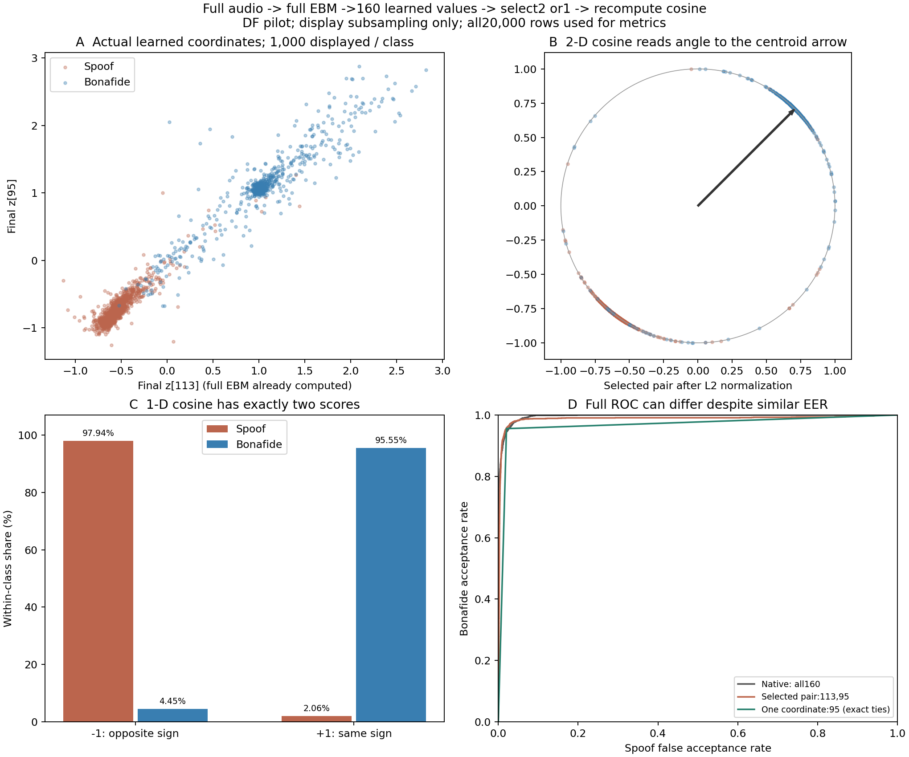

> 표시 명칭·링크 이름은 설명형으로 정리했다. 원래 코드·경로·수치는 그대로 보존한다.

> 역사 문서 보존본. 원문 작성 당시의 상태·계획을 포함한다. 최신 상태와 확정 결과는 experience의 각 실험 README를 우선한다.

# ② 후속: 1개 채널 결과와 2개 채널 실험의 쉬운 설명

> **해석 갱신: 2026-11-05 17:47 KST.** 과거 실행의 수치·그림을 보존하고 새 후속 결과에 맞춰 결론과 남은 범위를 수정했다. 최신 통합 판정은 [방향·채널 전체 분석](../ebm_frozen_all_results_20261105.md)에 있다. 기존 실험의 수치와 그림은 해당 실행의 결과로 보존한다.

2026-11-05 실행한 `channel_keep_one_v3` 결과다. [5·3·2개 실험](02_channel_reduction_to2.md)을 연장했다. [네 실험 목록](README.md).

후속 해석: [채널 증가와 EER·ROC의 관계](02_why_more_channels_can_worsen_eer.md). 전체160개는 하위2개보다 EER는 높지만 AUROC는 좋았고 두 ROC가 교차했다. 아래의 EER 유지 해석을 모든 운용 구간의 동등성으로 확대하지 않는다.

## 1. 가설

**전체 EBM이 만든 마지막 요약값에 정상/스푸프 신호가 반복돼 있다면, 그중 2개 또는 1개만 읽어도 어느 정도 구분할 수 있다.** 사용자의 요청에 따라 1개까지 검사하고, 앞선 2개 결과를 재현하며 계산 과정을 확인했다.

여기서 채널은 원음의 일부나 특정 주파수 두 개가 아니라, 전체 음성을 처리한 모델의 마지막 160차원 임베딩 좌표다. 같은 한 좌표라도 어떤 좌표를 남기는지에 따라 결과가 다를 수 있다.

## 2. 실험

남기는 수를 2개에서 **1개**로 줄였다. T에서 정한 Fisher 순위의 상위 1개, 하위 1개, 기존 무작위 경로 20개의 마지막 1개를 비교했다. 기존 2개 조건은 연결 확인을 위해 다시 계산했다. 새 EBM 학습이나 작은 분류기의 학습은 없었다.

또한 실제 DF 표본의 113번·95번 좌표 분포, 두 좌표를 정규화한 방향, 95번 한 좌표의 부호별 정상/스푸프 비율을 그려 두 채널 결과가 어떻게 나왔는지 확인했다.

## 3. 수행 방식

### 두 채널 실험을 쉽게 풀어 쓰면

처리 순서는 다음과 같다.

```text
음성 전체
  → 기존 XLS-R·EBM·pooling·Linear·160차원 LayerNorm을 전부 계산
  → 최종 요약값 z[0], z[1], ... z[159] 생성
  → z[113], z[95] 두 값만 선택
  → 기존 centroid에서도 c[113], c[95] 선택
  → 선택한 두 벡터의 코사인을 다시 계산
```

즉 많은 계산으로 만든 **최종 요약 점수 두 개를 읽는 실험**이다. 원음을 두 개의 간단한 원시 특징만으로 처리한 실험은 아니다. 각 좌표에는 앞선 네트워크가 학습한 음성 전체의 정보가 섞여 들어갈 수 있다.

선택한 두 값을 `a=z[113]`, `b=z[95]`, 기준의 두 값을 `p=c[113]`, `q=c[95]`라고 하면 다음과 같다.

```text
s_2 = (a*p + b*q) / (sqrt(a*a + b*b) * sqrt(p*p + q*q))
```

남기지 않은 158개 좌표는 이 점수 식에 들어가지 않는다. 원래 160개를 만들기까지의 계산은 모두 수행돼 있다. 마스크 적용 뒤 선택한 z와 c를 각각 재정규화하므로 점수는 원래 160차원 코사인과 달라질 수 있다.

설명용으로 기준을 (1,1), 정상 요약을 (2,2), 스푸프 요약을 (-2,-2)라고 생각하면 두 값만 있어도 코사인은 각각 +1과 -1이다. 잘 학습된 마지막 요약값에 같은 판별 신호가 여러 번 나타나는 상황에서는 이런 구분이 가능하다. 이 예시는 계산 이해를 위한 가상 숫자이며 실제 EER를 계산한 자료는 아니다.

### 실제 두 좌표의 분포

기존 DF 표본 전체에서 두 좌표의 클래스별 평균은 다음과 같았다.

| 클래스 | z[113] 평균 | z[95] 평균 |
| --- | ---: | ---: |
| 정상 | 1.041166 | 1.084666 |
| 스푸프 | -0.525601 | -0.694368 |

centroid의 두 값은 약 (0.080407, 0.080406)으로 양수였다. 정상의 평균 방향은 이 기준과 비슷하고 스푸프의 평균 방향은 반대였다. 완전히 분리된 것은 아니며 예외 표본이 남는다. 전체 DF에서 두 좌표의 상관은 0.973238이었다. 이 값에는 클래스 평균 차이의 영향도 포함되므로 표현 전체가 정확히 1차원이라는 의미로 확대하지 않는다.

### 한 채널에서는 무엇을 계산하는가

남은 값이 하나이며 0이 아니라면 코사인은 다음처럼 된다.

```text
s_1 = z[j]*c[j] / (abs(z[j])*abs(c[j]))
    = sign(z[j])*sign(c[j])
```

따라서 **같은 부호면 +1, 다른 부호면 -1**뿐이다. 두 채널에서는 연속적인 각도 차이를 읽을 수 있지만 한 채널 코사인은 부호만 읽는다. 이번 하위 1개는 95번, 상위 1개는 97번이다. 선택 값이 0인 표본은 없었다.

### 데이터·평가·검증

기존 T 25,380개, V 14,983개, DF pilot 20,000개(정상 2,000/스푸프 18,000)를 사용했다. 새 추출·학습·Q 접근은 없었다. T 순위와 무작위 seed 200~219를 유지했고 DF 결과로 좌표를 다시 고르지 않았다. 이번 20개 무작위 단일 좌표는 서로 다른 20개였다.

1차원의 동점을 임의로 나누지 않도록 점수를 정확한 부호값으로 계산했다. EER는 두 점수 집단을 통째로 처리한 ROC의 선형 보간값이다. 두 실제 운용점의 오류율이 다르면 그 EER와 정확히 같은 두 오류율을 만드는 결정적 threshold가 존재한다는 뜻은 아니다. 실제 부호 판별의 두 오류율도 따로 기록했다.

검증은 전체 ROC 계산, 클래스별 +1/-1 개수로 만든 닫힌 식, reject-all/양수만 수락/accept-all의 운용점을 직접 열거한 계산을 대조했다. 완전 분리·상수·역순·무작위 동점 합성 검사를 통과했다. source×speaker paired bootstrap 2,000회로 개별 95% 구간을 계산했으며 전체 반복 탐색을 보정한 확인 구간은 아니다.

최초 v1은 T의 독립 DET 검증에서, v2는 합성 역순 검증에서 중단됐다. 기존 DET 도우미가 점수 두 개를 한 운용점으로 줄여 버리는 문제였으며 끝점만 복원해서는 역순의 내부 운용점을 되살릴 수 없었다. 최종 v3은 세 운용점을 직접 계산해 검증했다. 주 평가인 전체 ROC 계산·부호 점수·마스크는 바꾸지 않았다. v1/v2는 미완료로 보존했고 새로운 DF 점수 생성 전의 검증에서 멈췄다.

T/V/DF 각각 45조건, 총135조건의 독립 검증이 통과했다. 이전 2개 점수 23조건은 오차 0으로 재현됐고, 두 좌표의 각도 차이를 직접 구한 별도 계산도 최대 4.44e-16 이내로 일치했다. 이번 상·하위 1차원 점수는 원래 나눗셈으로 계산해도 정확한 부호 점수와 같았다. 따라서 부동소수점의 가짜 순위 때문에 나온 2개 결과는 아니었다. 그림도 렌더링해 확인했다.

## 4. 결과

### DF EER: 전체 160개는 3.3500%

| 남기는 수 | 하위 유지 | 상위 유지 | 무작위 20회 중앙값 | 무작위 최소~최대 |
| --- | ---: | ---: | ---: | ---: |
| 2: 재현 | 2.9222% | 6.8500% | 5.5750% | 2.6056~11.2500% |
| 1 | 4.3459% | 14.8255% | 13.5020% | 6.8681~20.0419% |

하위 1개의 native 대비 EER 변화는 +0.995939pp, 개별 95% 구간은 [-0.628145, 3.749061]pp였다. 상위 1개는 +11.475540pp, 구간 [7.439908, 15.277732]pp였다. 표본·화자 구성의 불확실성과 반복 탐색의 범위를 유지한다.

### 95번 한 좌표에는 이미 어떤 신호가 있었는가

c[95]는 양수이므로 z[95]가 양수면 +1점이다.

| 실제 클래스 | -1점: 기준과 반대 부호 | +1점: 기준과 같은 부호 |
| --- | ---: | ---: |
| 정상 2,000개 | 89개 (4.45%) | 1,911개 (95.55%) |
| 스푸프 18,000개 | 17,630개 (97.9444%) | 370개 (2.0556%) |

이 한 좌표에서도 클래스가 대부분 다른 부호를 갖는다. 기존 V threshold 또는 0을 쓰면 정상 오거부율 4.45%, 스푸프 통과율 2.0556%다. 보고한 EER 4.3459%는 동점 ROC의 보간값이므로 이 두 운용 오류율과 구별한다.

### 전체 ROC와 EER의 구분

| 조건 | DF EER ↓ | DF AUROC ↑ |
| --- | ---: | ---: |
| native 160개 | 3.3500% | 0.995943 |
| 하위 2개 | 2.9222% | 0.987659 |
| 하위 1개 | 4.3459% | 0.967472 |

두 개의 EER가 좋았어도 전체 ROC의 순위 성능까지 같았던 것은 아니다. 한 개에서는 점수가 둘뿐이어서 더 세밀한 순위 정보를 잃는다.



그림 A는 실제 두 요약값, EBM-NoRepeat 모델은 두 값의 방향, EBM-FullContext 모델은 한 값의 부호별 클래스 비율, D는 전체 ROC다. 동일 구현의 반복 입력·비반복 입력 대조에는 클래스별 1,000개를 고정 표본으로 표시했고 성능과 통계는 DF 전체 20,000개로 계산했다.

## 5. 해석

**전체 신경망이 생성한 요약 좌표 일부에 클래스 차이가 들어 있기 때문에 소수 좌표의 cosine 점수도 작동할 수 있다.** 원음의 정보가 두 개뿐이거나 모델 전체가2차원이었다는 실험은 아니다. 두 좌표의 pooled 상관 약0.973에는 클래스 평균 차이도 포함된다.

하위1개 EER4.345939%는 하위2개의2.9222%보다 높았다. 1차원 cosine은0이 아닌 입력에서 sign(z[j])sign(c[j])로 정확히±1이다. 동점을 나누지 않은 보간 EER와 실제 부호 판정의 정상거부4.45%·spoof통과2.0556%를 구분한다.

두 좌표가 낮은 EER를 보여도 AUROC·V·일부 ROC 구간에서는 전체160개가 좋았다. 모든 정보를 보존했다거나 나머지 좌표가 전부 잡음이라는 결론은 나오지 않는다. 성능이 “유지됐다”는 표현도 이 표본의 EER 점 추정치 범위로 한정한다.

후속 T/V 학습 gate는 전이 EER 개선을 입증하지 못했다. 관찰된 좌표의 중복 가능성과 입력 적응형 gate의 유용성은 별도 질문이다. 새 회전 대조와 엄격한 평가 panel은 진행 중이며,새 방향 loss의 공동 학습은 수행하지 않았다.

기존 DF 표본의 반복 탐색,원발화 family 미해결,저장 예측에 조건부인 CI를 유지한다. 원래160차원 encoder와 LayerNorm을 계산했으므로1/2차원 모델의 학습 성능·추론 연산량 절감을 입증하지 않는다.

근거: [전체 지표](../../../artifacts/geometry_cache/local_analysis/channel_keep_one_v3/all_metrics.csv), [부호별 클래스 개수](../../../artifacts/geometry_cache/local_analysis/channel_keep_one_v3/exact_sign_class_counts.csv), [두 좌표의 분포 통계](../../../artifacts/geometry_cache/local_analysis/channel_keep_one_v3/two_coordinate_explanation_stats.json), [1차원 수치 점검](../../../artifacts/geometry_cache/local_analysis/channel_keep_one_v3/one_dimensional_roundoff_audit.json), [개별 구간](../../../artifacts/geometry_cache/local_analysis/channel_keep_one_v3/paired_intervals.json), [검증](../../../artifacts/geometry_cache/local_analysis/channel_keep_one_v3/verification.json), [계산 코드](../../../../workspace/artifacts/geometry_experiments/channel_keep_one.py).
