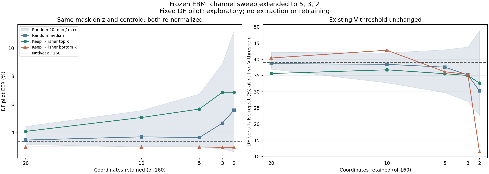

> 역사 문서 보존본. 원문 작성 당시의 상태·계획을 포함한다. 최신 상태와 확정 결과는 experience의 각 실험 README를 우선한다.

# ② 후속: 남기는 채널을 5·3·2개까지 줄인 실험

> **해석 갱신: 2026-11-05 17:47 KST.** 과거 실행의 수치·그림을 보존하고 새 후속 결과에 맞춰 결론과 남은 범위를 수정했다. 최신 통합 판정은 [방향·채널 전체 분석](../ebm_frozen_all_results_20261105.md)에 있다. 기존 실험의 수치와 그림은 해당 실행의 결과로 보존한다.

2026-11-05 10:13 KST 계산·검증 완료. [80→10개 유지 실험](02_channel_reduction_to10.md)을 연장한 `channel_keep_tiny_v1`이다. [네 실험 목록](README.md).

최신 후속: [1개 채널 결과와 2개 실험의 쉬운 설명](02_channel_reduction_to1_and_explanation.md). 하위 1개 EER 4.3459%, 상위 1개 14.8255%, 무작위 중앙값 13.5020%였다. 기존 2개 결과는 오차 0으로 재현했고 실제 두 좌표·한 좌표의 분포도 확인했다. 아래의 “1개 미실행”은 이 문서 작성 당시 상태다.

## 1. 가설

**기존 코사인 점수에 필요한 신호가 적은 좌표에 반복돼 있다면, 남기는 채널을 10개에서 5·3·2개로 줄여도 DF EER를 유지하는 부분집합이 있을 수 있다.** 같은 수를 남겨도 어떤 좌표를 택하느냐에 따라 결과가 달라질 수 있으므로 T 중요도 상위·하위·무작위를 함께 비교한다.

가설의 범위는 이미 생성한 160차원 표현에서 계산하는 코사인이다. 처음부터 2차원으로 학습한 모델, 표현 전체의 정보량, 최소 필요 차원을 검사한 것은 아니다.

## 2. 실험

새 유지 수는 **5·3·2개**다. 이전 결과와 연결되는지 확인하기 위해 10개도 다시 계산했다. 전체 160개 native cosine을 기준으로 각 개수에서 T-Fisher 상위 k개, 하위 k개, 같은 무작위 permutation 20개의 뒤 k개를 남겼다.

하위 유지가 앞선 “상위 채널 제거”의 연장이다. 상위 유지와 혼동하지 않는다. DF 결과를 보고 새 순위를 만들거나 좋은 무작위 집합만 선택하지 않았다. 모든 부분집합을 보고한다.

## 3. 수행 방식

기존 T 25,380개, V 14,983개, DF pilot 20,000개(정상 2,000/스푸프 18,000)의 h/z 캐시 중 z와 centroid를 재사용했다. Q는 열지 않았다. 새 임베딩 추출, EBM 재학습, 진단용 분류기 학습은 없었다.

T 공격별 Fisher score의 동일 가중 평균 순위와 무작위 seed 200~219는 이전 실행 그대로다. 각 5·3·2개 집합은 같은 경로의 10개 집합 안에 포함되며, 2개는 3개 안에, 3개는 5개 안에 포함된다. 설정·마스크를 새 점수 계산 전에 lock으로 저장했다.

남기는 집합 K의 z와 c에 같은 마스크를 적용하고 각각 재정규화했다.

```text
s_K = (z[K] · c[K]) / (||z[K]|| * ||c[K]||)
```

기존 EBM처럼 코사인만 점수로 사용하고 벡터 크기를 별도 변수로 넣지 않았다. 하위 2개는 원래 160좌표의 **113번과 95번(0부터 센 index)**이다. 하위 3개는 137·113·95번이다.

DF EER·AUROC를 계산하고, 기존 V threshold 0.9883067190214367에서 정상 오거부율과 스푸프 통과율도 기록했다. threshold를 DF에서 새로 고르지 않았다. source×speaker 93그룹의 paired bootstrap 2,000회(seed 7301)로 개별 95% 구간을 계산했다. 무작위의 최소·중앙값·최대는 마스크 변동이며 표본 신뢰구간이 아니다. 다중비교 전체를 보정하거나 비열등성 검정을 수행한 것은 아니다.

전체 160개의 기준 1개와 4개 크기×22개 마스크, 합계 89조건을 T/V/DF에 적용했다. 캐시 파일 해시·checkpoint·행 대응·중첩 마스크를 확인했다. 직접 좌표를 자른 점수와 전체 배열에서 제외 좌표를 0으로 만든 계산, DET 기반 EER와 순위 합 기반 AUROC를 대조했다. **267개 dataset×조건 검증이 통과**했고 점수 최대 오차는 7.77e-16이었다. 이전 10개 조건의 23개 점수(native 포함)는 오차 0으로 재현됐다. 계산은 CPU에서 약 22.19초였고 그림을 렌더링해 확인했다.

## 4. 결과

### DF EER: 기존 전체 160개는 3.3500%

| 남기는 수 | 하위 유지: 기존 제거 경로 | 상위 유지 | 무작위 20회 중앙값 | 무작위 최소~최대 |
| --- | ---: | ---: | ---: | ---: |
| 10: 연결 확인 | 2.9444% | 5.0500% | 3.6694% | 2.9500~5.5500% |
| 5 | 2.9500% | 5.6500% | 3.6194% | 2.9556~6.7278% |
| 3 | 2.9222% | 6.8500% | 4.6472% | 2.8056~8.9000% |
| 2 | 2.9222% | 6.8500% | 5.5750% | 2.6056~11.2500% |

하위 유지에서는 2개까지 DF EER가 약 2.92~2.95%로 유지됐다. 무작위는 5개 20회 중 13회, 3개는 15회, 2개는 16회가 native보다 높은 EER였다. 무작위의 최저값을 새 모델의 성능으로 선택하지 않는다.



### 하위 유지의 EER 변화와 불확실성

변화는 `후보 EER - native EER`이며 음수면 EER가 낮다.

| 남기는 수 | 변화 | 개별95%구간 |
| --- | ---: | --- |
| 5 | -0.400000pp | [-0.646561, 0.073212]pp |
| 3 | -0.427778pp | [-0.782105, 0.360954]pp |
| 2 | -0.427778pp | [-0.799146, 0.069279]pp |

세 구간 모두 0을 포함한다. 낮은 점추정만으로 확정 개선이나 엄밀한 동등성을 주장하지 않는다.

### EER 이외의 지표

| 조건 | DF AUROC ↑ | V EER ↓ | DF 정상 오거부율 ↓ | DF 스푸프 통과율 ↓ |
| --- | ---: | ---: | ---: | ---: |
| native 160개 | 0.995943 | 0.0000% | 39.00% | 0.0111% |
| 하위 5개 | 0.996048 | 0.0000% | 36.15% | 0.0611% |
| 하위 3개 | 0.995741 | 0.0000% | 35.35% | 0.0667% |
| 하위 2개 | 0.987659 | 0.1907% | 11.45% | 0.8167% |

마지막 두 오류율은 동일한 기존 V threshold에서 계산했다. 하위 2개는 정상 거부가 줄어든 대신 스푸프 통과가 늘었다. V도 기존 EER 0%에서 0.1907%로 나빠졌다.

하위 3개와 2개의 EER가 같아도 점수가 같은 것은 아니다. DF에서 두 점수의 최대 절대 차이는 1.554762였으며 AUROC도 달랐다. 2차원 벡터의 각도를 `atan2`로 구해 각도 차이의 cosine을 계산하는 추가 점검에서도 저장 점수와 최대 4.44e-16 이내로 일치했다.

## 5. 해석

**하위2개가 이 DF pilot의 EER 지점에서 낮은 점 추정치2.9222%를 보였다는 관찰은 유효하다.** 그러나 native 대비 차이의 개별95% CI는0을 포함하고,이를 성능 동등성·비열등성 입증으로 바꾸지 않는다. AUROC0.987659와 V EER0.1907%는 각각 native0.995943와0%보다 나빴다.

상위2개 EER6.85%,random2개 중앙값5.5750%였으므로 부분집합 선택이 중요했다. “2개면 충분하다”보다 “이 checkpoint의 특정 두 좌표가 이 표본의 EER에서 작동했다”가 정확하다. 다른158개가 모든 점수·공격·운용점에서 불필요하다는 뜻은 아니다.

후속1개 실험도 완료됐으며 하위1개 EER는4.345939%다. 2개는 최소 필요 차원으로 확인된 값이 아니고,현재 시험 범위의 최소 수도 아니다. 1차원에서는 cosine이±1만 남는 구조적 변화가 있다.

전체160개와 두 좌표의 ROC 교차,낮은 정상거부율에서 전체 표현의 이점,동일 숫자의 옛 threshold에 따른 점수 분포 변화도 함께 읽어야 한다. 원래160차원 encoder/LN은 모두 계산했다.

새 dynamic gate의 DF EER 이득은0.007407pp,99% CI는0을 포함했고21LA EER는 같았다. 이 후속 결과는 두 좌표의 기술적 관찰을 부정하지 않지만,그 관찰만으로 입력별 attention의 전이 개선을 예측할 수 없음을 보여준다. 반복 탐색·미해결 family 의존성은 남아 있다.

근거: [전체 지표](../../../artifacts/geometry_cache/local_analysis/channel_keep_tiny_v1/all_metrics.csv), [유지 곡선](../../../artifacts/geometry_cache/local_analysis/channel_keep_tiny_v1/curves.csv), [개별 구간](../../../artifacts/geometry_cache/local_analysis/channel_keep_tiny_v1/paired_intervals.json), [마스크](../../../artifacts/geometry_cache/local_analysis/channel_keep_tiny_v1/masks.json), [검증 기록](../../../artifacts/geometry_cache/local_analysis/channel_keep_tiny_v1/verification.json), [추가 2차원 검증](../../../artifacts/geometry_cache/local_analysis/channel_keep_tiny_v1/posthoc_two_coordinate_check.json), [계산 코드](../../../../workspace/artifacts/geometry_experiments/channel_keep_tiny_sweep.py).
