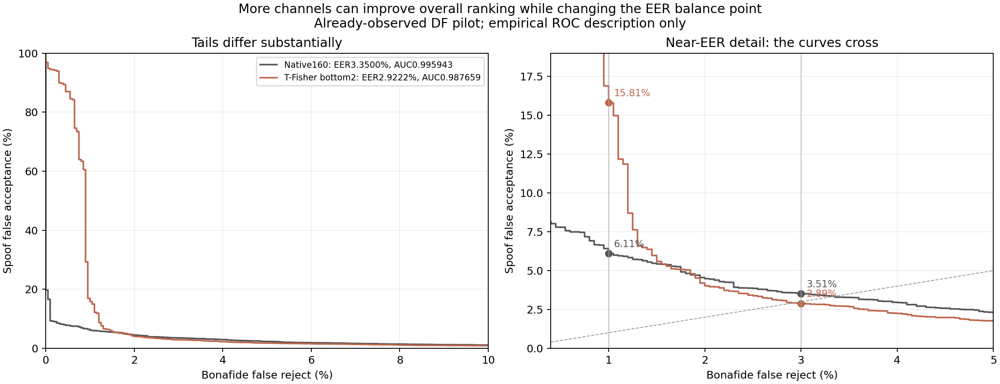

> 역사 문서 보존본. 원문 작성 당시의 상태·계획을 포함한다. 최신 상태와 확정 결과는 experience의 각 실험 README를 우선한다.

# 채널이 늘어날 때 EER가 올라간 이유: 기존 점수의 ROC 비교

> **해석 갱신: 2026-11-05 17:47 KST.** 과거 실행의 수치·그림을 보존하고 새 후속 결과에 맞춰 결론과 남은 범위를 수정했다. 최신 통합 판정은 [방향·채널 전체 분석](../ebm_frozen_all_results_20261105.md)에 있다. 기존 실험의 수치와 그림은 해당 실행의 결과로 보존한다.

기존 DF pilot 점수에 대한 사후 기술 분석 `channel_roc_explanation_v1`이다. 새 추출·학습·마스크 선택은 없었다. [채널 실험 목록](README.md).

## 1. 가설

관찰한 현상을 두 질문으로 나눴다.

1. 모든 채널 유지 경로에서 채널 수가 늘수록 EER가 높아졌는가?
2. 하위 유지 경로에서 전체 160개의 EER가 2개보다 높다는 것이 전체 판별 성능도 나쁘다는 뜻인가?

가능한 계산상의 설명은 고정 코사인에 좌표를 추가하면 내적과 두 정규화 분모가 함께 바뀌어 표본 간 점수 순서도 바뀐다는 것이다. 추가된 좌표의 효과를 새로 학습해 무시하거나 줄이는 단계는 없다. 일부 구간에 도움이 되는 좌표가 다른 구간에서는 불리할 수 있다.

다만 어떤 출처·코덱·음향 요인이 그 차이를 일으켰는지까지 이 비교로 결정할 수는 없다.

## 2. 실험

이미 저장된 동일 DF 20,000개 발화의 native 160차원 코사인과 T-Fisher 하위 2개 코사인을 비교했다. EER·AUROC뿐 아니라 같은 정상 오거부율에서 스푸프 통과율이 어떻게 다른지 ROC 전체를 살펴봤다.

또 정상 2,000개와 스푸프 18,000개의 모든 쌍에서 정상 점수가 더 높은지 직접 세어, 두 점수가 어느 쪽에서 더 많은 순위 오류를 만드는지 확인했다.

## 3. 수행 방식

입력은 완료된 `channel_keep_one_v3/DF_scores.parquet`의 native와 keep_bottom2 열이다. 동일 발화·label·표현이며 새 점수 모델을 fit하지 않았다. 이 분석은 이미 본 결과를 설명하는 사후 분석으로 기록했다.

정상 오거부율을 0.5/1/2/3/3.5/5/10% 이하로 제한했을 때 각 경험적 ROC에서 가능한 최소 스푸프 통과율을 계산했다. 이는 DF ROC의 기술 비교다. 이 값으로 배포 문턱값을 새로 선택하거나 기존 V threshold를 교체하지 않았다.

순위 비교는 2,000×18,000=36,000,000개 정상/스푸프 쌍을 나눠 계산했다. 동점은 없었다. 쌍별 올바른 순서의 비율로 AUROC를 독립 재계산해 일치하는지 확인했다. 같은 발화가 많은 쌍에 반복되므로 3,600만 쌍을 독립 표본 수로 해석하지 않는다.

## 4. 결과

### 채널 수 증가가 모든 경로에서 나빴던 것은 아니다

| 유지 경로 | 2개 DF EER | 160개 DF EER |
| --- | ---: | ---: |
| T 중요도 하위 유지 | 2.9222% | 3.3500% |
| T 중요도 상위 유지 | 6.8500% | 3.3500% |
| 무작위 20회 중앙값 | 5.5750% | 3.3500% |

사용자가 지적한 증가는 하위 유지 경로에서 나타났다. 상위 유지·무작위의 전반적인 방향은 반대였다. 정확한 중간 개수는 [80→10개](02_channel_reduction_to10.md), [5·3·2개](02_channel_reduction_to2.md) 결과에 있다.

### EER와 전체 순위 성능의 방향이 달랐다

| 점수 | EER ↓ | AUROC ↑ |
| --- | ---: | ---: |
| 하위 2개 | 2.9222% | 0.987659 |
| 전체 160개 | 3.3500% | 0.995943 |

160개는 EER가 조금 높았지만 전체 순위 지표 AUROC는 더 좋았다.

| ROC에서 허용한 정상 오거부율 | 2개 스푸프 통과율 | 160개 스푸프 통과율 | 유리한 점수 |
| --- | ---: | ---: | --- |
| 0.5% 이하 | 87.0056% | 7.7944% | 160개 |
| 1% 이하 | 15.8111% | 6.1056% | 160개 |
| 2% 이하 | 4.0222% | 4.4833% | 2개 |
| 3% 이하 | 2.8889% | 3.5111% | 2개 |
| 5% 이하 | 1.7611% | 2.3222% | 2개 |

두 ROC가 교차했다. 두 오류율이 비슷해지는 3% 근처에서는 2개가 유리하지만, 정상 오거부를 1% 이하로 제한하는 구간에서는 160개가 훨씬 유리했다. EER는 이런 ROC 전체에서 두 오류율이 같아지는 지점 하나만 요약한다.

### 어떤 정상/스푸프 쌍의 순서가 바뀌었는가

| 순위 비교 | 쌍 수 |
| --- | ---: |
| 두 점수 모두 정상 점수가 더 높음 | 35,493,249 |
| 160개는 틀리고 2개는 맞음 | 62,492 |
| 160개는 맞고 2개는 틀림 | 360,693 |
| 두 점수 모두 틀림 | 83,566 |

160개가 올바르게 정렬하고 2개가 틀린 쌍이 반대의 경우보다 많았다. 이 결과는 160개의 더 높은 AUROC와 일치한다. 하지만 그 전체 순위 이득이 EER 부근의 이득과 같은 것은 아니었다.

## 5. 해석

**확인한 직접적 사실은 좌표 선택 후의 순위 변화와 ROC 교차다.** 하위2개는 EER 부근에서,전체160개는 낮은 정상거부율 구간과 AUROC에서 유리했다. “채널이 많을수록 항상 나빠진다” 또는 “추가158개가 모두 잡음”은 이 결과와 맞지 않는다.

고정 cosine은 좌표를 추가할 때 유용성을 학습해 자동 제외하는 함수가 아니다. 분자와 재정규화가 함께 바뀌므로 순위가 달라질 수 있다. 그중 어떤 음향적·도메인 원인이 작용했는지는 ROC 비교만으로 식별하지 못한다.

새 P1 dynamic gate는 DF EER를 평균0.007407pp 낮췄지만99% 구간이0을 포함했고21LA EER는 같았다. 또한 dynamic의 DF LL은 약간 나빠졌다. 학습 가능한 가중치를 붙였다는 사실만으로 이 ROC trade-off가 해결되는 것은 아니었다.

새 P3 선형 방향 잔차는 반대로 LL을 작게 줄였지만 DF EER는0.05pp 나빠졌다. 이는 ranking·EER 운용점·확률 예측을 분리해 해석해야 한다는 추가 사례다. 한 지표의 부정 결과를 모든 효과 부재로,한 지표의 이득을 전체 성능 개선으로 바꾸지 않는다.

모든 수치는 이미 관찰한 DF pilot과 고정 checkpoint의 탐색이다. 기존160차원 encoder/LN을 유지했고,독립 일반화나 인과 원인·본질적 차원을 증명한 결과가 아니다.

근거: [분석 기록](../../../artifacts/geometry_cache/local_analysis/channel_roc_explanation_v1/analysis_record.json), [같은 정상 거부율의 ROC 수치](../../../artifacts/geometry_cache/local_analysis/channel_roc_explanation_v1/matched_ROC_points.csv), [쌍별 순위 집계](../../../artifacts/geometry_cache/local_analysis/channel_roc_explanation_v1/summary.json), [계산 코드](../../../../workspace/artifacts/geometry_experiments/explain_channel_roc.py).
