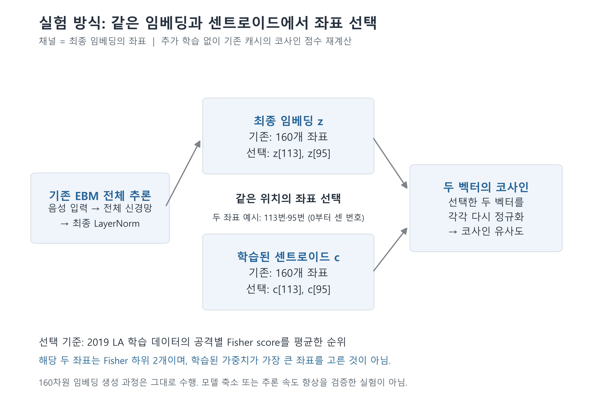
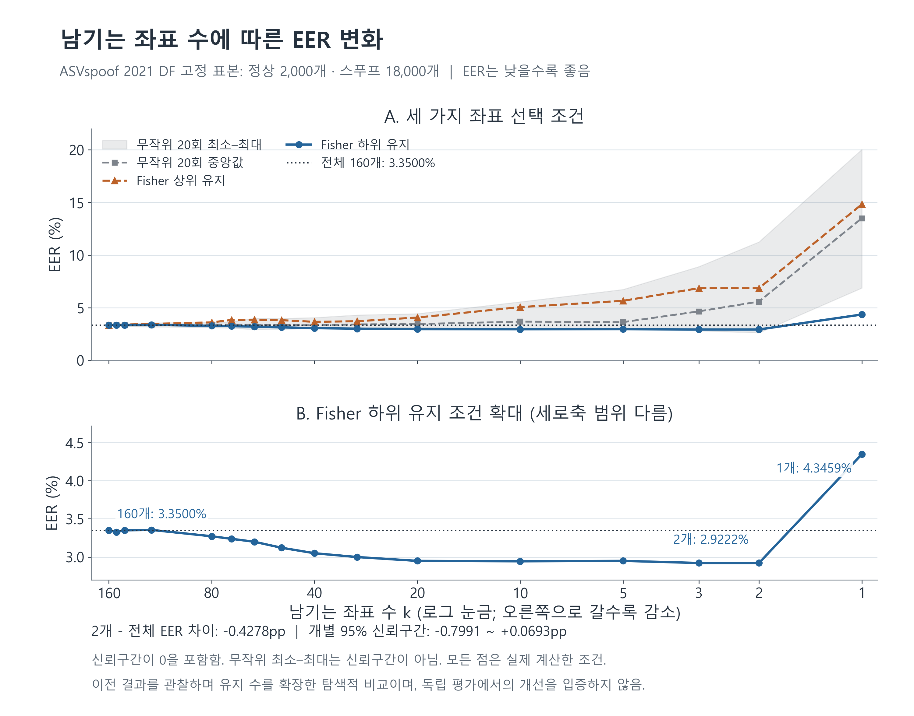
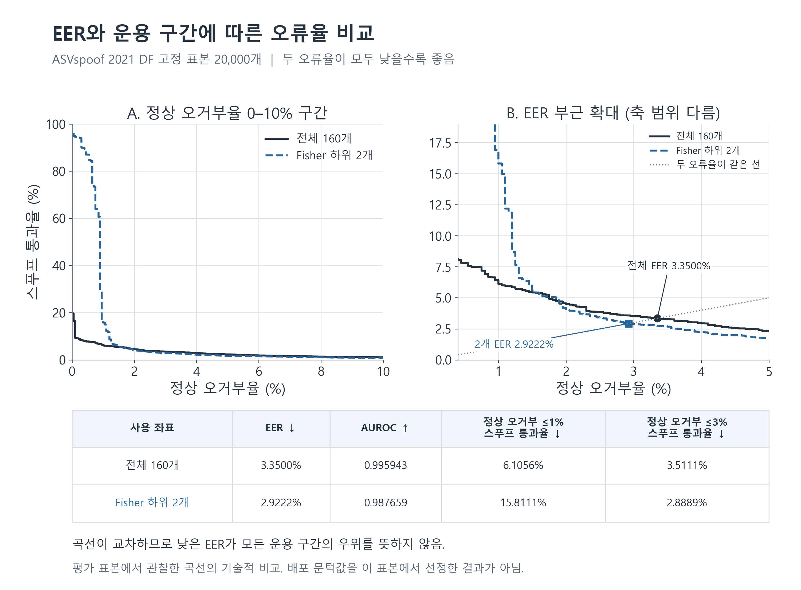

> 표시 명칭·링크 이름은 설명형으로 정리했다. 원래 코드·경로·수치는 그대로 보존한다.

> 역사 문서 보존본. 원문 작성 당시의 상태·계획을 포함한다. 최신 상태와 확정 결과는 experience의 각 실험 README를 우선한다.

# EBM 좌표 부분집합 실험: 참고 그림 및 캡션

> 해석 갱신: 아래 이미지는 기존 DF pilot의 좌표·ROC 또는 투영 그림이다. 새21LA·gate·metric·P3-4.0375초 상한 비반복 학습/P4 결과를 그린 그림이 아니다. [최신 통합 분석](../../ebm_frozen_all_results_20261105.md)의 전이/내부 진단 구분을 함께 적용한다. 이미지와 표시 표본은 변경하지 않았다.

아래 PNG는 흰 배경의 고해상도 이미지다. 워드에서 본문 너비에 맞춰 삽입할 수 있다.

## 그림 1. 좌표 부분집합 실험의 수행 과정

기존 EBM 전체 추론으로 얻은 160차원 임베딩과 학습된 센트로이드에서 같은 좌표를 선택한 뒤, 선택 벡터를 각각 다시 정규화하여 코사인 유사도를 계산했다. 예시에 사용한 113번과 95번은 ASVspoof 2019 LA train에서 공격별 Fisher score를 평균한 순위의 하위 두 좌표다. 모델과 센트로이드의 재학습은 수행하지 않았다. 좌표 번호는 0부터 시작한다.

보고서 삽입 위치: 2. 실험 또는 3.2 좌표 선택 기준.

## 그림 2. 유지 좌표 수에 따른 EER

ASVspoof 2021 DF eval의 고정 표본 20,000개(정상 2,000개, 스푸프 18,000개)에서 유지 좌표 수와 선택 조건별 EER를 비교했다. 가로축은 로그 눈금이며 오른쪽으로 갈수록 좌표 수가 감소한다. 음영은 고정된 무작위 마스크 20개의 최소–최대 범위로, 신뢰구간이 아니다. 아래 패널은 Fisher 하위 유지 조건을 다른 세로축 범위로 확대했다. 하위 두 좌표의 EER는 2.9222%, 전체 160개는 3.3500%였다. 두 방법의 EER 차이에 대한 개별 95% 신뢰구간은 0을 포함했다. 유지 수는 이전 결과를 관찰하며 확장했으므로 탐색적 비교다.

보고서 삽입 위치: 4.1 유지 좌표 수에 따른 EER.

## 그림 3. 전체 좌표와 하위 두 좌표의 오류율 곡선 및 운용 구간 비교

같은 20,000개 표본에서 전체 160개와 Fisher 하위 두 좌표의 점수를 비교했다. 가로축은 정상 오거부율, 세로축은 스푸프 통과율이며 두 값 모두 낮을수록 좋다. 오른쪽 패널은 EER 부근을 확대했다. 두 좌표의 EER는 낮았지만 AUROC는 전체 160개가 높았고, 정상 오거부율을 1% 이하로 제한하는 구간에서도 전체 160개가 유리했다. 표의 스푸프 통과율은 각 정상 오거부율 상한을 만족하는 경험적 ROC 지점 중 최솟값이다. 이는 평가 곡선의 기술적 비교로, 배포 문턱값을 평가 표본에서 선정한 결과가 아니다.

보고서 삽입 위치: 4.2 EER와 AUROC 비교 또는 4.3 정상 오거부율 조건에 따른 비교.

## 그림 사용 범위

본 수치는 한 모델의 탐색적 분석이며 전체 2021 DF 평가셋 성능이나 논문 성능의 재현을 의미하지 않는다. 모든 좌표 조건에서 기존 160차원 임베딩 생성 과정은 유지했다.

## 후속 실험과 함께 읽는 기준

특정 부분집합의 낮은 EER 점 추정치는 전체 성능 동등성이나 본질적 차원2의 증명이 아니다. 원래160차원 encoder/LN을 계산했고,전체 AUROC와 낮은 정상거부율 구간에서는 전체 표현이 유리했다. 후속 학습 dynamic gate도 두pilot 전이EER의 우월성을 입증하지 못했다.

그림의 투영·겹침은 정량 검정이나 원인 분석을 대체하지 않는다. 특히 원래평가20,000개와균형시각화4,000개,같은발화의여러점수조건을독립표본으로합산하지않는다. PCA 큰분산보존을판별정보보존으로동일시하지않는다.
