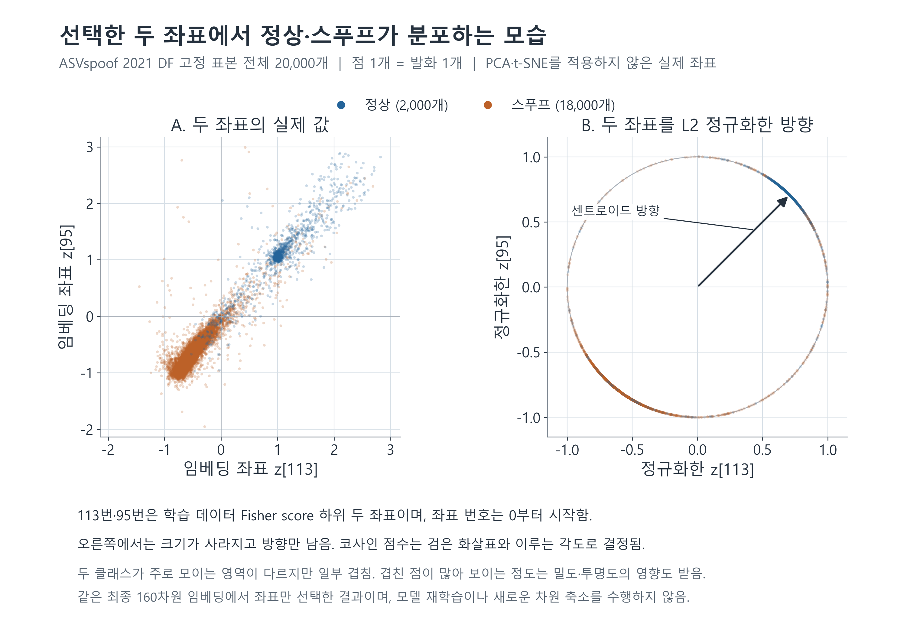
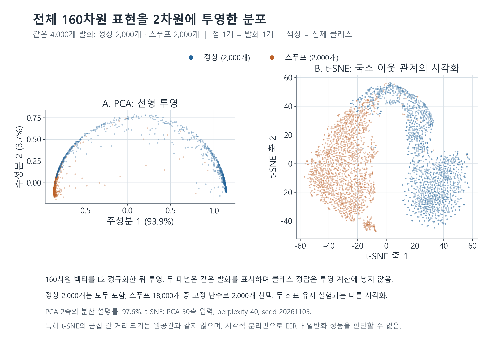

> 역사 문서 보존본. 원문 작성 당시의 상태·계획을 포함한다. 최신 상태와 확정 결과는 experience의 각 실험 README를 우선한다.

# 정상·스푸프 임베딩 분포 그림

> 해석 갱신: 아래 이미지는 기존 DF pilot의 좌표·ROC 또는 투영 그림이다. 새21LA·gate·metric·P3-B/P4 결과를 그린 그림이 아니다. [최신 통합 분석](../../ebm_frozen_all_results_20261105.md)의 전이/내부 진단 구분을 함께 적용한다. 이미지와 표시 표본은 변경하지 않았다.

## 그림 1. 선택한 두 좌표의 실제 분포

ASVspoof 2021 DF eval의 고정 표본 20,000개(정상 2,000개, 스푸프 18,000개)를 모두 표시했다. 왼쪽은 최종 160차원 임베딩에서 113번·95번 좌표를 직접 선택한 실제 값이다. 좌표 번호는 0부터 시작하며, 해당 두 좌표는 ASVspoof 2019 LA train에서 공격별 Fisher score를 평균한 순위의 하위 두 개다. 오른쪽은 이 두 좌표만으로 이루어진 벡터를 L2 정규화한 분포다. 검은 화살표는 동일한 좌표를 선택한 센트로이드의 정규화 방향이다. 오른쪽의 두 클래스는 같은 단위원 위에 있으며, 코사인 점수는 센트로이드와 이루는 각도로 결정된다. 이 그림에는 PCA 또는 t-SNE를 적용하지 않았다. 일부 클래스 겹침이 있으며, 점의 중첩으로부터 정확한 오류율을 읽을 수는 없다.

삽입 위치: 보고서 ‘4.5 선택된 좌표의 실제 값’.

## 그림 2. 전체 160차원 표현의 PCA·t-SNE 투영

같은 DF 고정 표본에서 정상 2,000개 전체와 스푸프 18,000개 중 고정 난수(seed 20261105)로 선택한 2,000개를 표시했다. 두 패널은 동일한 4,000개 발화를 사용한다. 전체 160차원 임베딩을 L2 정규화하고, 같은 4,000개 발화에서 학습한 PCA로 투영했다. t-SNE에는 PCA 50차원 결과를 입력했으며 perplexity 40, seed 20261105, 초기화 PCA, 학습률 auto, 최대 반복 1,000회로 계산했다. 클래스 정답은 표시 표본의 균형을 맞추고 색상을 정하는 데만 사용했고 투영 알고리즘의 입력에는 포함하지 않았다. PCA 축의 괄호는 각 축의 분산 설명률이다.

이 그림은 두 좌표만 남겨 점수를 계산한 실험과 다르며, 전체 160차원 표현을 관찰하기 위한 별도의 시각화다. 특히 t-SNE의 군집 간 거리·크기·빈 공간은 원공간의 전역 구조를 그대로 보존하지 않는다. 그림에서 보이는 분리 정도를 EER, 독립 데이터의 일반화 성능 또는 공식적인 군집 수의 근거로 해석하지 않는다. 보고서의 EER는 기존 20,000개 표본에서 계산한 값이며 이 4,000개 시각화 표본에서 새로 평가한 값이 아니다.

## 후속 실험과 함께 읽는 기준

특정 부분집합의 낮은 EER 점 추정치는 전체 성능 동등성이나 본질적 차원2의 증명이 아니다. 원래160차원 encoder/LN을 계산했고,전체 AUROC와 낮은 정상거부율 구간에서는 전체 표현이 유리했다. 후속 학습 dynamic gate도 두pilot 전이EER의 우월성을 입증하지 못했다.

그림의 투영·겹침은 정량 검정이나 원인 분석을 대체하지 않는다. 특히 원래평가20,000개와균형시각화4,000개,같은발화의여러점수조건을독립표본으로합산하지않는다. PCA 큰분산보존을판별정보보존으로동일시하지않는다.
