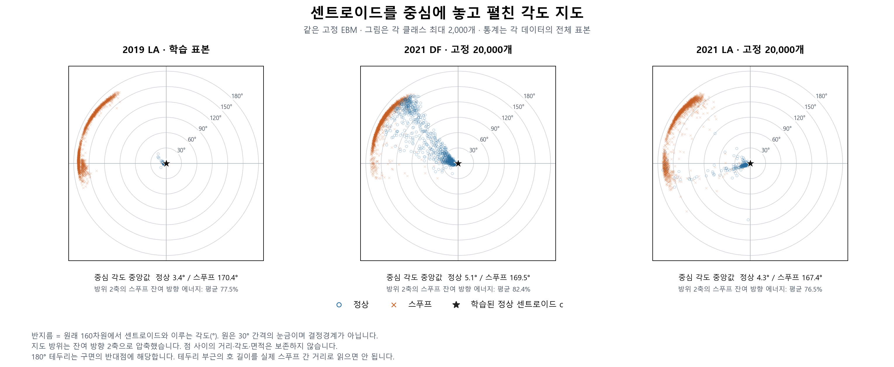
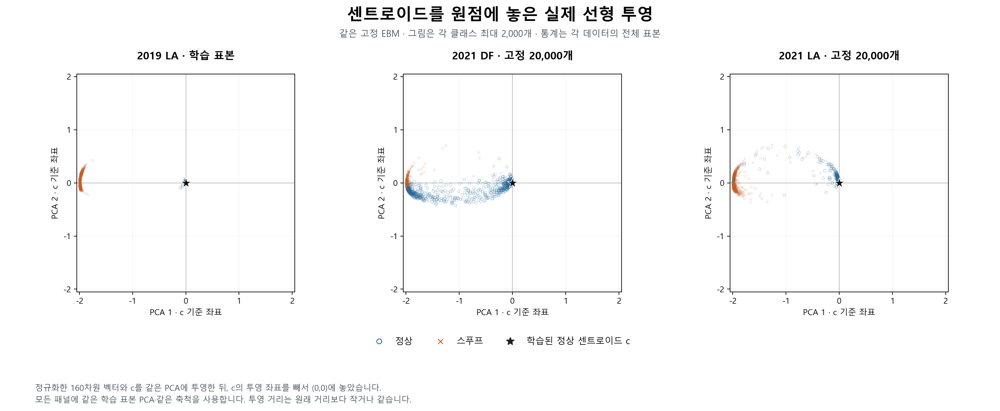
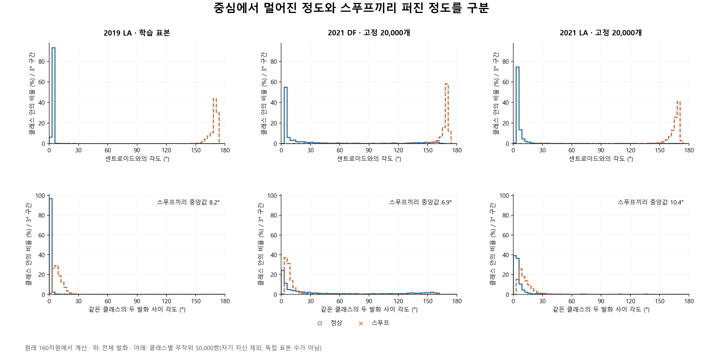
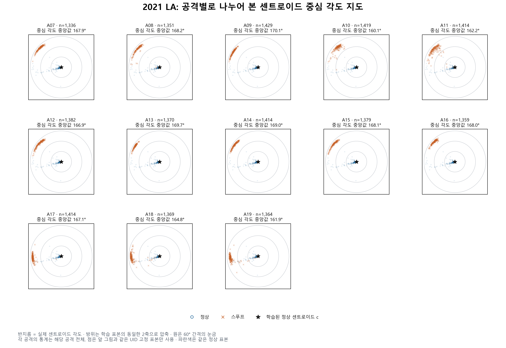
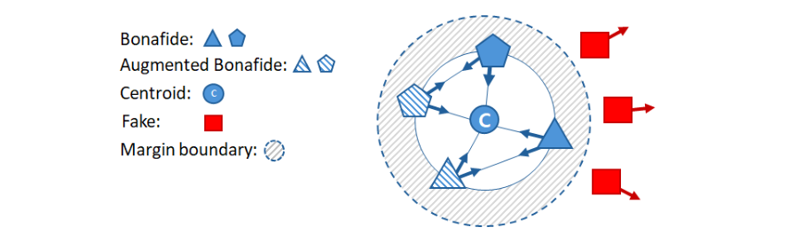

> 역사 문서 보존본. 원문 작성 당시의 상태·계획을 포함한다. 최신 상태와 확정 결과는 experience의 각 실험 README를 우선한다.

# 센트로이드를 중심에 둔 EBM 분포 시각화

2026-11-05 KST. 사용자가 요청한 센트로이드 중심 2차원 그림과 스푸프 분포의 기하 분석이다. 기존 고정 모델의 로컬 파생 캐시만 사용했다. 새 학습·원음 재추론·GPU 계산·Q 데이터 분석은 없다.

## 관찰

이 체크포인트와 고정 표본에서 스푸프 대부분은 정상 센트로이드의 거의 반대 방향에 응집했다. 중심에서 멀어진 정도와 스푸프끼리 퍼진 정도는 서로 달랐다. 2차원 그림에만 의존하지 않고 원래 160차원에서 확인했다.

| 표본 | 정상–c 각도 중앙값 | 스푸프–c 각도 중앙값 | 스푸프 쌍 각도 중앙값 | 전체 스푸프의 서로 다른 모든 쌍 평균 코사인 |
|---|---:|---:|---:|---:|
| 2019 LA T | 3.3854° | 170.3593° | 8.1896° | 0.982500 |
| 2021 DF pilot | 5.0595° | 169.4774° | 6.8988° | 0.964855 |
| 2021 LA pilot | 4.2728° | 167.4276° | 10.3799° | 0.942174 |

스푸프 쌍 각도는 클래스마다 자기 자신을 제외하고 뽑은 50,000쌍의 기술 통계다. 발화가 반복될 수 있으므로 50,000개의 독립 표본이나 신뢰구간으로 해석하지 않는다. 모든 쌍의 평균 코사인은 표본 추출 없이 전체 스푸프에서 정확히 계산했다.

스푸프–c 각도의 5–95백분위는 DF 159.4913–171.3723°, 21LA 152.5429–170.6784°다. 일부 예외가 있으므로 모든 스푸프가 한 점에 겹치거나 공격 정보가 사라졌다는 뜻은 아니다.

DF 정상의 15.8%는 c와의 각도가 90°보다 크다. 정상 중앙값만으로 이 긴 꼬리를 표현할 수 없으며, 이를 그림에 그대로 표시했다. 21LA 정상의 해당 비율은 0.8%다. 90°는 이번 분석의 기술적 구분이며 배포 결정 문턱값이 아니다.

## 그림

### 센트로이드 각도를 보존한 중심 지도

별표는 학습된 정상 센트로이드 c다. 반지름은 원래 공간의 c와의 각도이며 원은 30° 간격의 눈금이다. 결정경계가 아니다. 실제 데이터 점을 임의의 방위로 배치하거나 고르게 흩뜨리지 않았다.

지도 방위는 학습 표본의 잔여 방향 두 축으로 압축했다. 따라서 점 사이 거리·각도·면적은 보존하지 않는다. 특히 180° 테두리 전체가 구면의 반대점에 대응하므로, 테두리 부근의 긴 호를 원래 공간의 넓은 분포로 해석하지 않는다. 지도 반지름이 같아도 발화 간 거리가 같다는 뜻은 아니다.

### 같은 센트로이드를 원점에 둔 선형 PCA 투영

정규화한 임베딩 x와 c를 동일한 PCA로 투영하고 c의 투영 좌표를 뺐다. 즉 (x−c)Pᵀ다. 세 패널의 축·축척이 같다. PCA는 T에서만 fit했고 설명 분산은 99.1449%+0.4175%다. 이것은 해당 학습 표본의 분산이며 평가 표본에서의 정보 보존율이 아니다. 투영 거리는 원래 정규화 공간 거리보다 작거나 같다.

### 원래 공간에서의 각도 분포

위는 전체 발화의 c와의 각도, 아래는 같은 클래스의 무작위 발화 쌍 각도다. 정상과 스푸프를 각각 100%로 정규화했다. 각 행은 패널 사이에 같은 축척을 사용한다.

### 21LA 공격별 지도

13개 공격을 나누어 보아도 대부분 비슷한 바깥 영역에 있다. A17 등은 압축된 방위에서 다른 위치에 나타난다. 공격 간 차이가 없다는 결론이나, 이 2차원 방위에서 공격별 군집이 완전히 분리된다는 결론은 내리지 않는다. 점은 앞 그림과 같은 고정 표본의 부분집합이다. 패널 n과 각도 통계는 해당 공격 전체 기준이다.

## 표본과 방법

- T: 25,380개, 정상 2,580·스푸프 22,800.
- DF pilot: 기존 고정 20,000개, 정상 2,000·스푸프 18,000.
- 21LA pilot: 기존 manifest로 고정한 20,000개, 정상 2,000·스푸프 18,000. 148,176개 전체 캐시에서 UID·label·manifest SHA256을 확인하여 선택했다.
- 그림: 표본별 정상·스푸프 최대 2,000개씩. UID 해시로 선정했으며 점수·각도·모양을 보고 고르지 않았다. 전체 통계와 그림 표본을 구별한다.
- 체크포인트 SHA256: `104873703a57cad98b686d770e0860e031a2cf9abef79b72668780c1660e0b24`.
- c는 기존 학습된 고정 정상 센트로이드이며 평가 데이터의 경험적 평균이 아니다.
- 두 평가셋은 공유 화자가 있으므로 독립된 반복 재현 두 번으로 세지 않는다. 하나의 체크포인트·기존 관찰 pilot에 대한 탐색적 기술 분석이다.

x = z/||z||, s = x·c, θ = arccos(s), u = (x−sc)/||x−sc||로 정의했다. c도 단위 벡터다. T에서 UID 해시로 정상·스푸프 각 2,500개를 선택했다. u의 비중심 SVD 상위 두 축 e₁,e₂로 방위를 φ=atan2(u·e₂,u·e₁)로 정의하고 (θcosφ, θsinφ)를 그렸다. 같은 축을 모든 평가셋에 고정 적용했다. 임의 회전의 부호는 각 축의 절댓값 최대 계수를 양수로 맞춰 고정했다.

이 두 축의 스푸프 잔여 방향 제곱 투영 길이의 평균은 T 77.49%, DF 82.38%, 21LA 76.53%다. 이는 개별 u의 에너지 중 2축에 남은 비율이며 분류 정보 보존율이나 밀도 보존율이 아니다. 방향 유효성 기준은 tangent norm≥1e−4이고 이번 세 표본에서 탈락은 0개다.

모든 서로 다른 발화 쌍 평균 코사인은 R=||mean(x)||일 때 (nR²−1)/(n−1)로 계산했다. 작은 블록의 명시적 Gram 행렬로 이 닫힌식을 독립 대조했다. R은 T 스푸프 0.99121, DF 0.98227, 21LA 0.97066이다. 고르게 퍼진 전체 구면 분포보다 한 방향에 강하게 응집한 관찰과 일치하지만 균일성의 정식 가설검정이나 모집단 추론을 수행한 것은 아니다.

## 선행 그림과의 구분

[EBM 원 논문, Interspeech 2025](https://www.isca-archive.org/interspeech_2025/kim25g_interspeech.pdf) Fig. 1은 센트로이드와 최적화 방향을 설명하는 개념도다. 아래 원그림은 공개 논문 PDF에서 추출한 것으로 이번 실험의 실제 점 분포가 아니다.

[EBM 확장 논문, IEEE Access 2026](https://doi.org/10.1109/ACCESS.2026.3680160) Fig. 5에는 2021 DF t-SNE 실측 비교가 있다. 이번의 센트로이드 중심 반지름 보존 지도와는 다른 시각화다.

## 검증과 보관

새 코드: `artifacts/geometry_experiments/centroid_centered_maps.py`. 결과: `artifacts/geometry_cache/visualizations/centroid_centered_20261105_v2/`의 `statistics.json`, `group_statistics.csv`, `plotted_points.parquet`, `fixed_axes.npz`, `verification.json`. 그림은 PNG와 SVG로 보관했다. `--redraw-maps`는 저장된 동일 점으로 두 지도만 다시 렌더링한다.

입력 파일 SHA256, 원래 점수 대응, manifest 행 대응, 센트로이드 일치, tangent 직교성, 고정 축 정규직교성, 원래 거리와 코사인의 항등식, 지도 반지름 보존, 선형 투영 거리 축소, 모든 쌍 평균의 독립 대조를 통과했다. 저장된 그림 점에서도 반지름과 θ 대응을 다시 확인했다. 모든 그림을 화면으로 검수했고 선형 그림의 라벨 겹침을 수정한 뒤 재검수했다.

초기 v1은 T에 없는 조건 열을 일괄 참조해 그림 생성 전에 중단됐다. 없는 열을 임의로 채우지 않고 해당 조건별 분석을 건너뛴 v2로 완료했다. 원래 입력과 다른 실험 결과는 변경하지 않았다.

20:41 KST 읽기 전용 서버 확인에서 R1은 exit0, R23 추출은 기존 컨테이너에서 진행 중이었다. 배정 GPU6/7은 각 1,810MiB였다. 해당 실행을 변경하지 않았고 이번 계산은 로컬 CPU에서만 수행했다.
