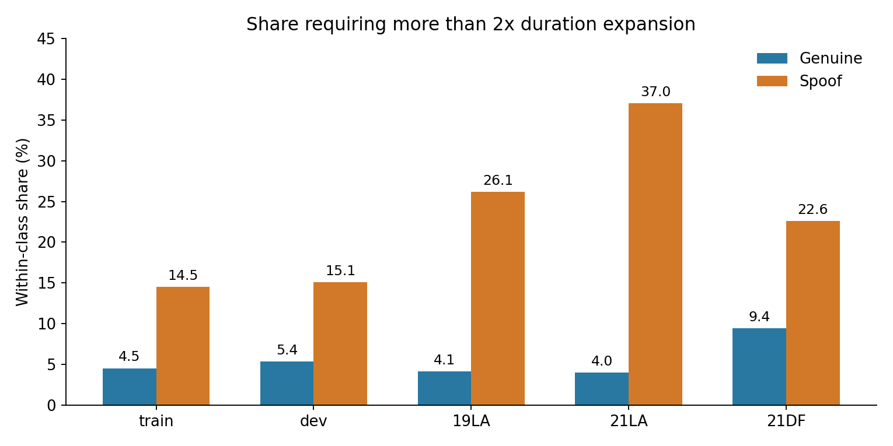
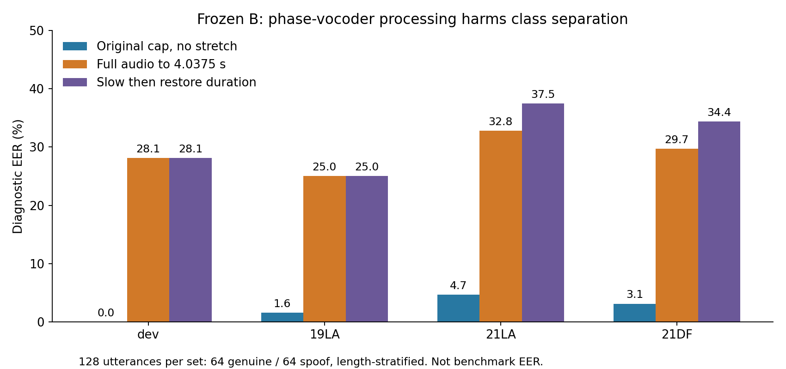
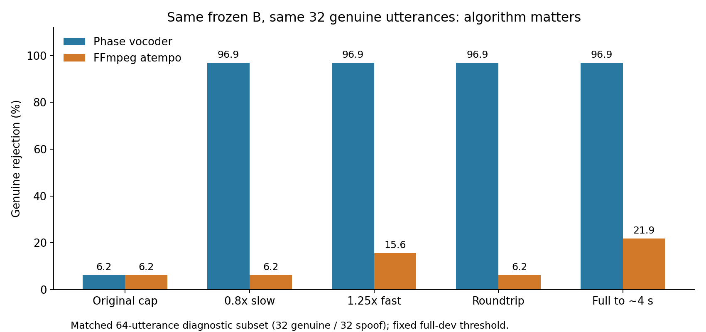

> 역사 문서 보존본. 원문 작성 당시의 상태·계획을 포함한다. 최신 상태와 확정 결과는 experience의 각 실험 README를 우선한다.

# B/C 전체 체크포인트 평가 실행

사용자가 C 학습 완료 후 평가 시작을 요청했고, 최종 50epoch뿐 아니라 모든 저장 체크포인트로 범위를 확대했다. B와 C 각각 5·10·15·20·25·30·35·40·45·50epoch, 총20개 모델을 같은 입력에서 평가한다. 기존 B8 평가와 별도 B/C50 평가는 이 한 실행으로 대체한다.

2026-11-09 11:22:34 KST 기존 컨테이너의 screen352153.exp:0에서 한 번 시작했다. CUDA_VISIBLE_DEVICES=0,1을 유지하며 서버 소스·브랜치·학습 결과를 변경하지 않았다. 11:23:37 확인에서 GPU 검증 exit0, 본 평가 부모와 두 rank 생존, dev 양 rank 첫8행 기록, GPU6/7 2568MiB씩·사용률51/52%, 오류 없음이다. 아직 평가 결과는 완성되지 않았다.

- 서버 실행 루트: `/home/mentee/analysis/ebm_B_C_checkpoints_20261109`
- [상태](../../artifacts/ebm_B_C_checkpoints_20261109/state.json), [최신 관측](../../artifacts/ebm_B_C_checkpoints_20261109/last_check.json), [출처·모델 해시](../../artifacts/ebm_B_C_checkpoints_20261109/provenance.json)
- [평가 코드](../../../../../tools/evaluate_B_C_checkpoints.py), [준비·실행 기록](../../../workspace/artifacts/ebm_B_C_checkpoints_20261109/prepare_and_launch.py), [읽기 전용 점검](../../../workspace/artifacts/ebm_B_C_checkpoints_20261109/check_evaluation.py)

dev24,844·19LA71,237·21LA148,176·21DF533,928, 총778,185개 입력을 사용한다. 각 GPU에서 frozen XLS-R 출력을 메모리에서만 재사용하고20개 head를 순차 계산한다. 서로 다른 GPU 작업20개를 동시에 띄운 것이 아니다. 앞64,600samples 상한·비반복·0패딩 및mask·GPU당batch8·pooling noise1e-5와 동일 GPU RNG를 유지한다. 원음·SSL hidden·checkpoint는 로컬로 가져오지 않는다.

전체20개 모델의 CLS와 TrainState SHA, strict load와 classifier tensor 일치, 각epoch×108 Adam step, B cap_long=True/C=False를 양 GPU에서 확인했다. 배치/단독 score 최대오차7.16e-7 미만, built-in forward와 직접 cosine score 오차0, 입력이 기존 EnrollmentSet과 일치했다. Smoke48개 입력에서 B50의 과거 독립평가 점수를 양 rank 모두 오차0으로 재현했다. CPU에서는20개 score column의 두 rank 병합·UID coverage·완전분리/역분리 EER0/100·dev threshold 재사용을 검증했다.

본 평가가 끝나면 모델별·집합별 EER, dev에서 정한 임계값의 정상 거부율과 spoof 통과율을 metrics.json에 저장한다. checkpoint_scores_{phase}.parquet, score CSV, done 파일 SHA와 UID·label·길이 분모를 검산해야 최종 보고할 수 있다. Target EER로 최종 checkpoint를 선택하지 않는다. 고정50 B/C 비교도 같은 결과에서 추출할 수 있다.

기존 ebm-c-30-b 정기 예약은 PAUSED 그대로다. 현재 평가 프로세스는 기존 screen에서 끝까지 실행되며, 정기 예약을 재활성화하지 않았다. 추가 재학습, 속도 변환 또는 NAP 실험은 실행하지 않았다. launch.claim이나 run.exit가 있으면 재실행하지 말고 현재 로그·진행·종료코드를 먼저 확인한다.

## 완료된 dev 중간 비교

완료된 dev 두 rank의 파생 score CSV만 읽어 분석했다. SHA·전체24,844 UID/index·정상2,548/spoof22,296·20개 score 유한값을 확인했다. 모든 EER를 독립 정렬/동점 그룹 ROC로 검산했고 B50은 보존된 이전 독립 dev 평가의 모든 점수를 오차0으로 재현했다. Target 점수는 이 분석에 사용하지 않았다.

| Epoch | B EER(%) | C EER(%) |
|---|---:|---:|
| 5 | 0.103158 | 0.156979 |
| 10 | 0.039246 | 0.040366 |
| 15 | 0.039246 | 0.039246 |
| 20 | 0.039246 | 0.039246 |
| 25 | 0.039246 | 0.039246 |
| 30 | 0.039246 | 0.039246 |
| 35 | 0.039246 | 0.039246 |
| 40 | 0.039246 | 0.039246 |
| 45 | 0.039246 | 0.039246 |
| 50 | 0.039246 | 0.039246 |

15~50epoch의 EER는 B/C 모두0.03924646781789942%다. B는10epoch에이값에도달했고C는15epoch에도달했다. Dev EER만으로15~50epoch의우열을가릴수없으며target기준최저epoch선택을하지않는다.

각모델의dev 근사EER 운영점에서50epoch 정상거부는둘다1/2548=0.0392465%,spoof통과는9/22296=0.0403660%다. EER는ROC보간값으로이두실제오류율과구별한다. 공통실패정상은LA_D_6451106,원길이1.711125초다. 두모델모두원길이2초미만정상127개중이1개를거부해0.787402%이고,다른길이구간의정상거부는0이다. 통과한spoof9개중공통3개·각모델에서만틀린6개로,같은EER가같은판정을뜻하지않는다.

50epoch AUROC는 B0.9999933814711609/C0.9999846682483543이다. 독립rank검산에서역전된정상-spoof쌍은B376/C871이며각각동일한정상1개만기여한다. 이극소차이를C의보편적성능악화로해석하지않는다. 정상score 하위1%는B0.991377/C0.984590,spoof상위1%는B-0.922097/C-0.916343이다. 두모델의score분포가같지는않지만dev에서C의개선근거는없다.

고정dev spoof통과예산0.1%와1%의기술적민감도비교에서도둘다정상1개거부였으며,각각spoof22/222개통과로같았다. 같은dev에서운영점을정하고평가한기술통계이며독립target성능의증거가아니다.

[분석 수치](../../artifacts/ebm_B_C_checkpoints_20261109/dev_analysis/analysis.json), [epoch 요약](../../artifacts/ebm_B_C_checkpoints_20261109/dev_analysis/epoch_summary.csv), [검산](../../artifacts/ebm_B_C_checkpoints_20261109/dev_analysis/validation.json), [재현 코드](../../../workspace/artifacts/ebm_B_C_checkpoints_20261109/analyze_dev.py).

## 완료된19LA·21LA의 기존/B/C 중간 비교

19LA71,237개(정상7,355/spoof63,882),21LA148,176개(정상14,816/spoof133,360)의완료CSV만읽어CPU분석했다. DF는이비교에사용하지않았고진행중평가를변경하지않았다. 기존모델은보존된동일B입력고정50평가점수를재사용했다. 각UID/index/speaker/label/입력길이/attack이현재결과와정확히같고B50모든점수도오차0으로재현되어참조를연결했다. 전21모델×두집합EER를별도정렬/동점그룹ROC로검산했다.

| 고정50 모델·조건 | 19LA EER(%) | 21LA EER(%) |
|---|---:|---:|
| 기존·공통비반복입력 | 1.128484 | 6.688715 |
| B·공통비반복입력 | 0.679810 | 4.792117 |
| C·공통비반복입력 | 0.584636 | 5.163467 |
| 기존·과거반복입력파이프라인 | 0.571040 | 1.052789 |

공통입력에서B/C는기존보다두LA집합의EER가낮다. 그러나원래기존파이프라인의과거반복평가와비교하면둘다낮지않다. 이조건차이를학습효과로혼동하지않는다. BvsC에서는C의19LA EER가0.095173pp(상대14%)낮지만21LA는0.371351pp(상대7.7492%)높다. C의Long상한해제가LA전반에개선된다는결론은지지되지않는다. 단일seed/모델쌍의점추정이며불확실성구간을계산하지않았으므로통계적유의성을주장하지않는다.

| Epoch | 19LA B | 19LA C | 21LA B | 21LA C |
|---|---:|---:|---:|---:|
| 5 | 1.278042 | 1.438590 | 6.884449 | 7.134179 |
| 10 | 1.022197 | 1.278042 | 5.987552 | 6.418737 |
| 15 | 0.756082 | 0.707002 | 5.365821 | 5.602052 |
| 20 | 0.494662 | 0.795216 | 4.792117 | 5.707109 |
| 25 | 0.788579 | 0.652617 | 5.009748 | 5.248950 |
| 30 | 0.720598 | 0.639021 | 4.052939 | 4.622076 |
| 35 | 0.734194 | 0.652617 | 4.706809 | 5.095842 |
| 40 | 0.738862 | 0.488400 | 4.850030 | 4.866361 |
| 45 | 0.462271 | 0.720598 | 3.759449 | 4.785367 |
| 50 | 0.679810 | 0.584636 | 4.792117 | 5.163467 |

21LA는동일epoch의10개비교모두C가B보다높다. 19LA는C가6개epoch에서낮고4개에서높다. 체크포인트는상관된관측이며10개의독립실험으로취급하지않는다. Dev15~50EER가동일했던사실은target일반화성능동일성을보장하지않는다. Target최저epoch를최종모델로선택하지않는다.

각모델의dev임계값을고정한운영점오류:

| 집합 | 모델 | 정상거부 수/분모 (%) | spoof통과 수/분모 (%) |
|---|---|---:|---:|
| 19LA | legacy240 | 61/7355 (0.8294) | 6297/63882 (9.8572) |
| 19LA | B_e50 | 1/7355 (0.0136) | 5663/63882 (8.8648) |
| 19LA | C_e50 | 1/7355 (0.0136) | 5427/63882 (8.4954) |
| 21LA | legacy240 | 706/14816 (4.7651) | 12925/133360 (9.6918) |
| 21LA | B_e50 | 725/14816 (4.8934) | 6319/133360 (4.7383) |
| 21LA | C_e50 | 935/14816 (6.3107) | 6139/133360 (4.6033) |

C는19LA정상거부1개를유지하면서spoof통과를236개줄였다. 21LA에서는spoof통과180개감소와정상거부210개증가가함께발생했다. 정상오류의순증210개는B에서만실패25개/C에서만실패235개의차이다. 21LA정상거부증가는길이구간별11·86·83·30개로모든구간에서발생했다.

원길이2초미만정상거부는19LA 기존0/265,B1/265,C1/265이며,21LA 기존27/507(5.3254%),B67/507(13.2150%),C78/507(15.3846%)다. 이는각모델별dev운영점오류이고targetEER와다르다. C가아주짧은정상문제를해결했다는근거는이두LA집합에서없다. 기존운영점의낮은정상거부율에는훨씬높은짧은spoof통과율이동반되어단일오류율만으로우열을판단하지않는다.

[전체 수치](../../artifacts/ebm_B_C_checkpoints_20261109/LA_analysis/analysis.json), [epoch별 요약](../../artifacts/ebm_B_C_checkpoints_20261109/LA_analysis/epoch_summary.csv), [길이별 요약](../../artifacts/ebm_B_C_checkpoints_20261109/LA_analysis/length_summary.csv), [검산](../../artifacts/ebm_B_C_checkpoints_20261109/LA_analysis/validation.json), [재현 코드](../../../workspace/artifacts/ebm_B_C_checkpoints_20261109/analyze_completed_LA.py).

## 사용자 요청: 데이터셋별 기록된 최저 EER 비교

고정50 비교에추가하여,각집합에서기록된체크포인트중최저EER와epoch를사후요약한다. 하나의공통checkpoint에서얻은세집합성능이아니며,배포할모델을이값으로확정한것은아니다. 기존240은15~50epoch의과거반복입력기록, B/C는5~50epoch의비반복공통입력기록이다.

| 집합 | 논문2025 보고값 | 기존240 최저(epoch) | B 최저(epoch) | C 최저(epoch) |
|---|---:|---:|---:|---:|
| 19LA | 0.26 | 0.217539 (25) | 0.462271 (45) | 0.488400 (40) |
| 21LA | 1.21 | 1.052789 (50) | 3.759449 (45) | 4.622076 (30) |
| 21DF | 1.89 | 2.396259 (15) | 평가중 | 평가중 |

모든수치는EER(%)다. B50의기존DF수치2.723788%는확인돼있지만전체체크포인트최저값이아니므로이표의최저값칸에대입하지않았다. 논문은150epoch/batch30으로우리50epoch/batch240과다르다.

## 2026-11-09 20:51 KST completion check

Read-only server check confirmed run.exit=0 and finished time 20:11:34 KST. All 20 checkpoints completed dev/19LA/21LA/21DF (778,185 inputs). Both DF done markers exist; complete.json was emitted after score hashes, counts, UID uniqueness, missing values, and used length checks. Evaluation processes exited; GPU6/7 each 6MiB, 0% utilization. Final server metrics.json retrieved; independent DF score revalidation and detailed analysis remain pending. Automation remains PAUSED.

| Dataset | B minimum EER% (epoch) | C minimum EER% (epoch) |
|---|---:|---:|
| 19LA | 0.462271 (45) | 0.488400 (40) |
| 21LA | 3.759449 (45) | 4.622076 (30) |
| 21DF | 2.084875 (5) | 2.152549 (5) |

## 속도·길이 정규화 및 속도 일관성 학습의 타당성 점검 — 2026-11-09

검토 결론: 완만한 속도 변형에 대한 판정 일관성은 검증할 가치가 있다. 그러나 전 음성을 무제한 배율로 4.0375초에 맞추고 바로 speed-BPL을 적용하는 설계는 보류한다. 길이와 발화속도는 다르고, 정확히 같은 길이로 다시 정규화한 두 전역속도 view는 속도차이가 상쇄된다. 현재 frozen 모델 진단에서는 phase-vocoder가 정상까지 spoof 방향으로 크게 이동시켰다. 이는 재학습 불가능의 증거가 아니라 전처리·손실을 분리해야 한다는 근거다. 후속 FFmpeg atempo 검사에서는 같은 표본의 완만한 감속이 훨씬 덜 해로웠다. 따라서 phase-vocoder 실패를 속도 변형 자체의 실패로 일반화하지 않는다.

### 길이를 맞추는 배율과 말하기 속도는 다르다

목표 T=64600/16000=4.0375초(4.04초와 2.5ms 차이), 원길이 d일 때 librosa speed-rate r=d/T이다. r<1이면 감속, r>1이면 가속한다. 최종 음절/초는 음절 수/T이므로 서로 다른 발화의 말하기 속도를 같게 만든 것은 아니다. 긴 내용과 무음까지 함께 압축·확장한다. 동일 내용 x에 서로 다른 전역 rate를 적용하고 모두 T로 재정규화하면 이상적인 시간변환의 최종 rate는 d/T로 동일해진다. 남는 파형 차이는 처리 이력의 비가역 DSP 효과일 수 있다.

전체 내용 보존·서로 다른 전역 속도·정확한 동일 길이를 동시에 만족시킬 수 없다. 속도 불변성 실험에서는 길이가 다른 view를 개별 처리/마스크로 받거나, 정확한 동일 길이가 필수라면 평균 속도를 유지하는 국소 time warp를 별도 가설로 정의해야 한다. 후자는 구간 접합 artifact를 다시 통제해야 한다.

### 실제 필요한 배율의 클래스·도메인 차이

| 집합·class | 배율 중앙값 | 5–95% | rate<0.5 비율 |
|---|---:|---:|---:|
| train 정상 | 0.802 | 0.507–1.278 | 4.53% |
| train spoof | 0.792 | 0.387–1.529 | 14.54% |
| 19LA 정상 | 0.792 | 0.507–1.329 | 4.13% |
| 19LA spoof | 0.682 | 0.307–1.507 | 26.15% |
| 21LA 정상 | 0.798 | 0.515–1.308 | 4.02% |
| 21LA spoof | 0.580 | 0.285–1.268 | 37.05% |
| 21DF 정상 | 0.824 | 0.420–1.409 | 9.41% |
| 21DF spoof | 0.713 | 0.339–1.252 | 22.63% |

전체 고유 발화 metadata 전수 계산이며 sampler 노출 가중은 하지 않았다. 학습 정상 2,580개·spoof22,800개와 전체 dev/target의 UID·분모·cache SHA를 확인했고 학습 sample 합은 별도의 C input audit와 일치했다. rate<0.5는 원래2.01875초 미만을 두 배 넘게 늘리는 경우다. DF spoof 전체 범위는0.099–7.260배로, 약0.4초를10.1배 늘리거나29.312초를7.26배 빠르게 해야 하는 극단도 있다. 길이 상관이 변환 배율·artifact 강도 상관으로 옮겨갈 수 있다.

### 본문까지 확인한 선행연구

| 연구 | 본문에서 확인한 방법 | 우리 설계와 다른 점·해석 한계 |
|---|---|---|
| [Wojcicki, IEEE Access2026](https://doi.org/10.1109/ACCESS.2026.3682478), III-C·IV-E | phase-vocoder로1초 길이 통일, CNN/RNN/Transformer ensemble | 고정길이 전처리의 선행. LJSpeech/WaveFake; EBM 속도쌍 손실이나 ASV21 검증 아님. 전체 EER0.22%를 stretch 단독 효과로 인용하지 않음 |
| [CLAD](https://arxiv.org/pdf/2404.15854) | 같은 음성의 manipulation views를 MoCo positive로 연결, time stretch 포함 | 입력은64600샘플 repeat/clip. 출력길이 배율0.9·0.95·1.05·1.1, FFT128. mild 변형이며 모든 원길이→고정길이 정규화 아님. 정상끼리 all-pairs EBM BPL과도 다름 |
| [DeePen v3](https://arxiv.org/html/2502.20427v3), TableI·II | 정상·spoof 모두 librosa rate0.8–1.2 검사 | W2V2 정상 정확도 ASV19 100→3%, MLAAD93→2%; spoof는99→99%,87→100%. 변환에 따른 정상 오인의 직접 선행이며 EER가 아님 |
| [ParallelChain2024](https://www.isca-archive.org/asvspoof_2024/tran24_asvspoof.pdf), 2.1.3–4 | resampling speed0.9–1.1 증강, 긴 음성의 여러4초 crop 점수 평균 | pitch도 변하는 방식이고 여러 증강 묶음이라 speed 단독 효과 아님 |
| [Schäfer et al., EUSIPCO2025](https://eurasip.org/Proceedings/Eusipco/Eusipco2025/pdfs/0000586.pdf), TableII | spoof-only pitch-preserving stretch 공격 | SSL ITW EER0.73→1.78/2.17%(minimum-rate0.8/0.6). 정상도 같은 변형을 받는 우리 전처리와 다름 |

CLAD는 stretch한 spoof가 더 잘 잡히는 현상의 원인 후보로 FFT/iFFT artifact를 제시한다. spoof 탐지율 개선만으로 불변성을 인정하면 안 된다. CLAD의 length loss는 embedding norm이며 음성 길이 정규화 손실이 아니다. 위 연구들로 정확히 같은 제안 전체의 효과나 신규성이 입증되는 것은 아니다. 배율 정의(출력길이 비율 vs speed-rate)를 혼용하지 않았다.

### 재학습 없이 수행한 512개 진단

기존240/B/C 모두50epoch로 고정했다. dev·19LA·21LA·21DF 각각 정상64/spoof64, 사전 길이4구간×각16개를 metadata UID hash/화자 round-robin으로 선택했다. 각 class의 최단·최장 sentinel도 결과를 보기 전에 포함했다. 입력512개×6조건×3모델=9,216개 점수이며 모델·원음·SSL hidden은 밖으로 내보내지 않았다. 기존 컨테이너/CUDA_VISIBLE_DEVICES=0,1에서 smoke와 본실행 모두 exit0, 본실행 GPU rank별256개 완료. pooling noise는 진단용0으로 고정했다.

조건은 (1)앞64600 cap·비반복 (2)원길이 (3)동일 cap 내용을0.8배 감속 (4)동일 cap 내용을1.25배 가속 (5)전체 원음을4.0375초로 정규화 (6)cap 내용을0.8배 감속한 뒤 원래 길이로 되돌리기다. librosa0.11.0, phase-vocoder FFT2048/hop512이며 길이 보정을 위한 추가 crop/pad는 하지 않고 출력 길이를 검증했다. rate1은 정확한 copy다. Roundtrip은 길이를 복원하지만 DSP 손실까지 원복하는 대조군은 아니다.

**다음 EER는 각 집합128개 균형·길이층화 표본의 탐색적 진단치다. 앞의 전체 benchmark EER와 직접 비교하지 않는다.** 단일 class 오류1개의 해상도는1.5625%p이며 이 표로 체크포인트·배율을 선택하지 않았다.

| 집합 | 모델 | 비반복 cap | 원길이 | 0.8배 | 1.25배 | 전체→4.0375초 | 감속→길이 복원 |
|---|---|---:|---:|---:|---:|---:|---:|
| dev | legacy240 | 0.0000 | 1.5625 | 25.0000 | 28.1250 | 21.8750 | 35.9375 |
| dev | B | 0.0000 | 0.0000 | 25.0000 | 35.9375 | 28.1250 | 28.1250 |
| dev | C | 0.0000 | 0.0000 | 23.4375 | 31.2500 | 26.5625 | 26.5625 |
| 19LA | legacy240 | 3.1250 | 3.1250 | 28.1250 | 34.3750 | 21.8750 | 39.0625 |
| 19LA | B | 1.5625 | 1.5625 | 23.4375 | 31.2500 | 25.0000 | 25.0000 |
| 19LA | C | 1.5625 | 1.5625 | 23.4375 | 29.6875 | 26.5625 | 31.2500 |
| 21LA | legacy240 | 3.1250 | 4.6875 | 37.5000 | 35.9375 | 32.8125 | 43.7500 |
| 21LA | B | 4.6875 | 4.6875 | 35.9375 | 42.1875 | 32.8125 | 37.5000 |
| 21LA | C | 4.6875 | 4.6875 | 34.3750 | 37.5000 | 32.8125 | 32.8125 |
| 21DF | legacy240 | 7.8125 | 10.9375 | 31.2500 | 35.9375 | 31.2500 | 32.8125 |
| 21DF | B | 3.1250 | 3.1250 | 31.2500 | 35.9375 | 29.6875 | 34.3750 |
| 21DF | C | 4.6875 | 4.6875 | 29.6875 | 35.9375 | 28.1250 | 32.8125 |

B의 전체음성→4.0375초 조건에서 원래 full-dev 임계값을 그대로 적용하면 정상 거부가 dev63/64,19LA64/64,21LA62/64,21DF64/64였다. 원래 길이로 되돌린 roundtrip도 거의 같은 실패를 보였다. EER 자체도 악화돼 단순 임계값 이동만으로 설명되지 않는다. 같은 조건의 dev 표본으로 재보정한 오류도 별도 CSV에 남겼지만 표본이 작아 배포 임계값으로 쓰지 않는다. 현재 결과는 이 phase-vocoder·동결 모델 조합의 실패이며 speed augmentation 재학습이나 다른 알고리즘의 실패를 뜻하지 않는다.

### EBM 목적식과 view 선택

현재 BPL은 정상12개 Long×정상12개 Short의144쌍을 모두 당긴다. 같은 발화쌍은 대각12개이고 나머지132개는 다른 정상 발화다. Long에만 분류 손실이 적용되며 spoof에는 BPL이 없다. 입력을 slow/fast로만 바꾸면 두 class의 같은 발화 속도 일관성을 학습한다는 목적과 다르다. 모든 spoof를 all-pairs로 당기는 것도 여러 공격을 한 군집으로 강제하므로 권하지 않는다.

검토할 목적식은 두 view의 OC 분류 손실 평균 + 같은 발화의 속도 일관성 항 + 기존 정상 all-pairs BPL이다. 각 항을 분리하고 같은 발화 항은 정상·spoof 모두에서 평가한다. 기존 BPL 유지/제거, score 일관성/embedding 일관성은 별도 ablation이다. centroid의 두 번째 업데이트에 어떤 view를 쓸지도 대칭으로 명시해야 한다. 현재 정상:spoof=1:9이므로 same-utterance 항을 전체 발화에 단순 평균하면 spoof가 지배할 수 있다. 두 class의 일관성 손실을 따로 평균하고 가중치를 명시하는 비교도 필요하다. 강한 embedding 일치는 탐지에 유효한 시간 단서까지 지울 수 있으므로 처음에는 score 일관성과 class margin 보존부터 확인한다.

기본 후보는 원본 anchor를 포함한 완만한 양방향 변형이다. 원본–slow만 쓰면 긴 음성 정규화에 필요한 fast를 다루지 못하고, slow–fast만 쓰면 두 view가 공유하는 DSP 흔적에 과적합할 수 있다. 원본–slow/원본–fast/slow–fast를 같은 perturbation budget·손실 수·원음으로 비교한다. 예로0.8/1.25는 log-rate 대칭이지만 안전성이 보장된 값은 아니며 현재 phase-vocoder 진단에서는 모두 실패했다. extreme rate까지 불변성을 한 번에 강제하지 않는다.

### 다음 실험과 성공·중단 기준

| 단계 | 비교 | 성공으로 볼 결과 | 해석·중단 조건 |
|---|---|---|---|
| 전처리 진단 | 원본/완만한 slow·fast/roundtrip, 두 알고리즘 | 정상 보존과 spoof 분리가 함께 유지, 변환 강도별 오류 급증 없음 | spoof만 잘 잡히고 정상까지 spoof로 밀리면 전처리 재설계 |
| 학습 ablation | B control / mild augmentation만 / same-utterance consistency추가 / duration-normalization만 | consistency의 추가 이득이 clean·robustness 모두에서 재현 | 전체 표현 collapse나 clean EER 악화로 민감도만 줄면 실패 |
| view ablation | original–slow / original–fast / slow–fast / original anchor+양방향 | 같은 비용에서 unseen-rate·unseen-algorithm 일반화가 좋음 | 동일T 재정규화로 두view가 같아지는 설계는 사용하지 않음 |
| 길이 가설 분리 | class별 길이분포 맞춤 / pooling 길이 의존성 변경 / time stretch | native 짧은 정상 오류와 길이조건부 score차이가 줄고 attack별 탐지가 유지 | 길이평균만 같거나 전체 EER만 좋아서는 원인 규명 아님 |
| 최종 검증 | 보지 않은 배율·알고리즘·데이터, 복수seed | clean EER·고정dev임계값의정상거부/spoof수락 모두 허용범위내, 속도 민감도 감소 | 허용 성능 저하량은 평가 전 정해야 하며 수치 근거 없이 임의로 성공 선언하지 않음 |

권장 순서는 전처리 알고리즘 확인 → mild augmentation 단독 → 원본 anchor+same-utterance consistency → 강한 고정길이 정규화의 추가 가치를 분리 검증하는 것이다. 긴 내용을 전부 쓰는 목적에는 여러4초 window의 score 집계가 시간 압축 없이 가능한 경쟁안이다. 짧은 음성에는 원본 길이 입력과 mask/개별처리를 유지하면서 class별 길이 분포를 맞추는 경쟁안이 있다. 고정64600샘플로 압축해도 모든 acoustic 정보가 손실 없이 보존되는 것은 아니며, 현재 XLS-R가 동결돼 강한 변형에서 frontend가 잃은 정보는 backend만으로 복원하기 어렵다.

분석 코드·프로토콜·전체 점수·검산: `artifacts/speed_duration_feasibility_20261109/`. ROC는 독립 동점그룹 누적 방식으로 재계산해 일치했고 UID·분모·6조건 coverage·SHA를 확인했다. 서버 source 전체 hash와 세 checkpoint hash 불변·Git clean을 확인했다. 추가 학습·optimizer 갱신·예약 재활성화는 하지 않았다.

### 다른 변환 방식으로 재검사한 결과

첫 512개 선택 중 phase×class×길이구간마다 metadata 순서의2개씩64개를 재선택했다. 기존 세 모델50epoch·noise0·두GPU·6조건을 유지하고 FFmpeg atempo로만 교체했다. 이미 실행한 phase-vocoder도 정확히 같은64개로 제한해 비교했으며 세 모델의 native-cap 점수는 두 실행 사이 오차0이다. 전체 benchmark가 아니고 정상32/spoof32를 네 집합에 균등 배치한 소표본 진단이다.

| 같은64개에서 B의 입력 | Phase vocoder 정상거부/32 | atempo 정상거부/32 | Phase vocoder spoof수락/32 | atempo spoof수락/32 |
|---|---:|---:|---:|---:|
| Original cap | 2 | 2 | 1 | 1 |
| 0.8x slow | 31 | 2 | 1 | 0 |
| 1.25x fast | 31 | 5 | 0 | 0 |
| Roundtrip | 31 | 2 | 0 | 0 |
| Full to ~4 s | 31 | 7 | 1 | 3 |

이 소표본에서 atempo0.8배 감속과 roundtrip은 원본 대비 추가 정상거부가 없었다. 반면 phase-vocoder는 거의 모두 spoof 방향으로 이동했다. 따라서 변환 알고리즘이 핵심 변수이며, '속도는 무관하니 어떠한 time-stretch도 안전하다'는 전제는 성립하지 않는다. atempo1.25배에서는 정상거부3개 증가, 전체→약4초에서는5개 증가했고 spoof수락도1→3개로 늘었다. 완만한 양방향 증강을 검증할 근거는 남지만 모든 길이를 강하게 정규화하는 안이 지지된 것은 아니다.

atempo는 출력 길이를 정확히 보장하지 않는다. 길이보정 crop/pad를 하지 않았으며 norm_full4의 실제 길이는3.4331875–4.061875초, 최대 오차0.6043125초였다. 따라서 이 실행은 정확4.0375초 정규화의 동등 재현이 아니라 알고리즘 민감도를 확인하는 근사 대조군이다. 샘플 당 극단 rate와 작은 정상 분모 때문에 전체 성능/통계적 유의성을 주장하지 않는다. 원본과 모두 같은 길이로 두 global-speed view를 만들 수 없다는 수학적 제약도 여전히 남는다.

현 단계 권고: **정확4초 전처리와 속도 불변 학습을 분리하고, 원본 anchor와 완만한 양방향 속도 일관성부터 실험한다.** 우선 더 큰 dev 표본에서 atempo류·고품질 pitch-preserving 알고리즘을 비교하고 정상 margin과 spoof margin을 함께 확인한다. augmentation 단독 대비 consistency 추가 이득, clean 성능 유지, unseen-rate/unseen-algorithm 전이가 나와야 학습 기여로 인정한다. exact-duration 정규화를 추가하려면 극단 배율을 따로 다루고 길이 오차·음소 보존·변환 강도에 대한 class 상관을 검증한다.
