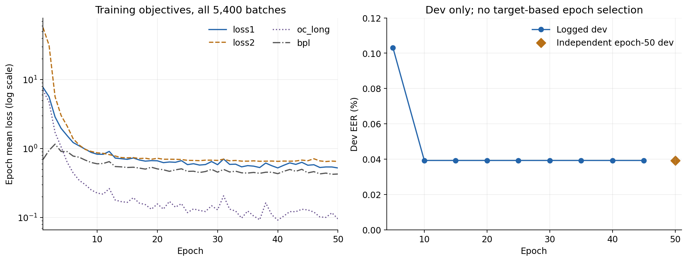
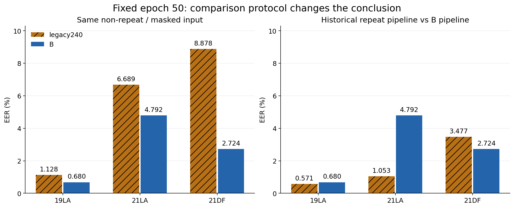
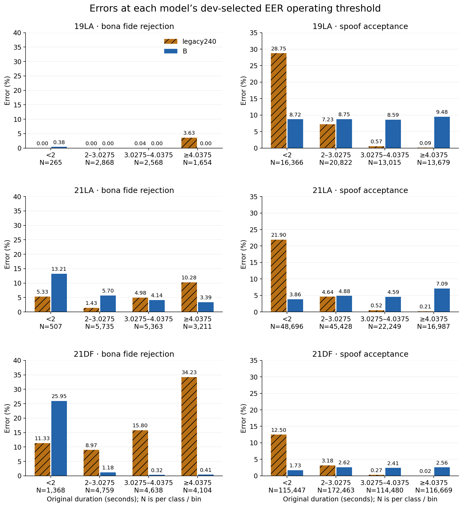
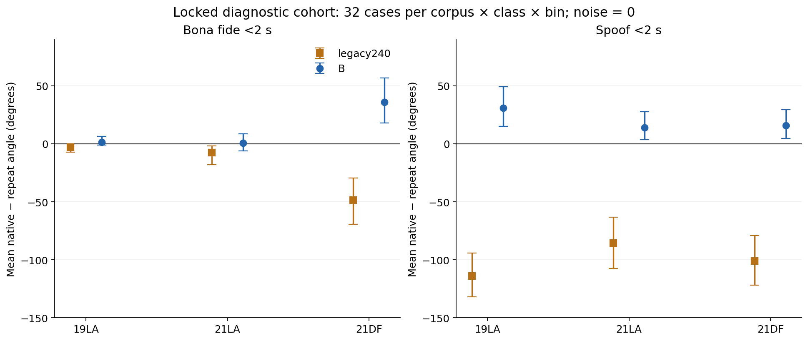
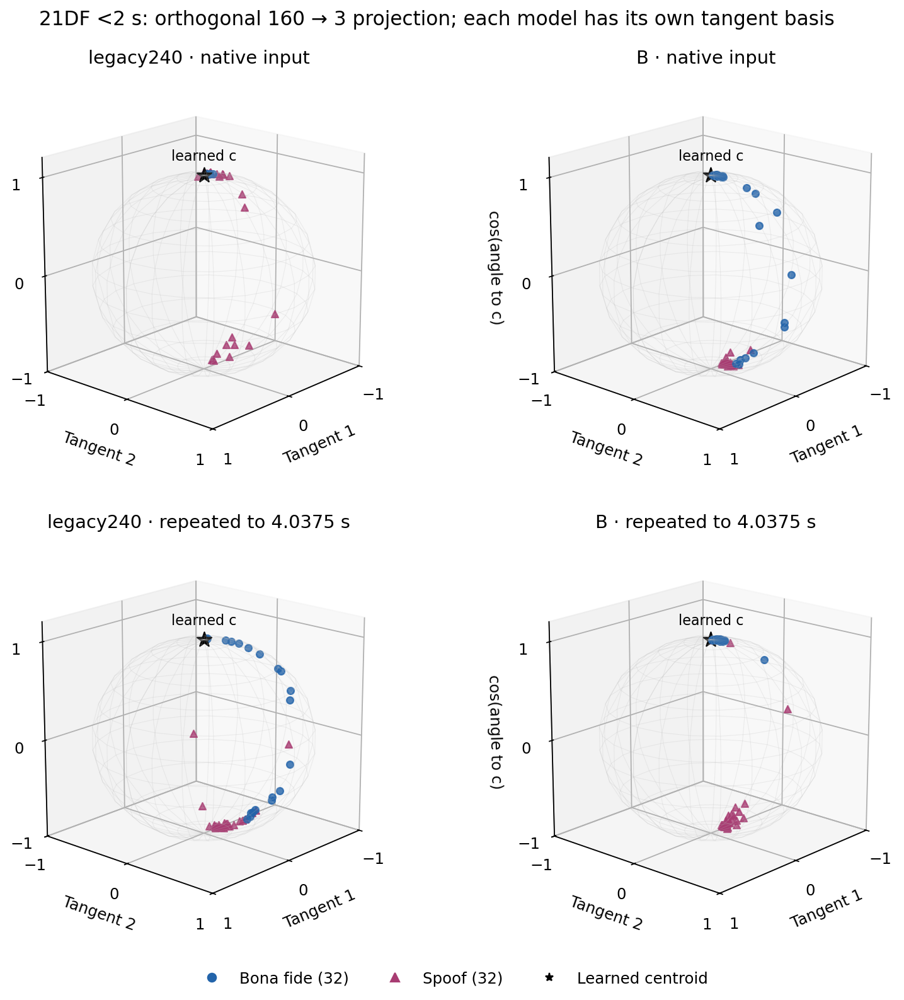

> 표시 명칭·링크 이름은 설명형으로 정리했다. 원래 코드·경로·수치는 그대로 보존한다.

> 역사 문서 보존본. 원문 작성 당시의 상태·계획을 포함한다. 최신 상태와 확정 결과는 experience의 각 실험 README를 우선한다.

# 4.0375초 상한 비반복 학습은 DF 전체 EER를 낮췄지만, 2초 미만 정상 음성 문제를 해결하지 못했다

작성·검산: 2026-11-08 KST. 실험 `EBM_e50_bs240_lr1e5_B_zeropad_short303`, 고정 50epoch 비교. 이 보고서는 승인된 학습, 최종 평가, 길이별 분석과 제한된 입력 개입을 완료한 기록이다. 새 학습은 추가하지 않았다.

**반복에 따른 표현 변화는 확인됐지만, “반복만 없애면 짧은 정상 음성의 표현과 탐지 성능이 좋아진다”는 가설은 이번 결과로 증명되지 않았다.** 같은 비반복 입력에서 4.0375초 상한 비반복 학습은 세 target의 EER를 낮췄다. 그러나 과거 실제 반복 평가와 비교하면 DF만 개선됐고 LA는 악화됐다. 특히 공통 비반복 평가에서 DF의 2초 미만 정상 거부율은 11.33%에서 25.95%로 높아졌다. 같은 원음에 반복 여부만 개입한 진단에서도 4.0375초 상한 비반복 학습의 아주 짧은 정상 표현이 비반복 입력에서 더 멀어지는 반대 증거가 나왔다.

| 검증하려던 주장 | 판정 | 근거와 적용 범위 |
| --- | --- | --- |
| 반복 입력 정책이 짧은 정상 음성의 표현을 바꾼다 | 조건부 지지 | 배치 240 고정 길이 반복 입력 학습의 DF <2초 정상 32개에서 반복을 없애면 각도 평균 −48.28°. 길이·문맥도 함께 바뀌므로 순수 주기성만의 효과는 아니다. |
| 4.0375초 상한 비반복 학습이 아주 짧은 정상의 centroid 이탈을 완화한다 | 해당 조건에서 반박 | DF <2초 전체 정상의 평균 각도는 배치 240 고정 길이 반복 입력 학습 5.03° → 4.0375초 상한 비반복 학습 70.26°. 진단 32개의 4.0375초 상한 비반복 학습도 비반복에서 반복보다 +36.22° 멀어졌다. |
| 4.0375초 상한 비반복 학습이 짧은 정상 오류를 줄이면서 spoof 탐지를 유지한다 | 보편적 주장은 반박 | DF <2초 정상 오류는 증가, 짧은 spoof 수락은 감소. 3.0275초 이상 spoof 수락은 오히려 증가했다. |
| 4.0375초 상한 비반복 학습이 기존 실행보다 모든 target에서 좋아졌다 | 반박 | 과거 반복 평가 대비 DF EER 개선, 19LA·21LA 악화. |
| 변화의 원인은 반복 제거 학습 하나다 | 미확정 | 역사적240과 4.0375초 상한 비반복 학습의 sampler·학습 구현·실제 codec 상태 등이 완전히 통제되지 않았다. |
| 특정 잔여 축이 특정 음향 요인이다 | 미확정 | 회전 가능한 latent 축이다. 이번 진단은 분포의 집중과 입력 민감도를 보여 주며 음향적 의미를 식별하지 않는다. |

## 1. 학습과 최종 평가가 정상적으로 끝났는가

4.0375초 상한 비반복 학습은 11월 6일 21:36:29부터 11월 7일 16:22:40까지 18시간 46분 11초 학습했다. 종료코드 0, 50×108=5,400개의 논리적 배치가 모두 존재하고 손실은 모두 유한했다. 모든 step에서 `loss1 = long OC + 기존 BPL`을 확인했으며 최대 산술 오차는 4.77×10⁻⁷이었다. 새 padding 손실과 active pair는 항상 0이다. `oc_short`는 기록용 진단이며 목적식에 추가되지 않았다. CLS50와 TrainState50의 classifier가 같고 Adam step은 모두 5,400이다.

기존 short crop 상한 48,440 samples(3.0275초), long cap 64,600 samples(4.0375초)는 유지됐다. 짧은 입력을 반복하지 않고 실제 길이로 계산하며, 물리적 microbatch에 필요한 오른쪽 0패딩은 frontend와 backend mask로 제외한다. 원본 BPL 수식·GPU당 정상 12개의 long×short 전체 쌍·global batch 240·두 단계 갱신·seed1·lr1e-5·frozen XLS-R·RawBoost를 유지했다. Codec 호출 두 곳은 주석 처리됐고 확률값 자체는 바꾸지 않았다.

그림의 loss1/loss2는 두 갱신 단계의 목적식 이름이며, epoch별 실제 metric 평균이다. Dev EER는 epoch10–45에서 0.039246%로 같았다. **epoch50의 dev 값은 학습 metric에 기록되지 않았지만**, checkpoint는 정상이고 독립 최종 평가에서 0.039246%를 재계산했다. 로그 flush 문제로 추정되지만 누락 원인을 확정한 것은 아니다. 45epoch 값을 복사한 것이 아니다. Target으로 checkpoint나 epoch를 선택하지 않았다.

최종 paired 평가는 778,185 trials, 추가 진단은 768 cases에서 각각 종료코드 0이었다. 마지막 서버 읽기에서 학습 소스·고정 checkpoint 세 개의 SHA가 불변이고 로컬/서버 Git 작업 트리는 clean이었다. GPU6/7은 각각 6MiB·0%, 기존 screen0 셸도 유휴였다. 부모·두 rank는 정상 종료 뒤 남아 있을 필요가 없다. [학습 검증](../../artifacts/geometry_cache/local_analysis/B_final_analysis_20261108_v1/training_audit.json), [손실 식 검증](../../artifacts/geometry_cache/local_analysis/B_final_analysis_20261108_v1/training_loss_identity_audit.json), [최종 서버 확인](../../artifacts/geometry_cache/local_analysis/B_final_analysis_20261108_v1/final_server_verification.json).

## 2. 입력 조건을 같게 하면 4.0375초 상한 비반복 학습의 EER가 낮다

두 모델 모두 고정50epoch이며 같은 원음의 앞 64,600 samples cap, 반복 없음, 0패딩+mask, GPU당 batch8을 사용했다. XLS-R300m frontend는 메모리에서 공유했으며 원음이나 SSL hidden states를 내보내지 않았다. 평가 기본 pooling noise_std=1e-5를 유지하고 두 모델에 공통 GPU RNG를 적용했다. 진단 실험의 noise0과 구별한다.

| 집합 | 정상 / spoof 수 | 배치 240 고정 길이 반복 입력 학습, 공통 4.0375초 상한 비반복 학습 입력 EER(%) | 4.0375초 상한 비반복 학습 EER(%) |
| --- | --- | --- | --- |
| dev | 2,548 / 22,296 | 0.313972 | 0.039246 |
| 19LA | 7,355 / 63,882 | 1.128484 | 0.679810 |
| 21LA | 14,816 / 133,360 | 6.688715 | 4.792117 |
| 21DF | 14,869 / 519,059 | 8.877530 | 2.723788 |

21DF는 현재 데이터셋 코드가 사용하는 공식 eval split 533,928개다. Progress split까지 포함한 전체 611k 파일을 평가한 수치로 읽지 않는다. 두 모델의 UID·label·입력 구간은 동일하다. EER는 target ROC의 설명 통계이며, 그 교차점을 운영 threshold나 모델 선택에 사용하지 않았다. 표는 한 고정 모델 쌍의 점추정으로 EER 차이의 신뢰구간은 계산하지 않았다. [원 수치](../../artifacts/geometry_cache/local_analysis/B_final_analysis_20261108_v1/analysis/comparison.json), [독립 ROC·coverage 검증](../../artifacts/geometry_cache/local_analysis/B_final_analysis_20261108_v1/analysis/validation.json).

## 3. 사용하던 과거 평가와 비교하면 LA는 악화된다

기존 모델에 학습 당시와 다른 비반복 입력을 주면 성능이 크게 바뀐다. 따라서 2절만으로 “기존 실행보다 전반적으로 향상됐다”고 결론내릴 수 없다. 아래 배치 240 고정 길이 반복 입력 학습 수치는 원래 반복 평가 콘솔의 **마지막 50epoch 출력**에서 회수했고 rank 간 일치와 로그 SHA를 확인했다. 과거 metric의 45epoch DF 2.885%를 50epoch로 대체하지 않았다.

| 집합 | 배치 240 고정 길이 반복 입력 학습의 과거 반복 평가 EER(%) | 4.0375초 상한 비반복 학습의 비반복 평가 EER(%) | 4.0375초 상한 비반복 학습 − 과거240 (pp) |
| --- | --- | --- | --- |
| 19LA | 0.571040 | 0.679810 | +0.108770 |
| 21LA | 1.052789 | 4.792117 | +3.739327 |
| 21DF | 3.477033 | 2.723788 | -0.753245 |

DF는 0.753245pp, 상대 약 21.66% 낮아졌다. 반면 21LA는 3.739327pp 높아졌다. 이것은 **기존 모델+과거 입력/구현**과 **4.0375초 상한 비반복 학습+새 입력/구현**의 파이프라인 비교다. 같은 추론 입력에서 학습된 표현을 비교하는 2절과 질문이 다르다. 과거 입력 평가에는 batch·mask·noise 등의 구현 조건 차이도 있어 이 표를 순수 반복 개입 실험으로 부르지 않는다. [50epoch 원 기록의 출처와 SHA](../../artifacts/geometry_cache/local_analysis/B_final_analysis_20261108_v1/historical_legacy_final.json).

## 4. 운영 오류는 길이에 따라 서로 반대 방향으로 바뀐다

정상으로 수락하는 규칙은 `cosine score ≥ threshold`다. 각 모델의 동일 dev에서 |FPR−FNR| 최소, 동률 시 낮은 FPR, 다시 동률이면 높은 threshold를 택했다. Target에서 threshold를 맞추지 않았다. 정상 거부율의 분모는 정상 수, spoof 수락률의 분모는 spoof 수다. EER와 이 운영 오류율은 서로 다른 수치다.

| 집합 / 오류 | 분모 N | 배치 240 고정 길이 반복 입력 학습 오류 수 / % | 4.0375초 상한 비반복 학습 오류 수 / % | 차이 4.0375초 상한 비반복 학습−240 (pp) | 차이의 동시 95% 구간 |
| --- | --- | --- | --- | --- | --- |
| 19LA 정상 거부 | 7,355 | 61 / 0.8294 | 1 / 0.0136 | -0.8158 | [-2.350, +0.013] |
| 19LA spoof 수락 | 63,882 | 6,297 / 9.8572 | 5,663 / 8.8648 | -0.9925 | [-2.107, +0.080] |
| 21LA 정상 거부 | 14,816 | 706 / 4.7651 | 725 / 4.8934 | +0.1282 | [-2.181, +1.834] |
| 21LA spoof 수락 | 133,360 | 12,925 / 9.6918 | 6,319 / 4.7383 | -4.9535 | [-6.216, -3.706] |
| 21DF 정상 거부 | 14,869 | 2,720 / 18.2931 | 443 / 2.9794 | -15.3137 | [-22.930, -8.141] |
| 21DF spoof 수락 | 519,059 | 20,259 / 3.9030 | 12,251 / 2.3602 | -1.5428 | [-2.491, -0.815] |

동시 구간은 세 target×두 class, 총 여섯 전체 오류 차이를 하나의 family로 두고 Bonferroni 조정한 paired speaker-cluster bootstrap 5,000회 구간이다. 같은 UID의 두 모델 오류를 함께 유지하고 protocol speaker를 재표집했다. 19LA의 두 차이와 21LA 정상 차이는 이 구간에서 0을 포함한다. Target 간 화자 중복, spoof 생성기·코덱 의존성과 한 seed의 학습 불확실성까지 모두 포괄하는 구간은 아니다.

### DF: 2초 미만 정상은 악화되고, 짧은 spoof는 개선된다

| DF 원길이 / 오류 | 분모 N | 배치 240 고정 길이 반복 입력 학습 오류 수 / % | 4.0375초 상한 비반복 학습 오류 수 / % | 차이 (pp) | 탐색적 95% 구간 |
| --- | --- | --- | --- | --- | --- |
| <2초 정상 거부 | 1,368 | 155 / 11.3304 | 355 / 25.9503 | +14.6199 | [+7.918, +20.826] |
| <2초 spoof 수락 | 115,447 | 14,432 / 12.5010 | 1,994 / 1.7272 | -10.7738 | [-14.237, -8.240] |
| 2–<3.0275초 정상 거부 | 4,759 | 427 / 8.9725 | 56 / 1.1767 | -7.7958 | [-11.732, -4.452] |
| 2–<3.0275초 spoof 수락 | 172,463 | 5,492 / 3.1845 | 4,520 / 2.6209 | -0.5636 | [-1.275, +0.047] |
| 3.0275–<4.0375초 정상 거부 | 4,638 | 733 / 15.8042 | 15 / 0.3234 | -15.4808 | [-22.470, -9.365] |
| 3.0275–<4.0375초 spoof 수락 | 114,480 | 314 / 0.2743 | 2,755 / 2.4065 | +2.1323 | [+1.342, +3.142] |
| ≥4.0375초 정상 거부 | 4,104 | 1,405 / 34.2349 | 17 / 0.4142 | -33.8207 | [-45.529, -22.177] |
| ≥4.0375초 spoof 수락 | 116,669 | 21 / 0.0180 | 2,982 / 2.5559 | +2.5379 | [+1.413, +4.519] |

길이별 구간은 사전에 정한 `[0,2)`, `[2,3.0275)`, `[3.0275,4.0375)`, `[4.0375,∞)`초다. 모두 원음 길이 기준이고 16kHz 정수 sample로 나눴다. 위 길이별 95% 구간은 **탐색적 주변 구간**이며 전체 길이·class 다중 비교에 대한 동시 보장을 하지 않는다. 모든 target×class×길이 조합은 비어 있지 않았다. 가장 작은 정상 구간은 19LA <2초의 265개이며 speaker 수와 각 구간 오차는 원 표에 남겼다.

DF <2초 정상은 4.0375초 상한 비반복 학습이 200개 더 거부했다(155→355/1,368). 반대로 같은 길이 spoof는 14,432→1,994/115,447로 덜 수락했다. 3.0275초 이상에서는 정상 오류 감소와 spoof 오류 증가가 공존한다. 전체 DF 평균만 보면 이 교환관계가 가려진다. 21LA에서도 <2초 정상 거부율은 5.33→13.21%로 높아졌다. 따라서 “짧은 정상 오류가 모두 줄었다”는 해석은 맞지 않는다.

### Threshold 변화와 표현 개선을 혼동하면 안 된다

배치 240 고정 길이 반복 입력 학습의 dev threshold는 **0.99272668(각도 약 6.91°)**이고 4.0375초 상한 비반복 학습은 **−0.83574450(약 146.69°)**다. 4.0375초 상한 비반복 학습의 dev 정상 2,548개 중 최저 score는 −0.93040이고 두 번째는 0.92468이다. 한 극단 정상과 거의 분리된 두 class 때문에 EER가 매우 낮아도 선택된 운영 threshold가 크게 달라질 수 있다. 이것은 재계산에서도 확인된 분포이며 낮은 dev EER만으로 target calibration이 좋다고 할 수 없다.

예를 들어 DF 2–3.0275초 정상은 4.0375초 상한 비반복 학습에서 거부율이 낮지만 평균 centroid 각도는 약 10.00°로 배치 240 고정 길이 반복 입력 학습의 4.53°보다 크다. 전체 DF 정상 평균 각도도 4.0375초 상한 비반복 학습 13.65°, 배치 240 고정 길이 반복 입력 학습 7.01°다. **덜 거부했다는 사실이 centroid에 더 가까워졌다는 뜻은 아니다.**

추가 탐색으로 target을 쓰지 않고 dev spoof 수락 예산을 각각 0.1%, 1% 이하로 정해 다시 threshold를 계산했다. 분모는 여전히 같은 DF <2초 정상 1,368개다.

| dev spoof 수락 예산 | 배치 240 고정 길이 반복 입력 학습 DF <2초 정상 거부 | 4.0375초 상한 비반복 학습 DF <2초 정상 거부 |
| --- | --- | --- |
| 0.1% | 23.3187% | 24.5614% |
| 1.0% | 2.6316% | 17.9825% |

0.1% 예산에서는 차이가 약 1.24pp로 작아지고 1%에서는 약 15.35pp다. 그러므로 주 운영점의 +14.62pp를 threshold와 무관한 고정 특성으로 일반화하지 않는다. 이 추가 규칙은 결과 확인 뒤 실시한 탐색이며 독립 확증 실험이나 새로운 최적 threshold 제안이 아니다. [threshold별 전체 수치](../../artifacts/geometry_cache/local_analysis/B_final_analysis_20261108_v1/analysis/threshold_sensitivity.csv), [dev 분포](../../artifacts/geometry_cache/local_analysis/B_final_analysis_20261108_v1/analysis/operating_points.json).

## 5. 같은 원음의 반복 여부를 바꾼 2×2 진단

고정 4.0375초 상한 비반복 학습/배치 240 고정 길이 반복 입력 학습 모델 두 개와 native/repeat 입력 두 개를 교차했다. 각 target×class×사전 길이구간에서 최대32개, 총768개를 **UID SHA와 speaker round-robin만으로 선택하고 추론 전에 잠갔다.** 결과·오류·score로 표본을 고르거나 교체하지 않았다. 각 구간 32개가 모두 확보됐다. 각 원음에서 같은 앞 구간을 사용하고 짧은 경우에만 한 입력을 64,600 samples까지 반복했다. 긴 입력 대조군은 두 입력·embedding·score가 정확히 같았다.

이 진단은 noise_std=0으로 통제했다. 공식 전체 평가는 1e-5를 유지했으므로 진단 표본의 score를 공식 benchmark 결과와 섞지 않는다. 반복 정책은 유효 프레임 수와 SSL 문맥까지 바꾼다. 여기서 식별되는 것은 고정 모델에 대한 **입력 정책의 총효과**이며 주기성 하나의 효과나 반복 제거 **학습**의 단독 인과효과가 아니다.

| 고정 모델 / 입력 | DF <2초 정상 평균 각도 | 평균 점수 | 비반복 − 반복 각도 / 탐색적 95% 구간 |
| --- | --- | --- | --- |
| 4.0375초 상한 비반복 학습 / native | 43.190° | 0.535460 | +36.224° / [+18.191, +56.841] |
| 배치 240 고정 길이 반복 입력 학습 / native | 4.086° | 0.997313 | -48.279° / [-69.144, -29.548] |
| 4.0375초 상한 비반복 학습 / repeat | 6.966° | 0.986770 | 동일 32개 표본의 반복 입력 |
| 배치 240 고정 길이 반복 입력 학습 / repeat | 52.364° | 0.426851 | 동일 32개 표본의 반복 입력 |

DF <2초 정상에서 배치 240 고정 길이 반복 입력 학습은 반복을 없애면 centroid에 가까워졌다. 4.0375초 상한 비반복 학습은 그 관계가 반대다. 4.0375초 상한 비반복 학습의 동일 32개 정상은 native에서 4개, repeat에서 0개가 dev threshold로 거부됐지만, 화자 균형 진단표본을 전체 DF 정상 오류율 추정에 쓰면 안 된다. 실제 전체 분포의 오류율은 4절 수치다. 이 32개 정상의 절대 score 민감도 차이 `B−기존240`은 −0.11776, 95% 구간 [−0.33536, +0.07364]로 0을 포함한다. 정상의 반복 민감도가 사라졌다고 말할 수 없다. 같은 조건 spoof의 민감도 차이는 −1.09573, 탐색적 구간 [−1.39179, −0.78621]로 더 크게 줄었다.

점과 선은 같은 표본의 native−repeat 평균 각도와 paired speaker bootstrap 주변 95% 구간이다. 음수는 비반복에서 centroid에 가까워졌음을 뜻한다. 19LA·21LA 정상의 반응은 DF와 크기가 다르므로 corpus와 길이 전반에 동일한 반응을 가정하지 않는다. [잠근 프로토콜](../../artifacts/geometry_cache/local_analysis/B_final_analysis_20261108_v1/mechanism_2x2/protocol.json), `../../artifacts/geometry_cache/local_analysis/B_final_analysis_20261108_v1/mechanism_2x2/selected.parquet` (원자료 경로; 배포 제외 또는 미확보, 출처 목록 참조), [각도·집중도](../../artifacts/geometry_cache/local_analysis/B_final_analysis_20261108_v1/analysis/geometry_statistics.json), [민감도 차이](../../artifacts/geometry_cache/local_analysis/B_final_analysis_20261108_v1/analysis/geometry_interactions.json).

## 6. 구의 어느 방향이 약한가

코드의 최종 score는 정규화 embedding `u`와 정규화 학습 centroid `c`의 내적 `s=u·c=cos θ`다. 따라서 **같은 θ를 가진 점은 잔여방향이 달라도 같은 score**를 받는다. 최종 OC head가 어떤 방위각만 별도로 나쁘게 판정하는 구조는 아니다. 그림의 특정 방향에서 정상/spoof가 겹친다면 encoder가 그 조건의 데이터를 그 방향과 각도로 보낸 결과다. 어떤 음향 속성이 그 표현을 만들었는지는 별도 개입이 필요하다. [실제 score 코드](../../../../../model/loss.py).

잔여성분은 `r=u−(u·c)c`이며 160개 좌표로 저장되지만 `r·c=0`이므로 가능한 부분공간의 자유도는 159다. 잔여방향은 `r/||r||`다. Learned centroid는 손실로 최적화한 파라미터이며 정상 embedding의 산술평균으로 강제되지 않는다. 구의 원점은 `(0,0,0)`, 학습 c는 북극 `(0,0,1)`로 두었다. 정상의 평균이나 모든 정상 표본이 그 점에 일치해야 하는 것은 아니다.

이 그림은 DF <2초의 잠근 정상32+spoof32개를 표시한다. 두 접선 축은 **모델마다 따로**, 전체 진단768개×두 입력의 잔여성분에 비중심 SVD를 적용한 상위 두 축이다. 세 번째 축은 c와의 실제 cosine이다. 따라서 세 번째 좌표와 score는 보존되지만, 접선공간 159차원 중 남은157차원은 투영에서 빠져 모든 점이 구 표면에 있을 필요는 없다. 점을 다시 구 표면으로 늘리지 않았다.

| 모델 | 잔여성분 상위 두 축 에너지 | c축을 포함한 3축 전체 에너지 |
| --- | --- | --- |
| 4.0375초 상한 비반복 학습 | 66.829% | 97.496% |
| 배치 240 고정 길이 반복 입력 학습 | 73.776% | 97.627% |

66.83%/73.78%는 이 진단 표본의 **잔여 에너지** 중 두 접선 축에 담긴 비율이다. 전체 unit vector 에너지는 c축이 크기 때문에 약97.5%가 남지만, 이 수치를 “잔여방향을 거의 모두 설명했다”로 읽으면 안 된다. 학습 표본의 PCA 설명분산이나 보편적 잠재 차원 추정도 아니다. 두 모델 축을 정렬하지 않았으므로 왼쪽/오른쪽의 같은 화면 방향을 같은 물리적 방향으로 해석하지 않는다.

균일한 사방 확산인지도 확인했다. DF <2초 진단의 잔여 unit-vector 평균 길이 R은 native 기준 정상/ spoof가 배치 240 고정 길이 반복 입력 학습 0.869/0.794, 4.0375초 상한 비반복 학습 0.749/0.898이었다(N=32씩). R=1은 같은 잔여방향 집중, 작은 R은 평균 상쇄를 뜻한다. 작은 R만으로 균일분포를 증명할 수는 없다. 여기서는 원점 주변에 균일하게 흩어진 분포로 가정하기보다 집중된 방향이 있는 분포로 보는 것이 맞다. 4.0375초 상한 비반복 학습 native에서 잘못 거부된 정상 4개의 평균 잔여방향과 spoof 평균방향 cosine은 0.796이었다. 이 값은 작은 선택 표본의 기술통계이며 방향 의미나 전체 population에서의 취약 축을 확정하는 검정은 아니다. [기하 검증](../../artifacts/geometry_cache/local_analysis/B_final_analysis_20261108_v1/analysis/geometry_validation.json), [방향 기술통계](../../artifacts/geometry_cache/local_analysis/B_final_analysis_20261108_v1/analysis/geometry_directions.json), [투영 에너지](../../artifacts/geometry_cache/local_analysis/B_final_analysis_20261108_v1/analysis/projection_basis.json).

## 7. 무엇이 아직 원인으로 분리되지 않았는가

반복 학습을 제거하면 유효 길이가 class와 연결될 가능성이 있다. 원길이 메타데이터에서 학습 정상 2,580개 중 <2초는 109개(4.2248%), <3초는 986개(38.2171%), <3.0275초는 1,040개(40.3101%)였다. 따라서 “정상은 3초 아래가 거의 없다”는 가정은 실제 데이터와 다르다. **아주 짧은 <2초**가 상대적으로 적다는 설명이 더 정확하다. 학습 spoof의 <2초는 3,207/22,800=14.0658%다. [정상 길이 검산](../../artifacts/geometry_cache/local_analysis/variable_length_audit_20261106_v1/normal_duration_counts.json), [class별 반초 구간 수](../../artifacts/geometry_cache/local_analysis/variable_length_audit_20261106_v1/train_half_second_class_counts.csv).

이는 4.0375초 상한 비반복 학습이 짧은 길이를 spoof 단서로 사용했거나, 짧은 정상의 문맥이 부족했을 가능성과 부합한다. 하지만 길이/class 상관만으로 원인을 정하지 않는다. RawBoost·데이터 출처·코덱·발화 내용과 학습 구현의 영향도 남아 있다. 이번 checkpoint 비교에서 학습 표본 수나 실제 gradient 노출 횟수를 고쳐 실험하지 않았다.

배치 240 고정 길이 반복 입력 학습의 archived source에는 codec 호출이 활성화돼 있지만 사용자는 당시 껐다고 기억한다. 실제 당시 호출 횟수 로그가 없으므로 **실제 codec 실행 여부는 미확정**이다. 4.0375초 상한 비반복 학습은 codec-off를 확인했다. 과거 모델과 4.0375초 상한 비반복 학습 사이에는 sampler·mask·분할 계산·논리적 batch 기준 OC 가중·학습 실행 구현 차이도 있어 단일 원인으로 분리되지 않는다.

인과효과를 좁히려면 **현재 4.0375초 상한 비반복 학습 코드 그대로의 A**를 별도 새 실험명으로 학습해야 한다. A는 `native_length=False, cap_long=True`, short3.0275초 cap과 두 새 손실0을 유지한다. 4.0375초 상한 비반복 학습과 동일한 sampler 순서·정상/spoof 구성·global240·micro8·재계산·두 단계 update·OC 가중·optimizer·seed·RawBoost·codec-off·frontend를 사용하고, 입력 반복 정책만 바꾼다. 단, augmentation RNG 소비 순서도 맞춰야 한다. 두 고정50epoch를 공통 비반복 입력과 반복 입력으로 모두 평가하여 학습 정책과 추론 정책을 분리한다. 먼저 같은 seed의 엄격한 쌍 비교를 하고, 일반화 주장은 여러 seed 재현 뒤에 한다. Target으로 epoch/threshold/길이별 규칙을 고르지 않는다. **이 추가 A 학습은 이번 예약에서 실행하지 않았다.**

이번 4.0375초 상한 비반복 학습을 모든 기존 조건의 대체 모델로 채택하거나 “반복 제거 가설이 증명됐다”고 쓰는 근거는 부족하다. 현재 결과는 DF 전체 순위 성능 개선과 짧은 spoof 민감도 감소를 보여 주지만, 아주 짧은 정상과 LA 성능에 반대 증거를 함께 제공한다.

## 8. 재현·검산 자료와 범위

| 검산 항목 | 확인한 내용 |
| --- | --- |
| Trial grain | corpus 안에서 UID 유일, index 0…N−1 연속, 라벨 두 class 및 예상 class 수 일치 |
| 유효값 | 모든 score 유한·cosine 범위 안, 입력 길이 `min(original,64600)`와 일치 |
| 산술 | 서버 sklearn ROC와 별도 NumPy tied-score ROC의 EER 일치(차이 <10⁻⁹), dev threshold·오류 수 재계산 |
| Paired 비교 | 동일 UID·label·입력 공유, speaker 단위 재표집 중 모델 쌍 보존 |
| 개입 | 추론 전 metadata-only 표본 lock, 768×2×2×160 shape, 내적 점수 재계산 오차 2.23×10⁻⁷ 미만, 긴 음성 no-op 정확 일치 |
| 파일 | 다운로드 원본과 SHA 일치, source·고정 checkpoint 최종 hash 불변 |
| 그림 | 저장 PNG 5개를 실제 열어 확인, 잘린 막대/구간을 수정하고 재확인 |

범위 내 수치는 검산됐고, 명시한 비교 조건과 한계를 붙여 공유할 수 있다. 다만 bootstrap 구간은 새 corpus/새 공격/새 codec/학습 seed의 모든 불확실성을 포함하지 않는다. 관측된 paired 차이가 전부0인 구간의 bootstrap [0,0]은 그 경험적 표본의 퇴화 구간이며 미관측 모집단 차이도 반드시0이라는 뜻이 아니다. 표본 선택은 score와 독립적이지만 균형 진단표본이 전체 trial 분포의 무작위 대표표본은 아니다. EER에 오류율 차이 구간을 붙이거나, marginal CI를 전체 다중 비교의 유의성으로 해석하지 않았다.

운영 서버 원본: `/home/mentee/analysis/ebm_B_final_eval_20261107_215451`. 전체 점수·원길이·UID·label parquet, metrics, QC, 진단 embedding과 protocol은 그 아래에 보관했다. 학습 실행 소스는 `train/ebm-B-zeropad-e50-bs240-20261106`, commit `2c2c6ff65bbadf33b811983f7c648c97fffb81a1` 그대로다.

| 고정 checkpoint | SHA256 |
| --- | --- |
| 4.0375초 상한 비반복 학습 CLS50 | `63ed02a1baef97efa9c8b701814dcccebf3360d441782abe9688d8edb3cdf457` |
| 4.0375초 상한 비반복 학습 TrainState50 | `3b1fe8ac2ec67e680ac582365e40cd6f34451a42484858f847f55e41a1b1cba0` |
| 배치 240 고정 길이 반복 입력 학습 BestCLS_50_21DF | `84a828eeda71d74212178dc2c2f02e72f8bb79b3573354f6cd9ca181a376d19e` |

분석은 [`analyze_B_scores.py`](../../../workspace/artifacts/ebm_git_private_20261106/analyze_B_scores.py), 기하는 [`summarize_B_geometry.py`](../../../workspace/artifacts/ebm_git_private_20261106/summarize_B_geometry.py), 그림과 추가 운영점은 [`render_B_final_analysis.py`](../../../workspace/artifacts/ebm_git_private_20261106/render_B_final_analysis.py), 보고서는 [`write_B_final_report.py`](../../../workspace/artifacts/ebm_git_private_20261106/write_B_final_report.py)로 재생성할 수 있다. 제한된 서버 추론 코드는 [`geometry_B_intervention.py`](../../../workspace/artifacts/ebm_git_private_20261106/geometry_B_intervention.py)다. 실행 완료된 서버 작업을 재실행할 필요는 없다.

전체 [길이별 검산 CSV](../../artifacts/geometry_cache/local_analysis/B_final_analysis_20261108_v1/analysis/paired_error_rates.csv), [공식 점수 파일의 hash manifest](../../artifacts/geometry_cache/local_analysis/B_final_analysis_20261108_v1/download_manifest.json), [진단 hash manifest](../../artifacts/geometry_cache/local_analysis/B_final_analysis_20261108_v1/mechanism_2x2/download_manifest.json)도 보존했다. 원본 음성·SSL hidden states·checkpoint·비밀 키를 로컬이나 GitHub에 새로 복사하지 않았다. 이번 보고서와 그림은 로컬 프로젝트의 `docs/experiments`에 저장했으며 실행 코드의 Git commit은 변경하지 않았다.

## 부록. 모든 target의 길이별 오류와 분모

| 집합 | 원길이 | class | N | 배치 240 고정 길이 반복 입력 학습 오류(%) | 4.0375초 상한 비반복 학습 오류(%) | 차이 (pp) | 탐색적 95% 구간 |
| --- | --- | --- | --- | --- | --- | --- | --- |
| 19LA | <2초 | 정상 | 265 | 0.0000 | 0.3774 | +0.3774 | [+0.000, +1.333] |
| 19LA | <2초 | spoof | 16,366 | 28.7486 | 8.7193 | -20.0293 | [-21.339, -18.686] |
| 19LA | 2–<3.0275초 | 정상 | 2,868 | 0.0000 | 0.0000 | +0.0000 | [+0.000, +0.000] |
| 19LA | 2–<3.0275초 | spoof | 20,822 | 7.2327 | 8.7456 | +1.5128 | [+0.904, +2.159] |
| 19LA | 3.0275–<4.0375초 | 정상 | 2,568 | 0.0389 | 0.0000 | -0.0389 | [-0.126, +0.000] |
| 19LA | 3.0275–<4.0375초 | spoof | 13,015 | 0.5686 | 8.5901 | +8.0215 | [+7.360, +8.697] |
| 19LA | ≥4.0375초 | 정상 | 1,654 | 3.6276 | 0.0000 | -3.6276 | [-7.679, -0.288] |
| 19LA | ≥4.0375초 | spoof | 13,679 | 0.0877 | 9.4817 | +9.3940 | [+8.531, +10.315] |
| 21LA | <2초 | 정상 | 507 | 5.3254 | 13.2150 | +7.8895 | [+5.304, +10.459] |
| 21LA | <2초 | spoof | 48,696 | 21.9012 | 3.8586 | -18.0425 | [-19.643, -16.548] |
| 21LA | 2–<3.0275초 | 정상 | 5,735 | 1.4298 | 5.7018 | +4.2720 | [+3.475, +5.096] |
| 21LA | 2–<3.0275초 | spoof | 45,428 | 4.6403 | 4.8758 | +0.2355 | [-0.262, +0.749] |
| 21LA | 3.0275–<4.0375초 | 정상 | 5,363 | 4.9786 | 4.1395 | -0.8391 | [-1.894, +0.219] |
| 21LA | 3.0275–<4.0375초 | spoof | 22,249 | 0.5214 | 4.5890 | +4.0676 | [+3.168, +4.960] |
| 21LA | ≥4.0375초 | 정상 | 3,211 | 10.2772 | 3.3946 | -6.8826 | [-11.946, -3.019] |
| 21LA | ≥4.0375초 | spoof | 16,987 | 0.2119 | 7.0878 | +6.8758 | [+5.576, +8.136] |
| 21DF | <2초 | 정상 | 1,368 | 11.3304 | 25.9503 | +14.6199 | [+7.918, +20.826] |
| 21DF | <2초 | spoof | 115,447 | 12.5010 | 1.7272 | -10.7738 | [-14.237, -8.240] |
| 21DF | 2–<3.0275초 | 정상 | 4,759 | 8.9725 | 1.1767 | -7.7958 | [-11.732, -4.452] |
| 21DF | 2–<3.0275초 | spoof | 172,463 | 3.1845 | 2.6209 | -0.5636 | [-1.275, +0.047] |
| 21DF | 3.0275–<4.0375초 | 정상 | 4,638 | 15.8042 | 0.3234 | -15.4808 | [-22.470, -9.365] |
| 21DF | 3.0275–<4.0375초 | spoof | 114,480 | 0.2743 | 2.4065 | +2.1323 | [+1.342, +3.142] |
| 21DF | ≥4.0375초 | 정상 | 4,104 | 34.2349 | 0.4142 | -33.8207 | [-45.529, -22.177] |
| 21DF | ≥4.0375초 | spoof | 116,669 | 0.0180 | 2.5559 | +2.5379 | [+1.413, +4.519] |
