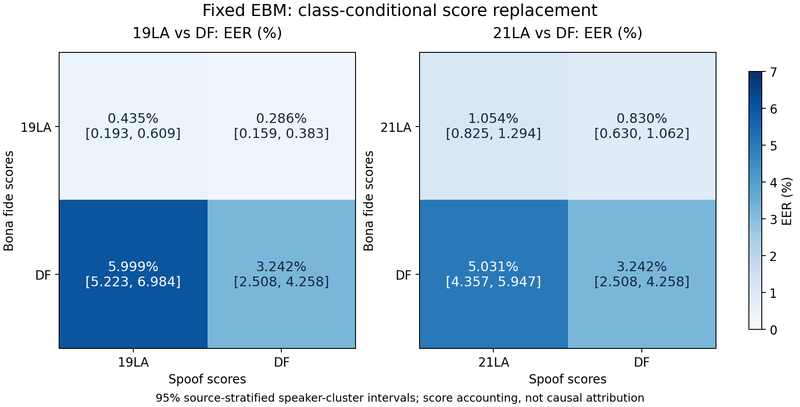

> 역사 문서 보존본. 원문 작성 당시의 상태·계획을 포함한다. 최신 상태와 확정 결과는 experience의 각 실험 README를 우선한다.

# 보나파이드·스푸프 교차 평가 재현 및 보완 결과

2026-11-06 KST. 로컬에 보존된 동일 EBM의 점수만 사용했다. 이전 `bonafide_domain_shift_v1`의 같은 실험을 발견해 보존하고, 별도 폴더에서 전체 계산과 독립 검산을 재실행했다. 재현 계산 18.10초, 출처·길이·codec 보완 계산 11.79초였다. 개발·검토·문서화 시간은 이 계산 시간에 포함하지 않는다.

**이 고정 EBM의 19LA/21LA 대비 DF 전체 EER 증가는 정상 점수 분포의 교체에 의해 주도된다. 스푸프 점수 집합만 DF로 교체하면 EER는 오히려 낮아진다.** 이는 평가 집합의 점수 분포에 대한 진단이다. 정상 학습 데이터 부족의 인과적 증명, 모든 공격에 대한 강건성, 정상 데이터 추가 학습의 성공을 뜻하지 않는다. 고정 운용점의 전체 오류는 별도로 해석한다.

## 1. 점수와 표본

- 같은 체크포인트 `104873703a57cad98b686d770e0860e031a2cf9abef79b72668780c1660e0b24`의 원래 160차원 cosine 점수. 높을수록 정상이다.
- 19LA eval: 정상 7,355 / 스푸프 63,882.
- 21LA eval: 정상 14,816 / 스푸프 133,360.
- DF 전체: 정상 14,869 / 스푸프 519,059. 기존 pilot과 remaining의 UID 중복 없는 합집합이다.
- 학습 T와 검증 V를 기준 평가셋으로 대체하지 않았다. 19LA/21LA 평가에 학습 도메인의 별도 평가 표본이라는 의미만 부여한다. 모든 공격이 학습에서 관측됐다는 뜻은 아니다.
- 모델 변경·새 학습·음성 forward·GPU 작업·SSH·새 연구실 데이터 수신은 없었다. 서버 현재 상태를 확인한 작업이 아니다.

## 2. 주 교차 평가: EER (%)

행은 정상 점수 집합, 열은 스푸프 점수 집합이다.

| 정상 | 19LA 스푸프 | DF 스푸프 |
| --- | ---: | ---: |
| 19LA | 0.435177 | 0.285520 |
| DF | 5.999058 | 3.241828 |

19LA 스푸프를 그대로 둔 정상 교체는 **+5.563881pp**, 19LA 정상을 그대로 둔 스푸프 교체는 **−0.149657pp**다. 순차 교체 순서가 달라지면 효과 크기가 달라지므로 두 값을 합해 전체 하락을 분해하지 않는다.

| 비교: 양수는 EER 악화 | 변화(pp) | 95% 군집 구간 | 98.75% 군집 구간 |
| --- | ---: | --- | --- |
| 정상 교체 / 19LA 스푸프 고정 | +5.563881 | [4.799040, 6.542598] | [4.658798, 6.847350] |
| 정상 교체 / DF 스푸프 고정 | +2.956308 | [2.287510, 3.970714] | [2.132495, 4.291119] |
| 스푸프 교체 / 19LA 정상 고정 | −0.149657 | [−0.320841, −0.023060] | [−0.363419, −0.002675] |
| 스푸프 교체 / DF 정상 고정 | −2.757230 | [−3.431002, −1.971101] | [−3.622906, −1.759400] |

2,000회 출처별 화자 군집 bootstrap이며 공유 ASV 화자의 가중치를 평가셋 간에 공유한다. 98.75%는 기준셋별 네 edge 비교에 대한 Bonferroni 구간이다. 상호작용과 다른 기준셋·보완 분석 전체에 대한 동시 보장은 아니다. 이 비교 family는 이번 재검토에서 정했으며 사전 등록된 확인 실험이 아니다. 작은 꼬리 확률의 분위수는 2,000회 Monte Carlo 해상도의 제한도 갖는다.

| 정상 | 21LA 스푸프 | DF 스푸프 |
| --- | ---: | ---: |
| 21LA | 1.053539 | 0.830184 |
| DF | 5.030601 | 3.241828 |

21LA 기준에서도 같은 방향이다. 19LA·21LA·DF에는 공유 자료·화자가 있으므로 독립 반복 두 번으로 세지 않는다.



## 3. 출처·공격 구성 보완

19LA 스푸프를 고정하고 DF 정상 출처만 나누면 EER는 다음과 같다. 이 절의 보완값은 점추정이며 별도 신뢰구간은 계산하지 않았다.

| 정상 집합 | EER (%) |
| --- | ---: |
| 19LA | 0.435177 |
| DF의 ASVspoof | 0.474312 |
| DF의 VCC2018 | 10.952381 |
| DF의 VCC2020 | 4.730159 |

정상 취약성은 DF의 모든 정상 출처에 동일하게 생기지 않았다. 전체 출처×점수 조합 36개와 AUROC는 `source_cross_matrix.csv`에 보존했다.

기존 출처 및 공격 대조도 재현했다. 19LA 정상을 고정하고 ASVspoof 출처 스푸프끼리 비교하면 19LA 스푸프 0.435177%, DF의 ASVspoof 스푸프 0.373700%다. DF 스푸프를 19LA의 공격 ID 비중으로 재가중해도 0.374231%다. 다만 정상도 각 데이터셋의 것으로 바꾸어 공격별 EER를 비교한 13개 공유 공격 중 **4개는 DF 조건에서 악화**했다. 이는 개별 공격의 순수 효과나 모든 스푸프가 쉬워졌다는 증거가 아니다. 원발화 수준의 정확한 대응은 미해결이다.

## 4. 길이와 codec 민감도

| 조건 | 정상19/스푸프19 | 정상DF/스푸프19 | 정상19/스푸프DF | 정상DF/스푸프DF |
| --- | ---: | ---: | ---: | ---: |
| 원래 전체 구성 | 0.435177 | 5.999058 | 0.285520 | 3.241828 |
| DF의 nocodec 부분집합 | 0.435177 | 6.141869 | 0.362812 | 3.633218 |
| 양 클래스의 길이 구성을 각각 19LA에 맞춤 | 0.435177 | 4.999843 | 0.285520 | 2.662010 |

단위는 EER %. DF `nocodec`은 정상 1,156 / 스푸프 52,920개다. DF 내부 압축 조건을 제한해도 정상 교체의 악화 방향은 남는다. 이는 원천 녹음 단계의 압축·채널 차이까지 없앴다는 뜻이 아니다.

길이 재가중은 양 클래스를 별도로 `<1, 1–1.5, 1.5–2, 2–3, 3–4.0375, 4.0375–6, ≥6초`로 나누어 19LA의 해당 클래스 비중에 맞췄다. 양 집합이 모든 bin을 갖고 있어 표본 제거는 없었다. 정상 19LA의 1초 미만은 1개, 1–1.5초는 13개로 참조 비중 추정이 불안정할 수 있다. 구간 내부 길이·화자·출처 분포는 일치시키지 않았다. 이 재가중은 모집단 민감도 분석이며 패딩 제거 효과나 모델 개선이 아니다. 보완값은 신뢰구간 없는 점추정이다.

## 5. 고정 임계값에서의 해석

검증 V의 스푸프 통과율 1% 이하만으로 정한 임계값 약 `−0.909973`을 전체 평가에 그대로 사용했다. 실제 저장된 정확한 threshold는 `V_spoof_FAR1_operating.csv`를 따른다.

| 평가셋 | 정상 오거부 FRR (%) | 스푸프 통과 FAR (%) | 균형 오류: (FRR+FAR)/2 (%) |
| --- | ---: | ---: | ---: |
| 19LA | 0.027192 | 9.520679 | 4.773936 |
| 21LA | 0.411717 | 7.057588 | 3.734653 |
| DF | 3.591365 | 3.044355 | 3.317860 |

고정 임계값에서도 DF 정상 오거부는 늘고 스푸프 통과는 줄었다. **이 운용점의 균형 오류는 DF에서 오히려 낮다. 따라서 주결론은 EER 증가에 대한 것이며, 모든 임계값·배포 비용의 전체 성능이 악화했다고 일반화하면 안 된다.** V에서 FAR≤1%였어도 외부 평가 FAR≤1%를 보장하지 않으며, 검증셋에서 EER가 0%였다는 사실도 임계값의 도메인 전이를 보장하지 않는다. 이전 `V_bona_1pct` 운용점과 이번 `V_spoof_FAR1` 운용점은 서로 다른 규칙이다.

## 6. 검수와 해석 범위

- 기존 주실험을 별도 결과 루트에서 재실행해 점추정·bootstrap draw·구간이 모두 정확히 재현됐다. 기존 결과는 덮어쓰지 않았다.
- 7개 캐시의 원본 파일 SHA256과 점수·임베딩 대응을 검수했다. 입력 체크포인트와 DF 합집합·UID도 확인했다.
- 독립 가중 ROC 무작위 검산 320회에 동점 점수를 포함했다. 출처×클래스 36개 조합은 독립 DET EER와 rank AUC로 재검산했다. 길이 가중 EER 4개는 별도 누적 DET 구현과 대조했다.
- 원발화·재인코딩 family 대응 미해결, 특히 VCC 스푸프의 적은 고유 화자 수는 bootstrap의 독립성 근사에 한계를 준다. 군집 구간은 학습 seed·체크포인트 선택·모델 적합 불확실성을 포함하지 않는다.
- 평가셋과 이 모델을 이미 반복 분석했다. 이번 계산은 탐색적 재현이며 새로운 미지 도메인 확인 실험이 아니다.
- DF 스푸프 교체는 공격 기법·출처·codec·구성 비중을 함께 바꾼다. 결과를 생성기 다양성의 순수 효과로 해석하지 않는다.
- 이전 결과의 Shapley 점수 분해와 100%를 넘는 기여 비중은 산술적 배분이다. 정상 학습 부족이 성능 하락의 몇 %를 인과적으로 일으켰다는 주장에 사용하지 않는다.

다음 연구 질문은 이 모델이 VCC의 특정 정상 음성에서 점수를 낮추는 이유와, 정상 다양성을 늘리는 학습 개입이 별도 미사용 도메인에서도 이를 개선하는지다. 이번 분석은 새로운 학습을 실행하지 않았다.

## 7. 재현과 파일

결과 루트: `artifacts/geometry_cache/local_analysis/bonafide_cross_recheck_20261106_v1/`.

실제로 실행한 재현 호출은 다음과 같다. 새로 실행할 때에는 미사용 출력 폴더를 지정해야 한다.

```python
import sys
from pathlib import Path
sys.path.insert(0, 'artifacts/geometry_experiments')
import test_bonafide_domain_shift as experiment
experiment.OUT = Path('artifacts/geometry_cache/local_analysis/bonafide_cross_recheck_20261106_v1').resolve()
experiment.main()
import verify_bonafide_domain_shift as audit
audit.OUT = experiment.OUT
audit.main()
```

```powershell
python -X utf8 artifacts/geometry_experiments/summarize_bonafide_cross_recheck.py --output artifacts/geometry_cache/local_analysis/bonafide_cross_recheck_20261106_v1
```

완료 판정은 `complete=0`, `independent_verification.json status=pass`, `recheck_summary.json status=pass`를 함께 확인한다. 보완 스크립트는 완료된 `recheck_summary.json`을 덮어쓰지 않는다.
