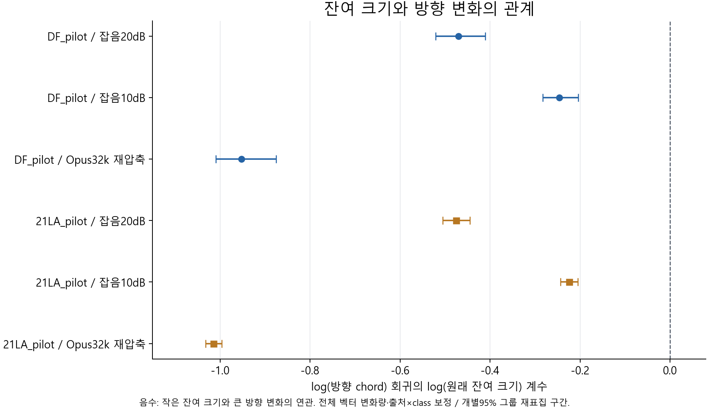
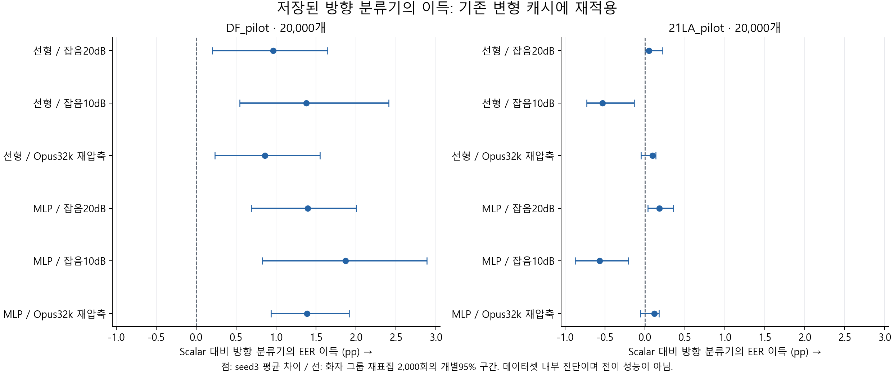

> 역사 문서 보존본. 원문 작성 당시의 상태·계획을 포함한다. 최신 상태와 확정 결과는 experience의 각 실험 README를 우선한다.

# EBM 새 가설의 캐시 검증 — 2026-11-06

완료: 2026-11-06T12:42:52.397155+09:00. 캐시 계산 33.16초와 별도의 독립 수식 검수를 수행했다. 이 시간에는 분석 설계·코드 작성·문서 작성은 포함하지 않는다.

**핵심 결과:** 깨끗한 T에서 OC의 spoof 학습 신호가 약한 현상, 작은 잔여 벡터의 방향 정규화 민감성, h를 읽는 분류기의 방향×스케일 상호작용을 확인했다. 환경 변화가 방향 이득을 모두 없앤다는 설명은 지지되지 않았다. DF에서는 이득이 유지됐고21LA의10dB 잡음에서 EER 이득이 역전됐다.

## 1. 범위와 가설별 판정

| 가설 | 이번에 실행한 검증 | 판정 |
| --- | --- | --- |
| H3 OC 학습 신호 부족 | clean T/V/두 pilot의 실제 OC gradient와 기존 head 파라미터 gradient | 현 조건의 spoof 신호 부족을 지지. 새 방향 loss의 개선 효과는 미시험 |
| H4 잔여 방향의 신뢰도 차이 | 동일 발화 R3 캐시의 변화량·잔여 크기·방향각과 조건 보정 회귀 | 기하적 증폭을 지지. float 반올림 오류나 신뢰도 gate의 성능 이득과는 구분 |
| H5 h 이득의 상호작용 설명 | T만으로 LN affine 복원, h 재구성, 저장된 h 분류기의 예측 분해 | 상호작용으로 동일 함수를 표현할 수 있음을 확인. 새로운 분류기의 학습 가능성·LN 인과성은 미시험 |
| H1 환경 신호 혼합으로 이득 소실 | 기존 내부CV 분류기를 잡음·재압축 캐시에 그대로 적용 | 조건별 민감성 확인. 일괄적인 이득 소실은 미지지이며 전이 실패의 원인인지는 미확정 |

원래 EBM, centroid, 기존 head와 probe를 학습하거나 변경하지 않았다. 새 음성 forward0회·새 detector/probe fit0회다. T에서 h/z의 고정된 LayerNorm affine 계수320개를 정답 없이 수치적으로 복원했으며, 이를 새 탐지기 학습으로 세지 않는다. 취소한DF4×3는 실행하지 않았다.

T25,380개·V14,983개·DF20,000개·21LA20,000개, 고유발화80,363개를 사용했다. R3는 기존 두 pilot의 동일 발화를 반복 측정한 조건이며 별도 독립 표본으로 합산하지 않는다.

## 2. H3: 손실 비중과 실제 gradient

실제 PyTorch softplus의 threshold20 선형 분기까지 맞췄다. 각 class에50%를 주는 원래 batch의 균형 OC 조건으로 비교했다. g_B와g_S는 각 class가 균형 OC 항에 주는 파라미터 gradient다. 변환 regularizer의 gradient는 포함하지 않았다. 비율은 `||g_S||/(||g_B||+||g_S||)`이며, 두 벡터의 합에 대한 분산 분해나 optimizer step 비율이 아니다.

T에서 spoof의 균형 OC 손실 비중은2.2004%, 원시 z에 대한 표본별 gradient norm의 class평균 비중은1.0281%였다. 초기 dynamic gate 파라미터의 비율은 seed3 평균0.5812%다.

| head | 상태 | seed | 정상 gradient L2 | spoof gradient L2 | spoof 비율(%) |
| --- | --- | --- | --- | --- | --- |
| static | identity | 101 | 0.0026235064 | 1.5336163e-05 | 0.5812 |
| metric | identity | 101 | 0.0005418947 | 6.4206314e-05 | 10.5933 |
| dynamic | identity | 101 | 0.0026285205 | 1.537748e-05 | 0.5816 |
| dynamic | selected | 101 | 0.00031768301 | 1.9365418e-05 | 5.7456 |
| dynamic | identity | 102 | 0.0026349202 | 1.5397828e-05 | 0.5810 |
| dynamic | selected | 102 | 0.00021196641 | 1.9127693e-05 | 8.2770 |
| dynamic | identity | 103 | 0.0026399753 | 1.543154e-05 | 0.5811 |
| dynamic | selected | 103 | 0.00025621465 | 1.9344299e-05 | 7.0200 |

선택된 dynamic gate에서는 정상 gradient가 작아지면서 spoof 비율이 약5.75~8.28%가 된다. metric의 초기 비율도10.59%로 다르다. 따라서 모든 구조·학습 단계에서 spoof gradient가0이라고 결론내리지 않는다. 파라미터화가 다른 head의 gradient 절대 크기를 직접 우열로 비교하지 않는다.

c와x 모두에 수직인 방위 방향의 OC 미분 최대 절댓값은5.55e-17이다. 이는 원래 OC의 구조적 불변성이다. 현재 진단은 clean long-view 캐시에 한정되며 원래 BPL·short-view·증강·학습 전 과정의 gradient를 복원하지 않았다.

## 3. H4: 큰 방향각의 의미

`r=x-sc`, `rho=||r||`, `u=r/rho`다. 잔여 크기는 `sqrt(1-s²)`이므로 독립된 새 정보는 아니다. 작은 r를 길이1로 정규화하면 같은 수준의 벡터 변화도 방향에서 크게 보일 수 있다.

`log(||u_changed-u_native||)`를 `log(rho_native)`, `log(||x_changed-x_native||)`, 출처×class 절편으로 기술했다. 반복 조건마다 따로 계산하고 화자 그룹을2,000회 재표집했다. 아래는 관찰된 기하적 관계이며 원인 효과 추정이나 독립성 검정이 아니다.

| 자료 | 조건 | rho 계수 | 개별95% CI | R² |
| --- | --- | --- | --- | --- |
| DF_pilot | 잡음20dB | -0.4701 | [-0.5207, -0.4105] | 0.7175 |
| DF_pilot | 잡음10dB | -0.2462 | [-0.2829, -0.2037] | 0.6819 |
| DF_pilot | Opus32k 재압축 | -0.9520 | [-1.0090, -0.8753] | 0.8166 |
| 21LA_pilot | 잡음20dB | -0.4749 | [-0.5050, -0.4446] | 0.7491 |
| 21LA_pilot | 잡음10dB | -0.2241 | [-0.2434, -0.2050] | 0.6010 |
| 21LA_pilot | Opus32k 재압축 | -1.0143 | [-1.0320, -0.9961] | 0.8641 |

6개 계수의 개별95% 구간은 모두 음수였다. float32로 다시 계산한 u와 float64 기준 u의 chord 차이는 최대약2.5e-6으로, 관찰한 잡음 방향 변화를 부동소수점 반올림 오류만으로 설명하기 어렵다. 여기서 확인한 것은 실제 입력 변화의 정규화 증폭이다. 큰 방향각을 곧바로 큰 위조 신호 변화로 해석하지 않는다. 신뢰도 가중 gate를 학습했을 때의 성능 이득은 아직 확인하지 않았다.

## 4. H5: h의 복원과 분류기 분해

T의 h/z 쌍에서 `q=(h-mean(h))/sqrt(var(h)+1e-12)`에 대해 채널별 `z=gamma*q+beta`를 정답 없이 복원하고, 이 고정 계수를 V/DF/21LA에 적용했다. gamma 최소 절댓값은약0.988로 역변환이 퇴화하지 않았다.

| 자료 | 행수 | h 복원 최대 오차 | 상대 RMS 오차 |
| --- | --- | --- | --- |
| T | 25380 | 1.03e-07 | 6.41e-08 |
| V | 14983 | 1.22e-07 | 6.36e-08 |
| DF_pilot | 20000 | 1.28e-07 | 6.36e-08 |
| 21LA_pilot | 20000 | 1.17e-07 | 6.47e-08 |

h160을 읽는 기존 선형 분류기의 항은 `mean(h)*sum(w) + scale(h)*(q(z) dot w) + 상수`로 분해된다. 따라서 평균·스케일 두 값만 선형으로 더하는 것과 달리, h를 추가하면 방향과 스케일의 곱을 사용할 수 있다.

독립 NumPy 수식으로 h에서 직접 분해한 예측의 최대 차이는5.33e-15였다. 복원한 h를 사용해도 seed101의 EER는 두 pilot에서 그대로였고 LL 차이는 약1e-10 수준이었다.

| 자료 | seed101 입력 조건 | EER(%) | balanced LL |
| --- | --- | --- | --- |
| DF_pilot | saved_h | 1.950000 | 0.055026521 |
| DF_pilot | reconstructed_h | 1.950000 | 0.055026521 |
| DF_pilot | scale_fixed_to_outer_train_mean | 2.050000 | 0.091064597 |
| DF_pilot | mean_fixed_to_outer_train_mean | 1.933333 | 0.055014239 |
| 21LA_pilot | saved_h | 0.800000 | 0.024918833 |
| 21LA_pilot | reconstructed_h | 0.800000 | 0.024918833 |
| 21LA_pilot | scale_fixed_to_outer_train_mean | 0.711111 | 0.034004433 |
| 21LA_pilot | mean_fixed_to_outer_train_mean | 0.800000 | 0.025002404 |

scale을 해당 outer-train 평균에 고정하면 LL은 DF0.05503→0.09106,21LA0.02492→0.03400으로 나빠졌다. 평균만 고정한 효과는 작았다. 다만21LA의 EER는 scale 고정에서0.80→0.71111%로 낮아져 지표 방향이 달랐다. 단일 seed의 고정 분류기 입력 개입이며, refit한 대조의 성능이나 LayerNorm이 원래 탐지 오류를 일으킨다는 인과 증거가 아니다.

## 5. H1: 환경 변화에서 방향 이득이 유지되는가

각 데이터셋 내부의 기존5×3 grouped CV가 저장한 outer refit 모델을 그대로 재사용했다. 매 발화의 원래 학습에서 제외된 outer-test 모델만 적용했으며, 같은 발화의 변형도 동일 모델·scaler로 계산했다. 전이T→DF/21LA 성능이 아니라 내부 held-out-speaker 분류기의 변형 민감도다.

아래 scalar는 원래 cosine과 구분되는 학습된 scalar probe이며, 수치는 seed3 지표 평균이다. 동일 모델 계열·fold의 scalar 대비 방향 증분을 비교한다.

**DF_pilot**

| 조건 | 분류기 | EER(%) | LL |
| --- | --- | --- | --- |
| 원래 음성 | scalar | 3.344444 | 0.172803 |
| 원래 음성 | direction_linear | 2.303704 | 0.082699 |
| 원래 음성 | direction_mlp | 1.662963 | 0.049364 |
| 잡음20dB | scalar | 4.203704 | 0.190087 |
| 잡음20dB | direction_linear | 3.242593 | 0.120596 |
| 잡음20dB | direction_mlp | 2.809259 | 0.099183 |
| 잡음10dB | scalar | 6.446296 | 0.261019 |
| 잡음10dB | direction_linear | 5.068519 | 0.188037 |
| 잡음10dB | direction_mlp | 4.577778 | 0.145771 |
| Opus32k 재압축 | scalar | 3.262963 | 0.176041 |
| Opus32k 재압축 | direction_linear | 2.405556 | 0.087501 |
| Opus32k 재압축 | direction_mlp | 1.875926 | 0.058004 |

**21LA_pilot**

| 조건 | 분류기 | EER(%) | LL |
| --- | --- | --- | --- |
| 원래 음성 | scalar | 0.800000 | 0.038032 |
| 원래 음성 | direction_linear | 0.800000 | 0.030893 |
| 원래 음성 | direction_mlp | 0.750000 | 0.027995 |
| 잡음20dB | scalar | 1.300000 | 0.057331 |
| 잡음20dB | direction_linear | 1.250000 | 0.051357 |
| 잡음20dB | direction_mlp | 1.118519 | 0.047399 |
| 잡음10dB | scalar | 1.681481 | 0.095937 |
| 잡음10dB | direction_linear | 2.212963 | 0.091442 |
| 잡음10dB | direction_mlp | 2.248148 | 0.080291 |
| Opus32k 재압축 | scalar | 0.750000 | 0.034975 |
| Opus32k 재압축 | direction_linear | 0.655556 | 0.027632 |
| Opus32k 재압축 | direction_mlp | 0.633333 | 0.026372 |

| 자료 | 방향 모델 | 조건 | EER 이득(pp) | 개별95% CI | 원래 대비 이득 변화의95% CI |
| --- | --- | --- | --- | --- | --- |
| DF_pilot | direction_linear | 잡음20dB | 0.961111 | [0.2006, 1.6415] | [-0.8016, 0.3457] |
| DF_pilot | direction_linear | 잡음10dB | 1.377778 | [0.5430, 2.4087] | [-0.3162, 1.0766] |
| DF_pilot | direction_linear | Opus32k 재압축 | 0.857407 | [0.2316, 1.5499] | [-0.5899, 0.1181] |
| DF_pilot | direction_mlp | 잡음20dB | 1.394444 | [0.6889, 2.0047] | [-1.1294, 0.2560] |
| DF_pilot | direction_mlp | 잡음10dB | 1.868519 | [0.8297, 2.8863] | [-0.8857, 1.0663] |
| DF_pilot | direction_mlp | Opus32k 재압축 | 1.387037 | [0.9338, 1.9132] | [-0.5566, 0.0009] |
| 21LA_pilot | direction_linear | 잡음20dB | 0.050000 | [0.0013, 0.2215] | [-0.0692, 0.2424] |
| 21LA_pilot | direction_linear | 잡음10dB | -0.531481 | [-0.7317, -0.1374] | [-0.7808, -0.1400] |
| 21LA_pilot | direction_linear | Opus32k 재압축 | 0.094444 | [-0.0491, 0.1351] | [-0.1425, 0.1568] |
| 21LA_pilot | direction_mlp | 잡음20dB | 0.181481 | [0.0369, 0.3555] | [-0.0838, 0.3428] |
| 21LA_pilot | direction_mlp | 잡음10dB | -0.566667 | [-0.8737, -0.2060] | [-0.9679, -0.2434] |
| 21LA_pilot | direction_mlp | Opus32k 재압축 | 0.116667 | [-0.0582, 0.1741] | [-0.1714, 0.1462] |

DF에서는 선형·MLP 모두 세 변형에서 scalar 대비 EER 이득의 개별 구간이0보다 컸다. 원래 음성 대비 이득 변화 구간은 모두0을 포함했다. 따라서 방향 정보가 잡음·재압축에서 일괄적으로 무너진다는 설명은 지지되지 않았다.

21LA의10dB 잡음에서는 방향 선형/MLP의 EER 이득이 각각-0.53148/-0.56667pp로 역전됐고 개별95% 구간도 음수였다. 그러나 LL은 여전히 scalar보다 작았다. EER 순위와 확률 예측 오차를 분리해서 해석한다. 이것은 조건별 민감성의 근거이며, 출처·codec 환경 성분을 제거하면 미지 도메인 전이가 개선된다는 H1 전체를 검증한 결과는 아니다.

## 6. 아직 검증하지 않은 부분과 연구 가설 수정

- H1: nuisance 성분을 제거한 새 모델의 전이 이득은 미시험이다. 방향 전체를 버리기보다 유지되는 성분과 조건별 취약성을 구분한다.
- H2: 원음 길이와 반복 패딩·출처의 인과 분리는 새 입력 개입이 필요하다. 이전 정상 오류의 관찰 진단을 반복해 새 검증으로 세지 않는다.
- H3: 새 방향 objective 또는 표현 공동 학습이 더 좋은지는 미시험이다.
- H4: rho 기반 신뢰도 gate의 실제 개선은 미시험이다.
- H5: 같은 정보와 용량을 주고 학습한 상호작용 대조가 h160 이득을 재현하는지는 미시험이다.
- H6/H7: 대체 검증셋 선택과 레이어 결합 적응의 효과는 이번 캐시 검증에 포함하지 않았다.
- 취소한DF4×3 보완 학습은 제외한 상태를 유지한다.

## 7. 검수·불확실성·근거

원래 입력309개 파일은 실행 전후 SHA256이 같았다. 원래 모델·fold·cache를 보존했다. 독립 수식으로 모델120개, 예측30,720개를 대조해 최대 오차1.07e-14를 확인했다. 전체96개 metric행의 EER/AUROC192개를 별도 ROC 구현과 대조했다. 조건 보정 계수6개와 T의 실제 autograd class 평균 norm도 별도로 검산했다.

CI는 동일 발화·화자 그룹의 paired resampling2,000회에 따른 개별95% 탐색 구간이다. 전체 다중 비교 보정이나 매 draw 재학습은 하지 않았다. 이미 저장된 head·fold·선택에 조건부이며 학습·선택 불확실성을 전부 포함하지 않는다. DF5×3의 출처×class 누락 제한, DF/21LA 공유 화자, 미해결 원발화 family 의존성, 반복 관찰 이력을 유지한다.

초기 v1은 합성 수치검증에서 smooth softplus와 실제 threshold20 구현의 극소 차이를 발견해 가설 결과 생성 전에 종료했다. 실제 구현의 분기를 반영한 v2에서 검수와 계산을 완료했으며 v1 기록은 보존했다. 원래 손실·모델·실험 결과를 수정한 것은 아니다.

- [실행 전 고정한 범위](../../artifacts/geometry_cache/local_analysis/cache_hypotheses_20261106_v2/protocol.json); [입력 해시](../../artifacts/geometry_cache/local_analysis/cache_hypotheses_20261106_v2/inputs.json)
- [OC loss/gradient](../../artifacts/geometry_cache/local_analysis/cache_hypotheses_20261106_v2/H3_OC_gradients.json); [LN 복원](../../artifacts/geometry_cache/local_analysis/cache_hypotheses_20261106_v2/H5_LN_reconstruction.json)
- [DF 기하](../../artifacts/geometry_cache/local_analysis/cache_hypotheses_20261106_v2/H4_DF_pilot_summary.json); [21LA 기하](../../artifacts/geometry_cache/local_analysis/cache_hypotheses_20261106_v2/H4_21LA_pilot_summary.json)
- [DF 방향 이득](../../artifacts/geometry_cache/local_analysis/cache_hypotheses_20261106_v2/H1_DF_pilot_advantage_retention.json); [21LA 방향 이득](../../artifacts/geometry_cache/local_analysis/cache_hypotheses_20261106_v2/H1_21LA_pilot_advantage_retention.json)
- [실행 검수](../../artifacts/geometry_cache/local_analysis/cache_hypotheses_20261106_v2/verification.json); [독립 수식 검수](../../artifacts/geometry_cache/local_analysis/cache_hypotheses_20261106_v2/independent_verification.json)
- [기존 F/P/R 결과](ebm_frozen_all_results_20261105.md); [기존 분할 제한](ebm_condition_audit_20261105.md)
