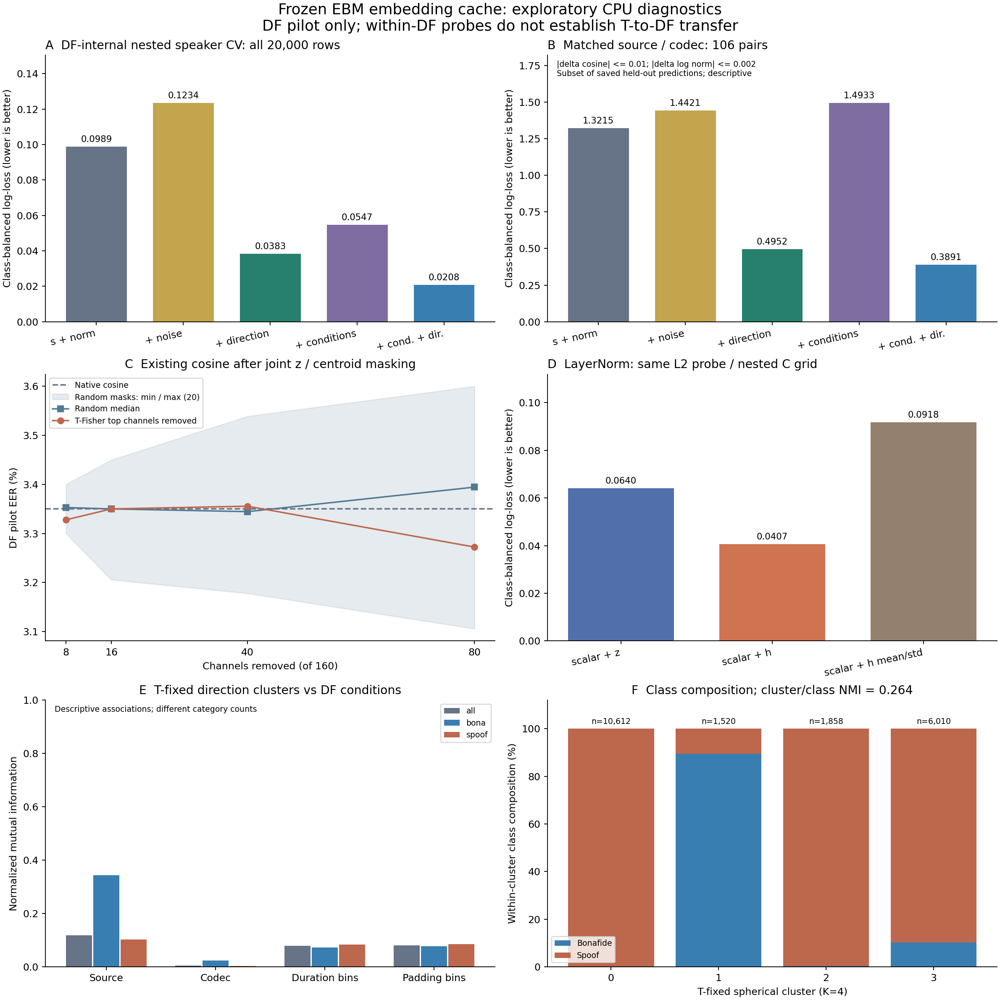

> 표시 명칭·링크 이름은 설명형으로 정리했다. 원래 코드·경로·수치는 그대로 보존한다.

> 역사 문서 보존본. 원문 작성 당시의 상태·계획을 포함한다. 최신 상태와 확정 결과는 experience의 각 실험 README를 우선한다.

# 기존 임베딩 캐시로 수행한 네 가지 진단

## 최신 결과와의 관계

이 문서의 본문은09:06 KST 완료한 `cached_core_v1`의 **역사적 결과와 방법**이다. 이후의 최신 통합 판정은 [고정 EBM 전체 분석](ebm_frozen_all_results_20261105.md)에 있다. 옛 수치를 최신 모델의 성능으로 바꾸지 않는다.

- DF 내부 방향 probe의 이득은 유효하지만 T→DF 전이 성능이 아니다. 새 P3 선형 전이는 LL을 작게 줄였으나 DF EER는3.35%→3.40%,21LA EER는0.80% 유지였다.
- 소수 채널의 낮은 EER 점 추정치는 전체 ROC·AUROC·V 또는 통계적 동등성의 입증이 아니다. 후속1개 실험까지 완료됐고,새 gate의 전이 우월성은 확인하지 못했다.
- 옛106쌍은 source×codec matching이다. 새 same-speaker 포함 F2는DF27쌍/9그룹,21LA10쌍/6그룹으로 최소 표본 기준에 미달했다.
- h/z probe 접근성 차이와 LayerNorm의 인과적 정보 손실을 구분한다. 새 scalar+u+h/noise P4의 최종 결과는 아직 없다.
- 새 F4는 두 데이터셋의 전체 u에 대한 eta²와 padding/duration 연관을 계산했다. 옛 K=4 NMI와 같은 지표가 아니다.

아래의 “Q는 열지 않았다”,“새 추론이 없었다”는 **이09시 실행의 범위**다. 이후 Q평가와 새 GPU 추론 작업이 시작된 현재 상태 전체를 뜻하지 않는다. 현재 진행·대기는 주 명세0절을 따른다.

## 기존 실행의 결과

2026-11-05 09:06 KST 완료. 기존 [실험 명세](ebm_embedding_geometry_spec_20261105.md)와 [검토 기록](ebm_embedding_geometry_review.md)을 확인하고, 사용자가 요청한 재추출 없는 네 가지 진단을 별도 탐색 버전 `cached_core_v1`으로 실행했다. 두 문서의 실제 생성 시각은 각각 11월 5일 00:36, 00:48 KST였다.

후속 문서 정리: 네 실험을 각각 **가설 → 실험 → 수행 방식 → 결과 → 해석** 순서로 읽으려면 [실험별 문서 목록](cached_core_20261105/README.md)을 참고한다. [① 방향](cached_core_20261105/01_direction.md), [② 채널 제거](cached_core_20261105/02_channel_ablation.md), [③ LayerNorm](cached_core_20261105/03_layernorm.md), [④ 데이터 조건](cached_core_20261105/04_conditions.md)에 실제 수행 범위·수치·해석의 한계를 함께 정리했다.

**기존 DF 내부 probe에서는 방향 추가의 이득이 관찰됐고,시험한 상위 채널 제거의 EER 점 추정치는 native와 가까웠다.** 이 관찰을 전이 개선이나 성능 동등성의 증명으로 확대하지 않는다. LayerNorm 이전 h도 이후 z보다 같은 선형 probe에서 더 잘 읽혔고, 방향 군집은 출처·길이·padding과도 연관됐다.

이 결과는 현재 표현의 진단이다. DF에서 진단용 분류기를 학습했으므로 아래 1.20%나 0.60%를 T→DF 일반화 성능 또는 새 EBM의 성능으로 사용할 수 없다. 앞선 T/V에서 고정한 방향 보정의 DF EER 3.35%와도 학습 조건이 다르다.

**기존 EBM은 코사인 `s=(z·c)/(||z|| ||c||)`만 탐지 점수로 사용하며 벡터 크기를 별도 판별 입력으로 사용하지 않는다.** 이 문서의 “코사인·크기 scalar”는 크기의 효과를 통제하기 위해 새로 학습한 진단용 확장 대조군이다. scalar의 EER 3.5056%와 log-loss 0.098882를 기존 EBM 자체의 지표로 해석하지 않는다. 기존 native cosine의 DF pilot EER는 3.35%다. 이번 실행에는 s만으로 새 학습한 probe와 s+u probe를 같은 DF 교차검증에서 비교하는 대조는 포함하지 않았다.



## 데이터와 비교 범위

T 25,380개, V 14,983개, DF pilot 20,000개의 기존 h/z·centroid·metadata를 재사용했다. DF는 정상 2,000개와 스푸프 18,000개의 기존 고정 표본이다. 새 음성 입력, GPU 추론, 임베딩 추출, EBM 학습은 없었다. Q는 열지 않았다. CPU에서 작은 진단용 분류기를 학습한 작업은 포함한다.

체크포인트 SHA256은 `104873703a57cad98b686d770e0860e031a2cf9abef79b72668780c1660e0b24`로 고정했다. 캐시 파일 해시, 행·label 정렬, native 점수 대응, centroid 일치, tangent 직교성과 방향 유효성을 확인했다.

09시 실행 전 서버를 읽기 전용으로 확인했다. 실제 확인 시각은 08:56:35 KST였으며 멘티의 실행 중 실험은 없고 배정 GPU 6/7은 각각 6 MiB, 사용률 0%였다. 기존 screen·컨테이너·연구 코드·서버 결과는 변경하지 않았다.

## ① 코사인·크기를 통제한 방향 비교

DF 내부의 source×speaker 93그룹을 사용했다. 바깥 5-fold에서 화자가 겹치지 않게 나누고, 각 학습 부분의 안쪽 3-fold에서 C=[0.01,0.1,1,10]을 balanced log-loss로 선택했다. spline, scaler, metadata one-hot도 각 학습 fold에만 fit했다. held-out 발화마다 예측은 한 번씩 저장했다.

scalar 입력은 코사인의 5-knot cubic spline, log(z norm), direction-valid 지시자다. 방향은 centroid에 수직인 단위 tangent 방향 u다. 잡음은 발화 ID별로 고정한 같은 160좌표의 단위 잡음이며 같은 tangent 공간에 투영했다. 잡음은 모델 용량의 보조 대조군이고 실제 u 분포와 동일한 null은 아니다.

| DF 내부 진단용 입력 | Balanced log-loss ↓ | EER (%) ↓ | AUROC ↑ |
| --- | ---: | ---: | ---: |
| 코사인·크기 scalar | 0.098882 | 3.5056 | 0.994842 |
| scalar + 무작위 방향 잡음 | 0.123376 | 4.2000 | 0.988348 |
| scalar + 실제 잔여 방향 | 0.038342 | 1.2000 | 0.999125 |
| scalar + 출처·코덱·길이·padding | 0.054727 | 2.0778 | 0.997094 |
| scalar + 위 조건 + 잔여 방향 | 0.020767 | 0.6000 | 0.999731 |

방향 추가의 balanced log-loss 개선은 0.060540, source×speaker bootstrap의 개별 95% 구간은 [0.042811, 0.080576]이었다. 잡음 대비 개선은 0.085034 [0.062568, 0.110277]이었다. 두 비교 모두 5개 outer fold 각각에서 방향 추가가 더 낮은 log-loss를 보였다.

출처·코덱·log(duration)·padding을 입력에 포함한 뒤에도 방향 추가의 개선은 0.033961 [0.021772, 0.047048]이었다. 측정한 조건을 포함한 이 probe에서 추가로 읽히는 신호가 남았다. 측정하지 않은 데이터 조건이나 비선형 교란까지 제거했다는 뜻은 아니다.

### 코사인과 크기가 가까운 표본만 비교

같은 출처×코덱 안에서 정상/스푸프를 중복 없이 매칭했다. 주 기준은 |코사인 차이|≤0.01, |log(norm) 차이|≤0.002이다. 106쌍, 28개 화자그룹, 20개 출처×코덱 구간이 남았다. 실제 평균 차이는 코사인 0.003867, log(norm) 0.000359였다.

| 주 매칭 표본 106쌍의 입력 | Balanced log-loss ↓ | EER (%) ↓ | AUROC ↑ |
| --- | ---: | ---: | ---: |
| scalar | 1.321538 | 50.9434 | 0.474635 |
| scalar + 잡음 | 1.442113 | 51.8868 | 0.475881 |
| scalar + 잔여 방향 | 0.495188 | 19.8113 | 0.889284 |
| scalar + 조건 | 1.493337 | 44.3396 | 0.538092 |
| scalar + 조건 + 잔여 방향 | 0.389107 | 16.0377 | 0.925774 |

각 예측은 전체 DF 교차검증에서 이미 held-out으로 생성된 값을 사용했다. 매칭 표본으로 분류기나 원음 전체 비반복 학습을 다시 선택하지 않았다. 방향 추가의 log-loss 개선은 0.826350, 개별 95% 구간은 [0.532227, 1.365502]였다. 방향 평균 차이의 norm은 0.452861, 매칭된 정상/스푸프 방향의 평균 코사인은 0.674227이었다. 이 방향 통계에 정확한 조건부 검정 p값은 붙이지 않았다.

주 매칭은 정상의 5.3%, 스푸프의 0.59%만 포함한다. 유사한 점수의 어려운 표본을 선택한 결과이므로 이 성능을 DF 모집단 성능으로 일반화할 수 없다. 전체 DF로 fit한 예측의 calibration도 매칭 표본의 균형 분포에 맞춰 다시 보정하지 않았다. 코사인·크기는 유한한 허용 오차로 맞췄으며 정확히 동일하지 않다.

더 좁은 기준(0.005/0.001)은 72쌍, 넓은 기준(0.02/0.004)은 139쌍이었다. 양쪽에서도 방향 추가가 scalar와 잡음보다 좋았다. 같은 화자까지 맞추면 18쌍·7그룹만 남아 참고값으로 한정했다. 출처별 주 매칭은 vcc2018 57쌍, vcc2020 47쌍, asvspoof 2쌍이고, 코덱별로는 9~15쌍이므로 세부 조건의 정밀한 성능 차이를 주장하지 않는다.

**판정:** 정한 scalar baseline을 넘어서 DF 내부에서 읽을 수 있는 방향 관련 판별 신호가 현재 표현에 남아 있다는 근거다. 조건부 상호정보량의 추정, 완전한 조건부 독립성 검정, T→DF 전이 개선의 증거는 아니다.

## ② 기존 코사인에서 채널 제거

채널 순위는 T에서만 공격별 Fisher score를 계산해 동일 가중 평균으로 정했다. 앞서 했던 선택 채널의 새 분류기 학습과 다르게, 여기서는 z와 learned centroid의 같은 좌표를 제거하고 두 벡터를 각각 재정규화한 코사인을 계산했다. 무작위 제거는 seed 200~219의 20개 permutation을 고정했다.

| 제거 채널 수 | T 상위 채널 제거 후 DF EER (%) | 무작위 제거 중앙값 | 무작위 20회 최소~최대 |
| --- | ---: | ---: | ---: |
| 0: 기존 코사인 | 3.3500 | — | — |
| 8 (5%) | 3.3278 | 3.3528 | 3.3000~3.4000 |
| 16 (10%) | 3.3500 | 3.3500 | 3.2056~3.4500 |
| 40 (25%) | 3.3556 | 3.3444 | 3.1778~3.5389 |
| 80 (50%) | 3.2722 | 3.3944 | 3.1056~3.6000 |

주 비교인 상위 40채널 제거의 EER 악화폭은 +0.005556pp, 개별 95% 구간은 [-0.092791, 0.080177]pp였다. 무작위 20개 중 13개는 상위 제거보다 낮고 7개는 높았다. 무작위 범위는 mask 설계의 변동이며 표본 불확실성의 신뢰구간이 아니다. V는 모든 제거 조건에서 EER 0%였다.

EER가 유지된다고 점수가 변하지 않은 것은 아니다. 사후 기술 점검에서 상위 40채널 제거의 DF 평균 절대 점수 변화는 0.004460, 최대는 0.129959, native와의 Spearman 상관은 0.996755였다. 기존 V threshold 0.9883067190214367을 그대로 쓰면 DF 정상 오거부율은 39.00%→39.55%였고, 80개 제거에서는 40.15%였다. threshold를 DF 결과로 재선택하지 않았다.

**판정:** 시험한 일부 부분집합에서160개 native와 가까운 또는 낮은 DF pilot EER의 점 추정치를 얻었다. 사전 비열등성·동등성 검정을 수행한 것은 아니다. 80개만 남겨도 상위 제거 EER는 3.2722%, 무작위 제거 20개의 중앙값은 3.3944%로 전체 160개의 3.35%와 비슷했다. 이는 현재 점수에 대한 중복·여유 가능성을 보여준다. 별도로, T 상위 채널을 제거했을 때 무작위 제거보다 크게 악화되는 패턴은 확인하지 못했다. 처음부터 80차원만 생성하는 모델의 성능, 모든 부분집합의 동등성, 다른 데이터·점수에서 제거 채널의 불필요성은 이번 실험으로 결정되지 않는다.

후속 [80→10개 유지 실험](cached_core_20261105/02_channel_reduction_to10.md)도 완료했다. 기존 제거 경로를 이은 T-Fisher 하위 10개 유지 EER는 2.9444%, 상위 10개는 5.0500%, 무작위 10개 20회의 중앙값은 3.6694%였다. 일부 10개 좌표로도 기존 EER를 유지할 수 있었지만 부분집합에 따라 차이가 컸다. 하위 10개의 고정 V threshold 정상 오거부율은 42.80%로 native 39.00%보다 높아 EER와 운용 오류의 구분도 유지한다.

추가 [5·3·2개 유지](cached_core_20261105/02_channel_reduction_to2.md)에서도 하위 유지 EER는 2.9500/2.9222/2.9222%였다. 상위 유지와 무작위 중앙값은 더 나빴다. 하위 2개도 DF AUROC는 0.995943→0.987659, V EER는 0→0.1907%로 악화돼 EER 유지가 전체 성능의 동등성을 뜻하지 않음을 함께 기록했다.

## ③ LayerNorm 전후의 읽기 쉬운 정보

scalar에 원래 160차원 h 또는 z를 각각 추가하고 동일한 L2 logistic, 같은 원음 전체 비반복 학습 grid, 같은 nested fold를 적용했다. h에 z의 centroid를 적용하지 않았다.

| DF 내부 입력 | Balanced log-loss ↓ | EER (%) ↓ |
| --- | ---: | ---: |
| scalar + LayerNorm 이후 z | 0.064016 | 1.7000 |
| scalar + LayerNorm 이전 h | 0.040671 | 1.4944 |
| scalar + h의 평균·log(std)만 | 0.091780 | 3.2444 |

h의 z 대비 log-loss 개선은 0.023345 [0.010456, 0.042250]이며 outer 5개 fold 모두에서 h가 좋았다. h의 평균·크기 통계만 추가한 개선은 더 작았다.

**판정:** 같은 선형 probe에서는 h의 정보가 z보다 더 쉽게 읽혔다. LayerNorm이 탐지 정보를 비가역적으로 없앴거나 기존 탐지 성능 하락을 일으켰다는 증명은 아니다. u도 z의 결정적 변환인데 raw z보다 이 probe에 잘 읽히므로, probe 성능을 정보이론적 정보량과 동일시하지 않는다.

## ④ 방향 군집이 반영하는 데이터 조건

T의 클래스 균형 5,000개 방향에 spherical k-means K=4를 fit했다. seed 501~505 중 T의 cosine 목적이 가장 좋은 초기화를 선택하고 V/DF에는 고정 적용했다. 길이 구간과 padding 구간 경계도 T에서만 정했다. label별 결과와 함께 출처·코덱·길이·padding의 군집 연관을 기술했다.

| DF 군집과 비교한 항목 | 전체 NMI | 정상 내부 NMI | 스푸프 내부 NMI |
| --- | ---: | ---: | ---: |
| 정상/스푸프 label | 0.264455 | — | — |
| 출처 | 0.118216 | 0.343788 | 0.102867 |
| 코덱 | 0.004659 | 0.023151 | 0.002396 |
| 길이 구간 | 0.078156 | 0.072378 | 0.083180 |
| padding 구간 | 0.080117 | 0.076551 | 0.084641 |

출처와의 연관은 정상 안에서도 나타났고, 길이·padding과도 연관이 있었다. 이 K=4 군집에서 코덱과의 연관은 상대적으로 작았다. 범주 수가 서로 달라 NMI 숫자를 곧바로 각 조건의 인과적 중요도 순위로 사용할 수 없다. 길이와 padding도 crop/padding 규칙으로 연결되므로 독립된 두 원인으로 세지 않는다.

**판정:** 방향 구조에는 클래스와 데이터 조건이 함께 반영된다. 측정한 조건을 probe에 포함한 뒤에도 방향 추가의 이득이 남았으나, 실제 음향 탐지 신호와 모든 데이터 조건의 영향을 완전히 분해한 결과는 아니다. 고정 K=4에서 약한 연관이 다른 군집 수나 원래 160차원에서 정보 부재를 뜻하지 않는다.

## 불확실성과 검증

paired source×speaker bootstrap 2,000회, seed 7301을 사용했다. 위 구간은 개별 95% 구간이다. 저장된 `CI99_pointwise`는 개별 99% 구간이며, 명시한 다섯 주 비교에만 Bonferroni family 95% 구간으로 해석할 수 있다. 최초 lock의 family99 표기는 수준 이름의 오류여서 숫자를 바꾸지 않고 정정 이력을 남겼다. 매칭·다른 mask·군집 등의 모든 탐색 이력이 함께 보정된 것은 아니다.

CI는 저장된 OOF 예측에 조건부이며 bootstrap마다 nested 분류기를 재학습하지 않았다. source×speaker 의존성만 묶었고 원발화·재인코딩·합성 파생본의 family 연결은 미해결이다. 이미 관찰한 DF 표본이고 하나의 기존 checkpoint, 선형 진단용 분류기, 한 묶음의 fold를 사용한 탐색이므로 독립된 새 외부 확인으로 부르지 않는다.

마스크·매칭·동률 EER·누락 클래스·ID 잡음·balanced loss 부호의 합성 경계 검사를 통과했다. 실제 결과는 별도 구현의 log-loss, rank 기반 AUROC, DET 기반 EER로 8개 probe를 검증했다. 3개 dataset×85조건=255개 마스크 지표도 재계산했고 독립 마스크 점수의 최대 오차는 2.22e-15였다. 저장 예측의 ID/label 정렬과 화자당 한 outer fold를 확인했다. 그림의 축·레이블·막대·범례를 렌더링해 확인했다.

최초 실행은 교차검증 완료 후 정상만 있는 매칭 구간의 빈 정수 index 처리에서 멈췄다. 완료된 예측을 보존하고 이 처리만 고쳐 후속 매칭·군집 단계를 복구했다. probe 재학습·원음 전체 비반복 학습 재선택은 0회였다. V threshold와 같은 native 점수의 부동소수점 합산 오차가 경계 판정을 바꾸지 않도록, 사후 threshold 점검의 native 기준값은 저장된 원래 cosine을 그대로 사용했다.

## 재현과 결과 위치

계산 코드는 [소스: cached_core_diagnostics.py](../../../workspace/artifacts/geometry_experiments/cached_core_diagnostics.py), 수학 경계 검사는 [소스: verify_cached_core_math.py](../../../workspace/artifacts/geometry_experiments/verify_cached_core_math.py), 출력 독립 검증은 [소스: audit_cached_core_results.py](../../../workspace/artifacts/geometry_experiments/audit_cached_core_results.py), 그림 생성은 [소스: plot_cached_core.py](../../../workspace/artifacts/geometry_experiments/plot_cached_core.py)다. 연구실 원본 소스를 복제한 코드가 아니다.

결과 폴더는 `artifacts/geometry_cache/local_analysis/cached_core_v1/`이다. 핵심 파일은 `summary.json`, `probe_metrics.csv`, `matched_summary.json`, `channel_ablation_curves.csv`, `cluster_associations.csv`, `output_audit.json`, `core_diagnostics.png`다. 발화별 예측·매칭·마스크 점수도 같은 로컬 캐시 안에 저장했다. 기존 캐시·원래 분석·frozen registry는 보존했다.

새 결과 경로에서 전체 CPU 진단을 재현하려면 프로젝트 루트에서 다음을 실행한다. 기본 결과 경로가 이미 있으면 덮어쓰지 않고 실패한다.

```powershell
python -X utf8 artifacts/geometry_experiments/verify_cached_core_math.py
python -X utf8 artifacts/geometry_experiments/cached_core_diagnostics.py --out artifacts/geometry_cache/local_analysis/cached_core_repeat01
python -X utf8 artifacts/geometry_experiments/audit_cached_core_results.py --out artifacts/geometry_cache/local_analysis/cached_core_repeat01
```

새 attention·손실이 유리한지는 같은 조건에서 공동 학습한 비교가 필요하다. 이번 결과는 그 재학습을 수행하거나 개선을 보장한 것이 아니다.
