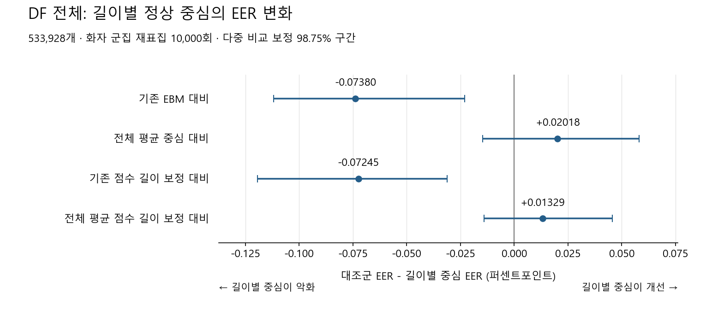

> 역사 문서 보존본. 원문 작성 당시의 상태·계획을 포함한다. 최신 상태와 확정 결과는 experience의 각 실험 README를 우선한다.

# 원음 길이별 정상 센트로이드: 동결 EBM 실험 결과

작성일: 2026-11-06 KST. 승인한 설계의 전체 계산과 독립 검수를 완료했다.

**주실험 D의 DF 개선 판정: 지지되지 않음.** 중심 재추정·스칼라 보정 이상의 이득(H2): 지지되지 않음.

DF 전체 EER는 기존 **3.241828% → 길이별 평균 중심 3.315623%**로, **0.073795pp 악화**됐다. 악화량의 다중 비교 보정 98.75% 구간은 **[0.022940, 0.111895]pp**다. 중심을 고정한 조건부 군집 검정에서 단순한 오차 범위 내 동률보다 악화를 지지하는 결과다.

기존 EBM 가중치·음성 입력·캐시는 변경하지 않았다. T 정상만으로 중심을 추정했고, V는 spoof FAR 1% 운영 threshold에만 사용했다. DF 내부 fit·교차검증·새 음성 forward·optimizer 학습은 없었다.

## 1. 전체 EER

| 방법 | DF 전체 | 19LA 평가 | 21LA 평가 | DF pilot |
| --- | ---: | ---: | ---: | ---: |
| 기존 EBM | 3.241828% | 0.435177% | 1.053539% | 3.350000% |
| 정상 전체 평균 중심 | 3.335799% | 0.464920% | 1.052916% | 3.450000% |
| 길이별 평균 중심(주실험) | 3.315623% | 0.464920% | 1.052916% | 3.422222% |
| 기존 점수 길이 보정 | 3.243177% | 0.435177% | 1.053539% | 3.350000% |
| 전체 평균 점수 길이 보정 | 3.328909% | 0.466485% | 1.052916% | 3.444444% |
| 기존 중심 보존·방향 보정 | 3.246837% | 0.435177% | 1.053539% | 3.350000% |
| 길이별 수축 평균 중심 | 3.322349% | 0.464920% | 1.052916% | 3.433333% |

DF 전체는 정상 14,869개·스푸프 519,059개, 합계 533,928개다. pilot 20,000개와 remaining 513,928개는 서로소 합집합으로 구성했다. 표의 19LA/21LA와 DF는 독립 반복으로 합치지 않았다.

## 2. 사전 고정한 주 비교

양수는 D의 EER 감소, 음수는 D의 악화다. source별 화자 군집을 동일하게 재표집한 10,000회 조건부 구간이다.

| 대조군 | 대조군 EER − D EER (pp) | 95% 구간 | 98.75% 보정 구간 |
| --- | ---: | --- | --- |
| 기존 EBM | -0.073795 | [-0.101090, -0.033699] | [-0.111895, -0.022940] |
| 정상 전체 평균 중심 | +0.020176 | [-0.008396, +0.047568] | [-0.014578, +0.058058] |
| 기존 점수 길이 보정 | -0.072447 | [-0.105916, -0.039435] | [-0.119311, -0.031103] |
| 전체 평균 점수 길이 보정 | +0.013286 | [-0.009245, +0.037394] | [-0.014045, +0.045613] |

중심·V threshold 추정의 불확실성과 미해결 원천 발화 family 의존성은 위 구간에 포함하지 않는다. A/S 및 추가 native 대비 비교는 탐색적 결과이며 주실험으로 승격하지 않았다.

## 3. V에서 threshold를 고정했을 때의 DF 오류

모든 방법의 V spoof FAR는 1% 이하로 맞췄다. DF에서 FAR가 같다는 뜻은 아니다. 정상·스푸프 오류를 함께 해석해야 한다.

| 방법 | 정상 오탐 FRR | 스푸프 통과 FAR | 정상 오류 수 | 스푸프 오류 수 |
| --- | ---: | ---: | ---: | ---: |
| 기존 EBM | 3.5914% | 3.0444% | 534 | 15,802 |
| 정상 전체 평균 중심 | 3.9747% | 2.9428% | 591 | 15,275 |
| 길이별 평균 중심(주실험) | 3.9007% | 2.9546% | 580 | 15,336 |
| 기존 점수 길이 보정 | 3.5510% | 3.0509% | 528 | 15,836 |
| 전체 평균 점수 길이 보정 | 3.9344% | 2.9488% | 585 | 15,306 |
| 기존 중심 보존·방향 보정 | 3.5510% | 3.0573% | 528 | 15,869 |
| 길이별 수축 평균 중심 | 3.9478% | 2.9432% | 587 | 15,277 |

## 4. 같은 길이 안의 구분 성능

| DF 길이 구간 | 정상 / 스푸프 | 기존 EBM AUROC | 전체 평균 G AUROC | 길이별 D AUROC | G EER | D EER |
| --- | ---: | ---: | ---: | ---: | ---: | ---: |
| B0 | 1,368 / 115,447 | 0.983207 | 0.982959 | 0.982977 | 6.557988% | 6.526805% |
| B1 | 4,499 / 164,412 | 0.995052 | 0.994922 | 0.994923 | 3.406686% | 3.406686% |
| B2 | 4,898 / 122,531 | 0.998023 | 0.997970 | 0.997971 | 2.298194% | 2.298194% |
| B3 | 4,104 / 116,669 | 0.998784 | 0.998773 | 0.998771 | 1.531684% | 1.532541% |

B0: 2초 미만, B1: 2–3초, B2: 3–4.0375초, B3: 4.0375초 이상. N-OFF/G-OFF는 해당 구간의 N/G 순위를 보존하는 것을 검수했다.

### 2초 미만의 출처별 차이

| 출처 | 정상 / 스푸프 | G EER | D EER | G AUROC | D AUROC | 작은 표본 |
| --- | ---: | ---: | ---: | ---: | ---: | --- |
| asvspoof | 235 / 28,134 | 0.103078% | 0.103078% | 0.999986 | 0.999986 | False |
| vcc2018 | 831 / 42,032 | 1.925391% | 1.925391% | 0.995361 | 0.995370 | True |
| vcc2020 | 302 / 45,281 | 3.642384% | 3.642384% | 0.994756 | 0.994752 | False |

각 셀의 전체 N·화자 수·FAR/FRR·tail 및 codec 결과는 상세 CSV에 보존했다.

## 5. 199회 무작위 대조와 중심 안정성

| 평가셋 | 무작위 EER 2.5% / 중앙값 / 97.5% | D EER | 무작위 EER ≤ D 비중 |
| --- | --- | ---: | ---: |
| 19LA_eval | 0.464920% / 0.464920% / 0.466485% | 0.464920% | 94.97% |
| 21LA_eval | 1.052916% / 1.052916% / 1.052916% | 1.052916% | 100.00% |
| DF_full | 3.328514% / 3.334688% / 3.339909% | 3.315623% | 0.00% |

위 무작위 분위수는 199개 대조군의 분포이며 D와의 paired confidence interval 또는 인과검정 p-value가 아니다.

| 구간 | T 정상 수 | 화자 수 | 정상 평균 norm | 전체 평균 중심과 각도 | 기존 중심과 각도 |
| --- | ---: | ---: | ---: | ---: | ---: |
| B0 | 109 | 15 | 0.998961 | 0.5802° | 3.3595° |
| B1 | 877 | 20 | 0.999381 | 0.2049° | 3.2281° |
| B2 | 1018 | 20 | 0.999741 | 0.1479° | 3.1298° |
| B3 | 576 | 20 | 0.999759 | 0.2923° | 3.2146° |

T 정상 화자 500회 재표집의 각도 분포·빈 구간 횟수도 저장했다. 각도 안정성은 성능 개선 자체의 증거가 아니다.

### 관측 결과의 해석

1. **학습 정상은 길이별 중심이 거의 같은 방향에 모여 있었다.** 길이별 중심과 전체 평균 중심의 각도는 약 0.148–0.580°이고, 구간별 정상 평균 norm은 0.998961–0.999759였다. 현재 T 표현에서 길이별 평균 방향의 차이는 작다. BPL이 모든 정상 long/short를 가깝게 하는 목적과 양립하지만, BPL 제거 대조를 하지 않았으므로 BPL만을 원인으로 확정하지 않는다.
2. **학습된 중심을 평균으로 바꾸는 변화가 길이 세분화보다 컸다.** 길이별 평균 중심과 학습된 중심의 각도는 약 3.13–3.36°였다. 전체 평균 G로 바꾸면 EER가 0.093971pp 악화됐고, 길이별 D는 G에서 0.020176pp만 회복했다. 후자의 98.75% 구간 [-0.014578, 0.058058]pp는 0을 포함한다. 따라서 평균 교체의 손해를 길이 조건이 확실히 만회했다고 보기 어렵다.
3. **길이 routing의 작은 신호와 기존 EBM 대비 개선은 구분해야 한다.** D는 DF의 무작위 대조 199개보다 모두 낮은 EER를 냈지만, 원래 EBM보다 나빴다. 무작위 군집보다 낫다는 결과를 실제 검출기 개선으로 확대할 수 없다.
4. **짧은 구간 내부의 추가 분별력도 확인되지 않았다.** DF B0에서 D−G AUROC 차이는 +0.0000182, 탐색적 95% 구간은 [-0.0000291, +0.0000560]이었다. 출처별 B0에서도 일관된 개선이 없었으며 VCC2018은 스푸프 화자 군집 수가 적다는 제한이 있다.
5. **기존 중심 보존 A도 개선을 입증하지 못했다.** A의 DF EER는 3.246837%로 native와 거의 같았고, native−A의 탐색적 95% 구간은 [-0.007234, +0.030775]pp였다. 단순 길이 점수 보정과 수축 평균도 기존 모델을 능가한다는 근거가 없었다.

따라서 이번 결과는 **“원래 학습 정상에서 길이별 평균 중심만 추정해 바꾸면 DF 오류가 해결된다”는 방법을 지지하지 않는다.** T의 짧은 정상과 새로운 출처의 짧은 정상 사이의 표현 차이가, T 평균 방향의 작은 분할만으로 교정되지 않았다는 해석이 가능하다. 새 출처의 정상 표현을 실제로 바꾸는 학습이나 원음 길이·반복 개입의 효과는 이번 결과로 확정할 수 없다.

## 6. 검수·범위와 원자료

- 승인한 구간·수식·반복 수·주 방법을 결과에 따라 변경하지 않았다.
- 원본 캐시의 hash를 실행 전후 대조했고 모든 저장 점수를 독립 DET/rank 방식으로 다시 검수했다.
- 각 평가셋에서 512개 원래 rank 임베딩을 UID로 직접 대조하고, 무작위 반복 0/99/198의 점수도 재계산했다.
- 길이와 반복 패딩을 분리한 인과 개입은 하지 않았다. 이번 성공/실패를 EBM 공동 재학습의 성공/실패로 확대하지 않는다.
- DF는 이전 분석에서 관찰한 데이터다. 새 독립 확증 실험이라는 표현을 사용하지 않는다.

- `../../artifacts/geometry_cache/local_analysis/duration_centroids_20261106_v1` (원자료 경로; 배포 제외 또는 미확보, 출처 목록 참조)
- [주 비교와 신뢰구간](../../artifacts/geometry_cache/local_analysis/duration_centroids_20261106_v1/paired_intervals.json)
- [전체 지표](../../artifacts/geometry_cache/local_analysis/duration_centroids_20261106_v1/metrics_overall.csv)
- [출처·길이·codec별 지표](../../artifacts/geometry_cache/local_analysis/duration_centroids_20261106_v1/metrics_source_duration.csv)
- [독립 검수](../../artifacts/geometry_cache/local_analysis/duration_centroids_20261106_v1/independent_verification.json)
- [승인한 설계](ebm_duration_conditioned_centroids_plan_20261106.md)
