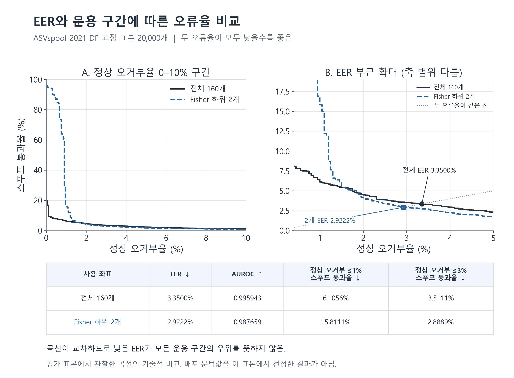

> 역사 문서 보존본. 원문 작성 당시의 상태·계획을 포함한다. 최신 상태와 확정 결과는 experience의 각 실험 README를 우선한다.

# EBM 방향·채널 실험 결과와 연구 가설의 해석

검토 기준: 2026-11-05 23:24 KST. F/P/R 계산과 수치 검수를 완료했지만,DF 내부 CV의 출처×클래스 커버리지 제한은 남아 있다.

## 1. 현재 결과가 말하는 것

**현재 표현에 추가로 읽을 수 있는 방향 신호가 있다는 DF 내부 진단은 남아 있다. 반면 두 pilot의 주 비교에서는 T에서 학습한 채널 gate의 전이 EER 우월성을 입증하지 못했다.** 두 문장은 모순되지 않는다. 같은 데이터셋 안에서 읽는 문제와 학습 도메인에서 다른 도메인으로 전이하는 문제가 다르기 때문이다.

- 기존 DF 내부 spline-linear probe에서는 방향 추가가 log-loss와 EER를 개선했다. 이는 DF 정답으로 작은 분류기를 학습한 정보 접근성 진단이다.
- 새 P1의 dynamic gate는 DF 평균 EER가 3.350000%에서 3.342593%로 변했으나, native 대비 개선의 99% 구간이 0을 포함했다. 21LA pilot EER는 0.800000%로 같았다.
- P2 supervised metric은 V에서 초기 identity가 선택됐다. 선택된 점수가 native와 같다는 결과이며, 모든 비등방성 거리의 가능성을 기각한 결과가 아니다.
- P3 전이의 선형 방향 잔차는 balanced log-loss를 작게 줄였지만 DF EER는 seed평균 3.35%에서 3.40%로 나빠졌다. 따라서 “방향 사용은 아무 효과가 없다”도, “탐지 성능이 개선됐다”도 정확한 요약이 아니다.
- 같은 scalar의 엄격한 matching은 DF27쌍,21LA10쌍으로 부족하다. F2의 결론은 방향 차이의 부재가 아니라 **표본 부족에 따른 판정 불가**다.
- 방향은 출처·codec·길이/padding과도 연관된다. 현재 관찰만으로 어떤 축이 위조 고유 신호이고 어떤 축이 shortcut인지 인과적으로 나눌 수 없다.

아래 수치는 한 epoch50/batch160 checkpoint와 반복 관찰한 benchmark의 탐색 결과다. “실험 완료”와 “가설 지지”를 별도로 판정한다. 원래 EBM을 새 attention 또는 방향 loss로 공동 재학습한 통제 비교는 이번 묶음에 없다.

## 조건 점검에서 추가로 확인한 제한

**현재 DF의5×3 내부 CV는 모든 출처×클래스가 매 fold에 존재하는 검증이 아니다.** vcc2018 spoof는4개 화자 그룹뿐이므로 outer5개 모두에 넣을 수 없다. 실제로 일부 outer-test·inner-validation,한 inner-train에서 해당 조건이 빠졌다. 화자 누수로 OOF 비교 전체가 무효인 것은 아니지만,이를 조건이 완전히 보존된 출처별 검증으로 해석하면 안 된다. P3-B와 그 분할을 쓰는 P4에 이 제한을 적용한다. T/V 전이와 native 평가의 계산 오류를 뜻하지 않는다.

기존의 분할은 변경하지 않았다. 점수·임베딩을 사용하지 않은4outer×3inner 보완 후보는 준비됐지만 새 학습을 시작한 것은 아니다. [조건 점검 보고서](ebm_condition_audit_20261105.md)에 누락 cell,학습 신호·V 선택력의 제한,metadata 정정과 P3 운용점 보충을 기록했다.

**2026-11-06 사용자 결정:** DF 4×3 보완 실험은 진행하지 않으며 이번 실행 범위에서 제외한다. 후보 분할만 보존하고 학습은 실행하지 않았다. 기존5×3의 출처×클래스 커버리지 제한은 그대로 명시한다.

## 2. 무엇을 비교했는가

### 2.1 원래 점수와 추가 방향의 의미

길이를 1로 정규화한 최종 표현을 `x=z/||z||`, 단위 정상 centroid를 `c`라 두면 원래 점수는 `s=xᵀc`다. c는 평가 데이터의 평균으로 바꾸지 않았다. 잔여 성분은 `r=x−sc`, 잔여 방향은 `u=r/||r||`다. `||r||²=1−s²`이므로 잔여 크기는 s와 별개의 추가 정보가 아니다.

**원래 EBM이 방향이나 채널을 전혀 사용하지 않는다는 설명은 틀리다.** 코사인은 centroid와의 방향을 사용하는 점수이고, 원래 모델도 채널 혼합·layer attention·time attention을 학습한다. 정확한 차이는 마지막160차원에 입력별 channel gate가 없고, 최종 점수와 spoof OC 항이 동일 s의 잔여 방위를 별도로 구분하지 않는다는 것이다.

따라서 사용자의 새 방향 loss 아이디어는 “거리 대신 처음으로 방향을 쓴다”보다 **동일한 centroid 각도 안에서 남는 방위 구조를 어떻게 유용하게 학습할지**로 구체화하는 편이 정확하다. OC도 정상/스푸프의 centroid 각도를 이미 다르게 만들고, BPL은 정상 long/short에만 적용된다. 이 구조적 불변성이 곧 유용 정보 손실이나 성능 저하의 원인임을 뜻하지는 않는다.

### 2.2 평가 경로

| 경로 | fit/선택 | 평가 | 답할 수 있는 질문 |
| --- | --- | --- | --- |
| Native | 추가 fit 없음 | 같은 표본의 기존 cosine | 기준 모델의 점수 성능 |
| P1/P2/P3-A 전이 | 2019LA T에서 fit, V에서 선택 | DF/21LA 각20,000개 | 학습 도메인에서 배운 새 readout이 전이하는가 |
| 기존 cached_core 및 P3-B/P4 | 각 평가셋의 outer-train/inner에서만 fit·선택 | 같은 셋의 held-out speaker | 현재 표현에서 다른 화자에게 읽히는 정보가 있는가 |
| F1/F3/F4 | 순위·공분산·PCA는 T, 설정·threshold는 V | 평가셋의 고정 점수/통계 | 현재 점수의 좌표·거리·조건 의존성 |
| R2/R3 | 원래 EBM·새 head·기준 threshold 고정 | attention 또는 동일 음성 입력 개입 | 학습된 함수가 개입에 얼마나 민감한가 |

서로 다른 경로의 EER를 같은 모델 개선량으로 빼지 않는다. 특히 DF 내부에서 fit한 1.20%를 T→DF native3.35%와 비교해 배포 성능 개선으로 보고하면 학습 데이터 역할을 혼동하게 된다.

## 3. 데이터와 native 기준

| 자료 | 정상 | 스푸프 | 역할 |
| --- | --- | --- | --- |
| T:2019LA train | 2,580 | 22,800 | 전이 head·순위·공분산 fit |
| V:2019LA dev 선택 부분 | 1,351 | 13,632 | 설정·epoch·threshold 선택 |
| DF_pilot | 2,000 | 18,000 | 주 평가, 기존에 관찰한 고정 표본 |
| 21LA_pilot | 2,000 | 18,000 | 추가 평가, UID hash로 독립적으로 표본 선택 |
| 21LA 전체 | 14,816 | 133,360 | pilot을 포함하는 보조 평가 |
| Q:2019LA dev 유보 부분 | 1,197 | 8,664 | 추가 적용 범위 확인 |
| 19LA eval | 7,355 | 63,882 | R1 확장 캐시·동결 head 평가 완료 |

R2/R3의 각 2,000개(정상200/spoof1,800)는 해당 pilot에 포함된다. 전처리 QC128개(32/96)는 V에서 정했다. 표본 선택에는 점수나 h/z를 쓰지 않았다. DF와21LA는67개의 asvspoof 화자 그룹을 공유하므로 완전히 독립된 반복 검증으로 세지 않는다. 원발화·합성·재인코딩 family 연결은 미해결이다.

| 같은20,000개 표본 | EER(%)↓ | AUROC↑ | Balanced LL↓ | V고정 정상거부(%) | V고정 spoof통과(%) |
| --- | --- | --- | --- | --- | --- |
| DF_pilot | 3.350000 | 0.995942833 | 0.563682 | 39.0000 | 0.0111 |
| 21LA_pilot | 0.800000 | 0.998634389 | 0.046816 | 12.4000 | 0.0167 |

전체21LA native EER는1.0535392921%다. pilot의0.80%와 표본 구성이 다르므로 어느 쪽이 다른 쪽을 대체하지 않는다.

운용 threshold는 V 정상 오거부율1% 이하 규칙으로 정했다. DF 정상 오거부39.00%,21LA12.40%는 EER가 아니라 이 고정 운용점의 결과다. EER가 낮아도 같은 threshold가 도메인 간에 잘 보정됐다는 뜻은 아니다. LL도 T에서 고정한 확률 링크를 쓰므로 ranking 지표와 calibration을 구분한다.

### 지표를 읽는 기준

- EER는 두 오류율이 만나는 운용 구간의 값으로 낮을수록 좋다. AUROC는 전체 점수 순위의 요약으로 높을수록 좋다.
- Balanced LL은 정상과 spoof의 평균 로그 손실을 각각50%씩 반영한다. 두 클래스의 실제 표본 비율을 그대로 평균한 손실과 다르며 낮을수록 좋다. 확률은[1e-7,1−1e-7]로 제한한다.
- 개선량은 baseline EER−candidate EER다. 예를 들어3.35%→3.05%는0.30%p(pp)의 절대 감소다.
- CI가0을 포함하면 이 절차로 개선을 확정하지 못했다는 뜻이다. 동등성이나 효과 부재가 입증됐다는 뜻은 아니다. 끝점이0인 구간도 엄격히 양의 개선 구간으로 읽지 않는다.

## 4. F0: 손실의 불변성이 증명한 범위

단위 centroid 주위에서 s와 norm을 유지한 채 잔여 방위만 회전하면 weighted OC 값은 바뀌지 않는다. float64 항등식과 방향미분을 확인한 구조적 사실이다. 정상 표본의 방향은 BPL에 영향을 줄 수 있지만 spoof만의 회전은 정상 쌍 BPL에 들어가지 않는다.

여기서 증명한 것은 embedding 공간에서 목적함수가 식별하지 않는 자유도다. 그 모든 회전 벡터가 encoder·LayerNorm을 거친 실제 음성 표현으로 실현된다는 증명, 실제 정보가 버려졌다는 증명, 새 loss가 더 잘 일반화한다는 증명은 아니다.

## 5. F1: 채널 선택과 소수 좌표 결과

### 5.1 이미 검수된 DF 부분집합 실험

| 점수 좌표 | DF EER(%) | DF AUROC | 해석 |
| --- | --- | --- | --- |
| 전체160 | 3.3500 | 0.995943 | 기준 cosine |
| T-Fisher 하위10 | 2.9444 | 개별 결과 파일 참조 | 특정 부분집합의 EER 지점 결과 |
| T-Fisher 하위2 | 2.9222 | 0.987659 | 낮은 EER와 낮은 AUC가 동시에 관찰됨 |
| T-Fisher 하위1(j95) | 4.345939 | 0.967472 | 1D cosine은 부호±1 두 점수 |

Fisher는 T raw post-LN z의 정상/공격별 평균·분산으로 정한 단변량 순위다. “하위”는 T에서 이 기준이 낮다는 뜻이며 무의미한 좌표라는 뜻이 아니다. 같은 mask를 z/c에 적용하고 각각 재정규화한 cosine을 계산했다.

하위2개의 native 대비 EER 차이 구간은0을 포함했다. 상위2개 EER는6.85%, random2개20회의 중앙값은5.5750%였다. 특정 두 좌표가 작동한 것과 아무 두 좌표나 충분한 것은 다르다. 하위2개의 V EER는0.1907%로 native0%보다 높았다.

전체160개와 하위2개의 ROC는 교차했다. 정상거부율1% 이하에서는 전체160개가,3% 부근에서는 두좌표가 더 유리했다. 같은 수치의 옛 native threshold를 부분집합에 그대로 적용한 오류율은 점수 분포 변화를 보여줄 뿐, 각 점수마다 V에서 재보정한 공정한 배포 비교는 아니다.

그림은 기존 DF20,000개 부분집합 비교다. 새 gate·21LA·내부 P3-B/P4의 결과를 그린 그림이 아니다. 곡선의 운용점별 장단점을 보여주며, 평가 표본에서 배포 threshold를 고른 결과로 읽지 않는다.

**현재 checkpoint가 만든160차원 표현의 일부 좌표만 읽어도 이 DF 표본의 EER가 낮은 점 추정치를 보였다**는 표현이 적절하다. “성능 동등성 입증”, “158개가 모두 잡음”, “모델의 본질적 차원이2”, “encoder 연산량 감소”로 확대하지 않는다. 전체 encoder와160차원LayerNorm은 여전히 계산했다.

### 5.2 신규 F1 전체 panel

| 좌표계 | 평가셋 | 비교 | 효과(pp) | 97.5% CI |
| --- | --- | --- | --- | --- |
| original | DF_pilot | keep | -0.281111 | [-0.625862, 0.049187] |
| original | DF_pilot | drop | -0.004167 | [-0.109350, 0.078576] |
| original | 21LA_pilot | keep | 0.004444 | [-0.088811, 0.057861] |
| original | 21LA_pilot | drop | 0.000000 | [-0.046416, 0.038318] |
| 511 | DF_pilot | keep | 0.084444 | [-0.186660, 0.236081] |
| 511 | DF_pilot | drop | -0.202778 | [-0.284307, -0.010810] |
| 511 | 21LA_pilot | keep | 0.007778 | [-0.033395, 0.068474] |
| 511 | 21LA_pilot | drop | 0.050000 | [-0.027058, 0.142696] |
| 512 | DF_pilot | keep | 0.056944 | [-0.237041, 0.280414] |
| 512 | DF_pilot | drop | -0.054444 | [-0.180898, 0.055825] |
| 512 | 21LA_pilot | keep | 0.007500 | [-0.052911, 0.057676] |
| 512 | 21LA_pilot | drop | 0.000000 | [-0.072862, 0.061109] |
| 513 | DF_pilot | keep | 0.034167 | [-0.201125, 0.227159] |
| 513 | DF_pilot | drop | -0.084167 | [-0.260242, -0.006156] |
| 513 | 21LA_pilot | keep | 0.005000 | [-0.061629, 0.060068] |
| 513 | 21LA_pilot | drop | 0.000000 | [-0.092670, 0.087898] |

keep효과=random20개 평균EER−topEER, drop효과=topEER−random20개 평균EER다. random mask seed와speaker group을같이재표집했다. 회전좌표에서는 T순위를새로fit했으며, full cosine 불변성과좌표부분집합의의미를구분한다.

## 6. F2: 같은 점수·크기의 잔여 방향

기존 source×codec matching106쌍과 새 strict matching을 구분한다. 기존106쌍은 같은 화자를 요구하지 않았고 caliper도0.01/0.002였다. 새 F2는 DF에서 source×speaker×codec,21LA에서 speaker×codec×transmission을 같게 하고 caliper0.02/0.002를 사용한다. 표본 수 차이를 모순이나 재현 실패로 해석하지 않는다.

| 평가셋 | caliper | 쌍 | 그룹 | 평균방향 각도(도) | biased MMD² | 판정 |
| --- | --- | --- | --- | --- | --- | --- |
| DF_pilot | primary | 27 | 9 | 34.358 | 0.234125 | inconclusive_low_overlap |
| DF_pilot | wide_sensitivity | 58 | 15 | 31.728 | 0.197523 | inconclusive_low_overlap |
| 21LA_pilot | primary | 10 | 6 | 25.925 | 0.158551 | inconclusive_low_overlap |
| 21LA_pilot | wide_sensitivity | 21 | 14 | 16.734 | 0.078633 | inconclusive_low_overlap |

모든 조건이 최소200쌍·10그룹 기준을 충족하지 못했다. 방향 moment와 MMD 계산은 완료됐지만 주 가설의 판정은 불가하다. biased MMD²의 bootstrap 구간이0보다 크다고 해서 조건부 방향 차이가 입증되는 것은 아니다. biased 추정량은 유한 표본에서 양의 기댓값을 가질 수 있고, 여기 CI는 관찰한 두 표본을 재표집한 효과 변동 구간이지 동일분포 null 검정이 아니다. matching도 정확한 s/norm 일치가 아닌 근사다.

정상/스푸프의 resultant length, centered covariance의 participation ratio(PR), uncentered2차 moment의 PR도 저장했다. 중심화 여부가 다른 수치를 같은 “내재 차원”으로 읽지 않는다. 작은 선택 표본의 PR을 전체 표현의 최소 필요 차원으로 해석하지 않는다.

## 7. F3/P2: 유클리드·공분산·학습 metric

단위 x, c에서는 `||x−c||²=2−2s`다. 따라서 단위 공간의 단순 유클리드 거리로 바꾸기만 하면 순위·EER·AUROC는 원래 cosine과 같다. raw z의 거리나 새 중심은 norm·center까지 바꾸는 별도 실험이다.

F3은 T 정상 unit 표현의 공분산으로 A를 정하고 `S_A=1−½(x−c)ᵀA(x−c)`를 썼다. 중심 c는 고정했다. diagonal/full과 shrinkage 후보를 V EER로 선택했다. 모든 후보의 V EER가0%여서, 사전에 정한 큰 gamma 우선 규칙에 따라 identity(gamma1)가 선택됐다.

| F3 후보 | DF EER(%) | 21LA EER(%) | 선택 역할 |
| --- | --- | --- | --- |
| identity | 3.350000 | 0.800000 | V선택/native |
| diagonal_0.01 | 3.050000 | 0.800000 | 탐색 후보 |
| diagonal_0.1 | 3.055556 | 0.800000 | 탐색 후보 |
| diagonal_0.5 | 3.177778 | 0.800000 | 탐색 후보 |
| full_0.01 | 3.150000 | 0.800000 | 탐색 후보 |
| full_0.1 | 3.150000 | 0.800000 | 탐색 후보 |
| full_0.5 | 3.083333 | 0.800000 | 탐색 후보 |

diagonal gamma0.01의 DF EER3.05%는 관찰한 후보값이다. native 대비 개선0.30pp의 개별95% CI는[0.065818,0.391215]이지만,8비교 보정 구간은[0,0.458775]로0을 포함한다. V에서 고른 주 모델도 아니다. 그러므로 “유클리드/마할라노비스가 개선됐다”는 확정 결론으로 쓰지 않는다.

P2는 정상 공분산의 비지도 추정과 달리 정답을 이용해 bounded diagonal A를 학습했다. 세 seed 모두 V에서 epoch0이 선택돼 최종 A=I다. [0,0]의 개선 CI는 선택된 점수가 같다는 대수적 결과이지, 어떤 metric도 소용없다는 정밀한 부정 증거가 아니다.

기존 native_preserving_v1의 보정 family9개와 새 F3의 후보8개는 범위가 다르므로 보정 CI 끝점이 다를 수 있다. 기존 결과와 새 결과를 같은 구간으로 섞어 쓰지 않는다. F3 후보들은 공통 T 확률 링크를 쓰므로,점수의 LL은 별도 확률 재보정의 결과가 아니다.

## 8. P1: static·dynamic gate와 같은 크기 MLP

원래 EBM/centroid를 고정하고 unit z 뒤에 작은 모듈을 붙였다. static은160파라미터, dynamic과 잔차 MLP는 각5,296파라미터다. gate 범위는0.5~1.5이며 identity 초기화와 변환 규제를 썼다. 학습 objective는 class-balanced weighted OC이고, V 선택에는 모든 head에 같은 T 고정 링크를 적용한 balanced LL을 썼다. 각 seed에서 동일한 epoch/batch 순서를 공유했다.

| 평가셋 | head | seed평균EER(%) | seed평균AUROC | seed평균LL |
| --- | --- | --- | --- | --- |
| 21LA_pilot | dynamic | 0.800000 | 0.998633861 | 0.046850 |
| 21LA_pilot | metric | 0.800000 | 0.998634389 | 0.046816 |
| 21LA_pilot | mlp | 0.801852 | 0.998653204 | 0.048232 |
| 21LA_pilot | static | 0.800000 | 0.998634389 | 0.046816 |
| DF_pilot | dynamic | 3.342593 | 0.995952972 | 0.565309 |
| DF_pilot | metric | 3.350000 | 0.995942833 | 0.563682 |
| DF_pilot | mlp | 3.390741 | 0.995849750 | 0.592174 |
| DF_pilot | static | 3.350000 | 0.995942833 | 0.563682 |

static과 metric은 epoch0, dynamic은 epoch1, MLP는 seed101/102/103 순서로11/9/11epoch가 선택됐다. 아래 CI는 각 draw에서 seed별 paired EER 차이를 먼저 계산한 뒤 평균한 것이다. 예측 평균 ensemble의 성능이 아니다.

| 평가셋 | baseline→candidate | 평균EER개선(pp) | 99% CI |
| --- | --- | --- | --- |
| DF_pilot | native→dynamic | 0.007407 | [-0.054719, 0.065027] |
| DF_pilot | static→dynamic | 0.007407 | [-0.054719, 0.065027] |
| DF_pilot | mlp→dynamic | 0.048148 | [-0.048189, 0.148789] |
| DF_pilot | native→metric | 0.000000 | [0.000000, 0.000000] |
| DF_pilot | static→metric | 0.000000 | [0.000000, 0.000000] |
| 21LA_pilot | native→dynamic | 0.000000 | [0.000000, 0.010401] |
| 21LA_pilot | static→dynamic | 0.000000 | [0.000000, 0.010401] |
| 21LA_pilot | mlp→dynamic | 0.001852 | [-0.068860, 0.048953] |
| 21LA_pilot | native→metric | 0.000000 | [0.000000, 0.000000] |
| 21LA_pilot | static→metric | 0.000000 | [0.000000, 0.000000] |

양수는 EER 개선이다. dynamic 대 native의 DF0.007407pp는 실용 효과 참고값0.1675pp보다도 작고 CI가0을 포함한다. DF LL은 native0.563682보다 dynamic 평균0.565309로 나빠졌다. 21LA EER는 같고 LL도 소폭 나빠졌다. 이 조건의 dynamic 우월성은 확인하지 못했다. 다만 동일성/비열등성을 따로 설계해 입증한 것도 아니다.

T 평균 gate·실제 gate·T에서 정한 score/norm 구간 안의 gate 재배치 개입도 저장했다. 이 개입은 비현실적인 중간 조합을 만들 수 있다. gate 값이나 shuffle 민감도만으로 인과적 채널 중요도를 정하지 않는다.

**부정 결론의 범위는 이 bounded posthoc 구조와 fit/선택 규칙에 한정된다.** V가 매우 쉽고, 원래 표현을 고정했으며, long 평가 캐시만 사용했다. 새 encoder/classifier와 attention을 공동 학습하거나 다른 목적함수로 학습하는 모든 attention 방식까지 기각한 것은 아니다.

## 9. P3: 방향 정보의 접근성과 전이

### 9.1 기존 DF 내부 진단

기존 cached_core_v1은 DF20,000개에서5×3 nested grouped CV를 수행했다. spline(s)+lognorm+valid의 LL0.098882/EER3.5056%에 방향 u를 더하면 LL0.038342/EER1.20%였고, 같은 차원 noise는 LL0.123376/EER4.20%였다. 출처·codec·길이·padding까지 입력한 대조에서도 방향 추가의 LL 감소0.033961에 대한 개별95% CI는[0.021772,0.047048]이었다.

이 결과는 정한 DF 내부 모델 계열에서 추가 방향 관련 신호가 held-out speaker에게 읽힌다는 근거다. u는 z의 결정적 변환이므로 새 정보를 생성한 것은 아니다. 특징 변환이 probe의 접근성·수치 조건을 바꾼 영향도 가능하다. 정확한 conditional mutual information이나 모든 nuisance 제거를 증명하지 않는다.

### 9.2 새 T/V 전이 평가

새 P3은 고정 norm에서 s에 대해 단조인 기본 logit에 선형 또는 hidden16 잔여 방향을 더했다. norm/valid가 다르면 전체 순위는 바뀔 수 있다. ridge 두 후보·epoch0 포함 V 선택·seed3개를 사용했고, s/n을 잔차 입력에 다시 넣지 않았다. 기존 DF spline 진단과 모델·fit 자료·규제·선택 규칙이 다르다.

**DF_pilot 전이**

| 입력/잔차 | seed평균EER(%) | seed평균LL |
| --- | --- | --- |
| direction_linear | 3.400000 | 0.561293864 |
| direction_mlp | 3.350000 | 0.563681719 |
| noise_linear | 3.350000 | 0.563681719 |
| noise_mlp | 3.350000 | 0.563681719 |
| scalar | 3.350000 | 0.563681719 |

**21LA_pilot 전이**

| 입력/잔차 | seed평균EER(%) | seed평균LL |
| --- | --- | --- |
| direction_linear | 0.800000 | 0.046598948 |
| direction_mlp | 0.800000 | 0.046815570 |
| noise_linear | 0.800000 | 0.046815570 |
| noise_mlp | 0.800000 | 0.046815570 |
| scalar | 0.800000 | 0.046815570 |

| 평가셋 | LL감소 | 개별95%LL CI | EER개선(pp) | 개별95%EER CI |
| --- | --- | --- | --- | --- |
| DF_pilot | 0.002387855 | [0.001384802, 0.003495527] | -0.050000 | [-0.088194, 0.000000] |
| 21LA_pilot | 0.000216622 | [0.000081649, 0.000385810] | 0.000000 | [0.000000, 0.005718] |

선형 방향 잔차의 LL 감소는 각각0.002387855와0.000216622로, 개별95% 구간이0보다 크다. 따라서 작은 확률 예측 개선도 기록해야 한다. 반면 DF EER는0.05pp 악화됐고21LA는 동일하다. 이 구간은 고정된 fit·선택에 조건부이며, 전체 탐색의 다중 비교를 보정한 것은 아니다.

세 seed 중 선형 direction의 seed101만 V에서 비영 잔차가 선택됐고 다른 두 seed는 epoch0이었다. scalar/noise/MLP 잔차도 최종 선택은 epoch0이다. LL 효과가 세 번 독립적으로 같이 재현됐다고 쓰지 않는다.

### 9.3 신규 데이터셋 내부 CV

**DF_pilot 내부CV, 전이와분리**

| probe | seed평균EER(%) | seed평균LL |
| --- | --- | --- |
| direction_linear | 2.303704 | 0.082699 |
| direction_mlp | 1.662963 | 0.049364 |
| noise_linear | 3.679630 | 0.176540 |
| noise_mlp | 3.316667 | 0.174983 |
| scalar | 3.344444 | 0.172803 |

**21LA_pilot 내부CV, 전이와분리**

| probe | seed평균EER(%) | seed평균LL |
| --- | --- | --- |
| direction_linear | 0.800000 | 0.030893 |
| direction_mlp | 0.750000 | 0.027995 |
| noise_linear | 0.800000 | 0.038050 |
| noise_mlp | 0.800000 | 0.037354 |
| scalar | 0.800000 | 0.038032 |

정확한paired효과와LL/EER구간은각셋B/paired_effects.json에있다. 같은fold·같은모델계열의scalar/noise대조에대한증분을판정하고, 원래native를별도기준으로확인한다. 내부CV가좋더라도T→평가셋의전이개선과동일시하지않는다.

## 10. P4: LayerNorm이 정보를 없앴는가

기존 DF 내부의 동일 L2 logistic 비교에서 scalar+h는 LL0.040671/EER1.4944%, scalar+z는 LL0.064016/EER1.7000%였다. LL 감소0.023345의 개별95% CI는[0.010456,0.042250]이었다. 이 수치는 원래 centroid cosine이 아닌 새 probe 점수의 결과다.

h는 최종 Linear 출력, z는 그 뒤 LayerNorm 출력이다. h160을 z160 대신 읽었을 때 정한 probe에 더 유리했다는 근거는 있다. 그러나 h가 z에 비해 얼마나 많은 정보를 가지는지, 그 차이가 기존 탐지기의 오류 원인인지까지 이 결과로 측정하지 못한다.

LayerNorm은 발화 내 공통 shift에는 정확히 불변이다. 양의 scale에는 epsilon>0일 때 일반적으로 정확히 불변하지 않다. 현재 h 분산은 epsilon1e-12보다 매우 커서 scale의 영향이 강하게 정규화된다. “평균·분산 정보가 모두 수학적으로 완전히 없어진다”는 표현은 피한다.

**DF_pilot의scalar+u증분비교**

| probe | seed평균EER(%) | seed평균LL |
| --- | --- | --- |
| direction_h | 1.944444 | 0.054025 |
| direction_hstat | 2.240741 | 0.079507 |
| direction_linear | 2.303704 | 0.082699 |
| direction_noise160 | 3.550000 | 0.100767 |
| direction_noise2 | 2.294444 | 0.082779 |

**21LA_pilot의scalar+u증분비교**

| probe | seed평균EER(%) | seed평균LL |
| --- | --- | --- |
| direction_h | 0.803704 | 0.025898 |
| direction_hstat | 0.800000 | 0.029845 |
| direction_linear | 0.800000 | 0.030893 |
| direction_noise160 | 0.800000 | 0.036947 |
| direction_noise2 | 0.800000 | 0.031542 |

## 11. F4: 클래스 구조와 데이터 조건

기존 T-fit K=4 방향 군집에서는 DF label NMI0.264455, source0.118216, codec0.004659였다. 정상 내부 source NMI는0.343788이었다. 새 F4는 군집 번호로 축약하지 않고 u 전체의 class별 벡터 분산 비율 eta²를 계산했다. NMI와 eta²는 정의가 다르므로 수치의 크기를 직접 비교하지 않는다.

| 평가셋 | class | 조건 | vector eta² |
| --- | --- | --- | --- |
| DF_pilot | spoof | source_corpus | 0.077111 |
| DF_pilot | spoof | codec | 0.007156 |
| DF_pilot | spoof | padding_bin | 0.163591 |
| DF_pilot | 정상 | source_corpus | 0.307754 |
| DF_pilot | 정상 | codec | 0.046126 |
| DF_pilot | 정상 | padding_bin | 0.106391 |
| 21LA_pilot | spoof | transmission | 0.009298 |
| 21LA_pilot | spoof | codec | 0.026600 |
| 21LA_pilot | spoof | padding_bin | 0.158263 |
| 21LA_pilot | 정상 | transmission | 0.065527 |
| 21LA_pilot | 정상 | codec | 0.168577 |
| 21LA_pilot | 정상 | padding_bin | 0.017110 |

DF 정상 source eta²0.307754와 spoof padding eta²0.163591,21LA 정상 codec eta²0.168577와 spoof padding eta²0.158263이 관찰됐다. 이는 조건별 평균 차이가 관찰한 방향 분산에서 차지하는 비율이다. 조건을 조작했을 때 제거되는 인과적 분산 비율이나 독립적인 원인 기여도는 아니다.

T-fit PCA1과 spoof padding의 Spearman은 DF−0.600272,21LA−0.577569였다. duration은 각각+0.601706,+0.576446이었다. PCA 축 부호는 임의적이고 duration/padding은 고정 crop 규칙으로 연결되므로 두 개의 독립 발견으로 세지 않는다.

transmission별 codec 분석에서 codec 범주가 하나뿐이면 eta²0은 “그 stratum에서 비교할 codec 변이가 없음”을 뜻한다. codec이 영향 없다는 음향적 증명이 아니다. 각 cell의 정상/spoof 수·화자 수·20개 미만 표시와 조건별 native 오류도 저장했다.

기존 metadata 포함 probe에서 방향이 추가로 도움됐다고 해도 측정하지 않은 조건과 조건 간 비선형 관계를 모두 제거한 것은 아니다. 반대로 조건 연관이 있다고 해서 그 방향이 전부 불필요한 shortcut이라는 뜻도 아니다. 동일 음성 개입 R3가 이 관찰을 보완한다.

## 12. R1/R2/R3: 새 추론 결과의 상태

### 12.1 평가 범위 확장

| 자료 | 행수 | native EER(%) | native AUROC | 상태 |
| --- | --- | --- | --- | --- |
| Q | 9861 | 0.011542 | 0.999999711 | 완료·독립metric검수 |
| 19LA_eval | 71237 | 0.435177 | 0.999907914 | 완료·독립metric검수 |
| DF_full | 533928 | 3.241828 | 0.995778392 | 완료·독립metric검수 |

완료된 확장 자료에는 같은 V 동결 head를 적용했다. 아래는 seed별 지표의 평균이며 ensemble 성능이 아니다. 확장 자료로 다시 fit하거나 가장 좋은 후보를 고르지 않았다.

| 확장 자료 | head | seed평균 EER(%) | seed평균 balanced LL |
| --- | --- | --- | --- |
| Q | dynamic | 0.011542 | 0.007370 |
| Q | metric | 0.011542 | 0.007358 |
| Q | mlp | 0.023084 | 0.008015 |
| Q | native | 0.011542 | 0.007358 |
| Q | static | 0.011542 | 0.007358 |
| 19LA_eval | dynamic | 0.444570 | 0.036739 |
| 19LA_eval | metric | 0.435177 | 0.037026 |
| 19LA_eval | mlp | 0.440917 | 0.038487 |
| 19LA_eval | native | 0.435177 | 0.037026 |
| 19LA_eval | static | 0.435177 | 0.037026 |
| DF_full | dynamic | 3.245296 | 0.601340 |
| DF_full | metric | 3.241828 | 0.599647 |
| DF_full | mlp | 3.295339 | 0.629620 |
| DF_full | native | 3.241828 | 0.599647 |
| DF_full | static | 3.241828 | 0.599647 |

이 표의 미세한 차이는 보조 적용의 점 추정치다. 새 독립 반복이나 확장 자료의 유의성 검정으로 읽지 않는다. EER와 LL의 방향이 다르면 각각 기록하며, 주 P1/P2 비교의 구간은 앞의 두 pilot 결과를 따른다.

각 완료 자료에는 T/V에서 이미 고른 head들을 추가 fit 없이 적용했다. Q 특징 추출은 T/V head 실행과 병행했지만 Q 결과로 선택하지 않았다. DF 전체는 기존20,000개와 미추출513,928개의 전처리/RNG 필드를 맞춰533,928개로 결합한다. 아직 추출 중인 행을 최종 성능의 표본 수로 세지 않는다.

전체21LA에서 dynamic의 seed평균 EER는1.053539%로 native와 같고, MLP는1.053289%였다. 이 극소 차이를 새 개선 근거로 선택하지 않는다. 전체 평가는 pilot을 포함하는 보조 적용이며 새 독립 반복이 아니다.

### 12.2 원래 attention 제거·입력 변형

**DF_pilot**

| 조건 | EER(%) | AUROC |
| --- | --- | --- |
| R2-00 | 3.350000 | 0.995942833 |
| R2-10 | 7.488889 | 0.979229972 |
| R2-01 | 4.094444 | 0.993694500 |
| R2-11 | 11.133333 | 0.959799917 |
| R3-noise20 | 4.200000 | 0.993721611 |
| R3-noise10 | 6.600000 | 0.986067028 |
| R3-Opus32k_recompression | 3.194444 | 0.996235306 |

**21LA_pilot**

| 조건 | EER(%) | AUROC |
| --- | --- | --- |
| R2-00 | 0.800000 | 0.998634389 |
| R2-10 | 4.855556 | 0.989972333 |
| R2-01 | 0.805556 | 0.999334000 |
| R2-11 | 8.911111 | 0.971785528 |
| R3-noise20 | 1.300000 | 0.998542556 |
| R3-noise10 | 1.755556 | 0.997904306 |
| R3-Opus32k_recompression | 0.711111 | 0.998181417 |

같은발화의paired score/방향각/gate변화와운용오류및구간을R2_R3에저장했다. attention제거의함수민감도와입력perturbation의안정성을보여주며, 제거모델을새로학습했을때의성능이나새loss의학습효과를증명하지않는다.

Opus 조건은 이미 압축된 음성의 추가 재압축일 수 있다. small2,000개는 pilot에 포함되고 개입 세 조건도 같은 원발화를 공유한다. 이들을 독립 표본으로 합산하지 않는다.

## 13. 연구 아이디어별 판정과 다음 해석

| 가설/아이디어 | 현재판정 | 이유와남은질문 |
| --- | --- | --- |
| 원래loss가같은s의spoof방위를별도로제약하지않음 | 구조적으로확인 | embedding불변성;실제음성상의유용성·원인증명은별도 |
| 현재z에추가방향신호가남음 | DF내부지정probe에서지지 | noise/metadata대조의LL이득;모든nuisance제거·CMI증명아님 |
| dynamic channel gate가전이EER를개선 | 현재bounded방식에서는미지지 | 작은DF점추정치·CI0포함,21LA같음 |
| 방향readout이전이에아무효과없음 | 그렇게단정불가 | P3선형잔차LL은소폭개선;EER는개선안됨 |
| 단순unit Euclidean이cosine보다좋음 | 동일순위라별도개선불가 | 비등방성/새중심/rawnorm은다른가설 |
| 학습metric으로거리의이점을확인 | V선택결과에서는미지지 | epoch0선택;비identity후보의가능성전부기각아님 |
| LayerNorm이성능저하의원인 | 미입증 | h의probe접근성이좋았음;새증분대조·통제개입필요 |
| 2차원만으로모델전체가충분 | 미입증 | 전체encoder뒤의특정점수좌표실험,ROC·V손해존재 |
| 새방향loss/공동attention이유리 | 아직학습효과미시험 | 동결readout과표현공동학습은다름 |

사용자의 “원래 모델이 그 정보를 활용하도록 학습되지 않아서 동결 후처리가 불리했을 수 있다”는 설명은 가능한 가설이다. 그러나 현재 결과만으로 그것을 원인으로 선택할 수는 없다. domain shift, V 선택력, 제한된 변환 폭, objective/regularization, 표현의 배치·nuisance 등 다른 설명도 남는다. 이를 구분하려면 같은 초기화·데이터·seed·optimizer·선택 규칙 아래에서 표현 공동 학습 비교가 필요하다.

새 loss를 설계할 때는 여러 spoof 공격을 하나의 임의 방향으로 모으는 것이 목표인지, 정상의 국소 분포에서 멀어지게 하는 것인지, 공격별 여러 방위를 허용하는 것인지부터 구분해야 한다. 현재 실험은 이 선택 중 하나가 좋다는 증거를 제공하지 않았다.

## 14. 통계·검수·근거 파일

P1/P2의 주 family는 DF의5개 비교다. 각99% CI로 이 family의95% 범위를 보수적으로 관리했다. 21LA는 보조 평가이며, 두 셋의10개 비교 전체를 같은95% family로 통제했다고 주장하지 않는다. F3 후보8개는 별도 보정했고, 기존 cached_core는2,000회 개별95% 구간, 새 F/P는10,000회 source×speaker paired 재표집이다. 서로 다른 구간 수준과 비교 family를 혼용하지 않는다.

CI는 고정된 T 순위·선택된 head·저장된 OOF 예측에 조건부다. 재표집마다 전체 fit/CV/모델 선택을 다시 하지 않으므로 학습 표본과 선택의 전체 불확실성은 포함하지 않는다. 세 seed만으로 학습 변동의 모집단을 정밀하게 추론하지 않는다. 반복 탐색한 DF와 과거 benchmark 관찰을 독립 확인으로 되돌릴 수도 없다.

완료 범위의 새 검수는 950개 metric / 1075check, P3 전이는 30개 metric / 30후보 fit을 독립 확인했다. 독립 NumPy head 수식, full tied ROC EER, rank AUC, ID정렬·V선택을사용한다. P3-B/P4의독립검수도완료했고각fold의선택·scaler·refit·OOF예측을대조했다. R1/R2/R3의검수범위는각완료JSON에있다.

- [새실험검수](../../artifacts/geometry_cache/local_analysis/frozen_all_v1/verification.json); [P3전이검수](../../artifacts/geometry_cache/local_analysis/frozen_all_v1/P3_P4/A/verification.json)
- [P1/P2모든seed·데이터지표](../../artifacts/geometry_cache/local_analysis/frozen_all_v1/head_metrics.csv); [P1/P2주비교CI](../../artifacts/geometry_cache/local_analysis/frozen_all_v1/head_paired_effects.json)
- [F2표본coverage/완료판정](../../artifacts/geometry_cache/local_analysis/frozen_all_v1/F2/summary.json); [F3선택기록](../../artifacts/geometry_cache/local_analysis/frozen_all_v1/F3/metric_registry.json); [F3보정CI](../../artifacts/geometry_cache/local_analysis/frozen_all_v1/F3/paired_effects.json)
- [F4벡터분산비율](../../artifacts/geometry_cache/local_analysis/frozen_all_v1/F4/vector_variance.csv); [F4길이/padding](../../artifacts/geometry_cache/local_analysis/frozen_all_v1/F4/padding_duration.csv); [F4조건별오류](../../artifacts/geometry_cache/local_analysis/frozen_all_v1/F4/condition_metrics.csv)
- [기존DF내부방향/LayerNorm지표](../../artifacts/geometry_cache/local_analysis/cached_core_v1/probe_metrics.csv); [그림·개별문서목록](cached_core_20261105/README.md)
- [실행명세와완료표](ebm_frozen_model_experiments_20261105.md); [원래공동학습명세](ebm_embedding_geometry_spec_20261105.md)

이 검토는 저장된 결과를 재해석한 작업이며 실행 중인 실험을 중단·재시작하거나 추가 EBM 학습을 하지 않았다. 원음·연구실 원본 소스·checkpoint를 새로 로컬에 복사하지 않았다.

## 15. 2026-11-06 추가 캐시 검증

[새 가설의 캐시 검증 결과](ebm_cache_hypotheses_20261106.md)에 OC gradient, 잔여 방향의 정규화 민감성, LayerNorm 이전 h의 복원·상호작용, 저장된 방향 분류기의 잡음·재압축 민감도를 추가했다. 새 detector/probe 학습과 음성 추론은 없으며 취소한DF4×3는 제외했다. 기존F/P/R 수치와 당시의 해석 범위는 위에 보존한다.
