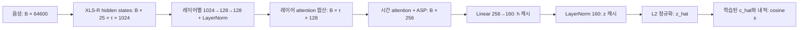

> 표시 명칭·링크 이름은 설명형으로 정리했다. 원래 코드·경로·수치는 그대로 보존한다.

> 역사 문서 보존본. 원문 작성 당시의 상태·계획을 포함한다. 최신 상태와 확정 결과는 experience의 각 실험 README를 우선한다.

# EBM 재학습 없이 수행하는 방향·채널 실험 명세

작성일: 2026-11-05 KST. 기준은 현재 캐시를 만든 **epoch 50 / batch 160 EBM**이다. 사용자의 두 아이디어인 마지막 임베딩의 채널 attention과 방향을 반영한 손실을, 기존 EBM 가중치를 갱신하지 않는 범위에서 조사한다.

이 문서는 실제 서버의 보관 소스와 로컬 캐시를 다시 확인해 작성한 **실행 명세**다. 초판 작성 중에는 새 학습·추론을 실행하지 않았고, **후속 사용자 요청**으로 같은 고정 EBM의 21LA 전체 특징을 추출해 캐시에 추가했다. 초판과21LA추출 단계에서는 새 gate/metric 학습을 하지 않았으며, 이후 사용자의 전체 실행 요청으로 실제 T/V 학습과 평가를 진행했다. 현재 완료/진행 범위는0절에서 확인한다. 합성 입력의 수학·gradient 검사는 실제 데이터의 성능 실험과 구분한다.

관련 파일:

- [구조 확인 기록](ebm_frozen_structure_audit_20261105.json): 보관 소스 SHA256, 줄 위치, 실제 설정, 캐시 구성.
- [수치·실행 설정](ebm_frozen_model_protocol_20261105.json): 실험 ID, 기본값, 분할·학습·판정 규칙.
- [기존 전체 연구 명세](ebm_embedding_geometry_spec_20261105.md): EBM 자체를 공동 학습하는 4.0375초 상한 비반복 학습/G 실험까지 포함한 별도 범위. 본 문서의 동결 후처리 실험과 같은 실험이 아니다.
- [캐시 사용법](../../artifacts/geometry_experiments/README.md), `../../MENTEE_SERVER.md` (원자료 경로; 배포 제외 또는 미확보, 출처 목록 참조).
- [완료된 네 가지 캐시 진단](ebm_cached_core_results_20261105.md): 09:06 KST 완료 결과. 아래 신규 명세와 설정이 같은 실험으로 합치지 않는다.
- [21LA 전체 캐시 추가 기록](21la_cache_20261105.md): 11:29 KST 로컬 저장·독립 검수 완료, 같은 기준 모델의 h/z를 재사용할 수 있다.

**2026-11-06 사용자 결정:** DF 4×3 보완 실험은 진행하지 않으며 이번 실행 범위에서 제외한다. 후보 분할만 보존하고 학습은 실행하지 않았다. 기존5×3의 출처×클래스 커버리지 제한은 그대로 명시한다.

## 0. 진행 체크리스트

2026-11-05 23:24 KST 실제 완료 marker 기준. **체크는 실험 수행 완료이며 성능 개선/가설 입증과 다르다.** 사용자의 후속 요청에 따른 동결 실험 전체의 계산과 검수를 완료했다.

### native 평가 및 준비

- [x] 기준 EBM 구조·손실과 T/V/DF·21LA 캐시 검수.
- [x] 21LA 전체148,176개 native 평가: EER1.0535393%.
- [x] 같은20,000개씩의 native 평가: DF3.35%,21LA0.80%.
- [x] DF/21LA 각2만 개, 소규모각2천 개와 V-QC128개 ID잠금.
- [x] 명세·수학/gradient·이전 결과 재사용 점검.

### F/P/R 실행

| ID | 진행 | 실제 범위 | 남은 작업/판정 |
| --- | --- | --- | --- |
| F0 | ✅ 완료 | 기존 항등식·weighted OC·gradient 검수 완료 | 없음 |
| F1 | ✅ 완료 | 명세의169조건 및 회전 좌표3개 계산·통계 실행 | 없음 |
| F2 | ✅ 완료 | 주 matching DF27쌍/9그룹,21LA10쌍/6그룹; 넓은 caliper 민감도·MMD·방향 moment 포함 | 표본 기준 미달이므로 결론은 판정 불가; 실행 실패와 구분 |
| F3 | ✅ 완료 | T 정상 covariance·V 선택·두2만 개 평가 및 CI; V 선택은 양쪽 metric 모두identity | 없음 |
| F4 | ✅ 완료 | 두 평가셋의 class별 vector eta²·padding/duration·조건별 native 오류 | 없음 |
| P1 | ✅ 완료 | static/dynamic/동일 크기MLP×seed3; T학습/V선택·gate개입·두 평가셋 및 전체21LA 보조 평가 | 없음 |
| P2 | ✅ 완료 | supervised diagonal metric×seed3; V에서는epoch0 identity가 선택됨 | 없음 |
| P3 | ✅ 완료 | T/V 전이 평가 완료; 새 단조 scalar·linear/MLP direction/noise와 데이터셋별5×3 grouped CV | 없음 |
| P4 | ✅ 완료 | P3과 같은fold에서 h-stat/h160 증분 및2/160차원 noise 대조 | 없음 |
| R1 | ✅ 완료 | 21LA 전체 native 평가 완료; Q·19LA·DF 전체 확장 | 없음 |
| R2 | ✅ 완료 | 두2만 개(각처음2천 개)의4조건 sidecar와 native대응 검사;R1 종료 후 실행 | 없음 |
| R3 | ✅ 완료 | V-QC128 ID잠금, 같은base noise20/10dB·Opus32k 재압축의 두2만 개 작업 | 없음 |

진행 결과: [이번 실제 실행 기록](ebm_frozen_all_results_20261105.md). 완료 근거는 `artifacts/geometry_cache/local_analysis/frozen_all_v1/`의 실험별 완료 JSON과 `verification.json`에 기록한다. 서버 raw 추출이 끝나기 전에는 부분 파일을 완료 캐시로 등록하지 않는다.

현재 실행 범위는 기존 EBM을 고정한 F/P/R 전체다. 작은 gate/metric/probe의 학습은 포함하며, 새 attention/방향 loss로 EBM 자체를 공동 재학습하는 N3/4.0375초 상한 비반복 학습/G는 이 묶음에 포함하지 않는다.

## 1. 먼저 구분할 네 가지 작업

여기서 **기존 EBM 재학습 없음**은 XLS-R, bridge, 원래 pooling, 마지막 linear, LayerNorm, 학습된 centroid의 값을 바꾸지 않는다는 뜻이다. 신규 후처리 모듈의 optimizer 학습과 새 음성 forward는 별도 항목으로 표시한다.

| 등급 | 기존 EBM 가중치 갱신 | 신규 optimizer 학습 | 새 음성 forward | 예 |
| --- | --- | --- | --- | --- |
| N0 | 없음 | 없음 | 없음 | 통계량·방향 분포·채널 마스크·공분산 거리 |
| N1 | 없음 | 작은 신규 모듈만 | 없음 | 캐시 위 gate·MLP·학습 metric·진단 probe |
| N2 | 없음 | 본 문서의 R 실험은 없음 | 있음 | 다른 평가셋, 원래 attention 제거, 입력 변형 |
| N3 | 있음 | 있음 | 통상 있음 | 기존 분류기와 새 attention/loss를 공동 학습 |

PCA·평균·공분산·matching에 필요한 통계 추정도 fit이지만 N0의 경우 신경망 optimizer 학습은 없다. N1을 “아무 학습도 없는 실험”이라고 부르지 않는다. N2도 재학습은 아니다. 따라서 **재학습을 하지 않는다고 해서 다른 데이터 평가나 입력 변형까지 불가능한 것은 아니다.**

권장 순서는 **기존 F1/F2/F4·P3/P4 대응 결과 재사용 → 아직 없는 F1 대조·F2 coverage 점검 → P1/P2**다. 기본 캐시 진단은 별도 버전 `cached_core_v1`에서 이미 일부 완료됐다. 새 명세와 다른 부분만 추가하고 기존 진단을 처음부터 반복하지 않는다. R1~R3는 새로운 입력 추론이 필요할 때 수행한다. N3는 이 문서의 실행 범위 밖이다.

## 2. 실제 모델 구조 재확인

### 2.1 기준과 소스 상태

기준 checkpoint:

`/home/mentee/results/CM/LA/EBM_e50_bs160_lr1e5/model/BestCLS_50_21DF.pt`

SHA256: `104873703a57cad98b686d770e0860e031a2cf9abef79b72668780c1660e0b24`.

기준 소스는 같은 실험의 `backup/scripts`다. `BestCLS`라는 이름을 최적 checkpoint라는 근거로 사용하지 않는다. 보관 파일의 실제 epoch는 50이다. 2026-11-05 08:53 KST 읽기 전용 확인에서 현재 작업 폴더의 `model/b_linear.py`, `model/loss.py`, `train.py`, `data_loaders.py`는 기준 archive와 같았으나 `arguments.py`는 달랐다. 현재 작업 폴더의 기본 실행 설정을 기준 모델 설정으로 대체하면 안 된다.

| 항목 | 실제 기준값 |
| --- | --- |
| SSL frontend | `facebook/wav2vec2-xls-r-300m` |
| hidden state 개수 / 각 채널 | 25 / 1024 |
| aggregation 채널 | 128 |
| 최종 임베딩 | 160 |
| 긴 입력 / 짧은 입력 | 64,600 / 48,440 sample, 16 kHz에서 약 4.0375 / 3.0275초 |
| 평가 segment 수 | 1 |
| LayerNorm epsilon | `1e-12` |
| OC alpha / margin | 20 / bona 0.9, spoof 0.2 |
| BPL alpha | 30 |
| 학습 epoch / T_0 / seed | 50 / 150 / 1 |
| 학습 bona:spoof 비율 | 1:9 |
| `use_class_weight` | **True** |

캐시에 사용한 pretrained frontend의 commit은 `1a640f32ac3e39899438a2931f9924c02f080a54`다. classifier의 strict load와 native score 대응은 검증됐지만, 과거 학습 당시 frontend의 전체 가중치와 비트 단위 hash가 같은지 별도로 증명한 것은 아니다.

### 2.2 긴 branch의 forward와 캐시 위치

4.0375초 상한 비반복 학습는 배치, `τ`는 SSL 시간 길이다. 다음은 실제 구현의 순서를 요약한 것이다.



단계별 의미:

1. 각 hidden layer에 **서로 다른** feedforward가 있다. 순서는 Linear(1024→128), ReLU, Dropout(0.35), Linear(128→128), LayerNorm(128)이다.
2. 레이어마다 time pooling으로 256차원 요약을 만든다. 이 요약과 학습된 256차원 벡터로 레이어 가중치를 계산한다.
3. 레이어 가중치는 `softmax(tanh(...), dim=layer)`이며 형태는 `B×25×1×1`이다. **발화·레이어별 스칼라**가 해당 레이어의 시간·128채널에 공통 적용된다.
4. 합산한 `B×τ×128`에 마지막 time pooling을 적용한다. time 가중치는 `B×τ×1`이며 **프레임별 스칼라**가 128채널에 공통 적용된다.
5. pooling의 평균과 표준편차를 붙인 256차원을 Linear로 160차원 `h`로 만든다. 그다음 LayerNorm 출력이 `z`다.
6. OC 안에서 `z`와 centroid를 각각 L2 정규화해 내적한다.

**정리할 구조적 사실:** 레이어·시간 attention과 학습 가능한 채널 혼합은 이미 있다. 그러나 **마지막 160개 채널에 대해 입력별 160개 gate를 출력하는 모듈은 없다.** “채널을 전혀 쓰지 않는다”와 “최종 채널별 dynamic gate가 없다”는 다른 말이다.

### 2.3 ASP는 일반적인 weighted variance와 다르다

실제 pooling은 시간 가중치를 `w_t`, 프레임 벡터를 `X_t`라 할 때 다음과 같다.

\[
Y_t=w_tX_t,\qquad \mu=\sum_tY_t,\qquad
\sigma=\operatorname{std}_t(Y_t+\epsilon_t),\quad
\epsilon_t\sim N(0,10^{-10}).
\]

여기서 noise의 **표준편차**는 `1e-5`다. 구현의 `torch.std`는 sample correction 1을 사용하는 경로다. `sqrt(sum(w_t*(X_t-mu)^2))` 형태의 통상적인 weighted variance로 바꿔 설명하거나 재구현하면 다른 모델이 된다.

`torch.randn` 호출에는 `self.training` 조건이 없다. 따라서 `.eval()`이어도 ASP noise는 생성된다. 새 추론의 정확한 재현에는 발화·crop·조건별 RNG가 필요하다. 기존 캐시는 microbatch 1, 발화별 seed로 이 경로를 고정했고 반복/GPU 간 일치를 확인했다.

### 2.4 원래 학습과 캐시 후처리의 차이

원래 학습에서는 epoch가 `T_0=150` 이하일 때 XLS-R을 eval 모드와 `torch.set_grad_enabled(False)`로 실행한다. 기준 50 epoch는 이 범위이므로 frontend를 미세조정하지 않는다. 반면 bridge, pooling, 최종 linear, LayerNorm과 centroid는 학습됐다.

소스에는 `param.require_grad`라는 속성 오기가 있다. 올바른 PyTorch 속성은 `requires_grad`다. 이 줄 자체를 실제 동결의 근거로 삼으면 안 된다. 기준 경로가 no-grad인 근거는 별도의 `train_plm=False` 및 `torch.set_grad_enabled(False)`다. 이번 작업에서 원본을 수정하지 않았다.

원래 iteration은 두 단계다.

1. centroid `loss.weight`를 고정하고 classifier를 OC+BPL로 갱신.
2. classifier 파라미터를 고정하고 bona 샘플로 centroid만 다시 갱신.

두 번째 단계도 classifier의 train 모드가 유지되므로 Dropout과 ASP noise가 동작할 수 있다. 현재 캐시는 eval 표현이며 이 두 단계의 학습 중 표현을 재생하는 자료가 아니다.

학습 데이터 로더는 long/short를 별도로 읽고 codec 증강을 명목 확률 0.8로 각각 시도한다. 각 view에는 `augtype=0..8`의 RawBoost 조합도 적용된다. 이는 소스 설정을 확인한 것이며 실제 codec 변환 성공률이 정확히 80%였다고 사후 측정한 것은 아니다. long은 앞 구간을 사용하고 short는 충분히 길면 임의 시작점을 사용한다. 평가 로더에는 이 학습 증강이 없고, 부족한 길이는 wrap padding하며 긴 음성은 앞 64,600 sample을 사용한다.

따라서 캐시 위 후처리 학습은 **증강 없는 평가 표현에 대한 새 readout 학습**이다. 원래 증강·두 view·BPL·centroid 갱신까지 재현한 EBM 학습이라고 부르지 않는다.

### 2.5 원래 class-weighted OC와 BPL

`y=1`이 bona, `y=0`이 spoof이며 큰 점수가 bona다. 기준 sampling ratio와 `use_class_weight=True`에서 실제 가중치는 다음과 같다.

\[
w_B=5,\quad w_S=5/9,\quad
L_{OC}=\frac1N\sum_iw_{y_i}\begin{cases}
\operatorname{softplus}(20(0.9-s_i)),&y_i=1\\
\operatorname{softplus}(20(s_i-0.2)),&y_i=0.
\end{cases}
\]

원래 구현에는 배치 크기 4 초과에서 가중치를 적용하는 조건이 있다. 본 명세의 신규 모듈 학습은 항상 160개 full batch를 사용해 이 조건을 모호하게 재현하지 않는다. bona 16/spoof 144일 때 위 weighted mean은 `0.5*mean_B(loss)+0.5*mean_S(loss)`와 같다.

BPL은 **bona long/short** 정규화 임베딩의 모든 쌍에 대해 `mean(softplus(30*(1-cos)) - 0.3)`를 계산한다. 기준 구현은 rank-local이며 global gather를 사용하는 다른 실험과 혼동하지 않는다. spoof는 BPL 입력에 직접 포함되지 않는다.

이 때문에 같은 `s`에서 spoof의 잔여 방위를 구별하라는 직접적인 항은 없다. 그러나 bona의 방향 관계는 BPL의 영향을 받고, 채널 변환도 학습된다. 이 사실로 “유용한 방향 정보가 실제로 사라졌다” 또는 “후처리 실패의 원인이 확정됐다”고 결론 내릴 수는 없다.

## 3. 사용할 수 있는 자료와 사용할 수 없는 자료

### 3.1 현재 로컬 캐시

| 별칭 | 정상 | 스푸프 | 전체 | 용도 |
| --- | ---: | ---: | ---: | --- |
| `T` | 2,580 | 22,800 | 25,380 | 원래 19LA train; 통계/모듈 fit |
| `V` | 1,351 | 13,632 | 14,983 | 19LA dev의 10화자; 선택/threshold |
| `DF_pilot` | 2,000 | 18,000 | 20,000 | DF eval의 고정 표본; 이미 관찰한 탐색 평가 |
| `21LA_eval` | 14,816 | 133,360 | 148,176 | 21LA 공식 eval 전체; 추가 전이 평가/보조 benchmark |

후속 전체 실행에서 Q9,861개와19LA eval71,237개(정상7,355/spoof63,882)의 임베딩 캐시·동결head 평가·독립 검수를 완료했다. DF 전체는 기존pilot20,000개를 보존하고 나머지513,928개를 추출 중이다. 이 추가 자료는 기본2만 개씩의 비교와 분리한다. **21LA eval 전체는 후속 요청으로 추출·검증을 완료했다.** DF 전체의 원래 eval 대상은 533,928개이고 pilot은 그 일부다. DF 표본은 점수와 무관한 클래스 내 hash 순위로 정했다.

캐시에 있는 것은 긴 평가 view의 `h[N,160]`, `z[N,160]`, 정규화 centroid, 원래 점수, `speaker_group`, 공격, 길이, padding 등 metadata다. DF에는 codec, source corpus, vocoder도 있고 21LA에는 codec·transmission·trim이 있다. T/V에는 같은 codec/source 열이 없으므로 임의로 DF `nocodec`과 같다고 채우지 않는다.

**없는 자료:** short 임베딩, 학습 증강별 임베딩, pooling 전 시간 특징, SSL hidden states, pooling 256차원, 원래 attention weight. `h`는 pooling 256차원이 아니라 **이미 마지막 Linear를 지난 160차원**이다.

기본 해석 자료에 접근하는 실제 API:

```python
from artifacts.geometry_experiments.geometry_cache import (
    load_embeddings, load_predictions, validate_run
)

validate_run("T")
t = load_embeddings("T")
v = load_embeddings("V")
df = load_embeddings("DF_pilot")
la21 = load_embeddings("21LA_eval")
x, h, rows = t.z, t.h, t.rows
geom = t.geometry()  # unit_z, cosine, norm, direction, valid 등
```

각 rank 배열과 점수 행의 대응은 이미 검사됐으며, 새 runner도 cache fingerprint와 행 순서를 확인해야 한다. UID로 merge할 때 `one_to_one`을 요구한다. 배열만 정렬하고 metadata를 그대로 두는 작업을 금지한다.

### 3.1.1 신규 캐시 실험의 기본 데이터 수

사용자 요청에 따라 **21LA도 DF와 같은 2만 개로 맞춘다.** 전체 캐시 보관량과 반복 실험 표본 수를 구분한다. 학습 T와 선택 V는 역할이 달라 기존 전체를 유지한다.

| 이름 | 정상 | spoof | 합계 | 용도 |
| --- | ---: | ---: | ---: | --- |
| T | 2,580 | 22,800 | 25,380 | 통계 추정·작은 모듈 학습 |
| V | 1,351 | 13,632 | 14,983 | 설정·epoch·threshold 선택 |
| DF_pilot | 2,000 | 18,000 | 20,000 | 기존 고정 표본 그대로, 주 평가·내부 진단 |
| **21LA_pilot** | **2,000** | **18,000** | **20,000** | 추가 평가·내부 진단의 기본 표본 |
| DF_small | 200 | 1,800 | 2,000 | DF_pilot 안의 R2/R3 소규모 확인 |
| 21LA_small | 200 | 1,800 | 2,000 | 21LA_pilot 안의 R2/R3 소규모 확인 |
| 21LA_eval | 14,816 | 133,360 | 148,176 | 보존하는 전체 캐시; 마지막 보조 평가 |

전이 실험 기본 고유 발화는 T+V+DF_pilot+21LA_pilot=**80,363개**다. small은 pilot 안에 포함되고, seed·모델·변형 수만큼 고유 표본 수가 늘지 않는다. R1에서 추가한 Q9,861개(정상1,197/spoof8,664)는 캐시·평가를 완료했으며,기본80,363개에는 포함하지 않는 보조 평가다. 21LA에서 pilot을 제외한 나머지는128,176개(정상12,816/spoof115,360)지만 미관찰·독립 holdout으로 간주하지 않는다.

**표본 고정 방법:** 21LA 클래스별로 `SHA256("21LA-pilot-20261105-v1|"+utterance_id)`가 작은 순서에서 정상2,000/spoof18,000개를 택하고 UID로 정렬한다. small은 각 pilot 안에서 같은 방식으로 정상200/spoof1,800개를 택하며 prefix는 각각 `21LA-small-20261105-v1|`, `DF-small-20261105-v1|`다. 기존 DF2만 개는 바꾸지 않는다.

[표본 생성 코드](../../../workspace/artifacts/geometry_experiments/lock_analysis_sample_sizes.py)로 metadata 열만 읽어 고정했고, [잠금 기록](../../artifacts/geometry_cache/analysis_manifests/frozen_data_sizes_v1/lock.json)에 ID 목록·source fingerprint·개수·coverage·SHA256을 기록했다. 점수·norm·h/z·탐지 오류는 선택에 사용하지 않았다. 결과에 따라 seed나 표본을 바꾸지 않는다.

21LA_pilot에는 화자67그룹(정상67/spoof48), 공격13종·codec7종·transmission5종이 있다. source의 실제 `(class, attack, codec, transmission)` 조합238개가 모두 포함됐다. 21LA_small은61화자그룹, DF_small은76그룹이다. DF_small은110공격·9codec을 포함하지만 `(class, attack, codec)` 결합조건은810/994개만 포함하므로 세부조건 성능의 최종 판정에 쓰지 않는다. 범주 coverage가 모든 화자×조건 조합이나 모집단 분포의 완전한 일치를 보장하지는 않는다.

**실험별 사용 수:** 과거 완료 결과는 그대로 두고 아래를 신규 실행에 적용한다.

| 실험 | 학습·선택·통계 추정 | DF 평가/진단 | 21LA 평가/진단 |
| --- | --- | --- | --- |
| F0 불변성 | 합성160개; 원래 EBM 학습 없음 | 불필요 | 불필요 |
| F1 채널 마스크 | T25,380 순위·V14,983 선택 | 20,000 | 20,000 |
| F2 matching/방향 | T 정상500+spoof500 bandwidth | 20,000에서 matching | 20,000에서 matching |
| F3 공분산 거리 | T 정상2,580 covariance·V14,983 선택 | 20,000 | 20,000 |
| F4 조건 분석 | 필요한 bin/PCA는 T에서만 fit | 20,000의 source/codec/길이/padding | 20,000의 codec/transmission/길이/padding |
| P1 gate/MLP·P2 metric·P3-A 전이 | T25,380 학습·V14,983 선택; 같은 head를 양쪽에 적용 | 20,000 | 20,000 |
| P3-4.0375초 상한 비반복 학습/P4 내부 진단 | 각 셋20,000 안에서 별도로5 outer×3 inner grouped CV | 20,000 OOF | 20,000 OOF |
| R1 전체 확장 | T/V에서 이미 동결한 비교군 | DF 전체는 별도 신규 추출 필요 | 전체148,176 마지막 보조 평가, 캐시 재사용 |
| R2 attention 제거 | 새 학습 없음, native도 같은 발화로 계산 | 먼저2,000×4조건, 확대20,000 | 먼저2,000×4조건, 확대20,000 |
| R3 입력 변형 | V128개(정상32/spoof96) 전처리QC; fit/설정 변경 없음 | 먼저2,000×새변형3조건 | 먼저2,000×새변형3조건 |

F2는 각20,000개 안의 실제 overlap으로 pair 수가 정해진다(셋별 최대2,000쌍). 최소200쌍·10그룹 미달이면 판정 불가로 기록하며, 21LA만 자동으로14.8만 개로 바꾸지 않는다. 주 matching은 DF에서 같은 source×speaker×codec, 21LA에서 같은 speaker×codec×transmission이다.

P3-4.0375초 상한 비반복 학습/P4는 DF2만 개와21LA2만 개에 **각각 별도의 CV 모델**을 fit한다. 두 셋을 합친4만 개에서 fit하거나 화자를 섞어 나누지 않는다. outer held-out은 평균 약4천 개지만 정확한 발화·class 수는 화자 구성에 따라 달라지며 실제 수를 기록한다. 같은 셋의 모든 비교군은 같은 fold ID를 재사용한다. 전이용 P1/P2/P3-A는 두 평가셋에서 다시 학습하지 않는다.

전체21LA는 V에서 이미 동결한 비교군을 마지막에 보조 평가할 때만 사용한다. pilot을 포함하므로 독립적인 두 번의 확인으로 세지 않는다. 이미 보고한 **전체 EER1.0535393%는 pilot의 baseline이 아니다.** 실제 주 실험에서는 같은2만 개의 native와 후보를 함께 계산한다. 2만 개는 비용·정상 표본 수·절차를 맞추기 위한 선택이며 작은 효과를 검출할 통계적 power까지 보장하지 않는다. 두 평가셋은 공격·조건·화자 분포가 다르므로 EER와CI를 각각 보고하고, 합친4만 개의 EER를 주 결과로 사용하지 않는다.

`21LA_pilot`, `21LA_small`, `DF_small`은 분석 표본 이름이며 raw catalog의 새 배열 별칭이 아니다. 원본은 `load_embeddings("21LA_eval")`로 읽고 잠근 행만 선택한다. 새 추론과 h/z 복제가 필요 없다.

```python
from pathlib import Path
import hashlib, json
import pandas as pd

root = Path("artifacts/geometry_cache/analysis_manifests/frozen_data_sizes_v1")
item = json.loads((root / "lock.json").read_text(encoding="utf-8"))["views"]["21LA_pilot"]
full = load_embeddings(item["source_alias"])
assert full.provenance["cache_fingerprint"] == item["source_cache_fingerprint"]
path = root / item["manifest_file"]
assert hashlib.sha256(path.read_bytes()).hexdigest() == item["manifest_sha256"]
chosen = pd.read_parquet(path)
ix = chosen.cache_row.to_numpy()
assert full.rows.iloc[ix].utterance_id.tolist() == chosen.utterance_id.tolist()
la_z, la_h = full.z[ix], full.h[ix]  # 각[20000,160]
la_rows = full.rows.iloc[ix].reset_index(drop=True)
```

### 3.2 알려진 의존성과 평가 한계

- canonical source+speaker로 확인한 T/V, T/DF, V/DF 화자 겹침은 각각 0이다. 이것이 원발화·합성 파생본의 완전한 누수 점검을 뜻하지 않는다.
- 추가된 21LA와 T/V의 화자 겹침은0이지만, **21LA와 DF pilot은67개 asvspoof 화자그룹을 공유한다.** 네 캐시 사이 발화ID 겹침은0이다. 두 평가셋을 독립적인 source-family 재현으로 세지 않는다.
- 현재 `family_id`는 발화 ID 대용이며 **원발화 파생 관계를 복원한 family map이 아니다.**
- DF pilot에는 93개 source×speaker 그룹, 110개 공격, 9개 codec이 있다. class별 기여 그룹은 spoof 62, bona 92다.
- DF 결과는 이미 여러 번 관찰했다. 새 분석 설정을 먼저 파일로 고정해도 이 DF가 새 blind test가 되지 않는다.
- V는 기존 코사인 EER 0%여서 선택력이 약하다. 결과가 불편하다고 DF에서 최저 후보를 골라 V 선택처럼 보고하지 않는다.
- 같은 DF에서의 추가 분석, source/codec 하위 집단 분석은 탐색이다. source-family 미해결 때문에 speaker bootstrap CI에도 한계가 있다.

### 3.3 기존 결과와 후속 실행의 구분

아래 첫 표는 초판 이전의 기존 결과다. 이후의 최신 수치·CI·진행 상태와 가설 판정은 [통합 분석](ebm_frozen_all_results_20261105.md)을 따른다. 신규 실험의 방법은 유지하고 결과·완료 여부만 갱신한다.

| 결과 | 관찰값 | 상태/해석 |
| --- | --- | --- |
| 기존 DF pilot cosine | EER 3.35% | 현재 기준 |
| 추가된 21LA 전체 cosine | EER 1.0535393%, AUROC .997452884 | native score만 평가; 기존 cache와 같은 checkpoint |
| 양의 기울기 단조 calibration | EER 3.35% | 순위 보존 대조 검증 완료 |
| bounded direction 보정 | EER 3.35%, log-loss 0.56368→0.62813 | 시험한 동결 선형 보정에서는 이득 없음 |
| 대각 공분산 γ=.01 | EER 3.05% | 이번 9비교 보정 delta CI [0.0000,0.4641]pp; 확정 개선 아님 |
| 전체 채널/상위40 새 선형 분류기 | EER 13.05% / 5.3111% | 아래 F1의 native 마스크 실험과 다름 |
| cosine-only spline probe | EER 17.10% | 원래 순위가 뒤집히는 후처리 일반화 실패 포함 |
| V-fixed native threshold | DF 정상 오거부 39% | DF EER threshold와 구분 |
| DF 내부 nested CV scalar → scalar+u | EER 3.5056→1.20%, balanced log-loss .098882→.038342 | `cached_core_v1`; DF 내부 fit, T→DF 전이 결과 아님 |
| DF 내부 조건 포함 → 조건+u | log-loss .054727→.020767 | 측정한 조건을 포함한 진단에서 추가 신호; 완전한 교란 제거 아님 |
| T 상위40 native 채널 제거 | DF EER 3.3500→3.3556% | random20 범위 안; 특정 좌표 독점 의존 확인 안 됨 |
| DF 내부 scalar+h / scalar+z | log-loss .040671 / .064016 | 동일 선형 probe의 읽기 쉬움 차이; LN의 성능 하락 인과 증명 아님 |

이미 만든 PCA는 T에서만 fit했으며 첫 두 축의 T 설명분산은 약 54.9%다. 그림의 겹침/분리만으로 160차원의 정보량을 판정하지 않는다.

최신 네 가지 결과의 [독립 출력 검수](../../artifacts/geometry_cache/local_analysis/cached_core_v1/output_audit.json)는 pass다. DF 내부 진단의 CI는 저장 OOF 예측에 조건부인 speaker bootstrap 2,000회이고 본 문서의 신규 head 기본 10,000회와 다르다. 기존 결과를 새로운 설정으로 이미 실행한 것처럼 표시하지 않는다.

| 본 문서 실험 | 이미 재사용할 결과 | 아직 남는 차이 |
| --- | --- | --- |
| F1 | 기존 drop 4개 fraction 및 후속 keep80→1 top/bottom/random 비교·검수 | 명세와 정확히 같은 mask 전체 panel·회전 좌표계·지정 bootstrap·21LA 적용 |
| F2 | 기존106쌍/18쌍과 새strict matching·moment/MMD 완료 | 새DF27쌍/9그룹,21LA10쌍/6그룹으로 최소200쌍·10그룹 미달:판정 불가 |
| F4 | 기존K=4 NMI와 새두pilot의class별vector eta²·coverage·조건별오류 완료 | 동일음성의noise/codec 개입 R3는 별도 대기/진행 |
| P3 | 기존DF내부spline 진단과 새단조scalar/linear/MLP 전이 완료 | 새모델계열의두평가셋별5×3 내부CV·OOF·독립검수 진행 중 |
| P4 | 동일 선형 probe의 scalar+h 대 scalar+z, h 평균/std | scalar+u 기반 증분과 차원 수를 맞춘 noise control |
| P1/P2 | T/V의실제12fit·두pilot평가·전체21LA보조적용·10,000회CI·검수 완료 | dynamic 전이EER 우월성 미확인;static/metric은V에서epoch0선택 |

**P1/P2의 identity를 포함한 전이 비교는 이제 완료됐다.** dynamic의 DF EER 평균 개선은0.007407pp이나99% CI가0을 포함했고21LA EER는같았다. P3선형전이는LL을작게줄였으나DF EER는0.05pp나빠졌다. 기존DF내부방향이득과전이성능을분리한다.

> **2026-11-05 조건 점검:** DF의 vcc2018 spoof는4개 화자 그룹뿐이므로 현재5outer의모든test fold에이source×class를넣을수없다. 일부inner train/validation도joint-cell이빠진다. 화자누수와는다르지만완전한조건별커버리지를갖춘CV로해석하지않는다. 현재분할과학습은유지했고,metadata만으로검수한4×3보완안은아직학습하지않았다. [조건점검보고서](ebm_condition_audit_20261105.md)를따른다.

## 4. 공통 계산과 실행 계약

### 4.1 표기와 기본 대조

\[
x=\hat z=z/\|z\|,\quad c=\hat c,\quad s=x^Tc,\quad
r=x-sc,\quad t=\|r\|,\quad u=r/t.
\]

`t<1e-4`이면 u를 0으로 두고 valid 지시자를 0으로 저장한다. 현재 T/V/DF는 모두 valid지만 새 자료에도 이를 가정하지 않는다. `t²=1-s²`이므로 **잔여 크기 t 자체를 새로운 정보라고 주장하지 않는다.**

native score는 s, 큰 값은 bona다. 수치 검사는 float64 기준 native 재계산 오차 `1e-10`, 원래 float32 forward score와 차이 `1e-5` 이하다. 새 score가 발산하거나 norm/centroid norm이 `1e-12` 이하면 해당 조건은 invalid/NA이며 임의 0점으로 완료 처리하지 않는다.

### 4.2 서로 다른 두 분석 경로

**경로 A: 전이 평가.** T에서 통계·파라미터를 fit, V에서 설정/epoch/threshold를 선택, **DF_pilot20,000개와21LA_pilot20,000개**에서 고정 평가한다. 전체21LA는3.1.1의 마지막 보조 평가로 분리한다. fit/선택은 여전히 T/V에 한정한다. 이 문서의 주 비교 family는 DF이고 21LA는 보조 평가이며, 이미 관찰한 benchmark와 공유 화자라는 한계를 유지한다. 21LA 캐시 추가 자체와후속head학습은별도단계다. 현재P1/P2/P3-A실제완료범위는0절과통합분석에기록한다.

**경로 4.0375초 상한 비반복 학습: 데이터셋 내부 정보 진단.** DF_pilot과21LA_pilot의 각20,000개에서 source×speaker가 겹치지 않는 outer5-fold와 inner3-fold를 **별도로** 사용한다. 21LA의 source는 asvspoof로 고정이라 class stratification과 speaker grouping이 된다. `StratifiedGroupKFold`의 stratification target은 source×class 조합, group은 source×speaker, seed는 outer 11/inner 12다. 분할마다 class·source coverage를 확인하고 불가능하면 임의 발화 분할로 바꾸지 않는다. fold manifest를 고정하고 모든 방법에 재사용한다.

경로 4.0375초 상한 비반복 학습에서는 scaler, covariance, PCA, class weight 추정, early stopping, hyperparameter 선택도 **해당 fold의 train/inner 부분**에서만 한다. DF/21LA 전체에 fit한 결과를 held-out 평가라고 부르지 않는다. 이 경로가 성공하면 “해당 데이터셋 내부에서 다른 화자에도 읽을 수 있는 정보가 현재 표현에 있다”는 근거이며, **T에서 학습해 DF로 전이한 성능이나 원래 EBM의 DF 성능이 아니다.**

두 경로의 결과를 같은 평균/CI로 합치지 않는다. 문서상의 모든 기본값은 경로 A 기준이며 4.0375초 상한 비반복 학습을 수행할 때 fold별 fit 규칙이 우선한다.

### 4.3 지표와 불확실성

- 전체 EER(%), AUROC, class-balanced log-loss를 구분한다. log-loss는 각 class에 50%를 주고 p를 `[1e-7,1-1e-7]`로 clip한다. EER/AUROC에는 포화되지 않은 score/logit을 사용한다.
- `delta_EER_pp = EER_baseline - EER_candidate`; 양수가 개선이다. 0.30pp와 상대 0.30%를 혼동하지 않는다.
- 운용 threshold는 V bona 오거부율 1% 이하가 되도록 정한다. bona score를 오름차순 정렬하고 `k=floor(.01*N_B)`, threshold=`sorted[k]`, accept=`score>=threshold`로 한다. tie와 실제 달성률을 기록한다. DF EER sweep의 threshold를 운용 threshold로 재사용하지 않는다.
- dependency_group/source×speaker를 함께 resample하는 paired bootstrap, seed 7301, 기본 10,000회. baseline과 모든 후보가 같은 draw를 사용한다. 그룹 수 <10 또는 class 기여 그룹 <5면 강한 판정을 하지 않는다.
- 기본 CI는 고정된 T 순위·선택된 head·저장 예측에 조건부다. bootstrap마다 T fit이나 nested CV를 재학습하지 않으므로 학습 표본·모델 선택의 전체 불확실성을 포함하지 않는다. 이를 추정하려면 별도의 바깥 재학습 bootstrap 설계가 필요하다.
- 여러 seed 모델의 주 비교는 draw마다 각 seed의 paired delta를 계산한 뒤 **seed 평균 delta**로 집계한다. 예측을 합쳐 ensemble한 EER나 모든 seed 행을 독립 발화로 세지 않는다. seed별 값과 그 범위도 별도 보고한다. seed 3개만으로 학습 변동의 정밀한 모집단 추론이 됐다고 주장하지 않는다.
- P1/P2의 주 비교 5개는 dynamic 대 native, dynamic 대 static, dynamic 대 matched MLP, 학습 metric 대 native, 학습 metric 대 static이다. 각 비교에 99% CI를 추가해 이번 family의 95% 범위를 보수적으로 관리한다. 과거 전체 DF 탐색 이력이 통제된 것은 아니다.
- 기존 기준의 실용 효과 참고값은 `max(0.05pp, baseline EER의 5%)`; 현재 3.35%면 0.1675pp다. 자연법칙이나 독립 검증 성공의 대체 기준이 아니다.

## 5. N0: 신규 optimizer 없이 캐시로 수행

### F0. 손실의 방향·거리 불변성

**질문:** 원래 목적이 어떤 변화를 구분하지 않는가?

1. 단위 centroid에 수직인 단위 u,v를 만들고 `x(theta)=s*c+sqrt(1-s²)*(cos(theta)*u+sin(theta)*v)`로 회전한다.
2. s, norm, **실제 class weight를 포함한** OC loss를 비교한다. 기존 간단한 회전 데모는 class weight를 생략했지만 양의 class별 상수배를 넣어도 불변성은 같다. 절대 loss 숫자까지 원래 학습 loss라고 혼동하지 않는다.
3. raw z에 대한 gradient는 `w_y*f'_y(s)/||z|| * (c-s*x)`다. c와 x에 모두 수직인 azimuth 방향의 방향미분이 0임을 해석식·finite difference로 검사한다.
4. `1-0.5*||x-c||²=s`와, x/c에 같은 orthogonal basis change를 적용한 score 불변성을 확인한다.
5. bona의 방향을 개별 회전하면 BPL은 변할 수 있지만, spoof만 회전하는 변수는 원래 BPL에 들어가지 않음을 구분한다.

**통과 기준:** float64 항등식과 loss 차이 `1e-10` 이하. numerical derivative는 step과 roundoff를 함께 기록한다. 수학 식을 증명하고 실험으로 구현을 점검하는 단계이지 표본 128개가 일반화를 증명하는 단계가 아니다.

**결론 범위:** loss가 동일 s의 spoof 잔여 방위를 별도로 식별하지 않는다는 구조적 사실. 회전한 벡터가 LayerNorm/encoder의 실제 출력으로 모두 실현 가능하다는 주장, 실제 유용 정보 손실의 원인 증명은 제외한다.

**기록:** `F0/identities.json`, `F0/rotation_checks.csv`, `F0/gradient_checks.json`.

### F1. 원래 코사인 계산을 이용한 채널 제거/보존

**질문:** 새 분류기를 학습하지 않고도, 현재 detector가 특정 좌표에 집중해 의존하는가?

**T에서 고정할 순위:** 기존 `artifacts/geometry_cache/runs/20261105_fast_p0_01/686e593443178bb8/fast_analysis/A_fisher_by_attack.npy`의 공격별 Fisher를 macro 평균해 내림차순 정렬한다. Fisher는 **L2 정규화 전 post-LN z**에서 계산하며 아래 분산은 `ddof=1`이다. 동점은 channel index 오름차순이다. 새 자료에서 순위를 다시 고르지 않는다. 이 순위는 데이터 좌표별 판별력 순위이며 물리적 주파수 중요도가 아니다.

\[
F_{j,a}=\frac{(\mu_{4.0375초 상한 비반복 학습,j}-\mu_{S_a,j})^2}{\sigma^2_{4.0375초 상한 비반복 학습,j}+\sigma^2_{S_a,j}+10^{-8}},
\quad R_j=\operatorname{mean}_{a\in T\ attacks}F_{j,a}.
\]

**조건:** fraction `[5,10,25,50]%`에 해당하는 k=`[8,16,40,80]`개를 keep하거나 drop한다. 각 k에 대해 top mask와 seed 200~219의 random mask 20개를 만든다. random drop은 해당 random keep의 여집합이다. baseline 포함 주 panel은 `1+4+4+80+80=169`개 score다.

**계산:** M이 고정 binary diagonal mask일 때:

\[
s_M(z)=\frac{(Mz)^T(Mc)}{\|Mz\|\|Mc\|}.
\]

full mask는 native와 같아야 한다. 각 mask에 자기 V threshold를 고정한 뒤 DF EER·AUROC·운용 오류를 계산한다. centroid norm이 작으면 NA로 둔다.

고정 binary mask에서 z만 지우고 c를 그대로 둔 score는 위 score의 양의 상수배다. 따라서 올바르게 재정규화하고 mask가 고정이면 EER/AUROC는 같다. 두 구현을 다른 EER 실험처럼 세지 않는다. 입력별 mask에서는 그 상수가 입력마다 달라지므로 같은 주장을 할 수 없다.

**주 비교는 25% 두 개:**

1. keep: `mean_random(EER_random_keep)-EER_top_keep`.
2. drop: `EER_top_drop-mean_random(EER_random_drop)`.

양수가 각각 top 보존의 이득, top 제거의 손해다. random mask 20개는 독립 데이터셋 20개가 아니다. paired group bootstrap 안에서 모든 mask의 EER를 같은 draw로 계산하고 mask seed도 별도 재표집해 평균 차이의 구간을 구한다. **평균 EER와 평균 score의 EER는 다른 양**이므로 혼용하지 않는다. 두 주 비교에 개별 97.5% CI를 추가하고, 나머지 fraction은 곡선/민감도 분석으로 표시한다.

**좌표계 대조:** seed 511~513으로 만든 orthogonal R에 z,c를 함께 회전시킨다. 표준정규 d×d 행렬의 QR 분해에 R-diagonal 부호를 반영해 Q를 고정하고 이 Q를 basis transform으로 쓴다. native 불변성을 확인한 뒤, 회전된 T raw z에서 같은 Fisher 순위를 새로 fit하고 25%만 동일 분석한다. 채널 집중 결과가 좌표계에 따라 변하면 특정 channel 번호를 보편적인 의미 단위로 해석하지 않는다. 이것은 좌표계 변경 분석이며 실제 파형 개입이 아니다.

**지지 범위:** top keep과 drop 효과가 random보다 일관되고 여러 fraction/조건에서 재현되면 “이 checkpoint 좌표에서 판별 정보가 집중됐다”는 근거. dynamic attention이 필요하거나 음향 원인이 규명됐다는 증거는 아니다.

**기록:** `F1/masks.json`, `F1/native_scores.parquet`, `F1/mask_curves.csv`, `F1/paired_effects.json`, `F1/rotated_basis.csv`.

### F2. 같은 scalar 조건에서 잔여 방향 분포 비교

**질문:** s와 norm이 비슷해도 정상/스푸프 방향 분포가 다른가?

원래 T/V는 scalar로 거의 분리되므로 overlap이 없는 곳에서 조건부 차이를 검사한 척하지 않는다. 주 진단은 DF_pilot/21LA_pilot 각2만 개의 겹치는 부분이며 **matched subset의 탐색 통계**다.

**고정 matching 절차:**

1. DF는 같은 알려진 source×speaker×codec, 21LA는 같은 speaker×codec×transmission 안에서 정상·스푸프를 모은다. 이 식별자는 matching/의존성 처리용이며 모델 feature로 넣지 않는다.
2. 정상 순서는 `SHA256("F2|17|"+UID)`의 사전식 순서로 고정한다. 아직 사용하지 않은 spoof 중 `|Δs|<=0.02`, `|Δlog(norm)|<=0.002`를 만족하는 후보를 찾는다.
3. `(Δs/.02)²+(Δlognorm/.002)²`가 가장 작은 후보를 고르고, 동점은 UID 순서다. replacement는 하지 않는다.
4. 각 class의 전체 대비 포함률, source/codec별 coverage, matching 전후 scalar 차이, speaker 수를 저장한다. 원발화 매핑이 없다는 한계를 유지한다.
5. 200쌍 미만 또는 10 speaker group 미만이면 주 진단을 `inconclusive_low_overlap`으로 둔다. 결과를 본 뒤 caliper를 늘리지 않는다. 미리 정한 넓은 caliper `.05/.005`는 별도 민감도 결과로만 보고한다.

**통계:** u의 class 평균 방향 간 각도, resultant length, centered covariance와 uncentered 2차모멘트 participation ratio를 구분한다. 평균 방향의 norm이 `1e-12` 이하면 각도는 NA다. participation ratio는 `tr(C)^2/tr(C@C)`로 정의하고 분모가 `1e-12` 이하면 NA다. Gaussian kernel은 `k(u,v)=exp(-||u-v||²/(2*b²))`이며 b는 T에서 class별500개를 `SHA256("F2-bandwidth|1701|"+UID)` 순위로 선택한 총1,000개 u의 양의 pairwise Euclidean distance 중앙값으로 고정한다. 각 class 크기가 m,n일 때 biased MMD²는 `sum(K_BB)/m² + sum(K_SS)/n² - 2*sum(K_BS)/(m*n)`다. DF에서 bandwidth를 골라 차이를 키우지 않는다. speaker-block bootstrap으로 효과 변동을 기술한다.

같은 조건의 **근사 matching**이지 s/norm이 정확히 같은 것은 아니다. 따라서 MMD나 pair-label swap을 정확한 conditional-independence 검정으로 부르지 않는다. p값이 필요하면 별도 exchangeability 가정이 검증돼야 하며 본 명세의 기본 출력은 coverage와 효과량이다. 정보의 예측 가능성을 더 직접 확인하는 것은 P3다.

**기록:** `F2/matches.parquet`, `F2/coverage.csv`, `F2/matching_balance.csv`, `F2/direction_statistics.json`, `F2/MMD_descriptive.json`.

### F3. 중심을 고정한 유클리드·공분산 거리

**질문:** 추론 점수에서 방향별 분산을 반영하면 native보다 유리한가?

1. 중심은 원래 c로 고정한다. covariance는 T bona의 **unit z**에서만 추정한다.
2. `Σγ=(1-γ)Σ+γ*tr(Σ)/d*I`, γ=`[.01,.1,.5,1]`로 만든다. scale이 `1e-12` 이하이면 degenerate/NA다.
3. identity, diagonal inverse, full inverse를 사용하고 inverse eigenvalue floor는 `1e-6*scale`, 최종 A의 trace는 d=160으로 정규화한다.
4. `S_A=1-0.5*(x-c)^T A (x-c)`로 계산한다. A=I 및 γ=1은 native와 `1e-10` 이내로 같아야 한다. inverse는 eigendecomposition/solve로 다루고 극소값을 무제한 증폭하지 않는다.
5. V EER 최소, 동점은 큰 γ를 선택한다. 현재 V에서 선택된 γ=1은 그대로 baseline이다. DF 후보 최저 3.05%를 사전 선택된 주 모델처럼 바꾸지 않는다.
6. 전체·corpus·codec 결과와 paired delta CI를 저장한다. 새 center `mu_B`를 쓰면 **center×metric의 별도 요인 실험**으로 분리하고 covariance 효과로 합치지 않는다.

이 분석은 이미 탐색 실행됐으며 현재는 작은 이득 후보만 있다. 같은 score를 반복 계산하거나 sample을 늘리는 것만으로 완전히 새 독립 검증이 되지 않는다.

**기록:** `F3/covariance.npz`, `F3/metric_registry.json`, `F3/scores.parquet`, `F3/condition_effects.csv`.

### F4. 방향/채널이 출처·codec·padding을 반영하는지

**질문:** class 차이처럼 보인 구조가 데이터 조건과 함께 움직이는가?

1. class를 분리한 뒤 DF는 source corpus별, 21LA는 transmission별 u 평균·분산과 scalar 분포를 비교한다. codec 비교는 DF에서 source, 21LA에서 transmission을 추가로 나눠 계산한다. class 구성비가 다른 corpus를 그대로 섞어 nuisance 효과로 해석하지 않는다.
2. 벡터형 between-group 분산 비율 `eta²=sum_g n_g*||mu_g-mu||² / sum_i ||u_i-mu||²`를 기술한다. 표본 20개 미만 cell, 적은 화자 수를 표시한다.
3. padding 비율은 `0`, `(0,.25]`, `(.25,.5]`, `(.5,1]`로 나눈다. duration과 padding은 짧은 발화에서 강하게 연결되므로 독립 발견 두 개로 세지 않는다.
4. 각 조건의 native EER와 V-fixed bona false reject/spoof false accept를 구한다. T-fit PCA 좌표와 연속 padding의 Spearman도 보조로 저장한다.
5. T padding>0은 18,609개, V 10,561개, DF 15,452개로 빈도가 높다. 따라서 padding/길이 분석은 생략하지 않는다.

codec/source를 잘 분류하는 **진단용 새 classifier**까지 쓰면 N1/P3의 grouped fitting 규칙을 적용한다. 서로 다른 발화의 관찰 차이를 codec의 인과 효과라고 부르지 않는다. 동일 발화 paired 개입은 R3에서 한다. `오거부=1[s<threshold]`는 s로 정해지는 값이므로 s를 넣어 오류를 예측한 결과를 새 방향 정보의 증거로 사용하지 않는다.

**기록:** `F4/coverage.csv`, `F4/vector_variance.csv`, `F4/padding_duration.csv`, `F4/condition_metrics.csv`.

## 6. N1: 기존 모델은 고정하고 작은 모듈만 학습

### 6.1 공통 학습·선택 규칙

이 절은 제안 구조의 **고정 표현 readout 실험**이다. 기존 4.0375초 상한 비반복 학습/G 공동 학습 결과와 같은 실험 ID로 세지 않는다.

| 항목 | 고정값 |
| --- | --- |
| 기존 파라미터 | 전부 고정, centroid 포함 |
| 입력 | 현재 long eval cache의 unit z; P4의 명시된 경우만 h/scalar 추가 |
| main head seeds | 101, 102, 103; 같은 epoch/batch의 데이터 순서는 모델 간 공유 |
| batch | bona 16 + spoof 144 = 160 |
| steps/epoch | max(ceil(2580/16), ceil(22800/144)) = 162 |
| sampler | class별 shuffle, 소진 시 해당 class를 다시 shuffle해 full batch로 순환; seed/epoch 키 고정 |
| optimizer | Adam, lr 1e-3, weight decay 0, 최대 80 epoch, patience 10 |
| regularizer | 아래 모듈별 명시 항, 계수 0.01 |
| 선택 | V balanced log-loss; 초기 epoch 0도 후보, 1e-8 내 동점은 이른 epoch |
| main LR/hidden 탐색 | 없음; 더 넓히면 새 탐색 버전으로 분리 |
| 원래 BPL / centroid 단계 | **사용하지 않음 / 없음** |

모든 full batch에서 원래 w_B=5, w_S=5/9의 weighted OC mean을 사용한다. sampling 비율에 맞춘 balanced class-mean과 수치 일치를 검사한다. 실제 원래 loader의 마지막 batch/증강 순서를 재현하는 것은 아니며 신규 head 간 동일 조건을 만든 것이다.

V log-loss를 위한 링크는 T에서 이미 고정한 양의 scalar calibration `p=sigmoid(8.710543812499347*S - 0.7151751091389169)`를 모든 head에 공통 사용한다. 이는 선택용 공통 링크이고 각 새 score가 배포 확률로 교정됐다는 보장이 아니다. EER는 비포화 S로 계산한다. 더 유리한 DF calibration을 새로 fit하지 않는다.

V의 모든 EER가 0이어도 selection rule을 바꾸지 않는다. V가 지나치게 쉬워 선택력이 약하다는 한계를 기록하고, 경로 4.0375초 상한 비반복 학습은 별도의 정보 진단 결과로만 수행한다.

원래 BPL을 캐시에서 재현할 수 없는 이유는 long/short 평가 표현 쌍도, 증강 학습 view도 없기 때문이다. long을 short 자리에 복사하거나 dropout으로 만든 벡터를 실제 원래 short로 부르지 않는다. 입력 전에 계산한 원래 BPL 상수를 더해도 신규 head에 gradient가 생기지 않는다.

### P1. static gate / dynamic gate / 같은 크기 MLP

**질문:** 현재 표현만으로 입력별 channel reweighting이 단순 static 가중치나 일반적인 nonlinear 용량보다 유리한가?

모든 모듈은 원래 마지막 LayerNorm **이후**, L2 정규화 score 앞에 붙인다. primary 입력은 x=unit z다. raw norm을 gate 입력으로 섞지 않는다. 변환 뒤 추가 LayerNorm은 두지 않는다. centroid c는 원래 것을 고정한다.

\[
F(x)=W_2\operatorname{GELU}(W_1x+b_1)+b_2,\quad
W_1:160\to16,\quad W_2:16\to160.
\]

| ID | 변환 x→x' | 학습 파라미터 |
| --- | --- | ---: |
| PH0 | x'=x, optimizer 없음 | 0 |
| PH1 | `g=1+0.5*tanh(v)`, x'=g⊙x | 160 |
| PH2 | `g(x)=1+0.5*tanh(F(x))`, x'=g(x)⊙x | 5,296 |
| PHm | `x'=x+(0.5/sqrt(160))*tanh(F(x))` | 5,296 |

이 bounded posthoc 구조는 기존 전체 명세 4.0375초 상한 비반복 학습/G의 `2*sigmoid` raw-z joint gate와 다르다. 학습 범위와 변환 폭을 제한하는 새 후처리 버전이며 이전 4.0375초 상한 비반복 학습/G run을 대체하지 않는다.

v=0, W2=0, b2=0으로 identity 초기화한다. W1은 seed별 비영 초기화, b1=0이다. W1/W2를 모두 0으로 만들어 학습이 막히게 하지 않는다. 첫 step의 W1 gradient가 0이어도 W2 gradient가 비영이면 다음 step부터 W1 경로가 열릴 수 있음을 검사한다.

score와 objective:

\[
S_H=\cos(x',c),\quad
L_H=L_{OC}(S_H)+0.01\operatorname{mean}_i\|x_i'-x_i\|_2^2.
\]

gate는 `[.5,1.5]` 범위이고 unit x에 대해 `||x'-x||<=.5`다. PHm도 같은 L2 변환 상한 .5를 갖도록 정의했다. 따라서 x' norm은 최소 .5이며 normalization collapse를 피한다. 신규 파라미터만 optimizer에 넣고 cached x/h와 c는 detach한다. 원래 classifier, LayerNorm 또는 centroid의 optimizer step은 없다.

**학습 후 gate 개입:** identity, T 평균 gate, 실제 gate를 비교한다. 다른 발화 gate는 label을 보지 않고 T에서 정한 s 10분위×lognorm 5분위 구간 안에서 재배치한다. singleton은 unchanged로 남기고 변경률을 보고한다. 이 개입은 비현실적인 특징 조합을 만들 수 있어 모델 우월성의 단독 근거로 쓰지 않는다.

**주 해석:** PH2가 PH0보다 좋아도 PH1과 같으면 입력 적응성의 근거가 약하다. PH2가 PHm보다 낫지 않으면 attention 형식보다 추가 용량의 효과일 수 있다. gate 값이 크다는 이유만으로 인과적 채널 중요도를 주장하지 않는다.

**고정 c의 의미:** primary는 g⊙x만 변환한다. g⊙c까지 같이 변환하면 다른 점수다. dynamic gate로 c까지 바꾸면 sample별 reference warp가 되므로 별도 이름과 protocol이 필요하다.

**기록:** `P1/<seed>/<model>/head_state.pt`, `train_history.csv`, `V_selection.json`, `<dataset>_scores.parquet`, `gate_statistics.parquet`, `gate_interventions.csv`.

### P2. 고정 표현 위의 supervised diagonal metric

**질문:** 공분산 추정 가중치보다 class label로 학습한 방향별 metric이 유리한가?

\[
a_j=\exp(2\tanh v_j),\quad
A=d\operatorname{diag}(a)/\sum_j a_j,\quad
S_A=1-\tfrac12(x-c)^TA(x-c),
\]
\[
L_A=L_{OC}(S_A)+0.01\|A-I\|_F^2/d.
\]

v=0이면 A=I이며 native다. 학습 파라미터는 v 160개뿐이고 c/x는 고정한다. A는 PSD, trace 160이며 condition ratio는 `exp(4)` 이하로 제한된다. score는 1 이하이나 -1보다 작아질 수 있으므로 clip하지 않는다. weight decay는 0이고 위 regularizer만 사용한다.

PH1과 파라미터 수는 같지만 score 정의는 다르다. F3의 covariance metric은 정상 통계 기반이며 P2의 supervised metric과 구분한다. 원래 EBM 표현이 바뀐 것은 아니다. N1 공통 설정으로 3 seeds, identity epoch 0 포함, V 선택 후 DF_pilot/21LA_pilot 각2만 개를 같은 설정의 고정 묶음으로 평가한다.

**보조 출력:** A의 min/max, trace, eigenvalue/condition number, identity 이탈 정도, seed별 가중치 안정성. 서로 다른 EBM checkpoint의 같은 channel index를 직접 대응시키지 않는다.

**기록:** `P2/<seed>/metric.pt`, `metric_spectrum.json`, `train_history.csv`, `V_selection.json`, `<dataset>_scores.parquet`.

### P3. 방향 정보의 조건부 예측 가능성

**질문:** 기존 T-fit 보정이 실패했어도 DF/21LA의 각2만 개 내부에 다른 화자에게 읽을 수 있는 방향 정보가 남아 있는가?

경로 A와 4.0375초 상한 비반복 학습을 별도 실행한다. 경로 4.0375초 상한 비반복 학습이 성공하고 A가 실패하면 “정보는 이 진단에서 읽히지만 학습 도메인에서 학습한 readout의 전이가 약하다”는 해석이 가능하다. 표현이 반드시 정보를 버렸다는 결론과 구분한다.

입력군:

- scalar: s, log(norm), valid.
- direction: scalar + u160.
- noise: scalar + label 독립 unit noise160.

기본 logit은 `ell0=a*s+b+beta*n+eta*valid`, `a=softplus(a0)+1e-4>0`로 fixed norm에서 단조성을 보장한다. n은 train 부분의 log(norm) 평균/std로 표준화한다(std 하한1e-12). direction/noise는 `ell=ell0+w^T*u`의 선형 잔차 또는 `ell=ell0+w2^T*GELU(W1*u+b1)+b2`의 hidden16 잔차를 추가한다. noise 모델은 u 자리에 UID별 고정 잡음을 c 수직 공간에 투영·단위 정규화해 넣으며 유효하지 않은 direction 행에서는 동일하게0으로 둔다. s/n을 잔차 입력에 다시 넣지 않는다. 두 모델 계열은 별도 결과다.

scalar는 기존 T calibration으로 시작하고 beta/eta=0, 선형 잔차 w=0, MLP의 W1 비영·w2/b2=0으로 시작한다. ridge는 intercept와 bias를 제외한 학습 파라미터의 제곱합에 곱하며 `[1e-4,1e-2]` 두 후보만 inner/V에서 선택한다. Adam lr1e-3, 최대80 epoch, patience10, 동일 seeds를 사용한다. loss는 각 class 50%의 BCE다. 경로 4.0375초 상한 비반복 학습의 epoch 선택도 inner fold에서 하고 outer held-out에서는 선택하지 않는다. 이 probe objective는 P1/P2의 OC 학습과 다른 진단용 목적이다.

경로 4.0375초 상한 비반복 학습에서는 각 inner fold의 class-balanced log-loss를 epoch별로 저장해 평균이 가장 작은 `(ridge, epoch)`를 고른다. 후보 epoch는 세 inner fit 모두에 존재하는 epoch의 교집합(0 포함)이며 동점은 작은 epoch, 큰 ridge 순이다. 그 설정으로 outer-train 전체에서 초기화부터 정확히 해당 epoch까지 다시 fit하고 outer-test는 한 번만 예측한다. outer-train 전체의 scaler도 이 refit 때만 fit한다. sampler steps/epoch는 해당 train 부분의 `max(ceil(N_B/16), ceil(N_S/144))`로 계산한다.

scalar·noise 대조와 **native cosine**을 모두 보고한다. scalar baseline이 나빠졌다는 이유만으로 그보다 나은 direction 모델을 기존 탐지기 개선이라고 하지 않는다. 단조성을 s 단독의 전체 샘플 순위 보존으로 확대하지 않는다. norm/방향이 다르면 의도적으로 순위가 바뀔 수 있다.

metadata controls를 추가할 때는 DF의 source/codec, 21LA의 codec/transmission one-hot을 같은 scalar/direction/noise 모델 모두에 넣고 fit fold에서만 vocabulary를 만든다. 이런 모델은 metadata를 사용한 정보 진단이며 배포용 검출기와 구분한다. UID, 정답 공격 label, speaker ID를 classifier feature로 넣지 않는다. metadata로 grouping하는 것은 가능하다.

**지지 범위:** held-out speaker의 balanced log-loss가 scalar/noise보다 일관되게 줄면 **정한 모델 계열이 추가 방향 정보를 읽었다**는 근거다. 조건부 mutual information의 정확한 추정이나 완전한 독립성 검정이 아니다. 실패도 정보가 완전히 없다는 증명이 아니다.

**기록:** `P3/<route>/<dataset>/fold_manifest.json`, `fold_models/`, `oof_predictions.parquet`, `scalar_noise_direction.csv`, `coverage.csv`.

### P4. LayerNorm 전후의 추가 정보

**질문:** 현재 z에서 읽기 어려운 정보가 h의 offset/scale 또는 나머지 좌표에 있는가?

\[
z_j=\gamma_j\frac{h_j-\bar h}{\sqrt{v_h+10^{-12}}}+\beta_j,
\qquad v_h=d^{-1}\sum_j(h_j-\bar h)^2.
\]

LayerNorm은 per-vector shift에 수학적으로 불변이다. 그러나 양의 scale에 대한 **정확한** 불변성은 epsilon>0일 때 일반적으로 성립하지 않는다. 현재 h variance 최소는 약2.18e-4로 epsilon보다 매우 크므로 scale의 영향이 강하게 정규화되는 상황이지만 “분산 정보가 수학적으로 완전히 사라졌다”고 단정하지 않는다.

P3의 선형 scalar+u 대조에 `(mean(h), log(sqrt(var(h))+1e-12))` 두 scalar를 더한 경우와, h160 전체를 더한 경우를 비교한다. 각각 2차원/160차원 UID별 독립 표준정규 noise를 추가한 같은 용량 대조를 둔다. h/scalar/noise 추가 열은 해당 train fold 평균/std(std 하한1e-12)로 표준화한다. 같은 P3 ridge grid·fit 규칙을 사용한다. nonlinear 확장은 primary와 분리한다.

**금지할 비교:** z 공간에서 배운 centroid c를 raw h에 그대로 적용해 `cos(h,c)`를 주 성능으로 보고하지 않는다. h에서 새 중심을 추정하는 분석은 중심과 표현을 동시에 바꾸므로 별도 탐색이다.

**지지 범위:** h-stat/h 추가가 held-out probe 예측을 개선하면 그 정보에 대한 접근성 차이가 있다는 근거다. 새 attention이나 새 loss가 실제로 그 정보를 활용하도록 학습된다는 증거는 아니다. 입력 정보량 자체의 증가나 감소를 probe 하나로 증명하지 않는다.

**기록:** `P4/feature_definitions.json`, `oof_predictions.parquet`, `pre_post_LN_comparison.csv`, `noise_controls.csv`.

## 7. N2: 재학습은 없지만 새 forward가 필요한 실험

### R1. Q·다른 평가셋·DF 전체 확장

목적은 현재 고정 방법의 적용 범위를 넓히는 것이다. **21LA eval148,176개는 이번 후속 작업에서 추출·로컬 검수를 완료했다.** 후속실행에서Q/19LA eval캐시와동결head평가를완료했으며,full DF미추출분은현재고정모델로추출중이다. 아래는이확장의고정된방법이다. 기존20,000개 DF는 조건·crop·seed가 정확히 같다면 재사용하고 나머지513,928개만 추출한다. UID가 같다는 이유만으로 전처리가 다른 cache를 합치지 않는다.

manifest와 모델/전처리/RNG fingerprint를 먼저 잠그고, 현재 추출기와 같은 archived 모듈·offline frontend·strict checkpoint load·microbatch1·발화별 RNG를 사용한다. 기존 container, `CUDA_VISIBLE_DEVICES=0,1`에서 수행한다. 새 원래 모델 학습은 없다.

현재 pilot 측정은 약33.42 utterance/sec다. 이 속도 그대로면 DF 미추출분은 약4.27시간이다. 파일 I/O와 서버 부하에 따라 달라지는 추정이며 시작 전 소수 표본을 재측정한다. Q/새 benchmark를 먼저 보고 방법을 바꾸면 그 자료도 개발/탐색 자료가 된다. full DF도 기존 pilot·과거 benchmark 관찰과 겹치므로 완전한 blind 최종 검증이라고 부르지 않는다.

### R2. 원래 layer/time attention의 inference ablation

이 실험은 모델에 이미 있는 attention이 현재 출력을 얼마나 바꾸는지 묻는다. endpoint h/z만으로는 pooling 전 경로를 재생할 수 없어 새 forward가 필요하다.

사전에 고정한 2×2 조건:

| 조건 | layer attention | 마지막 temporal attention |
| --- | --- | --- |
| R2-00 | native | native |
| R2-10 | 레이어별 1/25 | native |
| R2-01 | native | 시간별 1/τ |
| R2-11 | 레이어별 1/25 | 시간별 1/τ |

레이어 안의 pooling은 이 주 panel에서 그대로 유지한다. 마지막 pooling의 noise 생성·std 정의·호출 순서도 유지한다. uniform weight를 넣는 것과 pooling 함수 자체를 건너뛰는 것은 다른 개입이다.

별도 sidecar runner에서 hook/명시된 wrapper로 계산 경로를 통제하고 원래 소스 파일은 수정하지 않는다. 모델 state hash를 전후 비교하고 optimizer가 없음을 확인한다. native 복제 조건은 기존 score와1e-5 이내여야 한다. 같은 발화는 같은 RNG 키를 사용해 의미 없는 noise 차이를 줄인다.

잠근 DF_small/21LA_small 각정상200·spoof1,800개로 먼저 runtime·개입 동작을 확인한다. 확대하면 각pilot20,000개를 사용한다. native 성능도 **같은 subset**으로 계산한다. 결과가 좋아 보이는 개입을 그 평가 결과로 새 기본 모델에 채택하지 않는다.

**해석 한계:** attention 제거에 따른 기능적 민감도다. OOD 중간 특징을 만들 수 있으며 attention을 제거한 모델을 처음부터 학습했을 때의 성능이나 causal audio importance를 증명하지 않는다. 레이어/시간 attention을 최종 channel attention과 혼동하지 않는다.

### R3. 입력 변형에 대한 방향·채널 안정성

먼저 DF_small/21LA_small 각2,000개의 동일 발화에 noise20dB/10dB와 고정 codec1조건을 적용해 추출한다. 확대하면 각pilot20,000개를 사용한다. 원음은 서버에서 읽고 변형은 새 결과 경로에 저장한다. DF에는 원래 codec 조건이 있으므로 추가 codec은 **이미 압축된 발화의 재압축일 수 있음**을 condition ID에 기록한다.

V의고정128개(정상32/spoof96)로 codec 도구 버전·delay·sample rate·출력 길이 처리만 QC하고 변형 평가셋에서 threshold나 module을 다시 fit하지 않는다. V 안의 클래스별 SHA256("V-QC-20261105-v1|"+UID) 순위로 선택해 R3 실행 전에 ID를 잠근다. noise 두 SNR은 같은 base noise의 크기만 달리한다. 원래 timestamp 기준 같은 crop/padding 규칙을 사용하고, 변형 조건마다 별도 캐시 fingerprint를 만든다.

baseline과 변형의 score 차이, u 각도, PH2 gate 변화, V-fixed 오류 변화를 paired 발화로 저장한다. 조건 수만큼 독립 발화 수가 늘었다고 세지 않는다. source-family/화자 의존성을 함께 다룬다. 입력 변형으로 드러난 변화도 새로운 손실의 학습 효과를 직접 검증한 것은 아니다.

## 8. 재학습 없이 해서는 안 되는 결론과 비교

| 잘못된 해석/방법 | 올바른 범위 |
| --- | --- |
| 고정 z의 probe가 나쁘므로 새 loss도 소용없다 | 현재 표현/정한 readout에서의 결과일 뿐 |
| original model은 방향·채널을 전혀 쓰지 않는다 | layer/time attention·학습 채널 혼합은 존재; 같은 s의 spoof 잔여방위에 직접 supervision이 없음 |
| 가상 회전이 실제 음성/encoder에서 항상 가능하다 | loss 함수의 입력 공간에서 확인한 불변성 |
| current cache로 원래 long/short BPL을 복원한다 | short/증강 cache가 없어 불가능 |
| gate를 원래 LayerNorm 앞에 붙였는데 최종 z cache만 쓴다 | 바뀐 경로를 계산할 입력/고정 LN 파라미터 또는 새 forward가 필요 |
| 원래 bridge/linear/LN/c를 갱신해도 재학습이 아니다 | 기존 EBM 파라미터 갱신이므로 N3 |
| DF 내부 CV에서 학습한 head를 T→DF 일반화 성능으로 보고한다 | DF 내부 정보 접근성 진단으로만 보고 |
| sample 수를 늘리면 이전 DF 선택 이력이 사라진다 | 추가 coverage/정밀도와 선택 편향은 별개 |

새 loss가 **표현을 더 좋게 학습시키는지**는 아래 하단 행이 필요하다. 기준 50 epoch에서는 frontend가 원래도 고정돼 있으므로 여기서 공동 학습은 적어도 bridge/pooling/linear/LN과 새 모듈의 갱신을 포함한다. frontend unfreeze는 또 다른 요인이다.

| 표현을 만든 학습 | 원래 cosine | 같은 절차의 가중/방향 score |
| --- | --- | --- |
| 기존 학습 표현 | 현재 native 기준 | 이 문서의 동결 후처리 |
| 새 목적/attention으로 학습한 표현 | 표현 변화의 진단 | 표현+score의 전체 변화 |

현재 캐시로는 위 행만 평가할 수 있다. 아래 행 없이 모델 구조가 실제 정보 손실의 원인이었다고 확정하지 않는다.

특히 **기존 표현과 centroid를 전부 고정한 채 새 방향 loss 값만 계산해도 표현이 바뀌지는 않는다.** 새 loss의 학습 효과를 보려면 P1/P2처럼 새 변환에 gradient를 주는 제한된 실험 또는 N3 공동 학습이 필요하다. 전자는 현재 표현의 활용 가능성을 조사하고 후자는 표현 자체의 학습 효과를 조사한다.

## 9. 구현 순서·산출물·검수

### 9.1 실행 순서

1. cache fingerprint·행 정렬·모델 동일성 확인. 기존 재계산 script를 재사용한다.
2. `cached_core_v1`과후속 channel_keep_*의 완료 marker·출력 검수 및 대응 결과를 읽는다. 기존 F1 drop/keep·선형 P3/P4는 설정이 같은 부분을 재사용한다.
3. 필요하면 F1 keep/회전 대조와 F2 same-speaker overlap/coverage, F4 남은 통계를 추가한다. overlap 부족이면 이유를 기록하고 그 조건의 정보 부재를 주장하지 않는다.
4. P1/P2 공통 runner와 synthetic gradient/identity 테스트를 구현한다. PH0/PH1/PH2/PHm/metric을 같은 코드의 비교군으로 다룬다.
5. P1/P2의 trainable4종×3 seeds=12개의 **작은 posthoc fit**을 경로 A로 실행한다. 기존 EBM full run 12개가 아니다.
6. P3/P4는 필요하면 경로 4.0375초 상한 비반복 학습로 확장하되 별도 registry와 결과로 남긴다. outer/inner 반복으로 CPU 비용이 크게 늘어나는 점을 기록한다.
7. 유망 후보의 범위 확장이 필요하면 R1~R3를 별도 실행한다. 이 문서 작성만으로 새 서버 추론을 실행하지 않는다.

### 9.2 실제 존재하는 명령과 계획 단계의 구분

다음은 **현재 구현된** 캐시 검증/재계산 명령이다. 원본캐시 전체 지표의 무결성 확인이며, 신규 실험의21LA2만 개 선택은3.1.1의 잠금 manifest를 사용한다.

```powershell
python -X utf8 artifacts/geometry_experiments/analyze_geometry_cache.py
python -X utf8 artifacts/geometry_experiments/verify_native_preserving_math.py
python -X utf8 docs/experiments/verify_frozen_model_spec.py
```

기존 네 가지 진단의 실제 구현은 [소스: cached_core_diagnostics.py](../../../workspace/artifacts/geometry_experiments/cached_core_diagnostics.py)이며 완료 결과를 먼저 읽는다. 초판에는 추가 runner가 없었으나 후속 전체 실행 요청으로 `frozen_n0.py`, `frozen_heads.py`, `frozen_probes.py`, `frozen_r1_extract.py`, `frozen_r23.py`를 구현해 실행했다. 실제 marker 기반 진행 상황은0절과 결과 기록을 따른다. 위 명령을 실행했다고 이 신규 실험들이 완료되는 것은 아니다. module 계약과 아래 의사코드는 구현 가이드이며 실행 완료 기록이 아니다.

```python
# 명세용 의사코드: 기존 EBM을 import해서 train시키지 않는다.
cache = load_verified_cache(model_hash, recipe_hash)
fit_statistics_or_new_head(cache.T)  # 해당 실험의 N0/N1 범위
selection = select_on_V(include_identity=True)
freeze_registry(selection, source_hashes, cache_fingerprints)
scores = evaluate_cached_vectors(cache.DF_pilot, selection)
paired_group_effects(scores, dependency_groups)
```

### 9.3 공통 결과 계약

새 run은 `artifacts/geometry_cache/experiments/<unique_run_id>/` 아래에 만들고 이미 존재하면 실패한다. 기존 logger/main.py를 재사용하지 않는다.

- `run_registry.json`: 실험 ID, 등급, 기존 파라미터 갱신 여부, 신규 파라미터, 캐시/코드/모델 hash, analysis_view와 analysis_manifest_sha256, 실제 데이터셋별 행·class 수, fit/selection/eval split, seed, 명세 변경.
- `fit_manifest.json`: 실제 fit·선택 행/그룹 해시, fold별 class/source 수, 미해결 family 관계.
- `predictions.parquet`: dataset, analysis_view, manifest SHA256, ID, condition, fold/seed, label, native와 후보 score, V threshold, dependency group.
- `metrics.csv`, `paired_effects.json`: EER/AUROC/log-loss/운용 오류, delta, CI, 다중비교 family와 적용 범위.
- `decision.json`: `structural_verified`, `exploratory_signal`, `no_gain_in_tested_model`, `inconclusive`, `invalid`, `not_run` 중 상황에 맞는 상태와 주장 범위.
- `complete`: 모든 검수와 쓰기가 끝난 뒤에만 생성. 부분 memmap/부분 prediction을 완료 결과로 동기화하지 않는다.

### 9.4 검수 항목

1. full mask·identity gate·identity MLP·identity metric의 score가 native와 같은가?
2. optimizer parameter ID가 신규 모듈에만 속하고 원래 EBM/c가 변경되지 않았는가?
3. W2=0 초기화에서도 gradient가 열리는가? 두 linear를 모두0으로 두지 않았는가?
4. class-weighted mean과 1:9 batch의 class-balanced mean이 일치하는가?
5. 각 head의 score 범위·norm 하한·regularizer 정의가 문서와 같은가?
6. s만의 positive calibration이 원래 EER/AUROC 순위를 보존하는가?
7. fixed-mask only-z와 both-z/c score의 상수배 관계를 이해하고 중복 비교하지 않았는가?
8. train/eval mode와 no-grad, ASP noise를 서로 다른 문제로 다뤘는가?
9. h centroid를 z centroid와 혼용하거나 short view를 만들어낸 척하지 않았는가?
10. V가 쉬워도 DF에서 최저 epoch/seed/γ를 고르지 않았는가?
11. DF 내부 nested CV 결과를 전이 평가와 분리했는가?
12. source-family 미해결, 여러 seed/마스크의 의존성, 과거 DF 탐색 이력을 CI에 함께 설명했는가?

### 9.5 시간 산정

사용자의 후속 요청에 따라 최근 기록과 같은 PC의 짧은 처리 시간 측정으로 갱신했다. 아래는 **코드가 준비된 뒤 계산·결과 저장·기본 통계에 드는 시간 추정**이다. 신규 runner 구현·설계 검토, 서버 대기 시간은 별도다. 범위가 겹치는 경우 대략적인 중심 시간을 기준으로 정렬했으며 시간 범위는 통계적 신뢰구간이 아니다.

#### 9.5.1 실제 측정 근거

| 측정 | 기록 | 해석 |
| --- | ---: | --- |
| 최근 `native_preserving_v1` CPU 분석 | 36.67초 | 선형 방향 보정·공분산 거리·10,000회 bootstrap 등이 함께 포함된 실제 run |
| 최근 `cached_core_v1` 네 가지 CPU 진단 | 219.65초 = 약3분40초 | lock부터 복구 완료까지 경과 시간; 중간 수정/재개가 있어 순수 계산 시간은 아님 |
| DF pilot 20,000개 추출 | 598.38초 = 약9분58초 | 모델 로딩 제외; **GPU 두 장 합산** 33.42개/초 |
| T/V 40,363개 추출 | 1,254.79초 = 약20분55초 | 모델 로딩 제외; 두 장 합산 32.17개/초 |
| 정적/동적 gate, MLP, metric의 10 epoch | 2.01 / 3.16 / 3.02 / 1.53초 | CPU 2 threads, float64, 합성 벡터; 162 step/epoch와 매 epoch V크기 forward 포함 |
| DF 20,000행의 weighted EER 1,000회 | 0.229초 | 기존 저장 score에서 계산 속도만 측정; score별 사전 정렬 재사용 |

새 CPU 속도 측정과 환산값은 [시간 산정 기록](../../artifacts/geometry_cache/local_analysis/frozen_runtime_profile_v1.json)에 있다. 합성 벡터로 연산 속도를 측정했으며 **새 실제 데이터 head 실험을 실행한 것이 아니다.** BCE probe도 scalar/linear/hidden16의 합성 입력으로 별도 측정했다. 이 기록은 수렴 속도나 선택 epoch의 실측값이 아니다.

#### 9.5.2 빠른 순서

아래 시간표는 **21LA 추가 전의 T/V/DF pilot** 기준이다. N1 기본 head는 seed3개·최대80 epoch다. R2/R3는 작은 확인 단계와 2만 개 확장을 나눴다. 이번 표본 수 정리 후에도 T/V 학습 비용은 같다. 기본 평가에는21LA_pilot20,000개를 추가하며 점수·통계 비용이 늘어난다. P3-4.0375초 상한 비반복 학습/P4를 양쪽에서 모두 수행하면 CV 계산도 두 묶음이다. 전체148,176행은 마지막 보조 평가에만 쓰며 그 비용은 이 표에 포함되지 않는다. 이번21LA 추출 실측은 모델 로딩 제외 **72분21초**이고, 완료된 캐시를 재사용하면 같은 추출을 반복할 필요가 없다.

| 순서 | 실험·실행 범위 | 예상 실행 시간 | 상태/시간을 좌우하는 부분 |
| ---: | --- | ---: | --- |
| 0 | 기존 완료 결과 읽기 | 1~5초 | F3, F1 drop, 선형 DF 방향/LN probe, K4 연관은 먼저 재사용 |
| 1 | **F0** 손실·거리·gradient 항등식 | **5~20초** | 합성 검수는 이미 완료; 새로운 성능 실험이 아님 |
| 2 | **F3** 공분산 거리 후보 계산 | **10~60초** | 이미 완료. 같은 조건이면 결과 읽기만 하면 됨 |
| 3 | **F2** same-speaker×codec matching/방향 통계 | **20초~2분** | overlap 부족 시 coverage 기록 후 종료; 충분한 경우 MMD/통계 추가 |
| 4 | **F4** 조건별 벡터 분산·padding·오류 통계 | **30초~2분** | K4 NMI 재실행 제외; 남은 통계만 추가 |
| 5 | **P2** supervised metric + static 대조 | **1~3분** | metric seed3개 순수80epoch 약37초; static을 새로 fit하면 약48초 추가 |
| 6 | **F1의 핵심 25%** keep/drop + random20 + CI | **2~4분** | score43개 ×10,000회 EER만 약98초; 다른 fraction·회전 대조 제외 |
| 7 | **P1** static/dynamic/MLP 각 seed3개 | **3~7분** | 9개 fit의 순수80epoch 환산 합계 약197초; gate 개입·CI 추가 |
| 8 | **P3-A** T→V→DF 전이 probe | **3~12분** | 선형/MLP, scalar/direction/noise, ridge2개, seed3개 기준 |
| 9 | **R2 소규모** 2,000개×attention 조건4개 | **5~10분** | 독립 forward4회 가정 시 순수 추론 약4분 + 로딩/QC |
| 10 | **R1-Q** 9,861개 최초 추출 | **6~10분** | 순수 추론 약5.1분 + 로딩/QC·저장 |
| 11 | **R3 소규모** 2,000개×새 변형3개 | **5~12분** | noise20/10dB와 codec1개; 순수 추론 약3분 + 변형/QC |
| 12 | **F1 전체** 4개 fraction + 회전 좌표3개 | **8~15분** | 핵심25%를 포함한 총시간. 주 비교 CI만 계산하면 EER 연산 약6.6분; 모든 score CI 확장은 약11.4분 |
| 13 | **P4** DF nested CV + h-stat/h와 noise 대조 | **8~40분** | P3의 scalar+u baseline 재사용. seed3개·ridge2개·5×3 CV; 모두80epoch면 약32분 연산 환산 |
| 14 | **P3-4.0375초 상한 비반복 학습** DF 내부 nested CV 전체 | **15~65분** | 선형/MLP·ridge2개·seed3개·5×3 CV. 모두80epoch면 약54분 연산 환산 |
| 15 | **R3 확장** DF20,000개×새 변형3개 | **35~55분** | 순수 추론 약30분 + codec/noise 생성·QC·통계 |
| 16 | **R2 확장** DF20,000개×조건4개 | **45~60분** | 독립 forward4회 기준 순수 추론 약40분 |
| 17 | **R1-DF 전체** 미추출513,928개 | **4.5~5.5시간** | 순수 추론 약4.27시간 + 로딩/QC·저장·소수 고정 score 평가 |

F2는 기존 strict same-speaker 참고 matching이 18쌍·7그룹뿐이어서, 새 caliper에서도 주 기준200쌍·10그룹을 충족하지 못할 가능성이 크다. **오래 실행하면 해결되는 문제가 아니며**, 빠르게 coverage를 확인해 판정 불가를 기록하는 것이 우선이다.

P3/P4가 앞선 네 가지 진단보다 오래 걸릴 수 있는 이유는 새 명세의 Adam 최대80epoch·seed3개·후보 선택을 각 fold 안에서 반복하기 때문이다. 최근3분40초의 선형 logistic 진단을 이 신규 NN/CV 실험의 실측 시간으로 대체하지 않는다. P3-동일 구현의 반복 입력·비반복 입력 대조와 P4의 shared baseline을 재사용하면 단순 합계보다 줄며, epoch0 선택·early stopping의 시점은 실제로 실행하기 전에는 알 수 없다. metadata 조건을 넣은 추가 probe family는 위 기본 panel과 별도 비용이다.

R2에서 같은 발화의 XLS-R 출력을 RAM에서 한 번 계산해 여러 고정 classifier 조건에 재사용하면 독립 forward4회보다 빨라질 수 있다. 위 시간은 이 최적화를 가정하지 않았다. R3는 음성 입력이 달라 XLS-R forward를 조건별로 다시 해야 한다.

19LA/21LA 등 다른 평가셋은 해당 run의 실제 eval 행 수를 먼저 확인한다. 지금 사용할 환산은 **1만 발화·조건1개당 순수 추론 약5~6분 + 로딩/QC**이며, 확인하지 않은 행 수로 총시간을 확정하지 않는다. full DF에서 수백 개 F1 score의 bootstrap까지 모두 다시 계산하는 비용은 R1-DF의 소수 고정 score 평가 추정에 포함하지 않았다.

#### 9.5.3 현재의 실용적인 진행 순서

**기존 결과 재사용 → F2/F4의 빠진 부분 → F1 핵심25% → P2 → P1 → 필요한 경우 F1 회전/전체와 P3/P4 확장**을 권장한다. 핵심25%와 P2는 시간 범위가 겹치며 준비된 코드부터 실행하면 된다. P1/P2를 함께 실행하면 static 대조와 bootstrap 준비를 공유하므로 표의 개별 시간을 기계적으로 더하지 않는다. P1/P2의 12개 fit을 모두80epoch까지 수행하는 순수 학습 환산은 약3분53초다.

아직 없는 runner의 **구현·검수 시간은 위 실행 시간과 별도**다. 이번 요청에서는 시간 측정용 합성 계산만 수행했고 새 연구 실험·서버 추론은 시작하지 않았다.

## 10. 확인 근거와 이번 문서의 검증 범위

실제 서버 소스 줄 위치·hash와 현재 캐시 schema는 [구조 확인 기록](ebm_frozen_structure_audit_20261105.json)에 있다. 원래 연구실 코드를 로컬에 복사한 문서가 아니라 확인 사실과 계산 규칙을 정리한 것이다.

참고 primary sources:

- [EBM 공개 classifier](https://github.com/kimho1wq/EBM/blob/main/model/b_linear.py): 구조의 외부 참고. 실행 기준은 공개 main의 현재값이 아니라 확인한 서버 archive다.
- [EBM 공개 loss](https://github.com/kimho1wq/EBM/blob/main/model/loss.py): OC/BPL 계산 참고.
- [OC-Softmax 원 논문](https://arxiv.org/abs/2010.13995): compact bona와 angular margin의 연구 배경.
- [PyTorch 2.6 autograd 설명](https://docs.pytorch.org/docs/2.6/notes/autograd.html#locally-disabling-gradient-computation): `requires_grad`, no-grad, eval mode의 차이.

[합성 검수 코드](../../../workspace/docs/experiments/verify_frozen_model_spec.py)와 [검수 결과](ebm_frozen_model_spec_validation_20261105.json)는 head identity·파라미터 수·gradient 경로, class weight reduction, LayerNorm 불변성의 범위, ASP variance 정의, mask와 metric 항등식 및 문서/설정 일치를 점검한다. 수학·gradient·문서와 표본 잠금 일치 검사를 통과했으며 정확한 검사 수는 검수 JSON에 기록한다. 이는 신규 gate/metric 성능 검증이 아니다. 21LA 실제 캐시 검수는 별도 기록이다.
