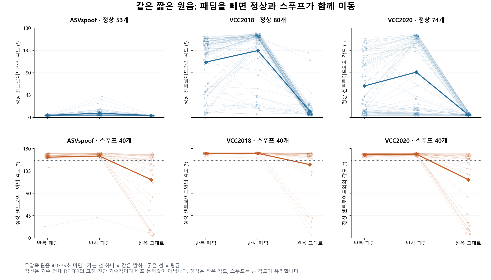
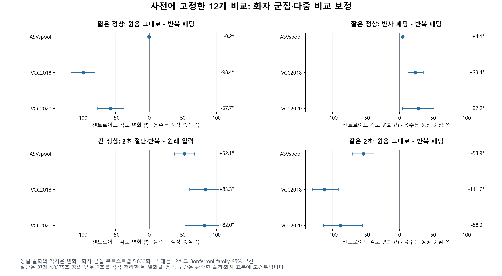
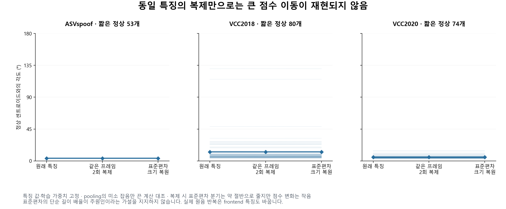
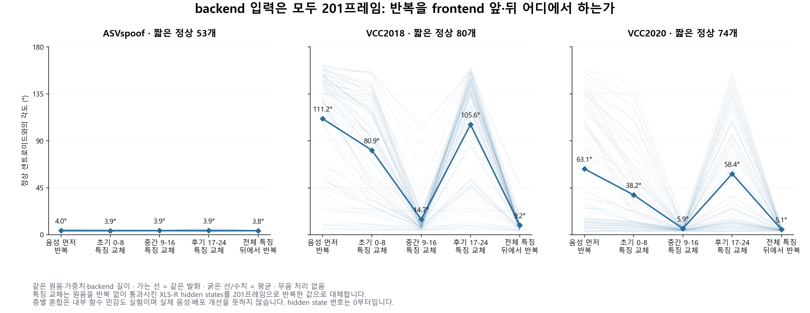

> 역사 문서 보존본. 원문 작성 당시의 상태·계획을 포함한다. 최신 상태와 확정 결과는 experience의 각 실험 README를 우선한다.

# EBM 정상의 한 방향 이동: 반복 전처리와 frontend 문맥의 통제 실험

2026-11-06. 참고 채팅 `01a1abcd-37ab-73b3-9e02-3b493a9315ea`를 읽고 기존 결과·제외 조건을 반영했다. 사용자는 이 채팅에서 원인을 직접 분석·실험하고 더 엄밀하게 검증하도록 요청했다. 원래 EBM, 센트로이드, 평가 캐시는 변경하지 않았다.

## 1. 이번에 좁혀진 경로와 범위

선택한 짧은 정상에서 **원음을 XLS-R 앞에서 반복하는 것과, 원음을 먼저 XLS-R에 통과시킨 뒤 특징을 반복하는 것은 큰 차이를 만들었다.** 후자의 backend 입력도 201프레임으로 고정했으므로 단순한 backend 입력 길이 차이로는 이 결과를 설명할 수 없다. 정상의 큰 이동에는 중간 hidden states 9–16이 특히 민감했고, 최종 pooling의 평균 특징 변화가 큰 점수 변화를 매개했다.

같은 발화의 final Linear 출력 h 변화는 한 축에 강하게 집중됐다. 이 관찰은 구면 그림에서 정상들이 특정 경로를 따라 이동하는 모습과 일치한다. 그 축은 현재 고정 readout이 문맥 변화에 반응하는 표현 방향이지, 특정 마이크·음색·주파수 대역으로 해석된 물리적 축이 아니다.

반복 없는 입력은 정상 일부를 구제하지만 스푸프의 정상 점수도 올렸다. 선택한 471개에서 EER/AUROC가 악화돼 수정안을 성능 개선으로 제시하지 않는다. 특정 녹음 특성 또는 학습 원인을 유일한 원인으로 확정하지 않았고 공동 재학습은 하지 않았다.

## 2. 참고 채팅에서 유지한 사항

- 정상 도메인 변화가 EER 악화를 주도한다는 교차 평가, 출처×길이 조건의 오류 집중, 원음 3,419개의 음향 측정 결과를 새 결과와 구별한다.
- **무음 분포 의존성은 제외**한다. 무음 비율 측정·구간 제거·무음 추가 처리를 하지 않았다.
- 고정 표현의 길이별 중심 교체는 개선되지 않았지만, 길이 조건을 반영한 공동 재학습 가설은 미검증이다.
- 취소한 DF 4×3 교차검증을 실행하지 않았고 새로운 분류기를 fit하지 않았다.
- 기존 수치: DF 전체 533,928개 EER 3.241828%, 기존 pilot 20,000개 3.35%. 아래 471개 EER와 모집단이 다르다.
- 코드에 대한 정정: long/short 입력은 같은 정상 발화 목록에서 각각 생성하지만, 실제 `BPL.forward()`는 정규화한 `X @ Y.T`의 모든 원소를 평균한다. 따라서 동일 발화의 대각 쌍과 서로 다른 정상 발화의 교차 쌍을 모두 포함한다. 논문의 식(8)은 동일 발화의 증강 쌍을 설명하므로 논문 설명과 실제 loss 구현을 구별한다. 이 구분은 입력·내부 개입에 관한 이번 동결 모델 결과를 바꾸지 않는다. 2026-11-06 원길이 검토에서 실제 loss 수식을 다시 확인해 이전의 대각 쌍만 사용한다는 설명을 수정했다.

## 3. 표본·고정 설계

공식 DF metadata의 `nocodec` 조건에서 출처×정상/스푸프×원음 길이 구간으로 선택했다. nocodec은 이번 평가 코덱 조건이며 원본 녹음 과정의 모든 압축 이력이 없다는 주장이 아니다. DF pilot과 DF_remaining의 완료 캐시 metadata를 합치고 UID 해시·화자별 round-robin으로 골랐다. 점수나 임베딩을 보고 표본을 고르지 않았다.

| 출처 | 정상 <2초 | 정상 2–4.0375초 | 정상 ≥4.0375초 | 스푸프 <2초 | 스푸프 2–4.0375초 | 스푸프 ≥4.0375초 |
|---|---:|---:|---:|---:|---:|---:|
| ASVspoof | 13 | 40 | 32 | 20 | 20 | 16 |
| VCC2018 | 40 | 40 | 32 | 20 | 20 | 16 |
| VCC2020 | 34 | 40 | 32 | 20 | 20 | 16 |

총 471개(정상 303·스푸프 168). 짧은 정상은 207개다. 표본 비율은 모집단 비율이 아니며, population weighting한 DF 성능으로 해석하지 않는다.

원래 체크포인트 SHA256은 `104873703a57cad98b686d770e0860e031a2cf9abef79b72668780c1660e0b24`다. 새 forward 전 `protocol.json`, 선택 manifest SHA256과 첫 12개 주 비교를 고정했다. 이후 기전 실험 두 개는 첫 결과를 본 뒤 설계한 **탐색적 후속 검증**임을 별도 protocol에 기록했다.

## 4. 실험 A: 같은 원음의 패딩 개입

모든 471개에 원래 반복 패딩, 반사 패딩, 원음 그대로의 세 조건을 적용했다. 반복·반사는 64,600샘플을 유지한다. 원음 그대로 조건은 짧은 음성을 실제 길이로 입력하고 긴 음성은 기존 첫 64,600샘플을 유지한다. 반사는 시간 역전된 반복 구간을 만드는 비자연적 민감도 대조이며 배포 대안으로 권고하지 않는다.

긴 원음 144개에는 기존 첫 4.0375초 창에서 앞·뒤 1.5초 및 2초를 각각 골라 세 처리를 적용했다. 앞·뒤 결과는 발화별 평균으로 집계했고 독립 발화 두 개로 세지 않았다. 절단은 음성 내용을 줄이므로 내용 범위의 영향과 길이를 완전히 분리한 실험은 아니다.

총 3,141개의 조건별 최종 h/z와 점수를 얻었다. 동일 원음·동일 seed·고정 가중치를 사용했고, 음량 정규화·속도 변경·무음 처리를 하지 않았다. 원래 반복 조건의 모든 h/z/코사인은 기존 캐시와 최대 오차 **0**으로 재현됐다. 입력도 원래 EnrollmentSet과 일치했다. 양 GPU 공통 18개 QC와 동일 조건 반복은 bitwise 일치했다. 긴 원음의 세 기본 조건은 실제로 동일 입력이며 별도 forward의 점수 차이는 0이었다.

### 4.1 원래 짧은 정상: 센트로이드 각도의 평균 변화

음수는 정상 중심 쪽으로 이동했다는 뜻이다. 각 source 안에서 화자 군집을 짝지어 5,000회 재표집했고, 12비교 Bonferroni family 95% 구간을 보고한다. 원발화 family 의존성은 미해결이다.

| 출처 | 원음 그대로 - 반복 평균 변화 | family 95% CI | 반사 - 반복 평균 변화 | family 95% CI |
|---|---:|---|---:|---|
| ASVspoof, n53 | -0.228° | [-0.428, -0.041] | +4.426° | [1.958, 7.607] |
| VCC2018, n80 | -98.413° | [-117.021, -81.168] | +23.364° | [12.491, 35.167] |
| VCC2020, n74 | -57.678° | [-76.786, -37.474] | +27.877° | [3.967, 50.665] |

ASVspoof의 변화는 통계적으로 구별돼도 실질 크기는 작다. 출처별 전체 효과를 평균으로만 해석하지 않도록 모든 발화의 짝지은 경로도 표시했다.

### 4.2 원래 긴 정상의 절단 대조

각 출처 정상 n32에서 앞·뒤 2초를 반복하면 원래 입력보다 평균 각도가 ASVspoof +52.105°, VCC2018 +83.324°, VCC2020 +82.042° 커졌다. family 95% 구간은 각각 [37.279,67.285], [60.221,103.661], [52.995,103.860]°다. 같은 2초를 반복 없이 넣으면 반복 입력에 비해 각각 -53.855°, -111.703°, -88.040° 이동했다. 기존에 잘 처리하던 출처의 정상에서도 절단·반복으로 큰 이동이 재현됐다.

## 5. 실험 B: 표준편차 배율 가설의 반증과 평균/표준편차 분리

실제 pooling은 평균에는 sum(w×x), 표준편차에는 sample_std(w×x+작은 noise)를 사용한다. 일반적인 가중 분산과 다르며 같은 특징 프레임을 k회 복제하면 표준편차가 대략 1/k로 줄어든다. 잡음을 끈 수학 대조에서 정확한 복원 배율은 `sqrt(k*(k*T-1)/(T-1))`이다. 이 사실만으로 정상 오류의 원인이라고 단정하지 않았다.

원음 그대로의 SSL 특징을 메모리에서 2회·4회 복제했다. 음성·특징 값·가중치가 같고 프레임 수만 바뀐다. 평균 절대 점수 변화는 2회 0.000236, 4회 0.000350에 불과했다(최대 0.01065/0.01595). 모든 pooling의 분석식 배율을 복원하면 최대 오차 약 1.36e-6/1.22e-6로 기준 점수로 돌아왔다. **표준편차의 단순 길이 배율은 큰 원음 패딩 효과의 주원인이라는 가설을 지지하지 않았다.**

실제 원음 반복/비반복 forward의 최종 pooling 평균 μ와 표준편차 σ를 각각 교체하고 두 교체 순서를 모두 계산했다. 두 순서 평균의 Shapley 기여는 정확히 전체 점수 차이로 합쳐졌다.

| 짧은 정상 | 반복→원음의 평균 점수 변화 | 평균 μ 분기 기여 | 표준편차 σ 분기 기여 |
|---|---:|---:|---:|
| VCC2018 | +1.262285 | +1.261679 | +0.000607 |
| VCC2020 | +0.688776 | +0.688014 | +0.000762 |

큰 변화는 최종 평균 특징에서 왔다. 이는 내부 함수의 기여 분해이며 혼합 μ/σ가 실제 음성으로 실현 가능하다는 증명은 아니다. μ 변화에는 frontend와 bridge/time attention의 영향이 함께 포함되므로 이를 곧바로 SSL 평균 하나의 원인으로 읽지 않는다.

## 6. 실험 C: backend 201프레임을 고정하고 frontend 반복 문맥을 분리

같은 원음에서 다음을 비교했다.

1. 원음을 64,600샘플로 반복한 뒤 XLS-R → 기존 backend.
2. 원음을 반복 없이 XLS-R에 넣고 나온 각 hidden state를 시간축에서 반복·절단해 **모두 201프레임**으로 맞춘 뒤 동일 backend.

가중치·backend 프레임 수·seed를 고정했다. 후기 특징 복제는 원래 짧은 내용의 표현을 반복하므로 단순 backend 길이 차이를 통제한다. 두 방식 모두 새로운 음성 내용을 추가하지 않지만, 전자는 XLS-R이 반복 문맥을 직접 처리한다. 시간축의 정수 프레임 반복/끝 절단은 파형 반복의 정확한 음향적 동등물이 아니므로 이 제한은 남는다.

### 6.1 짧은 정상의 평균 센트로이드 각도

| 조건 | ASVspoof n53 | VCC2018 n80 | VCC2020 n74 |
|---|---:|---:|---:|
| 원래 파형 반복 | 3.968° | 111.232° | 63.149° |
| hidden states 0–8만 교체 | 3.851° | 80.934° | 38.200° |
| **9–16만 교체** | **3.909°** | **14.749°** | **5.860°** |
| 17–24만 교체 | 3.941° | 105.614° | 58.446° |
| 모든 층의 특징을 뒤에서 반복 | 3.839° | 9.200° | 5.101° |

0은 첫 hidden state이고 1–24는 순서대로 encoder 출력이다. 세 블록의 2³=8개 조합을 모두 계산했다. 조합별 점수의 상호작용을 포함해 6개 교체 순서로 Shapley 기여를 계산하면, VCC2018의 중간 블록은 점수 변화 1.30217 중 1.01972(78.3%), VCC2020은 0.68972 중 0.48139(69.8%)를 차지했다. 이 비율은 이 내부 함수 분해의 비율이며 모집단 오류 원인의 비율이 아니다.

중간 블록의 교체 민감도가 컸다는 것은 frontend의 **해당 층에만 문제가 발생했다**거나 attention 블록 하나가 유일 원인이라는 뜻은 아니다. 서로 다른 forward의 층을 섞은 내부 개입이므로 비자연적 조합일 수 있다. 모든 층을 교체한 동일 길이 대조는 파형 반복 전·후의 위치가 판정에 영향을 준다는 더 직접적인 근거다. 원음이 긴 144개에서는 전부 같은 입력이므로 8조건의 점수 차이가 **0**이었다.

### 6.2 왜 구면에서는 거의 한쪽 경로로 보이는가

짧은 정상 207개의 실제 짝지은 변화 `h(original)−h(wrap)`를 원래 160차원에서 분석했다. 비중심 SVD 제곱 길이의 **99.696%가 첫 축**에 놓였다. 최종 LN 이후 z 변화는 93.672%였다. 이 계산에는 원형/구면 지도의 두 축을 사용하지 않았다.

따라서 이 표본의 변화가 실제 고차원에서도 강하게 한 축에 집중된다는 근거가 있다. 크기가 큰 변화가 제곱합에 더 크게 반영되며, 이 수치는 표현 전체의 본질적 차원이 1이라는 증거가 아니다. 정규화된 구면에서 보이는 경로의 화면 방위는 여전히 시각화 축에 따라 달라진다.

## 7. 정상 구제와 전체 구분을 구별

기존 전체 DF native EER에서 얻은 **진단용 고정 threshold -0.9145589682**를 유지하면 짧은 VCC2018 정상 오류는 11/80→0/80, VCC2020은1/74→0/74였다. 그러나 같은 source의 짧은 스푸프 통과는 VCC2018 0/40→8/40, VCC2020 0/40→20/40으로 증가했다. 이것은 고정 threshold의 변화이며 EER 자체와 다르다.

또한 각 방법의 순위를 같은 471개에서 다시 평가했다. 아래는 **층화 표본의 탐색적 성능**이지 DF 전체 EER가 아니다.

| 조건 | 선택 표본 EER | AUROC | native 대비 EER 악화(pp), 개별 탐색 95% CI |
|---|---:|---:|---|
| 원래 반복 | 3.571429% | 0.992594 | 기준 |
| 원음 그대로 | 9.570957% | 0.971790 | +5.999529 [2.758621,9.473911] |
| 반사 패딩 | 11.221122% | 0.969295 | +7.649694 [4.579469,10.344828] |
| 중간 9–16 특징 교체 | 5.357143% | 0.989804 | +1.785714 [-0.694531,4.568580] |
| 모든 특징을 뒤에서 반복 | 9.523810% | 0.971908 | +5.952381 [2.777778,8.934050] |

구간은 출처별 화자 군집 paired bootstrap5,000회, 총80그룹으로 계산했다. 후속 탐색 구간으로 첫 사전 고정12개 비교의 family 구간과 섞지 않는다. 원발화 family 의존성·모델 fit 불확실성은 포함하지 않았다. 원음 그대로 조건의 정상 점수가 좋아졌다는 사실만으로 반복 제거가 탐지 성능 개선이라고 결론 내릴 수 없다.

## 8. 검증과 재현

세 서버 실행은 기존 컨테이너에서 사용자 지정 `CUDA_VISIBLE_DEVICES=0,1`을 사용했다. 원음·원본 코드·체크포인트를 로컬로 복사하지 않았고 frontend hidden state를 서버 파일로 저장하지 않았다. 첫 실험의 최종160차원 h/z와 파생 점수, 후속의 스칼라 통계만 보관했다. 어떤 optimizer도 사용하지 않았다.

실행 코드: `padding_causal_sidecar.py`, `run_padding_causal.py`, `pooling_mechanism_sidecar.py`, `run_pooling_mechanism.py`, `frontend_context_sidecar.py`, `read_frontend_context.py`.

분석·검수: `analyze_padding_causal.py`, `verify_padding_mechanisms.py`, `summarize_padding_ranking.py`, `plot_padding_causal.py`.

결과 루트: `artifacts/geometry_cache/local_analysis/padding_causal_20261106_v1/`. 독립 검수는 `independent_verification.json`, 수학·점수 대응 검수는 `analysis_verification.json`이다. 원래 score 재현, 긴 음성 no-op, 2분기·3블록 Shapley의 합, 명시적 복제 배열의 분산식, SVD 제곱합, 독립 DET와 weighted ROC의 EER 일치를 확인했다. 입력·출력 SHA256도 대조했다.

16:12:25 KST 서버 재확인에서 세 실행 모두 exit0, GPU6/7 각6MiB·0%, 보관 원본28파일 SHA256과 체크포인트 SHA256이 변하지 않았다. 실행 중이던 기존 작업을 중단·재시작하지 않았다.

## 9. 남은 질문

이번에는 **특정 입력 반복 문맥 → frontend 특징 변화 → backend 평균 특징 → 공통 임베딩 방향 이동**이라는 작동 경로를 좁혔다. 특정 마이크·발성·주파수 성분이 이 차이를 시작하게 하는지는 미확정이다. XLS-R 내부의 개별 정규화/위치 처리/attention 연산 중 무엇이 원인인지도 분리하지 않았다. 이 고정 head가 왜 그 변화를 정상성의 신호로 사용하게 됐는지, 데이터 보강·단일 중심·BPL 학습 중 무엇이 이를 만들었는지는 공동 재학습 대조가 필요하다. 이번 실험은 그 재학습 가설을 검증했다고 주장하지 않는다.
