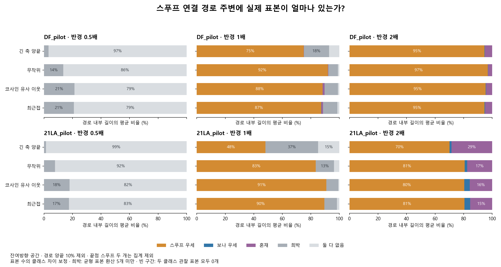

> 역사 문서 보존본. 원문 작성 당시의 상태·계획을 포함한다. 최신 상태와 확정 결과는 experience의 각 실험 README를 우선한다.

# 스푸프 연결 경로 주변의 보나와 스푸프 표본 수

2026년 11월 5일. 기존 고정 EBM의 저장 표현과 앞선 분석의 연결 쌍을 재사용했다. 최근접 클래스만 정하는 대신 같은 반경 안의 클래스별 표본 수를 세어, 관찰 표본이 없는 경로와 스푸프가 실제로 많은 경로를 구분한다.

앞선 ‘정상 최근접 영역을 지나지 않음’은 스푸프 표본이 경로를 채운다는 증거가 아니다. 이번 결과는 표본의 빈 공간을 명시적으로 포함한 후속 해석이며, 앞선 최근접 판정의 수치를 바꾸지는 않는다.

## 집계 기준

T 25,380개, V 14,983개, 기존 DF·21LA pilot 각 20,000개(보나 2,000, 스푸프 18,000)의 같은 체크포인트를 사용했다. 전체 단위 임베딩 x와 코사인 성분을 제거한 잔여방향 u를 따로 계산했다. 아래 주표는 잔여방향 공간이다.

각 자료·공간에서 고정 난수로 최대 2,000개씩 클래스 균형 표본을 골라, 혼합된 표본 안에서 다섯 번째 다른 이웃까지 거리의 중앙값을 기본 반경으로 정했다. 같은 반경을 두 클래스와 경로의 모든 위치에 적용하며, 절반·기본·두 배를 모두 보고했다. 반경은 탐색용 공간 척도이고 유일한 정답은 아니다.

집계에는 각 클래스의 전체 저장 표본을 쓰되 연결의 양끝 스푸프 두 개는 제외했다. 경로의 양끝 10%도 제외했다. 그래서 끝점 자체로 인해 경로가 스푸프로 채워져 보이는 효과를 줄였다. 단위구면 최단 호와 각 표본 반경 공이 만나는 구간을 해석적으로 구하고, 진입·이탈 사건을 정렬해 연속 경로 길이 비율과 주변 표본 수를 적분했다. 중간점 격자만으로 빈 구간을 정하지 않았다.

경로의 각 위치에서 보나 수 nB, 스푸프 수 nS를 센다. 클래스별 전체 수 NB, NS에 대해 b=nB/NB, f=nS/(NS−2)를 함께 기록해 스푸프 표본이 약 9배 많은 효과를 보정했다. 동일한 공의 부피는 두 클래스 비교에서 상쇄되므로 이는 클래스별 국소 표본 비율의 비교다. 원래 클래스 비율의 사후확률은 아니다.

- **둘 다 없음:** nB=nS=0. 관찰된 표본에 대한 빈 구간이다.
- **희박:** 0 < NB×(b+f) < 5. 클래스 균형 표본으로 환산해 5개 미만의 지지다.
- **보나 우세:** 환산 지지가 5개 이상이고 b≥2f.
- **스푸프 우세:** 환산 지지가 5개 이상이고 f≥2b.
- **혼재:** 지지가 5개 이상이며 두 클래스 비율 차이가 2배 미만.

‘많음’과 ‘희박’은 운영상 탐색 기준이다. 환산 지지 1·5·10의 결과를 모두 저장했다. 분류 비율은 각 경로 내부 길이에서 구한 뒤 경로마다 같은 가중치로 평균했다. 따라서 ‘경로 중 몇 개가 전부 비었는가’와는 다른 값이다.

## 기본 반경에서의 경로 구성

| 자료 | 연결 | 경로 수 | 스푸프 우세 (%) | 보나 우세 (%) | 혼재 (%) | 희박 (%) | 둘 다 없음 (%) |
| --- | --- | --- | --- | --- | --- | --- | --- |
| DF_pilot | 최근접 | 592 | 87.22 | 0.17 | 1.17 | 10.01 | 1.44 |
| DF_pilot | 코사인 유사 이웃 | 587 | 88.16 | 0.03 | 1.40 | 9.36 | 1.05 |
| DF_pilot | 무작위 | 600 | 91.92 | 0.00 | 0.25 | 6.86 | 0.97 |
| DF_pilot | 긴 축 양끝 | 600 | 74.96 | 0.00 | 0.18 | 17.60 | 7.26 |
| 21LA_pilot | 최근접 | 596 | 89.52 | 0.00 | 0.00 | 8.78 | 1.70 |
| 21LA_pilot | 코사인 유사 이웃 | 589 | 90.84 | 0.00 | 0.00 | 8.35 | 0.80 |
| 21LA_pilot | 무작위 | 600 | 83.43 | 0.00 | 0.00 | 12.78 | 3.78 |
| 21LA_pilot | 긴 축 양끝 | 600 | 48.11 | 0.00 | 0.00 | 37.01 | 14.89 |

같은 반경에서 보나와 스푸프가 모두 0인 구간은 ‘스푸프 우세’에 포함하지 않는다. 반대로 빈 구간이 아니어도 표본이 충분하지 않으면 희박으로 따로 남긴다.

## 실제 주변 개수와 클래스별 비율

| 자료 | 연결 | 평균 주변 보나 수 | 평균 주변 스푸프 수 | 보나 1000개당 | 스푸프 1000개당 |
| --- | --- | --- | --- | --- | --- |
| DF_pilot | 최근접 | 1.20 | 958.52 | 0.600 | 53.257 |
| DF_pilot | 긴 축 양끝 | 0.26 | 603.44 | 0.131 | 33.528 |
| 21LA_pilot | 최근접 | 0.00 | 1019.83 | 0.001 | 56.664 |
| 21LA_pilot | 긴 축 양끝 | 0.00 | 238.62 | 0.000 | 13.258 |

위 개수는 경로의 임의 위치 주변에서 기대되는 표본 수를 경로 길이에 대해 평균한 것이다. 경로 전체에서 한 번이라도 가까웠던 고유 표본 수는 별도 `tube_unique_bona`, `tube_unique_spoof`에 있고, 평균·중앙값을 모두 저장했다. 긴 경로의 고유 표본 수가 많다고 경로의 중간이 조밀하다는 뜻은 아니다.

## 반경에 따른 민감도

| 자료 | 연결 | 반경 배수 | 둘 다 없음 (%) | 희박 (%) | 스푸프 우세 (%) | 보나 우세 (%) | 혼재 (%) |
| --- | --- | --- | --- | --- | --- | --- | --- |
| DF_pilot | 최근접 | 0.5 | 79.03 | 20.97 | 0.00 | 0.00 | 0.00 |
| DF_pilot | 긴 축 양끝 | 0.5 | 96.79 | 3.21 | 0.00 | 0.00 | 0.00 |
| DF_pilot | 최근접 | 1.0 | 1.44 | 10.01 | 87.22 | 0.17 | 1.17 |
| DF_pilot | 긴 축 양끝 | 1.0 | 7.26 | 17.60 | 74.96 | 0.00 | 0.18 |
| DF_pilot | 최근접 | 2.0 | 0.00 | 0.07 | 94.64 | 0.44 | 4.85 |
| DF_pilot | 긴 축 양끝 | 2.0 | 0.00 | 0.00 | 94.60 | 0.35 | 5.04 |
| 21LA_pilot | 최근접 | 0.5 | 82.52 | 17.48 | 0.00 | 0.00 | 0.00 |
| 21LA_pilot | 긴 축 양끝 | 0.5 | 98.53 | 1.47 | 0.00 | 0.00 | 0.00 |
| 21LA_pilot | 최근접 | 1.0 | 1.70 | 8.78 | 89.52 | 0.00 | 0.00 |
| 21LA_pilot | 긴 축 양끝 | 1.0 | 14.89 | 37.01 | 48.11 | 0.00 | 0.00 |
| 21LA_pilot | 최근접 | 2.0 | 0.00 | 0.00 | 80.57 | 4.01 | 15.42 |
| 21LA_pilot | 긴 축 양끝 | 2.0 | 0.00 | 0.00 | 70.11 | 1.34 | 28.55 |

반경이 커지면 주변 표본 수가 늘고 빈 구간이 줄어드는지 모든 연결에서 확인했다. 서로 다른 공간의 반경 숫자는 직접 비교하지 않는다. 클래스별 밀도와 국소 구조가 달라 기본 반경만으로 결론을 고정하면 안 된다.

| dataset | representation | calibration_count_per_class | base_radius | normal_5nn_median_in_balanced_pool | spoof_5nn_median_in_balanced_pool |
| --- | --- | --- | --- | --- | --- |
| T | unit_z | 2000 | 0.035113 | 0.022992 | 0.053032 |
| T | residual_u | 2000 | 0.345475 | 0.385664 | 0.295306 |
| V | unit_z | 1351 | 0.037298 | 0.025376 | 0.052688 |
| V | residual_u | 1351 | 0.342699 | 0.379739 | 0.297053 |
| DF_pilot | unit_z | 2000 | 0.058101 | 0.041006 | 0.060504 |
| DF_pilot | residual_u | 2000 | 0.369306 | 0.413611 | 0.319696 |
| 21LA_pilot | unit_z | 2000 | 0.058757 | 0.032978 | 0.077348 |
| 21LA_pilot | residual_u | 2000 | 0.394677 | 0.427449 | 0.341482 |

## 이전 최근접 반례를 다시 세었을 때

앞선 분석의 정상 최근접 진입 증거점 30개 중 기본 반경에서 **둘 다 0인 지점은 29개**, **희박한 지점은 1개**였다. 이 개수는 서로 독립적인 반례 수가 아니고, 중복 끝점·다른 연결 종류가 포함된 30개 경로 관찰이다.

DF 잔여방향의 유일한 긴 축 반례 지점에서는 기본 반경 0.369306 안에 보나 1개, 스푸프 17개였다. 가장 가까운 보나까지 거리는 0.337786, 스푸프까지 거리는 0.338764였다. ‘보나가 더 가깝다’와 ‘근처에 보나가 많다’가 서로 다름을 보여준다. 절반·두 배 반경의 개수도 `previous_nearest_label_witness_counts.csv`에 있다.

## 해석과 검증

학습 가설에는 보나 침범 여부뿐 아니라 경로의 스푸프 지지와 빈 구간 비율을 함께 써야 한다. 스푸프 지지가 많은 구간은 연결 학습 후보가 될 수 있지만, 빈 구간은 정답을 알 수 없는 외삽 구간으로 남긴다. 두 클래스가 함께 조밀한 구간은 별도로 취급한다. 이번 결과는 실제 보간 음성의 정답이나 새 학습법의 효과를 증명하지 않는다.

캐시 해시·동일 체크포인트·행 대응을 확인했다. 모든 반경에서 각 경로의 다섯 상태 비율 합이 1인지, 반경 확대에 따라 표본 수가 단조 증가하고 빈 비율이 감소하는지 확인했다. 실제 표본의 직접 160좌표 거리 집계와 구간 계산을 대조했고, 사건 누적 적분과 각 표본의 구간 길이 합도 독립 대조했다. 합성 빈 공간·부분 지지 사례를 포함했다.

관찰 표본이 0이라고 실제 음성 분포가 완전히 비었다고 증명한 것은 아니다. 표본 수와 반경의 한계가 있으며, 기존 benchmark를 이미 반복 관찰한 탐색 분석이다. DF와 21LA는 독립 반복 실험으로 세지 않고 원발화 계열 의존성도 미해결이다. 기존 실험·모델·원본 캐시는 바꾸지 않았다.

결과는 `artifacts/geometry_cache/local_analysis/spoof_path_geometry_v1/path_density_v1/`에 있다. `density_metrics.csv`는 전체 상태 비율·평균 개수, 각 `edge_density.parquet`는 경로별 값, `radii.csv`는 반경, `median_counts.csv`는 중앙값, 두 verification JSON은 검증 근거다. 재현 코드는 `artifacts/geometry_experiments/spoof_path_density.py`, 보고서와 독립 검증 코드는 `report_spoof_path_density.py`다.
