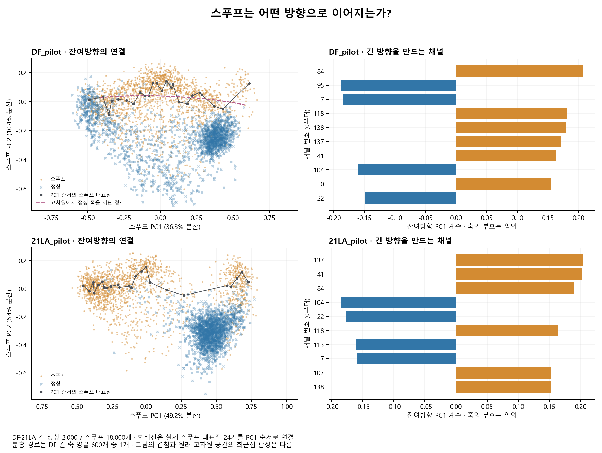

> 역사 문서 보존본. 원문 작성 당시의 상태·계획을 포함한다. 최신 상태와 확정 결과는 experience의 각 실험 README를 우선한다.

# 스푸프 연결 방향과 정상 음성의 중간 겹침 분석

> 후속 밀도 분석: 최근접 클래스와 실제 주변 표본 수는 다르다. 빈 구간을 포함한 [경로 주변 표본 수 분석](spoof_path_density_20261105.md)을 함께 읽는다. 아래 최근접 진입 수치는 보존하지만 스푸프가 경로를 채운다는 뜻으로 해석하지 않는다.

2026년 11월 5일. 같은 고정 EBM의 저장 임베딩을 사용한 탐색 분석이다.

스푸프 잔여방향에는 데이터셋을 넘어 비슷한 주축이 있다. 그러나 하나의 가느다란 타원이나 단일 곡선으로 설명되지는 않는다. 관찰된 전체 스푸프와 정상 표본을 기준으로 연속 경로를 검사하면, 가까운 스푸프 쌍에서는 정상 최근접 영역의 중간 진입을 찾지 못했고 먼 쌍에서는 일부 찾았다. 이 관찰은 보간 음성의 실제 정답이나 새 학습법의 성능을 증명하지 않는다.

## 가설과 자료

가설은 스푸프에 연속적인 방향 구조가 있고, 가까운 스푸프 사이의 연결이 정상 영역을 자주 가로지르지 않을 수 있다는 것이다. 타원이라는 모양은 가정하지 않고 공분산과 연결 경로를 확인했다.

T 25,380개, V 14,983개와 기존에 고정한 DF·21LA pilot 각각 20,000개(정상 2,000, 스푸프 18,000)를 사용했다. 새로운 학습·추출·모델 변경은 없었다. 같은 체크포인트를 사용하며 화자와 원발화 계열의 의존성 때문에 경로를 독립 시행으로 세지 않는다. DF와 21LA도 독립 반복 실험이 아니다.

단위 임베딩 x=z/||z||, 단위 정상 중심 c, 코사인 s=x·c, 잔여방향 u=(x-sc)/||x-sc||를 구분했다. 잔여방향의 겹침은 s를 제거한 공간의 겹침이며 전체 임베딩의 겹침과 같지 않다. 채널 표준화 없이 각 공간의 스푸프만으로 PCA를 계산했고, 정상은 같은 축에 투영했다.

## 스푸프의 긴 방향과 채널

| 자료 | 공간 | PC1 분산 (%) | PC1+2 분산 (%) | 90%에 필요한 차원 | 장축/제2축 길이비 |
| --- | --- | --- | --- | --- | --- |
| T | 전체 단위 임베딩 | 47.75 | 69.35 | 18 | 1.49 |
| T | 잔여방향 | 51.54 | 63.96 | 23 | 2.04 |
| V | 전체 단위 임베딩 | 48.95 | 71.60 | 18 | 1.47 |
| V | 잔여방향 | 50.99 | 63.54 | 22 | 2.02 |
| DF_pilot | 전체 단위 임베딩 | 54.50 | 71.47 | 13 | 1.79 |
| DF_pilot | 잔여방향 | 36.30 | 46.72 | 37 | 1.87 |
| 21LA_pilot | 전체 단위 임베딩 | 44.28 | 69.36 | 15 | 1.33 |
| 21LA_pilot | 잔여방향 | 49.16 | 55.57 | 32 | 2.77 |

PC1은 분산이 가장 큰 방향이며 판별력이 가장 큰 방향이라는 뜻이 아니다. 잔여방향에서 DF는 PC1 36.30%, 21LA는 49.16%를 설명하지만 90% 설명에는 각각 37·32차원이 필요했다. 2D에 보이는 점들의 연결은 고차원 구조 전체가 아니다.

| 자료 | 큰 계수의 채널 (부호 포함) | 상위 8개 제곱계수 합 (%) |
| --- | --- | --- |
| T | 137:+0.215, 104:-0.197, 84:+0.193, 22:-0.187, 7:-0.177, 24:+0.159, 95:-0.156, 120:-0.155 | 26.2 |
| V | 137:+0.217, 84:+0.196, 104:-0.190, 22:-0.189, 7:-0.178, 24:+0.159, 95:-0.159, 69:-0.156 | 26.4 |
| DF_pilot | 84:+0.207, 95:-0.188, 7:-0.184, 118:+0.182, 138:+0.180, 137:+0.172, 41:+0.163, 104:-0.161 | 26.0 |
| 21LA_pilot | 137:+0.204, 41:+0.203, 84:+0.189, 104:-0.185, 22:-0.177, 118:+0.164, 113:-0.161, 7:-0.159 | 26.2 |

위 계수는 잔여방향 좌표 u의 변화 방향이다. 축의 반대쪽을 고르면 모든 부호가 함께 뒤집힌다. DF에서는 한쪽 방향으로 84·118·138·137·41번이 증가하고 95·7·104번이 감소하는 조합이 큰 계수를 가졌다. 상위 8개 계수의 제곱합은 약 26%이므로 몇 개 채널이 방향을 독점한다고 해석하지 않는다. 채널 번호는 0부터 센다.

T와 평가셋에서 따로 얻은 잔여방향 PC1의 절대 내적은 DF 0.930, 21LA 0.961이다. 전체 단위 임베딩 PC1은 각각 0.180·0.322였다. 잔여방향의 주축이 더 비슷하다는 관찰이며, 고유한 위조 단서나 미지 공격 일반화의 증명은 아니다. T의 잔여 분산 중 공격 평균 차이에 해당하는 비율은 63.5%, DF 35.0%, 21LA 51.0%여서 공격 종류의 혼합도 구조에 영향을 준다.

## 연결했을 때 정상 음성이 중간에 있는가

‘중간 포함’을 정답 없는 보간점의 라벨로 정의할 수는 없다. 대신 경로의 양끝 10%를 제외한 연속 구간에, 어떤 관찰 정상보다 모든 관찰 스푸프가 더 멀어지는 지점이 있는지 검사했다. 즉 **정상까지의 최근접 거리 < 스푸프까지의 최근접 거리**인 지점의 존재다. 모든 정상·스푸프 표본을 비교에 사용하고 실제 스푸프 양끝도 포함했다.

각 연결 종류는 600개를 목표로 고정 난수로 뽑았고 같은 종류 안의 중복 무방향 쌍을 제거했다. 최근접·20번째 이웃·코사인 차이 0.02 이하인 가까운 이웃·무작위·스푸프 PC1 하위 10%와 상위 10% 사이 연결을 비교했다. 가까운 이웃은 각 공간의 거리로 정했다. 독립 지지 표본용 스푸프를 제외한 나머지에서 끝점을 뽑았고, 최종 판정에는 제외했던 표본까지 전부 포함했다.

| 자료 | 공간 | 최근접 | 20번째 이웃 | 코사인 유사 이웃 | 무작위 | 긴 축 양끝 |
| --- | --- | --- | --- | --- | --- | --- |
| T | 전체 단위 임베딩 | 0/592 (0.00%) | 0/600 (0.00%) | 0/592 (0.00%) | 0/600 (0.00%) | 0/600 (0.00%) |
| T | 잔여방향 | 0/591 (0.00%) | 0/600 (0.00%) | 0/590 (0.00%) | 0/600 (0.00%) | 0/600 (0.00%) |
| V | 전체 단위 임베딩 | 0/598 (0.00%) | 0/599 (0.00%) | 0/598 (0.00%) | 0/600 (0.00%) | 0/600 (0.00%) |
| V | 잔여방향 | 0/597 (0.00%) | 0/599 (0.00%) | 0/597 (0.00%) | 0/600 (0.00%) | 0/600 (0.00%) |
| DF_pilot | 전체 단위 임베딩 | 0/594 (0.00%) | 1/600 (0.17%) | 1/593 (0.17%) | 1/600 (0.17%) | 13/600 (2.17%) |
| DF_pilot | 잔여방향 | 0/592 (0.00%) | 0/600 (0.00%) | 0/587 (0.00%) | 0/600 (0.00%) | 1/600 (0.17%) |
| 21LA_pilot | 전체 단위 임베딩 | 0/598 (0.00%) | 1/600 (0.17%) | 0/597 (0.00%) | 1/600 (0.17%) | 11/600 (1.83%) |
| 21LA_pilot | 잔여방향 | 0/596 (0.00%) | 0/600 (0.00%) | 0/589 (0.00%) | 0/600 (0.00%) | 0/600 (0.00%) |

핵심 비교에서 DF의 긴 축 양끝 연결은 전체 임베딩 13/600, 잔여방향 1/600이었다. 21LA는 각각 11/600, 0/600이었다. 최근접 연결은 두 평가셋의 두 공간 모두 0건이었다. 코사인 유사 이웃도 잔여방향에서는 두 평가셋 모두 0건이지만, DF 전체 임베딩에서는 1건이 있었다. 따라서 ‘가까우면 반드시 안전하다’는 결론은 아니다.

DF에서 확인한 잔여방향의 유일한 긴 축 반례는 서로 다른 공격을 연결한 쌍이며, 원래 코사인 차이는 0.12835, 잔여방향 사이 각도는 72.57도였다. 해당 정상 우세 구간은 전체 경로의 약 26.696%~27.196%로 좁았다. 10% 간격으로 점만 찍으면 놓쳤지만 연속 구간 계산과 실제 거리 대조로 확인했다. 이 반례는 동일 코사인의 작은 방향 변화 실험과 구별해야 한다.

스푸프 PC1을 24개의 같은 표본 수 구간으로 나누고, 각 구간 평균 방향에 가장 가까운 실제 스푸프를 대표점으로 골라 23개 구간을 연결한 결과는 별도 표에 있다. 이 대표점 연결은 분기 구조나 실제 최근접 연결을 보장하지 않는다.

| dataset | representation | segments | continuous_bona_nearer_hits |
| --- | --- | --- | --- |
| T | unit_z | 23 | 0 |
| T | residual_u | 23 | 0 |
| V | unit_z | 23 | 0 |
| V | residual_u | 23 | 0 |
| DF_pilot | unit_z | 23 | 0 |
| DF_pilot | residual_u | 23 | 0 |
| 21LA_pilot | unit_z | 23 | 0 |
| 21LA_pilot | residual_u | 23 | 0 |

## 연속 경로의 계산과 검증

단위구면에서 두 점 사이 최단 호를 사용했다. 중심화한 경로 p(d)=m cos(d)+v sin(d)에서 |d|<π/2이므로, 정상 b가 스푸프 a보다 가까운 조건은 (b-a)·m+(b-a)·v tan(d)>0이 된다. 각 관찰 스푸프에 대한 이 1차 부등식의 구간을 교차하면, 해당 정상이 모든 스푸프보다 가까운 연속 구간의 존재를 계산할 수 있다. 어떤 정상 하나라도 이런 구간을 가지면 해당 경로를 진입으로 센다. 수치상 코사인 차이 1e-10 이상의 증거점을 요구했다.

합성 교차·비교차 검증, 초기 10,001점 조밀 격자와 닫힌식 거리 대조, 실제 경로의 독립 1차원 최적화 대조를 수행했다. 최종 진입 증거점은 모두 실제 160좌표의 유클리드 거리로 재계산해 정상 최근접 거리가 전체 스푸프 최근접 거리보다 작은지 확인했다. 캐시 해시·행 정렬·동일 체크포인트·코사인 재계산도 확인했다.

## 판정 기준에 따른 민감도

초기 정상 5-NN 반경의 합집합은 DF에서 스푸프 끝점까지 포함하는 경우가 많았다. 이 넓은 반경 진입률을 ‘정상이 중간에 낀 비율’로 사용하지 않았다. 같은 수의 별도 스푸프 참조점만 쓰는 최근접 비교도 전체 스푸프를 쓰는 비교보다 겹침을 크게 보였기 때문에, 위 주표는 전체 관찰 표본 기준의 연속 판정을 사용한다.

더 보수적인 반경 min(정상 5-NN 거리, 가장 가까운 스푸프 거리/2)의 공 내부로 들어가는 경로는 검사한 모든 종류에서 0건이었다. 이 공은 해당 정상 중심이 모든 관찰 스푸프보다 가까운 충분조건만 나타내므로, 진입 0이 정상 최근접 영역의 부재를 뜻하지 않는다. 주표의 소수 교차와 모순되지 않는다.

잔여방향 경로를 끝점 코사인의 평균으로 고정해 전체 임베딩에 복원한 별도 민감도 검사에서도 보수적 공 진입은 0건이었다. 이는 최종 모델 판별 성능 검증이 아니다.

## 가설에 대한 해석

방향을 따라 연결한다는 아이디어를 살펴볼 구조적 근거는 있다. 특히 잔여 주축이 데이터셋 간 유사하고, 이번 표본의 가까운 잔여방향 연결에서는 정상 최근접 영역 진입이 확인되지 않았다. 그러나 분산은 다차원이고, 먼 스푸프의 연결은 실제로 정상 최근접 영역을 지날 수 있다. 그러므로 하나의 전역 타원 전체를 스푸프로 채우는 학습보다, 가까운 쌍과 제한된 코사인 변화에서 출발하는 가설이 현재 관찰에 더 잘 맞는다.

선택한 연결은 전체 가능한 쌍의 일부이며 0건은 무교차의 증명이 아니다. 관찰 표본의 최근접 영역은 실제 음성 분포나 보간 음성의 정답이 아니다. 미지 공격·다른 체크포인트·새 학습의 성능은 이번 분석으로 확인하지 않았다.

## 근거 파일

결과 루트는 `artifacts/geometry_cache/local_analysis/spoof_path_geometry_v1/`이다. `summary.json`과 각 자료의 `channel_loadings.csv`에 모양·채널 계수가 있다. 최종 연속 판정은 `conservative_neighborhood/continuous_labels/metrics.csv`, 반례의 끝점·정상 행과 구간은 `witnesses.csv`, 독립 실제 거리 검증은 `delivery_verification.json`에 있다. 초기 반경·참조점 민감도 결과는 덮어쓰지 않고 보존했다. 초기 `path_overlap.png`는 넓은 5-NN 공 진입률이며 최종 정상 교차율로 인용하지 않는다.

재현 코드는 `artifacts/geometry_experiments/`의 `spoof_path_geometry.py`, `refine_spoof_path_neighborhood.py`, `scan_spoof_path_support.py`, `verify_spoof_path_geometry.py`, `continuous_spoof_path_labels.py`, `report_spoof_path_geometry.py` 순서다. 기존 캐시와 완료 결과를 덮어쓰지 않는다. 보고서 그림만 재생성할 때 마지막 코드를 사용한다.
